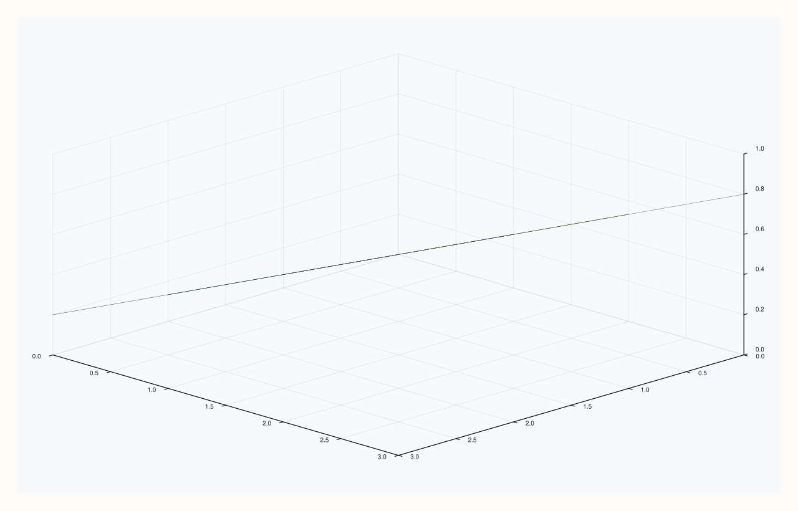
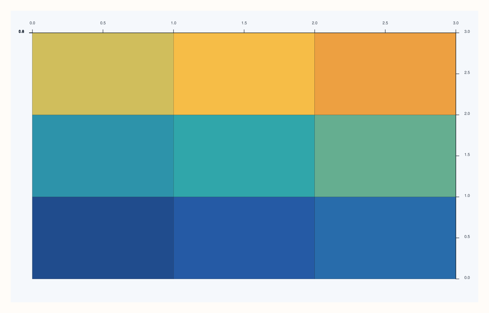
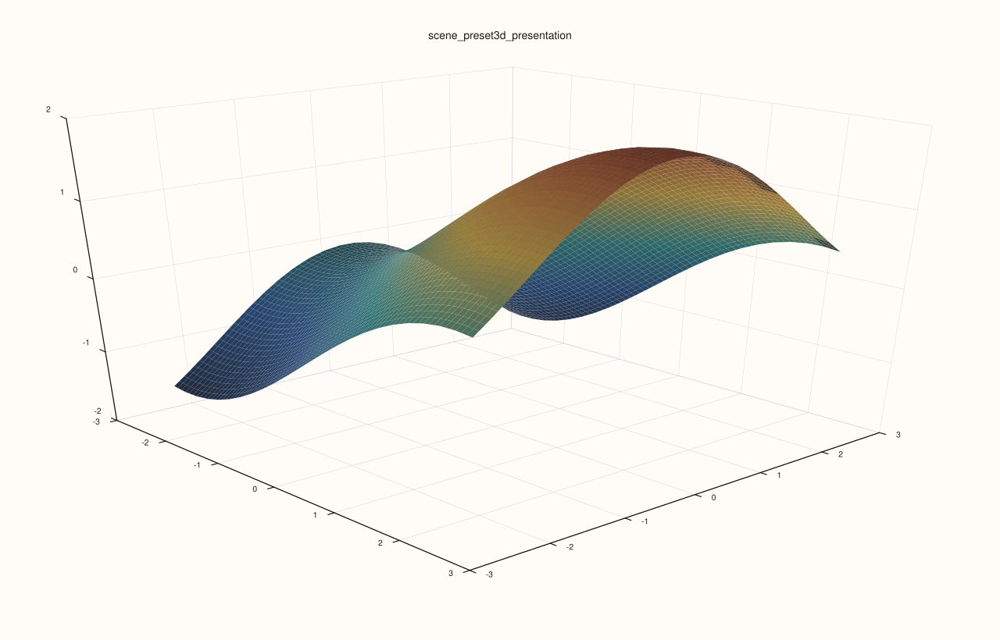

<!-- pluss-hand-authored -->

# flash::scene_preset3d

[Back to flash API Reference](../../flash_api_reference)

## Signature

```cpp
enum class ScenePreset3D : std::uint8_t { Survey, Presentation, Studio, Topology };

Pane& flash::scene_preset3d(Pane& pane, ScenePreset3D preset)
```

## What It Does

Applies one of four complete, named "scene" configurations — each a fixed combination
of a [`theme_preset3d`](theme_preset3d.md) call, `Pane::grid(GridStyle::Major)`, either a
[`camera3d`](camera3d.md) or [`camera_preset3d`](camera_preset3d.md) call, and a
[`lighting3d`](lighting3d.md) call, applied in that order.

| Preset | Theme | Camera | Lighting |
|---|---|---|---|
| `Survey` | `Ocean` | `camera_preset3d(Isometric)` | headlight + lamp_left |
| `Presentation` | `Paper` | `camera3d(-42.0, 24.0, Perspective, 28.0)` | headlight + lamp_right + sun_key |
| `Studio` | `Slate` | `camera_preset3d(Spatial)` | headlight + lamp_left + lamp_right |
| `Topology` | `Mist` | `camera_preset3d(TopDown)` | headlight only |

`Presentation` is the only preset that switches to `Perspective` projection — the other
three all use the `Orthographic` presets from [`camera_preset3d`](camera_preset3d.md).

## Parameters

**pane** (`Pane&`)
    The target pane — its `Theme`, grid style, `Lens`, and `LightRig` are all mutated.

**preset** (`ScenePreset3D`)
    Which named scene to apply — see the table above.

## Returns

`Pane&`
    A reference to the same pane, for chaining.

## Examples

Example 1. `Survey` — `Ocean` theme, isometric camera, headlight + left lamp.

```cpp
using namespace pluss::pl;

auto fig = studio("flash_scene_preset3d_survey");
auto& pane = fig.pane3();
pane.sheet(std::vector<double>{0.0, 1.0, 2.0, 3.0}, std::vector<double>{0.0, 1.0, 2.0, 3.0}, pluss::series::linspace(0.0, 1.0, 16, pluss::ScalarType::Float64).reshape({4, 4}));
flash::scene_preset3d(pane, flash::ScenePreset3D::Survey);
fig.show();
```



Example 2 (verification, not a distinct rendering). `Topology` renders genuinely
differently from `Survey`, confirmed via direct SVG comparison.

```cpp
using namespace pluss::pl;

auto fig1 = studio("flash_scene_preset3d_survey_cmp");
auto& pane1 = fig1.pane3();
pane1.sheet(std::vector<double>{0.0, 1.0, 2.0, 3.0}, std::vector<double>{0.0, 1.0, 2.0, 3.0}, pluss::series::linspace(0.0, 1.0, 16, pluss::ScalarType::Float64).reshape({4, 4}));
flash::scene_preset3d(pane1, flash::ScenePreset3D::Survey);

auto fig2 = studio("flash_scene_preset3d_topology");
auto& pane2 = fig2.pane3();
pane2.sheet(std::vector<double>{0.0, 1.0, 2.0, 3.0}, std::vector<double>{0.0, 1.0, 2.0, 3.0}, pluss::series::linspace(0.0, 1.0, 16, pluss::ScalarType::Float64).reshape({4, 4}));
flash::scene_preset3d(pane2, flash::ScenePreset3D::Topology);

std::cout << "scene_preset3d Survey vs Topology differ: " << (fig1.to_svg() != fig2.to_svg()) << "\n";
fig2.show();
```

Output:

```text
scene_preset3d Survey vs Topology differ: 1
```



Example 3. `Presentation` is the one preset in this family that switches to perspective
projection. Use it when you want a stronger depth cue than the orthographic presets give.

```cpp
using namespace pluss::pl;

auto fig = studio("flash_scene_preset3d_presentation");
auto& pane = fig.pane3();
auto gx = pluss::series::linspace(-2.5, 2.5, 24, pluss::ScalarType::Float64);
auto gy = pluss::series::linspace(-2.5, 2.5, 24, pluss::ScalarType::Float64);
auto gz = gx.reshape({1, 24}).tile({24, 1}).mul(0.6).sin()
            .add(gy.reshape({24, 1}).tile({1, 24}).mul(0.7).cos());

flash::scene_preset3d(pane, flash::ScenePreset3D::Presentation);
auto& trace = pane.sheet(gx, gy, gz);
flash::trace_preset3d(trace, flash::TracePreset3D::Surface);
fig.show();
```



## Notes

- Not `noexcept`.
- Always sets `GridStyle::Major` — none of the four presets ever hide the grid.
- Given [`flash::lighting3d`](lighting3d.md)'s own important callout, these lighting
  configurations only become visibly meaningful once the pane's traces also have
  `LightingMode::Gouraud`/`Flat` set (e.g. via
  [`flash::trace_preset3d`](trace_preset3d.md)).

## See Also

- [`flash::scene3d`](scene3d.md): the more granular, `std::optional`-composed sibling —
  can apply a preset *and* override individual pieces afterward.
- [`flash::theme_preset3d`](theme_preset3d.md), [`flash::camera3d`](camera3d.md),
  [`flash::camera_preset3d`](camera_preset3d.md),
  [`flash::lighting3d`](lighting3d.md): the four building blocks every preset here
  composes.

<div class="pluss-inline-prev-next">
  <a class="prev-link" href="theme_preset3d.html">
    <span class="label">Previous</span>
    <span class="title">theme_preset3d</span>
  </a>
  <a class="next-link" href="scene3d.html">
    <span class="label">Next</span>
    <span class="title">scene3d</span>
  </a>
</div>
