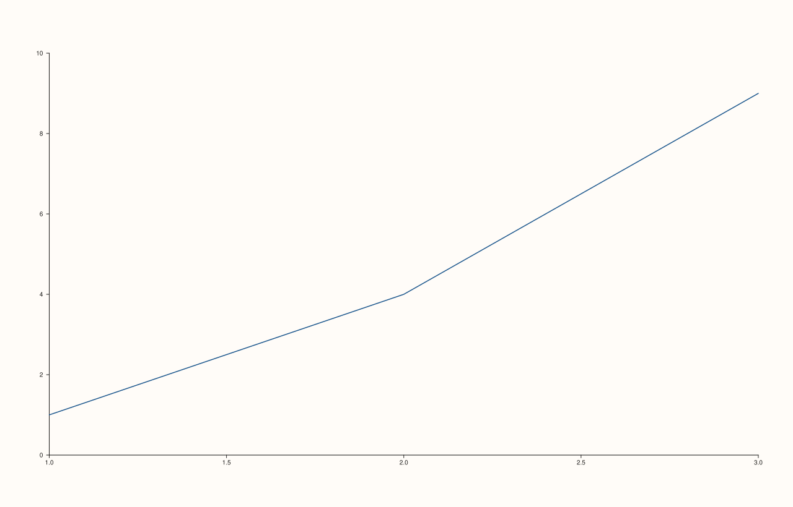
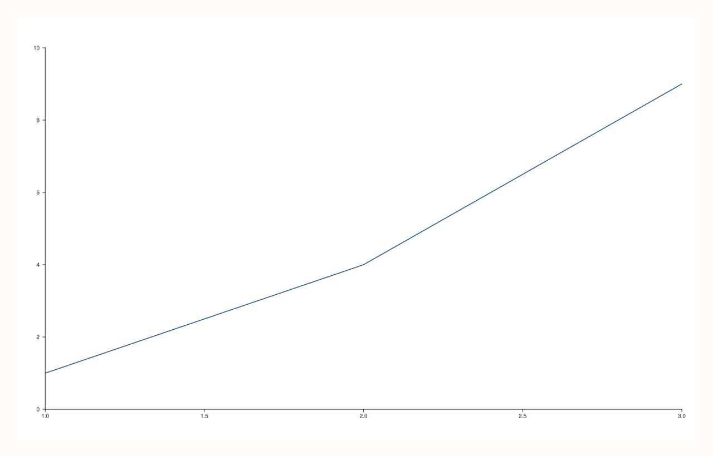
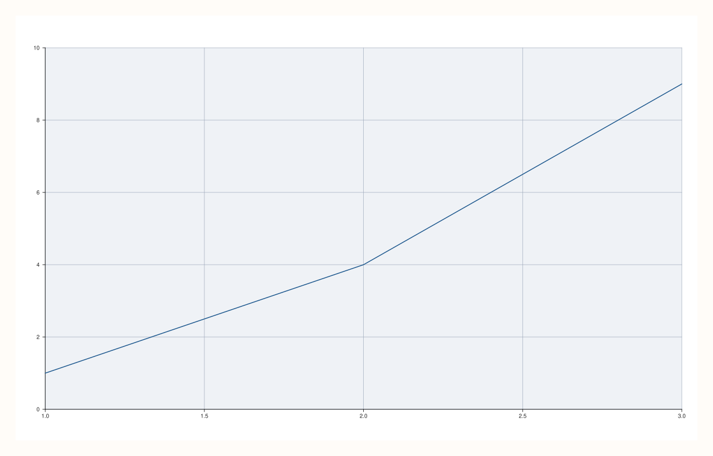

<!-- pluss-hand-authored -->

# flash::set_style

[Back to flash API Reference](../../flash_api_reference)

## Signatures

```cpp
enum class FlashStyle : std::uint8_t { Darkgrid, Lightgrid, Sandgrid, Dark, Light, Sand };

Pane& flash::set_style(Pane& pane, GridStyle style = GridStyle::Major)
Pane& flash::set_style(Pane& pane, FlashStyle style)

Pane& flash::axes_style(Pane& pane, GridStyle style = GridStyle::Major)
Pane& flash::axes_style(Pane& pane, FlashStyle style)
```

## What It Does

Two independent overloads sharing the `set_style` name, plus an exact-alias pair
(`axes_style`) for each:

- **`(Pane&, GridStyle)`** is a thin one-line forward to
  [`Pane::grid`](../pane/grid.md) — sets only the grid style (`None`/`Major`/
  `MajorMinor`), touching nothing else.
- **`(Pane&, FlashStyle)`** is the richer overload:
  it picks one of six named looks (three grid-family styles, three gridless styles),
  each setting the pane's foreground color, a distinguishing internal theme name, grid
  visibility on all three axes, and (for the three gridless styles) minor-grid
  visibility too.

`axes_style` is a pure alias of `set_style` for both overloads — verified
byte-identical below.

## Parameters

**pane** (`Pane&`)
    The pane to style.

**style** (`GridStyle`, default `Major`, first overload)
    See [`Pane::grid`](../pane/grid.md) for `GridStyle`'s three values.

**style** (`FlashStyle`, second overload — no default; must be given explicitly)
    See the field-by-field breakdown below.

## `FlashStyle` values

**Darkgrid**, **Lightgrid**, **Sandgrid** — the three grid-family styles
    All three enable `axes_visible(true)`, `grid(GridStyle::Major)`, and major grid
    lines on all three axes (`x_major_grid`/`y_major_grid`/`z_major_grid`, all `true`).
    They differ only in foreground color and internal theme name:
    - `Darkgrid`: foreground `rgb(34,34,34)`, theme name `flash_style_darkgrid`.
    - `Lightgrid` (the default `FlashThemeOptions::style`): foreground
      `rgb(34,34,34)`, theme name `flash_style_lightgrid`.
    - `Sandgrid`: foreground `rgb(56,52,40)` (a warm near-black), theme name
      `flash_style_sandgrid`.

**Dark**, **Light**, **Sand** — the three gridless styles
    All three enable `axes_visible(true)` but `grid(GridStyle::None)`, and disable both
    major and minor grid lines on all three axes. They differ only in foreground color
    and internal theme name:
    - `Dark`: foreground `rgb(34,34,34)`, theme name `flash_style_dark`.
    - `Light`: foreground `rgb(26,26,26)`, theme name `flash_style_light`.
    - `Sand`: foreground `rgb(56,52,40)`, theme name `flash_style_sand`.

```{important} Background is always neutral white; only foreground and grid visibility change
Every one of the six FlashStyle values sets the pane's background to plain white
(rgb(255,255,255)) -- style differences are expressed entirely through foreground
color, grid on/off, and the internal theme name (which flash::horizontal_grid reads
via a substring match to decide whether a pane is currently grid-family or gridless --
see that page).
```

## Returns

`Pane&`
    A reference to `pane`, for chaining.

## Examples

Example 1. `(Pane&, GridStyle)` — grid turned off directly, no `FlashStyle` involved.

```cpp
using namespace pluss::pl;

auto fig = studio("flash_set_style_gridstyle");
auto& pane = fig.pane2();
pane.trend(std::vector<double>{1, 2, 3}, std::vector<double>{1, 4, 9});
flash::set_style(pane, GridStyle::None);
fig.show();
```



Example 2. `(Pane&, FlashStyle::Light)` — a gridless light look.

```cpp
using namespace pluss::pl;

auto fig = studio("flash_set_style_flashstyle_light");
auto& pane = fig.pane2();
pane.trend(std::vector<double>{1, 2, 3}, std::vector<double>{1, 4, 9});
flash::set_style(pane, flash::FlashStyle::Light);
fig.show();
```



Example 3. `(Pane&, FlashStyle::Darkgrid)` — same data, grid-family style — confirmed to
render genuinely differently from Example 2's `Light` style via direct SVG comparison.

```cpp
using namespace pluss::pl;

auto fig2 = studio("flash_set_style_flashstyle_light");
auto& p2 = fig2.pane2();
p2.trend(std::vector<double>{1, 2, 3}, std::vector<double>{1, 4, 9});
flash::set_style(p2, flash::FlashStyle::Light);

auto fig3 = studio("flash_set_style_flashstyle_darkgrid");
auto& p3 = fig3.pane2();
p3.trend(std::vector<double>{1, 2, 3}, std::vector<double>{1, 4, 9});
flash::set_style(p3, flash::FlashStyle::Darkgrid);

std::cout << "set_style(Light) vs set_style(Darkgrid) differ: " << (fig2.to_svg() != fig3.to_svg()) << "\n";
fig3.show();
```

Output:

```text
set_style(Light) vs set_style(Darkgrid) differ: 1
```



Example 4 (verification, not a distinct rendering). `axes_style` is byte-identical to
`set_style` for both overloads.

```cpp
using namespace pluss::pl;

auto fig4 = studio("flash_axes_style_gridstyle_cmp_a");
auto& p4 = fig4.pane2();
p4.trend(std::vector<double>{1, 2, 3}, std::vector<double>{1, 4, 9});
flash::axes_style(p4, GridStyle::None);

auto fig5 = studio("flash_axes_style_gridstyle_cmp_b");
auto& p5 = fig5.pane2();
p5.trend(std::vector<double>{1, 2, 3}, std::vector<double>{1, 4, 9});
flash::set_style(p5, GridStyle::None);
std::cout << "axes_style(GridStyle) vs set_style(GridStyle) byte-identical: " << (fig4.to_svg() == fig5.to_svg()) << "\n";

auto fig6 = studio("flash_axes_style_flashstyle_cmp_a");
auto& p6 = fig6.pane2();
p6.trend(std::vector<double>{1, 2, 3}, std::vector<double>{1, 4, 9});
flash::axes_style(p6, flash::FlashStyle::Sand);

auto fig7 = studio("flash_axes_style_flashstyle_cmp_b");
auto& p7 = fig7.pane2();
p7.trend(std::vector<double>{1, 2, 3}, std::vector<double>{1, 4, 9});
flash::set_style(p7, flash::FlashStyle::Sand);
std::cout << "axes_style(FlashStyle) vs set_style(FlashStyle) byte-identical: " << (fig6.to_svg() == fig7.to_svg()) << "\n";
```

Output:

```text
axes_style(GridStyle) vs set_style(GridStyle) byte-identical: 1
axes_style(FlashStyle) vs set_style(FlashStyle) byte-identical: 1
```

## Notes

- Not `noexcept` for either overload.
- The `FlashStyle` overload has no default parameter value — it must always be given
  explicitly, unlike the `GridStyle` overload's `GridStyle::Major` default.
- [`flash::set_theme`](set_theme.md) calls this exact `(Pane&, FlashStyle)` overload
  internally as its first step, before applying its other toggles.
- `axes_style` exists purely as an alternate, equally-valid name for `set_style` — pick
  whichever reads better in context; both compile to the same call.

## See Also

- [`flash::set_theme`](set_theme.md): the richer helper that calls this function
  internally, then layers context/border/grid/legend toggles on top.
- [`flash::horizontal_grid`](horizontal_grid.md): reads the theme name this function
  sets to decide whether a pane is currently grid-family.
- [`Pane::grid`](../pane/grid.md): the lower-level method the `GridStyle` overload
  forwards to directly.

<div class="pluss-inline-prev-next">
  <a class="prev-link" href="set_theme.html">
    <span class="label">Previous</span>
    <span class="title">set_theme</span>
  </a>
  <a class="next-link" href="set_context.html">
    <span class="label">Next</span>
    <span class="title">set_context</span>
  </a>
</div>
