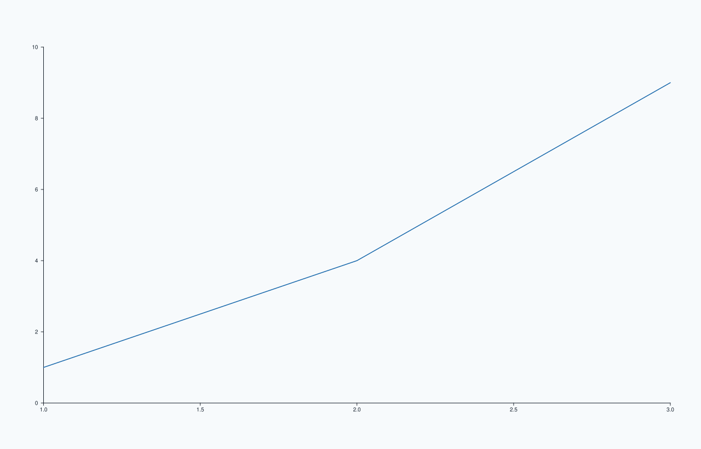
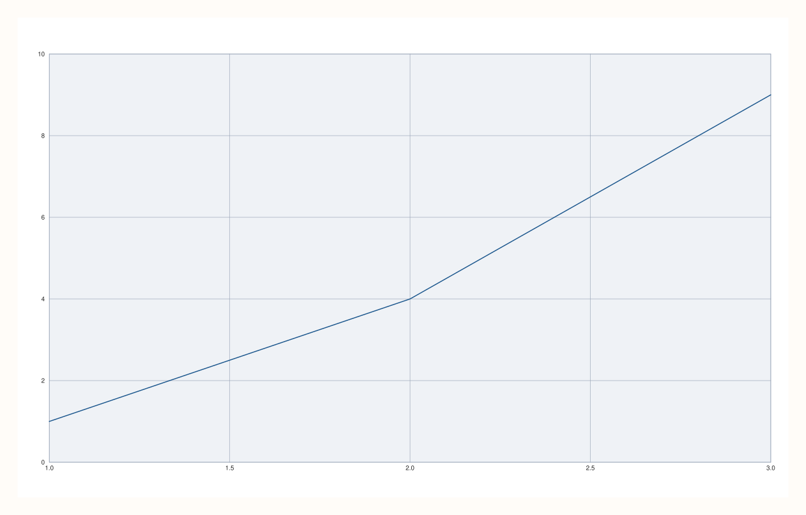
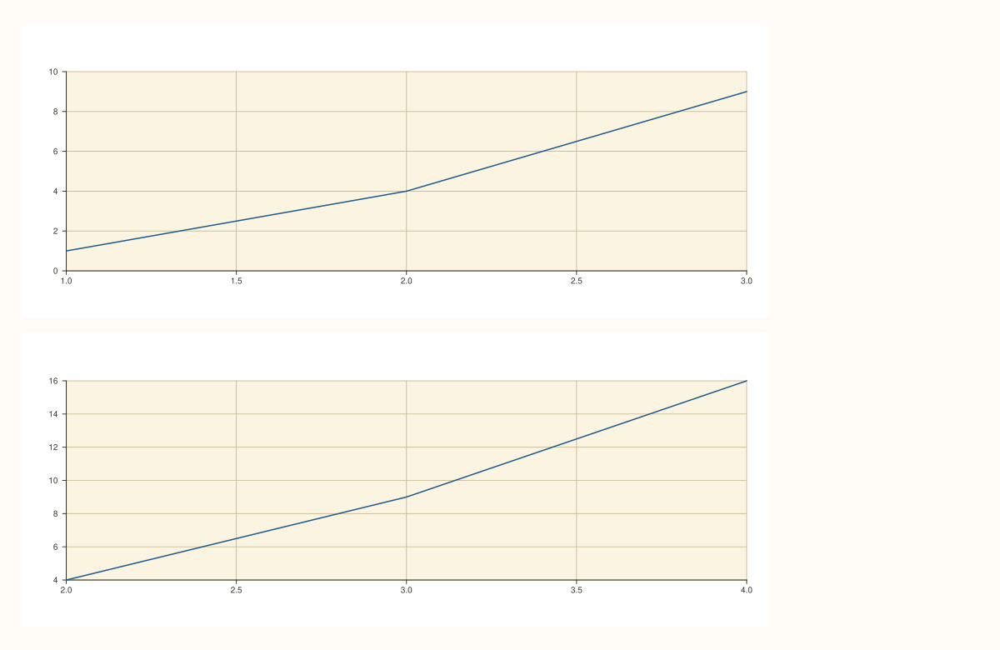

<!-- pluss-hand-authored -->

# flash::set_theme

[Back to flash API Reference](../../flash_api_reference)

## Signatures

```cpp
Studio& flash::set(Studio& studio, Theme theme = Theme::paper())
Studio& flash::set_theme(Studio& studio, Theme theme = Theme::paper())

Pane& flash::set_theme(Pane& pane, const FlashThemeOptions& options)
Pane& flash::set_theme(
    Pane& pane, FlashStyle style, FlashContext context = FlashContext::Inherit,
    bool borderless = false, bool horizontal_grid = false)

Studio& flash::set_theme(Studio& studio, const FlashThemeOptions& options)
```

```{important} The (Studio&, Theme) overload only affects panes created afterward
flash::set/flash::set_theme(Studio&, Theme) forward straight to Studio::theme, which
only restyles panes added to the figure AFTER the call -- panes that already exist
when set_theme(Studio&, Theme) runs are left on their old theme. This is Studio::theme's
own documented contract, not something specific to flash::set_theme, but it is easy to
miss since the other three set_theme overloads (Pane+Options, Pane+convenience,
Studio+Options) all DO restyle already-existing panes, by looping over them directly
instead of going through Studio::theme. See Example 1 below for a before and after comparison.
```

## What It Does

The high-level entry point of `flash::`'s theming layer — four
overloads spread across two different jobs, all sharing the `set_theme` name:

- **`(Studio&, Theme)`** swaps the figure's whole [`Theme`](../studio/theme.md) object
  wholesale — a pure one-line forward to [`Studio::theme`](../studio/theme.md). This
  overload is a plain alias of `flash::set`, identical below.
- **`(Pane&, const FlashThemeOptions&)`** and its convenience overload
  **`(Pane&, FlashStyle, FlashContext, bool, bool)`** apply a *bundle* of
  toggles (grid style, context scaling, borderless axes, horizontal-only grid, legend
  placement/shape) to one already-existing pane, without touching its base `Theme`
  colors. These two are identical to each other below — the second is a
  pure convenience wrapper that builds a `FlashThemeOptions` and forwards.
- **`(Studio&, const FlashThemeOptions&)`** applies the same bundle of toggles across
  *every* pane currently in the figure, and also stores it as the figure's
  [`pane_style_defaults`](../studio/pane_style_defaults.md) so future panes created
  after this call inherit the same look.

## Parameters

**studio** (`Studio&`, `Studio` overloads)
    The figure to theme.

**pane** (`Pane&`, `Pane` overloads)
    The single pane to theme.

**theme** (`Theme`, default `Theme::paper()`, `(Studio&, Theme)` overload)
    The full replacement theme — see [`Studio::theme`](../studio/theme.md).

**options** (`const FlashThemeOptions&`, `Options`-taking overloads)
    See the field table below.

**style**, **context**, **borderless**, **horizontal_grid** (`Pane` convenience
overload)
    Individually-named equivalents of `FlashThemeOptions`' first four fields — see the
    field table below. This overload builds a `FlashThemeOptions` from exactly these
    four values (`legend_place`/`legend_dock`/`legend_shape`/`width`/`height` are left
    at their empty defaults) and forwards to the `Options`-taking overload — verified
    identical below.

## `FlashThemeOptions` fields

| Field | Type and default | Description |
|---|---|---|
| `style` | `FlashStyle`, default `Lightgrid` | Forwarded to [`flash::set_style`](set_style.md) — see that page's full field description of `FlashStyle`'s six values. |
| `context` | `FlashContext`, default `Inherit` | Forwarded to [`flash::set_context`](set_context.md) — see that page's full field description of `FlashContext`'s five values and the width/height/font-scale each one sets. `Inherit` (the default here) leaves sizing/font-scale untouched. |
| `borderless` | `bool`, default `false` | When `true`, calls `axes_visible(false)` on the affected pane(s) — see [`Pane::axes_visible`](../pane/axes_visible.md) — hiding the axes frame entirely. |
| `horizontal_grid` | `bool`, default `false` | Forwarded to [`flash::horizontal_grid`](horizontal_grid.md) — restricts the grid to horizontal lines only, on grid-family styles. |
| `legend_place` | `std::optional<KeyPlace>`, default empty | When set, calls [`Pane::legend`](../pane/legend.md) with this placement on the affected pane(s). Only meaningful on the `Pane`-affecting overloads. |
| `legend_dock` | `std::optional<KeyDock>`, default empty | When set, calls [`Studio::legend`](../studio/legend.md) with this dock on the figure. Only read by the `(Studio&, const FlashThemeOptions&)` overload — `Pane`-affecting overloads ignore this field, since a `Pane` has no dock concept. |
| `legend_shape` | `std::optional<KeyShape>`, default empty | When set, calls `legend_shape(*legend_shape)` on the affected pane(s) (and, on the `Studio` overload, on the figure's own legend shape too). |
| `width`, `height` | `std::optional<double>`, default empty, `Studio` overload only | When set, forwarded into [`flash::set_context`](set_context.md)'s explicit width/height override. Ignored on the `Pane`-affecting overloads (a single pane has no independent figure size). |

## Returns

`Studio&` / `Pane&`
    A reference to the same object passed in, for chaining.

## Examples

Example 1. `(Studio&, Theme)` swaps the whole theme — identical to
`flash::set`, its lower-level alias. Per `Studio::theme`'s own documented contract
(only affects panes created *afterward*), `set`/`set_theme` is called **before**
`pane2()` here — calling it after pane creation would have no visible effect, which
this example separately confirms against an untouched baseline.

```cpp
using namespace pluss::pl;

auto fig0 = studio("flash_set_theme_studio_baseline");
auto& p0 = fig0.pane2();
p0.trend(std::vector<double>{1, 2, 3}, std::vector<double>{1, 4, 9});

auto fig1 = studio("flash_set_theme_studio_set");
flash::set(fig1, Theme::ocean());
auto& p1 = fig1.pane2();
p1.trend(std::vector<double>{1, 2, 3}, std::vector<double>{1, 4, 9});

auto fig2 = studio("flash_set_theme_studio_settheme");
flash::set_theme(fig2, Theme::ocean());
auto& p2 = fig2.pane2();
p2.trend(std::vector<double>{1, 2, 3}, std::vector<double>{1, 4, 9});

std::cout << "set(Theme) vs set_theme(Theme) byte-identical: " << (fig1.to_svg() == fig2.to_svg()) << "\n";
std::cout << "set(ocean, before pane2()) vs baseline (default theme) differ: " << (fig1.to_svg() != fig0.to_svg()) << "\n";
fig2.show();
```

Output:

```text
set(Theme) vs set_theme(Theme) byte-identical: 1
set(ocean, before pane2()) vs baseline (default theme) differ: 1
```



Example 2. `(Pane&, const FlashThemeOptions&)` — a borderless dark-grid pane.

```cpp
using namespace pluss::pl;

auto fig = studio("flash_set_theme_pane_options");
auto& pane = fig.pane2();
pane.trend(std::vector<double>{1, 2, 3}, std::vector<double>{1, 4, 9});
flash::FlashThemeOptions opts;
opts.style = flash::FlashStyle::Darkgrid;
opts.borderless = true;
flash::set_theme(pane, opts);
fig.show();
```



Example 3 (a comparison, not a new picture). The `Pane` convenience overload
(`style`, `context`, `borderless`, `horizontal_grid` as individual arguments) is
identical to building the equivalent `FlashThemeOptions` directly.

```cpp
using namespace pluss::pl;

auto fig1 = studio("flash_set_theme_pane_options");
auto& p1 = fig1.pane2();
p1.trend(std::vector<double>{1, 2, 3}, std::vector<double>{1, 4, 9});
flash::FlashThemeOptions opts;
opts.style = flash::FlashStyle::Darkgrid;
opts.borderless = true;
flash::set_theme(p1, opts);

auto fig2 = studio("flash_set_theme_pane_convenience");
auto& p2 = fig2.pane2();
p2.trend(std::vector<double>{1, 2, 3}, std::vector<double>{1, 4, 9});
flash::set_theme(p2, flash::FlashStyle::Darkgrid, flash::FlashContext::Inherit, true, false);
std::cout << "set_theme(Pane,Options) vs set_theme(Pane,style,ctx,borderless,hgrid) byte-identical: "
          << (fig1.to_svg() == fig2.to_svg()) << "\n";
```

Output:

```text
set_theme(Pane,Options) vs set_theme(Pane,style,ctx,borderless,hgrid) byte-identical: 1
```

Example 4. `(Studio&, const FlashThemeOptions&)` applied across a two-pane figure —
`Sandgrid` style, `Notebook` context, and a docked legend, all applied to every current
pane at once, plus stored as the figure's future-pane defaults.

```cpp
using namespace pluss::pl;

auto fig = studio("flash_set_theme_studio_options");
auto& p1 = fig.pane2();
p1.trend(std::vector<double>{1, 2, 3}, std::vector<double>{1, 4, 9});
auto& p2 = fig.pane2();
p2.trend(std::vector<double>{2, 3, 4}, std::vector<double>{4, 9, 16});

flash::FlashThemeOptions opts;
opts.style = flash::FlashStyle::Sandgrid;
opts.context = flash::FlashContext::Notebook;
opts.legend_dock = KeyDock::East;
flash::set_theme(fig, opts);
fig.show();
```



## Notes

- Not `noexcept`.
- `flash::set` and `flash::set_theme(Studio&, Theme)` are the exact same operation —
  `set_theme` is implemented as `return set(studio, std::move(theme));` — use whichever
  name reads better; nothing is lost by preferring `set`.
- The `Pane`-affecting overloads never touch the pane's `Theme` colors (accents,
  background, foreground) — only style/context/border/grid/legend toggles. To change
  colors on a `Pane`, mutate [`Pane::theme_tokens`](../pane/theme_tokens.md) directly,
  or use `(Studio&, Theme)` at the figure level.
- `FlashPalette` (a third small option type in this same header, alongside `FlashStyle`/
  `FlashContext`) is unrelated to `FlashThemeOptions` — it has no field here. It only
  appears in [`flash::flash_palette`](flash_palette.md) and
  [`flash::flash_theme`](flash_theme.md) (an unused-by-`set_theme` helper that builds
  a whole new `Theme` from a `FlashStyle`/`FlashPalette` pair, distinct from this
  page's toggle-only theming).
- `fc::`/`fs::`/`fp::` are compact `inline constexpr` shorthand namespaces for
  `FlashContext`/`FlashStyle`/`FlashPalette` respectively (e.g. `fs::Darkgrid` instead
  of `flash::FlashStyle::Darkgrid`) — purely a naming convenience, no behavior
  difference.

## See Also

- [`flash::set_style`](set_style.md): the narrower style-only helper `set_theme`
  delegates to internally.
- [`flash::set_context`](set_context.md): the narrower context/sizing-only helper
  `set_theme` delegates to internally.
- [`flash::horizontal_grid`](horizontal_grid.md), [`flash::flash_palette`](flash_palette.md):
  related but independently-callable helpers in the same theming family.
- [`Studio::theme`](../studio/theme.md), [`Pane::theme_tokens`](../pane/theme_tokens.md):
  the lower-level, non-`flash::` color-theming surface this page's functions never
  touch.

<div class="pluss-inline-prev-next">
  <a class="prev-link" href="../../flash_api_reference.html">
    <span class="label">Previous</span>
    <span class="title">Back to flash API Reference</span>
  </a>
  <a class="next-link" href="set_style.html">
    <span class="label">Next</span>
    <span class="title">set_style</span>
  </a>
</div>
