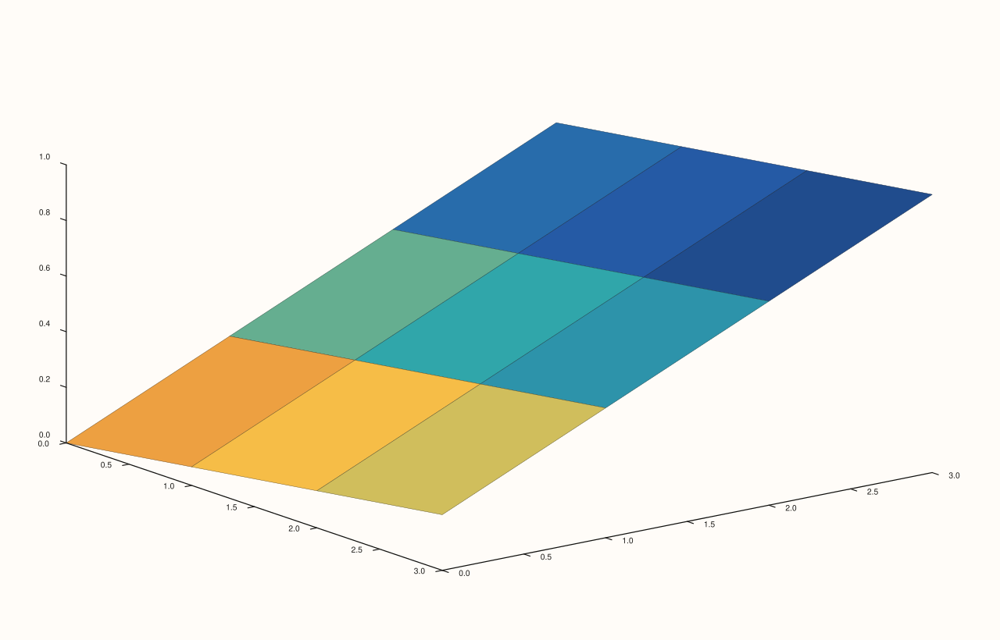

<!-- pluss-hand-authored -->

# flash::sheet

[Back to flash API Reference](../../flash_api_reference)

## Signatures

```cpp
Trace& flash::sheet(Pane& pane, Series x, Series y, Series z)

Trace& flash::sheet(Pane& pane, Series x, Series y, Series z, Series c)

Trace& flash::sheet(Studio& studio, Series x, Series y, Series z, std::string title = {})
```

## What It Does

A thin wrapper around [`Pane::sheet`](../pane/sheet.md): converts every argument to
`Series`, validates each is rank ≤ 3, then delegates to the identically-shaped native
`Pane::sheet` overload. Every `Pane`-overload delegation is identical to calling
`Pane::sheet` directly. Three overloads:
`(x, y, z)`, `(x, y, z, c)` (a separate fill-color matrix decoupled from `z`'s own
height), and a `Studio` convenience overload (matching only the `(x, y, z)` shape) that
creates the [`Volumetric`](../studio/pane3.md) pane for you.

## Parameters

**pane** (`Pane&`, Pane overloads)
    The target pane. Must be `Volumetric`.

**studio** (`Studio&`, Studio overload)
    The figure to create a new `Volumetric` pane in.

**x**, **y** (series-convertible, must each be rank ≤ 3)
    The grid's coordinate axes.

**z** (series-convertible, must be rank ≤ 3, and rank-2 to satisfy
[`Pane::sheet`](../pane/sheet.md)'s own deeper requirement)
    The surface height at each `(x, y)` grid point.

**c** (series-convertible, must be rank ≤ 3, four-argument overload only)
    A separate fill-color value per grid point.

**title** (`std::string`, default `{}`, Studio overload only)
    Forwarded to `Studio::pane3` as the new pane's title.

## Returns

`Trace&`
    A reference to the newly created trace, for chaining.

## Examples

Example 1. `(x, y, z)` overload — surface colored directly from `z`.

```cpp
using namespace pluss::pl;

auto fig = studio("flash_sheet_xyz");
auto& pane = fig.pane3();
std::vector<double> x{0.0, 1.0, 2.0, 3.0};
std::vector<double> y{0.0, 1.0, 2.0, 3.0};
auto z = pluss::series::linspace(0.0, 1.0, 16, pluss::ScalarType::Float64).reshape({4, 4});
flash::sheet(pane, x, y, z);
fig.show();
```


Example 2. `(x, y, z, c)` overload — a separate reverse-gradient fill-color matrix.

```cpp
using namespace pluss::pl;

auto fig = studio("flash_sheet_xyzc");
auto& pane = fig.pane3();
std::vector<double> x{0.0, 1.0, 2.0, 3.0};
std::vector<double> y{0.0, 1.0, 2.0, 3.0};
auto z = pluss::series::linspace(0.0, 1.0, 16, pluss::ScalarType::Float64).reshape({4, 4});
auto c = pluss::series::linspace(1.0, 0.0, 16, pluss::ScalarType::Float64).reshape({4, 4});
flash::sheet(pane, x, y, z, c);
fig.show();
```



Example 3. `Studio` overload — no explicit `pane3()` call needed.

```cpp
using namespace pluss::pl;

auto fig = studio("flash_sheet_studio");
std::vector<double> x{0.0, 1.0, 2.0, 3.0};
std::vector<double> y{0.0, 1.0, 2.0, 3.0};
auto z = pluss::series::linspace(0.0, 1.0, 16, pluss::ScalarType::Float64).reshape({4, 4});
flash::sheet(fig, x, y, z);
fig.show();
```


Example 4 (a comparison, not a new picture). `flash::sheet(pane, x, y, z)`
renders identical to `pane.sheet(x, y, z)` called directly.

```cpp
using namespace pluss::pl;

std::vector<double> x{0.0, 1.0, 2.0, 3.0};
std::vector<double> y{0.0, 1.0, 2.0, 3.0};
auto z = pluss::series::linspace(0.0, 1.0, 16, pluss::ScalarType::Float64).reshape({4, 4});

auto fig1 = studio("flash_sheet_flash");
auto& pane1 = fig1.pane3();
flash::sheet(pane1, x, y, z);

auto fig2 = studio("flash_sheet_native");
auto& pane2 = fig2.pane3();
pane2.sheet(x, y, z);

std::cout << "flash::sheet(pane,x,y,z) == pane.sheet(x,y,z): " << (fig1.to_svg() == fig2.to_svg()) << "\n";
```

Output:

```text
flash::sheet(pane,x,y,z) == pane.sheet(x,y,z): 1
```

## Notes

- Not `noexcept`.
- `flash::sheet`'s own validation only checks rank ≤ 3 on each argument — the stricter
  "`z` must be rank-2 exactly" requirement (and the resulting `pluss::Error:
  ... z must be a rank-2 matrix` on mismatch) is enforced one layer deeper, inside [`Pane::sheet`](../pane/sheet.md) itself.
- See [`Pane::sheet`](../pane/sheet.md) for what actually gets rendered, including how
  the `c` argument colours the surface independently of its shape.

## See Also

- [`Pane::sheet`](../pane/sheet.md): the underlying native method this function
  delegates to entirely.
- [`flash::lattice`](lattice.md): the wireframe sibling — same payload shape, filled
  surface vs. wireframe mesh.
- [`flash::triplot`](triplot.md): a caller of `sheet()` internally, via a binned-grid
  triplet (see that page for how the grid is built).
- [`Studio::pane3`](../studio/pane3.md): what the `Studio` overload calls internally.

<div class="pluss-inline-prev-next">
  <a class="prev-link" href="cloud3.html">
    <span class="label">Previous</span>
    <span class="title">cloud3</span>
  </a>
  <a class="next-link" href="lattice.html">
    <span class="label">Next</span>
    <span class="title">lattice</span>
  </a>
</div>
