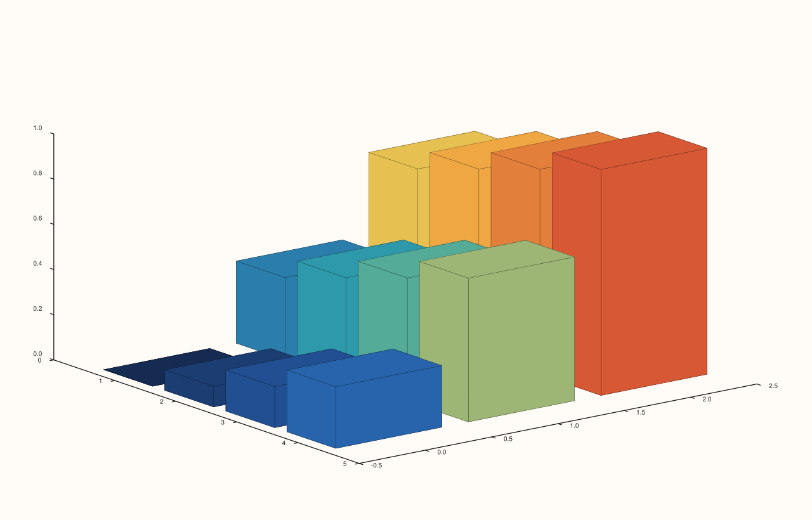
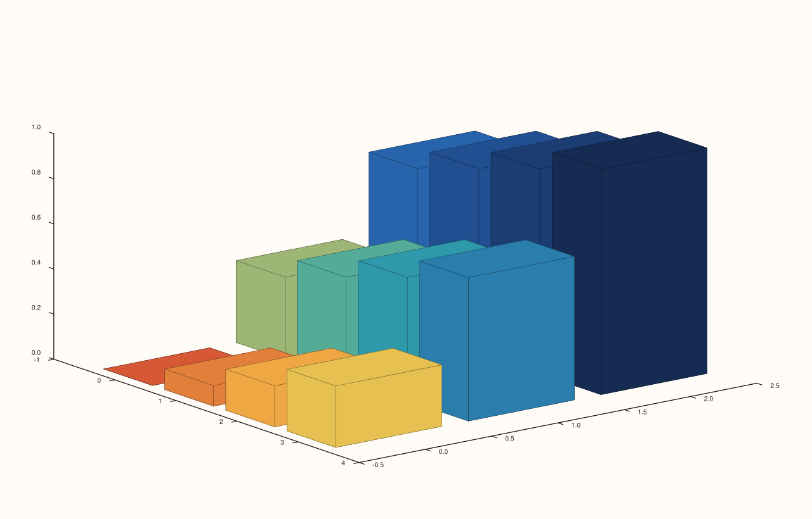

<!-- pluss-hand-authored -->

# flash::spire3

[Back to flash API Reference](../../flash_api_reference)

## Signatures

```cpp
Trace& flash::spire3(Pane& pane, Series z)

Trace& flash::spire3(Pane& pane, Series y, Series z)

Trace& flash::spire3(Pane& pane, Series x, Series y, Series z)

Trace& flash::spire3(Pane& pane, Series x, Series y, Series z, Series c)
```

## What It Does

A thin wrapper around [`Pane::spire3`](../pane/spire3.md): converts every argument to
`Series`, validates each is rank ≤ 3, then delegates to the identically-shaped native
`Pane::spire3` overload. Every delegation is identical to calling `Pane::spire3`
directly. Four overloads, mirroring
[`Pane::spire3`](../pane/spire3.md)'s own: `(z)` (both axes auto-indexed), `(y, z)` (`x`
auto-indexed), `(x, y, z)` (fully explicit), and `(x, y, z, c)` (plus a separate
color matrix).

```{important} No Studio-creates-pane3-for-you convenience overload, unlike path3/cloud3/sheet/lattice
Unlike flash::path3, flash::cloud3, flash::sheet, and flash::lattice -- each of which
has one extra Studio-taking overload that creates the Volumetric pane for you --
flash::spire3 has no Studio overload at all. Every call needs an existing Pane&,
obtained via Studio::pane3() yourself first. 
```

## Parameters

**pane** (`Pane&`)
    The target pane. Must be `Volumetric`.

**z** (series-convertible, must be rank ≤ 3, and rank-2 to satisfy
[`Pane::spire3`](../pane/spire3.md)'s own deeper requirement in every overload)
    The bar height at each grid cell.

**x**, **y** (series-convertible, must each be rank ≤ 3, two- through four-argument
overloads)
    Explicit coordinate axes, auto-indexed as `0, 1, 2, …` when omitted.

**c** (series-convertible, must be rank ≤ 3, four-argument overload only)
    A separate per-bar color matrix, matching `z`'s shape.

## Returns

`Trace&`
    A reference to the newly created trace, for chaining.

## Examples

Example 1. `(z)` overload — both axes auto-indexed, a `3×4` bar grid.

```cpp
using namespace pluss::pl;

auto fig = studio("flash_spire3_z_only");
auto& pane = fig.pane3();
auto z = pluss::series::linspace(0.0, 1.0, 12, pluss::ScalarType::Float64).reshape({3, 4});
flash::spire3(pane, z);
fig.show();
```


Example 2. `(y, z)` overload — `y` supplied explicitly, `x` still auto-indexed.

```cpp
using namespace pluss::pl;

auto fig = studio("flash_spire3_yz");
auto& pane = fig.pane3();
std::vector<double> y{0.0, 1.0, 2.0};
auto z = pluss::series::linspace(0.0, 1.0, 12, pluss::ScalarType::Float64).reshape({3, 4});
flash::spire3(pane, y, z);
fig.show();
```



Example 3. `(x, y, z)` overload — both axes explicit.

```cpp
using namespace pluss::pl;

auto fig = studio("flash_spire3_xyz");
auto& pane = fig.pane3();
std::vector<double> x{0.0, 1.0, 2.0, 3.0};
std::vector<double> y{0.0, 1.0, 2.0};
auto z = pluss::series::linspace(0.0, 1.0, 12, pluss::ScalarType::Float64).reshape({3, 4});
flash::spire3(pane, x, y, z);
fig.show();
```


Example 4. `(x, y, z, c)` overload — a separate per-bar color matrix.

```cpp
using namespace pluss::pl;

auto fig = studio("flash_spire3_xyzc");
auto& pane = fig.pane3();
std::vector<double> x{0.0, 1.0, 2.0, 3.0};
std::vector<double> y{0.0, 1.0, 2.0};
auto z = pluss::series::linspace(0.0, 1.0, 12, pluss::ScalarType::Float64).reshape({3, 4});
auto c = pluss::series::linspace(1.0, 0.0, 12, pluss::ScalarType::Float64).reshape({3, 4});
flash::spire3(pane, x, y, z, c);
fig.show();
```



Example 5 (a comparison, not a new picture). `flash::spire3(pane, z)` renders
identical to `pane.spire3(z)` called directly.

```cpp
using namespace pluss::pl;

auto z = pluss::series::linspace(0.0, 1.0, 12, pluss::ScalarType::Float64).reshape({3, 4});

auto fig1 = studio("flash_spire3_flash");
auto& pane1 = fig1.pane3();
flash::spire3(pane1, z);

auto fig2 = studio("flash_spire3_native");
auto& pane2 = fig2.pane3();
pane2.spire3(z);

std::cout << "flash::spire3(pane,z) == pane.spire3(z): " << (fig1.to_svg() == fig2.to_svg()) << "\n";
```

Output:

```text
flash::spire3(pane,z) == pane.spire3(z): 1
```

## Notes

- Not `noexcept`.
- `flash::spire3`'s own validation only checks rank ≤ 3 — the stricter, uniformly
  eagerly-enforced rank-2-exact requirement on `z` (in every overload, per
  [`Pane::spire3`](../pane/spire3.md)'s own important callout) lives one layer deeper.
- See the important callout above: no `Studio` convenience overload exists for this
  function.

## See Also

- [`Pane::spire3`](../pane/spire3.md): the underlying native method this function
  delegates to entirely.
- [`flash::ridge3`](ridge3.md): the elevated-contour sibling, also lacking a `Studio`
  convenience overload.
- [`flash::triplot`](triplot.md): a caller of `spire3()` internally, via a binned-grid
  triplet (see that page's important callout for the bug this session fixed
  there).

<div class="pluss-inline-prev-next">
  <a class="prev-link" href="lattice.html">
    <span class="label">Previous</span>
    <span class="title">lattice</span>
  </a>
  <a class="next-link" href="ridge3.html">
    <span class="label">Next</span>
    <span class="title">ridge3</span>
  </a>
</div>
