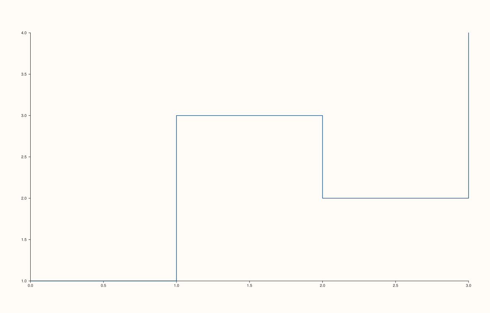

<!-- pluss-hand-authored -->

# flash::stepplot

[Back to flash API Reference](../../flash_api_reference)

## Signatures

```cpp
template <class X, class Y>
Trace& flash::stepplot(Pane& pane, X&& x, Y&& y)
```

## What It Does

Adds a step-interpolated line — a connected line that holds each `y` value flat until the
*next* `x` position, then jumps, rather than [`flash::lineplot`](lineplot.md)'s direct
point-to-point interpolation. There is only one overload: no hue support, no `Note`
grouping.

Internally, `stepplot()` expands the `n` input points into `2n - 1` step vertices (holding
each `y[i]` flat across to `x[i+1]`, then rising/falling to `y[i+1]`) and draws the result
through [`Pane::trend`](../pane/trend.md) — there is no dedicated "step" trace kind on
`Pane`; this is purely a data-reshaping convenience built on the ordinary line trace.

## Parameters

**pane** (`Pane&`)
    The target pane. Must be `Planar` (2D).

**x**, **y** (series-convertible)
    The step's corner coordinates, in index order. Must have identical lengths.

## Returns

`Trace&`
    A reference to the newly created (expanded) line trace.

## Examples

Example 1. A basic step plot — the line holds each value flat until the next `x`
position, then jumps vertically.

```cpp
using namespace pluss::pl;

auto fig = studio("flash_stepplot");
auto& pane = fig.pane2();
flash::stepplot(pane, std::vector<double>{0.0, 1.0, 2.0, 3.0}, std::vector<double>{1.0, 3.0, 2.0, 4.0});
fig.show();
```



Example 2 (failure). Mismatched `x`/`y` lengths.

```cpp
using namespace pluss::pl;

auto fig = studio("flash_stepplot_mismatched");
auto& pane = fig.pane2();
try {
  flash::stepplot(pane, std::vector<double>{1.0, 2.0, 3.0}, std::vector<double>{1.0, 2.0});
} catch (const std::invalid_argument& e) {
  std::cout << e.what() << "\n";
}
```

Output:

```text
flash::stepplot requires x and y with identical lengths
```

Example 3 (edge case). Empty input. The implementation's own comment suggests an
empty-input call should fall through to a plain `Pane::trend()` call and succeed
trivially — but `Pane::trend()` itself rejects empty series, so the *actual*, verified
behavior is that empty input throws too, just with a different message coming from one
layer deeper.

```cpp
using namespace pluss::pl;

auto fig = studio("flash_stepplot_empty");
auto& pane = fig.pane2();
try {
  flash::stepplot(pane, std::vector<double>{}, std::vector<double>{});
} catch (const std::invalid_argument& e) {
  std::cout << e.what() << "\n";
}
```

Output:

```text
trend: empty series inputs are not supported
```

## Notes

- Not `noexcept`.
- The length-mismatch check is `stepplot()`'s own, throwing immediately with a
  `flash::stepplot`-prefixed message; the empty-input rejection is not — it comes from
  the underlying [`Pane::trend`](../pane/trend.md) call, one layer down, with a
  differently-worded message. Don't rely on the error message alone to identify which
  layer validated a given `stepplot()` call.
- No hue/grouping overloads exist for `stepplot()`, unlike [`flash::lineplot`](lineplot.md)
  and [`flash::scatterplot`](scatterplot.md).
- Not reachable through [`flash::relplot`](relplot.md)'s `kind=` dispatch, which only
  chooses between `"scatter"` and `"line"`.

## See Also

- [`flash::lineplot`](lineplot.md): direct point-to-point interpolation instead of a step
  hold, and the family's hue-grouping support that `stepplot()` lacks.
- [`Pane::trend`](../pane/trend.md): the underlying method every `stepplot()` call
  eventually reaches, and the source of the empty-input error message.

<div class="pluss-inline-prev-next">
  <a class="prev-link" href="lineplot.html">
    <span class="label">Previous</span>
    <span class="title">lineplot</span>
  </a>
  <a class="next-link" href="relplot.html">
    <span class="label">Next</span>
    <span class="title">relplot</span>
  </a>
</div>
