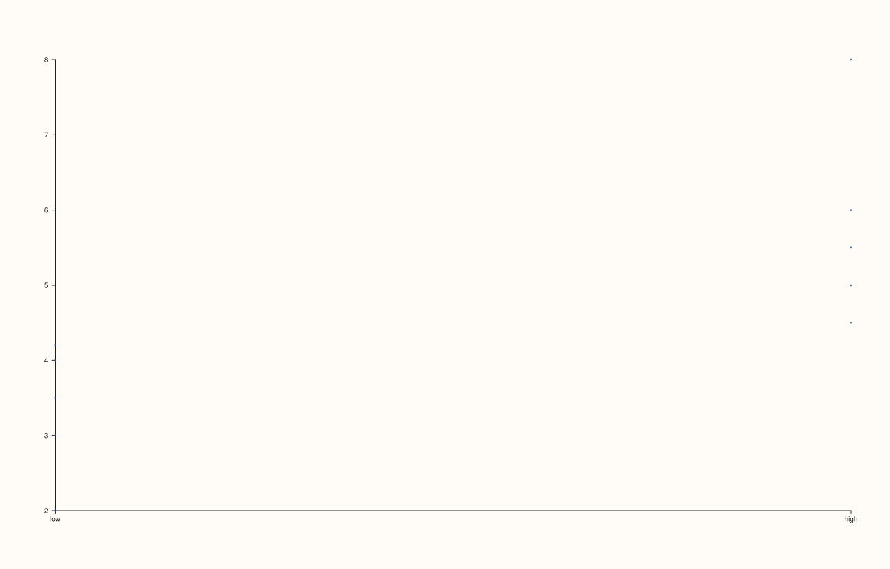
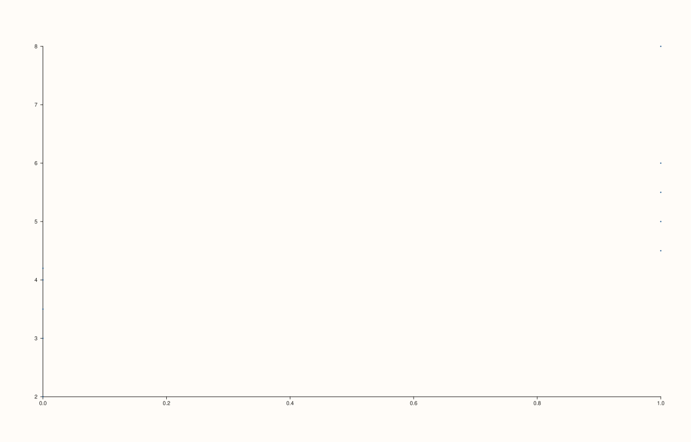

<!-- pluss-hand-authored -->

# flash::stripplot

[Back to flash API Reference](../../flash_api_reference)

## Signatures

```cpp
Trace& flash::stripplot(Pane& pane, const Note& categories, const Series& values)

Trace& flash::stripplot(Pane& pane, Series group, Series values)
```

## What It Does

Draws individual observations as a scatter along a categorical x-axis — every point at its
`group`/`categories` position, `values` on the y-axis. Two overloads, with a real
behavioral difference beyond just the parameter type:

- **`stripplot(pane, categories, values)`** where `categories` is a
  [`Note`](../pane/x_categories.md) — encodes each distinct label to an integer position
  **and calls [`Pane::x_categories`](../pane/x_categories.md)**, so the x-axis shows the
  original string labels as tick text.
- **`stripplot(pane, group, values)`** where `group` is any other series-convertible
  value — draws a plain [`Pane::cloud`](../pane/cloud.md) at the raw numeric `group`
  positions, with **no category-label setup at all**. The x-axis shows the raw numeric
  values, not text labels.

```{important} The numeric-group overload does not set x-axis category labels
After a Note-based stripplot() call, the pane's x-axis
has real category labels (read back via Pane::x_axis().ticks->labels).
After a numeric-group stripplot() call with the identical group structure (0/1
positions), the x-axis has NO category labels at all -- ticks remains
unset. If you want text category labels on the x-axis, you must supply
categories as a Note; passing a numeric group vector (even one meant to
represent discrete categories) skips that step entirely.
```

## Parameters

**pane** (`Pane&`)
    The target pane. Must be `Planar` (2D) — this wraps `Pane::cloud`, which requires it.

**categories** (`const Note&`, first overload only)
    The categorical grouping variable. Distinct labels become x-axis category tick text,
    in first-seen order.

**group** (series-convertible, second overload only)
    A numeric x-position variable, paired with `values` by index. No category-label setup
    is performed.

**values** (series-convertible, or `const Series&` for the `Note` overload)
    The y-axis observation values.

## Returns

`Trace&`
    A reference to the newly created (cloud) trace.

## Examples

Example 1. Categorical, via a [`Note`](../pane/x_categories.md) — the x-axis shows real
text labels.

```cpp
using namespace pluss::pl;

auto fig = studio("flash_stripplot_note");
auto& pane = fig.pane2();
auto grp = pluss::note::make({"low", "low", "low", "low", "low", "high", "high", "high", "high", "high"});
std::vector<double> values{2.0, 3.0, 3.5, 4.0, 4.2, 4.5, 5.0, 5.5, 6.0, 8.0};
flash::stripplot(pane, grp, pluss::make_series(values, {10}));
const auto& ticks = pane.x_axis().ticks;
std::cout << "x_categories count: " << (ticks.has_value() ? ticks->labels.size() : 0) << "\n";
fig.show();
```

Output:

```text
x_categories count: 2
```



Example 2. Numeric group — no category-label setup, verified directly via the pane's own
tick state.

```cpp
using namespace pluss::pl;

auto fig = studio("flash_stripplot_numeric_group");
auto& pane = fig.pane2();
std::vector<double> group{0.0, 0.0, 0.0, 0.0, 0.0, 1.0, 1.0, 1.0, 1.0, 1.0};
std::vector<double> values{2.0, 3.0, 3.5, 4.0, 4.2, 4.5, 5.0, 5.5, 6.0, 8.0};
flash::stripplot(pane, group, values);
const auto& ticks = pane.x_axis().ticks;
std::cout << "x_categories count: " << (ticks.has_value() ? ticks->labels.size() : 0) << "\n";
fig.show();
```

Output:

```text
x_categories count: 0
```



## Notes

- Not `noexcept`.
- [`flash::swarmplot`](swarmplot.md) is a pure alias for this exact function — see that
  page for direct verification. There is no point-avoidance/jitter layout in either
  function despite the "swarm" name.
- The `Note` overload's category encoding follows first-seen label order (via
  `encode_categories`), not alphabetical or insertion-sorted order.

## See Also

- [`Pane::cloud`](../pane/cloud.md): the underlying method both overloads call.
- [`Pane::x_categories`](../pane/x_categories.md): what the `Note` overload calls
  internally to label the x-axis.
- [`flash::swarmplot`](swarmplot.md): a identical alias.
- [`flash::boxplot`](boxplot.md), [`flash::violinplot`](violinplot.md): other categorical
  functions sharing this same `Note`-vs-numeric-group overload split.

<div class="pluss-inline-prev-next">
  <a class="prev-link" href="rugplot.html">
    <span class="label">Previous</span>
    <span class="title">rugplot</span>
  </a>
  <a class="next-link" href="swarmplot.html">
    <span class="label">Next</span>
    <span class="title">swarmplot</span>
  </a>
</div>
