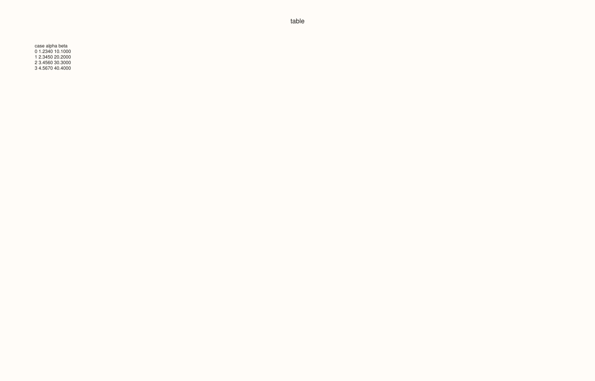
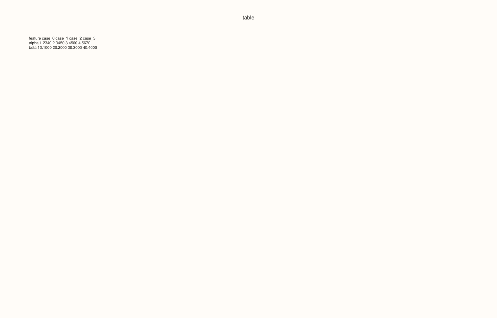

<!-- pluss-hand-authored -->

# flash::summaryplot

[Back to flash API Reference](../../flash_api_reference)

## Signatures

```cpp
Studio& flash::summaryplot(Studio& studio, pluss::msharp::RangeView::Series columns,
                            pluss::msharp::RangeView::Of<std::string_view> labels,
                            const SummaryOptions& options = {})

Studio& flash::summaryplot(Studio& studio, std::initializer_list<Series> columns,
                            std::initializer_list<std::string_view> labels,
                            const SummaryOptions& options = {})
```

## What It Does

Not a chart — a formatted, fixed-width text table of raw values, rendered as a single
pane's [`caption`](../pane/caption.md) with every axis element hidden. `summaryplot` is
the `flash::` equivalent of glancing at `DataFrame.head()`: it lays every feature's first
`max_cases` values out as monospace-aligned columns (or rows, with `transpose`), builds
that as a plain string, then puts the whole string in one pane's caption via
`Pane::caption(...)`, with grid/legend/axis-labels all switched off and both font scales
shrunk to `0.01` (effectively invisible) so the caption text is the only visible content.

Two overloads: a `RangeView::Series`/`RangeView::Of<std::string_view>` form, and an
`std::initializer_list` convenience form that forwards to it.

```{important} This is a text table, not a computed summary -- no mean/std/min/max anywhere
Despite the name, summaryplot does not compute any summary STATISTICS (no mean,
std, quantiles, etc.) -- it formats and displays the first max_cases RAW rows of
each feature, verbatim, at options.precision decimal places. Rows beyond max_cases
are dropped and replaced with a single "... (N more cases)" trailer line. If you
want statistics, compute them yourself and pass the results in as the "features."
```

## `SummaryOptions` fields

| Field | Type and default | Description |
|---|---|---|
| `title` | `std::string`, default `"table"` | The pane's title, passed to [`Studio::pane2`](../studio/pane2.md). |
| `precision` | `int`, default `4` | Decimal places for every formatted cell, via `std::setprecision` in fixed-point mode. Clamped to at least `0`. Non-finite values format as the literal string `"nan"` regardless of `precision`. |
| `include_header` | `bool`, default `true` | Whether the first line is a header row (feature names, or `"feature"`/`"case_N"` labels when `transpose` is `true`). |
| `max_cases` | `std::int64_t`, default `10` | How many rows/cases are shown per feature. `0` or negative falls back to `10` (`options.max_cases > 0 ? options.max_cases : 10`, not clamped to `1` like most other `flash::` count fields). Cases beyond this are summarized by a trailing `"... (N more cases)"` line rather than silently dropped. |
| `transpose` | `bool`, default `false` | `false`: cases are rows, features are columns (each feature gets a header column). `true`: features are rows, cases are columns (each case gets a header column, `"case_0"`, `"case_1"`, …) — useful when you have many features but few cases. |
| `include_case_index` | `bool`, default `true` | Whether the non-transposed layout's leading `"case"` index column is shown. Has no effect when `transpose` is `true` (that layout's row label is always the feature name, unconditionally). |
| `features_per_table` | `std::int64_t`, default `0` | How many features go in each table block before starting a new one. `0` means "all features in one table." A single, large feature set can be broken into several narrower tables via this field, then optionally arranged side by side via `tables_per_row`. |
| `tables_per_row` | `std::int64_t`, default `1` | How many of the `features_per_table`-sized table blocks are laid out side by side (padded to equal column width, joined with `table_gap_spaces` of padding) before wrapping to a new row of tables. Only visibly matters when `features_per_table` actually produces more than one table. |
| `table_gap_spaces` | `std::int64_t`, default `4` | Spaces between adjacent tables when `tables_per_row > 1`. Clamped to at least `1`. |

## Parameters

**studio** (`Studio&`)
    The figure to populate — a single new, titled [`Studio::pane2`](../studio/pane2.md).

**columns** (`pluss::msharp::RangeView::Series` or `std::initializer_list<Series>`)
    One entry per feature. Must be non-empty, or `summaryplot` throws
    `std::invalid_argument("flash::summaryplot requires at least one column")`, and every
    column must be the same length (`"flash::summaryplot requires equal-length
    columns"`).

**labels** (`pluss::msharp::RangeView::Of<std::string_view>` or
`std::initializer_list<std::string_view>`)
    Per-feature names. May be empty (falls back to `"x1"`, `"x2"`, …), but if non-empty
    its length must exactly match `columns`' length, or `summaryplot` throws
    `std::invalid_argument("flash::summaryplot: labels size must match columns size")`.

**options** (`const SummaryOptions&`, optional)
    See the field table above.

## Returns

`Studio&`
    A reference to the same figure, for chaining.

## Examples

Example 1. Default overload — two features, four cases (all shown, since `max_cases`
defaults to `10`).

```cpp
using namespace pluss::pl;

auto fig = studio("flash_summaryplot_default");
std::vector<pluss::Series> cols{
    pluss::make_series(std::vector<double>{1.234, 2.345, 3.456, 4.567}, {4}),
    pluss::make_series(std::vector<double>{10.1, 20.2, 30.3, 40.4}, {4})};
std::vector<std::string_view> labels{"alpha", "beta"};
flash::summaryplot(fig, pluss::msharp::RangeView::Series(cols), pluss::msharp::RangeView::Of<std::string_view>(labels));
std::cout << fig.panes()[0].caption_text();
fig.show();
```

Output:

```text
case               alpha          beta
0                 1.2340       10.1000
1                 2.3450       20.2000
2                 3.4560       30.3000
3                 4.5670       40.4000
```



Example 2. `std::initializer_list` overload — verified byte-identical caption text to
Example 1 given the same data.

```cpp
using namespace pluss::pl;

auto x1 = pluss::make_series(std::vector<double>{1.234, 2.345, 3.456, 4.567}, {4});
auto x2 = pluss::make_series(std::vector<double>{10.1, 20.2, 30.3, 40.4}, {4});
auto fig = studio("flash_summaryplot_il");
flash::summaryplot(fig, {x1, x2}, {"alpha", "beta"});
std::cout << fig.panes()[0].caption_text();
fig.show();
```

Output:

```text
case               alpha          beta
0                 1.2340       10.1000
1                 2.3450       20.2000
2                 3.4560       30.3000
3                 4.5670       40.4000
```


Example 3. Empty `labels` — features fall back to `"x1"`/`"x2"`.

```cpp
using namespace pluss::pl;

auto fig = studio("flash_summaryplot_nolabels");
std::vector<pluss::Series> cols{
    pluss::make_series(std::vector<double>{1.234, 2.345, 3.456, 4.567}, {4}),
    pluss::make_series(std::vector<double>{10.1, 20.2, 30.3, 40.4}, {4})};
flash::summaryplot(fig, pluss::msharp::RangeView::Series(cols), pluss::msharp::RangeView::Of<std::string_view>{});
std::cout << fig.panes()[0].caption_text();
```

Output:

```text
case                  x1            x2
0                 1.2340       10.1000
1                 2.3450       20.2000
2                 3.4560       30.3000
3                 4.5670       40.4000
```

Example 4. `transpose = true` — features become rows, cases become columns.

```cpp
using namespace pluss::pl;

auto fig = studio("flash_summaryplot_transpose");
std::vector<pluss::Series> cols{
    pluss::make_series(std::vector<double>{1.234, 2.345, 3.456, 4.567}, {4}),
    pluss::make_series(std::vector<double>{10.1, 20.2, 30.3, 40.4}, {4})};
std::vector<std::string_view> labels{"alpha", "beta"};
flash::SummaryOptions opts;
opts.transpose = true;
flash::summaryplot(fig, pluss::msharp::RangeView::Series(cols), pluss::msharp::RangeView::Of<std::string_view>(labels), opts);
std::cout << fig.panes()[0].caption_text();
fig.show();
```

Output:

```text
feature                   case_0        case_1        case_2        case_3
alpha                     1.2340        2.3450        3.4560        4.5670
beta                     10.1000       20.2000       30.3000       40.4000
```



Example 5. `max_cases = 2` against 4 actual cases — a trailing `"... (2 more cases)"`
line replaces the hidden rows.

```cpp
using namespace pluss::pl;

auto fig = studio("flash_summaryplot_maxcases");
std::vector<pluss::Series> cols{
    pluss::make_series(std::vector<double>{1.234, 2.345, 3.456, 4.567}, {4}),
    pluss::make_series(std::vector<double>{10.1, 20.2, 30.3, 40.4}, {4})};
std::vector<std::string_view> labels{"alpha", "beta"};
flash::SummaryOptions opts;
opts.max_cases = 2;
flash::summaryplot(fig, pluss::msharp::RangeView::Series(cols), pluss::msharp::RangeView::Of<std::string_view>(labels), opts);
std::cout << fig.panes()[0].caption_text();
```

Output:

```text
case               alpha          beta
0                 1.2340       10.1000
1                 2.3450       20.2000
... (2 more cases)
```

Example 6. `precision = 1` — every cell reformatted to one decimal place.

```cpp
using namespace pluss::pl;

auto fig = studio("flash_summaryplot_precision");
std::vector<pluss::Series> cols{pluss::make_series(std::vector<double>{1.234, 2.345, 3.456, 4.567}, {4})};
std::vector<std::string_view> labels{"alpha"};
flash::SummaryOptions opts;
opts.precision = 1;
flash::summaryplot(fig, pluss::msharp::RangeView::Series(cols), pluss::msharp::RangeView::Of<std::string_view>(labels), opts);
std::cout << fig.panes()[0].caption_text();
```

Output:

```text
case               alpha
0                    1.2
1                    2.3
2                    3.5
3                    4.6
```

Example 7. `include_header = false`, `include_case_index = false` — bare value columns,
no header row and no leading case-index column.

```cpp
using namespace pluss::pl;

auto fig = studio("flash_summaryplot_no_header");
std::vector<pluss::Series> cols{
    pluss::make_series(std::vector<double>{1.234, 2.345, 3.456, 4.567}, {4}),
    pluss::make_series(std::vector<double>{10.1, 20.2, 30.3, 40.4}, {4})};
std::vector<std::string_view> labels{"alpha", "beta"};
flash::SummaryOptions opts;
opts.include_header = false;
opts.include_case_index = false;
flash::summaryplot(fig, pluss::msharp::RangeView::Series(cols), pluss::msharp::RangeView::Of<std::string_view>(labels), opts);
std::cout << fig.panes()[0].caption_text();
```

Output:

```text
        1.2340       10.1000
        2.3450       20.2000
        3.4560       30.3000
        4.5670       40.4000
```

Example 8. `features_per_table = 1`, `tables_per_row = 3` — three features, each its own
one-column table, laid out side by side.

```cpp
using namespace pluss::pl;

auto fig = studio("flash_summaryplot_grid");
std::vector<pluss::Series> cols{
    pluss::make_series(std::vector<double>{1.234, 2.345, 3.456, 4.567}, {4}),
    pluss::make_series(std::vector<double>{10.1, 20.2, 30.3, 40.4}, {4}),
    pluss::make_series(std::vector<double>{100.0, 200.0, 300.0, 400.0}, {4})};
std::vector<std::string_view> labels{"alpha", "beta", "gamma"};
flash::SummaryOptions opts;
opts.features_per_table = 1;
opts.tables_per_row = 3;
flash::summaryplot(fig, pluss::msharp::RangeView::Series(cols), pluss::msharp::RangeView::Of<std::string_view>(labels), opts);
std::cout << fig.panes()[0].caption_text();
```

Output:

```text
case               alpha    case                beta    case               gamma
0                 1.2340    0                10.1000    0               100.0000
1                 2.3450    1                20.2000    1               200.0000
2                 3.4560    2                30.3000    2               300.0000
3                 4.5670    3                40.4000    3               400.0000
```

Example 9. `title` sets the pane's title, verified via `Pane::title_text`.

```cpp
using namespace pluss::pl;

auto fig = studio("flash_summaryplot_title");
std::vector<pluss::Series> cols{pluss::make_series(std::vector<double>{1.234, 2.345, 3.456, 4.567}, {4})};
std::vector<std::string_view> labels{"alpha"};
flash::SummaryOptions opts;
opts.title = "my stats";
flash::summaryplot(fig, pluss::msharp::RangeView::Series(cols), pluss::msharp::RangeView::Of<std::string_view>(labels), opts);
std::cout << "pane title: '" << fig.panes()[0].title_text() << "'\n";
```

Output:

```text
pane title: 'my stats'
```

Example 10 (edge case). Empty `columns` throws.

```cpp
using namespace pluss::pl;

auto fig = studio("flash_summaryplot_empty");
try {
  flash::summaryplot(fig, pluss::msharp::RangeView::Series{}, pluss::msharp::RangeView::Of<std::string_view>{});
} catch (const std::invalid_argument& e) {
  std::cout << "summaryplot(empty) threw: " << e.what() << "\n";
}
```

Output:

```text
summaryplot(empty) threw: flash::summaryplot requires at least one column
```

Example 11 (edge case). A `labels` length that doesn't match `columns` throws.

```cpp
using namespace pluss::pl;

auto fig = studio("flash_summaryplot_mismatch");
std::vector<pluss::Series> cols{
    pluss::make_series(std::vector<double>{1.234, 2.345, 3.456, 4.567}, {4}),
    pluss::make_series(std::vector<double>{10.1, 20.2, 30.3, 40.4}, {4})};
std::vector<std::string_view> labels{"alpha"};
try {
  flash::summaryplot(fig, pluss::msharp::RangeView::Series(cols), pluss::msharp::RangeView::Of<std::string_view>(labels));
} catch (const std::invalid_argument& e) {
  std::cout << "summaryplot(labels mismatch) threw: " << e.what() << "\n";
}
```

Output:

```text
summaryplot(labels mismatch) threw: flash::summaryplot: labels size must match columns size
```

## Notes

- Not `noexcept`.
- Every table cell is left-aligned for the header/index column and right-aligned for
  every data column, at a fixed `14`-character column width (`10` for the leading case
  index column) — genuinely fixed-width, not adaptive to the longest cell's content.
- `Pane::tick_font_scale`/`Pane::axis_label_font_scale` are set to `0.01` (not `0`) —
  effectively invisible rather than literally disabled, since neither accessor accepts
  `0`.
- The pane's title comes from `options.title`, defaulting to the literal string
  `"table"` — always set, never empty, regardless of what (if anything) you pass.
- See the important callout above: no statistics are computed anywhere in this
  function — it is a verbatim, precision-formatted, row/case-limited dump of the input
  columns.

## See Also

- [`Pane::caption`](../pane/caption.md), [`Pane::caption_text`](../pane/caption_text.md):
  the native methods that set and read back the rendered table text.
- [`Pane::title_text`](../pane/title_text.md): reads back `options.title`.

<div class="pluss-inline-prev-next">
  <a class="prev-link" href="jointplot.html">
    <span class="label">Previous</span>
    <span class="title">jointplot</span>
  </a>
  <a class="next-link" href="lagplot.html">
    <span class="label">Next</span>
    <span class="title">lagplot</span>
  </a>
</div>
