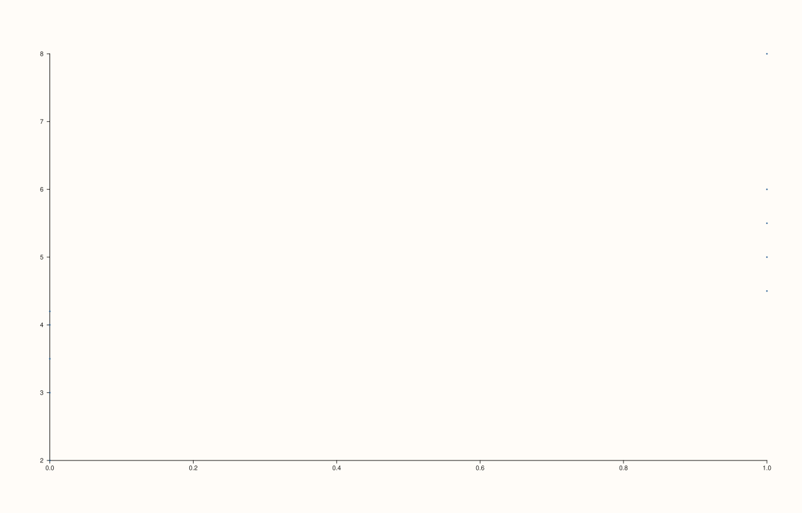

<!-- pluss-hand-authored -->

# flash::swarmplot

[Back to flash API Reference](../../flash_api_reference)

## Signatures

```cpp
template <class Group, class Values>
Trace& flash::swarmplot(Pane& pane, Group&& group, Values&& values)
```

## What It Does

A pure alias for [`flash::stripplot`](stripplot.md)'s second (numeric-group) overload —
the implementation is literally `stripplot(pane, group, values)`, nothing more. Directly
verified: identical arguments to both functions produce **byte-for-byte identical** SVG
output.

```{important} No swarm/point-avoidance layout, despite the name
The name might suggest swarmplot() jitters/offsets overlapping points sideways so
they don't visually stack (a "swarm" beeswarm layout algorithm). This function does
not do that -- it draws a plain scatter at the raw group/values positions,
identically to flash::stripplot(pane, group, values). Overlapping points will
visually overlap; there is no separation logic.
```

## Parameters

**pane** (`Pane&`)
    The target pane. Must be `Planar` (2D).

**group** (series-convertible)
    A numeric x-position variable, paired with `values` by index.

**values** (series-convertible)
    The y-axis observation values.

## Returns

`Trace&`
    A reference to the newly created (cloud) trace.

## Examples

Example 1. Identical call shape to `stripplot()`'s numeric-group overload.

```cpp
using namespace pluss::pl;

auto fig = studio("flash_swarmplot_default");
auto& pane = fig.pane2();
std::vector<double> group{0.0, 0.0, 0.0, 0.0, 0.0, 1.0, 1.0, 1.0, 1.0, 1.0};
std::vector<double> values{2.0, 3.0, 3.5, 4.0, 4.2, 4.5, 5.0, 5.5, 6.0, 8.0};
flash::swarmplot(pane, group, values);
fig.show();
```



Example 2 (verification, not a distinct rendering). `swarmplot(group, values)` and
`stripplot(group, values)` on identical data, confirmed to produce **byte-for-byte
identical** output.

```cpp
using namespace pluss::pl;

auto fig1 = studio("flash_alias_check_strip");
auto& pane1 = fig1.pane2();
std::vector<double> group{0.0, 0.0, 0.0, 0.0, 0.0, 1.0, 1.0, 1.0, 1.0, 1.0};
std::vector<double> values{2.0, 3.0, 3.5, 4.0, 4.2, 4.5, 5.0, 5.5, 6.0, 8.0};
flash::stripplot(pane1, group, values);

auto fig2 = studio("flash_alias_check_swarm");
auto& pane2 = fig2.pane2();
flash::swarmplot(pane2, group, values);
std::cout << "swarmplot(group, values) == stripplot(group, values): " << (fig1.to_svg() == fig2.to_svg()) << "\n";
```

Output:

```text
swarmplot(group, values) == stripplot(group, values): 1
```

## Notes

- Not `noexcept`.
- No `Note`-taking / categorical-label overload exists for `swarmplot()` — only the
  numeric-`Group` shape `stripplot()` also has. Call `stripplot()` directly with a `Note`
  for labeled category axes.

## See Also

- [`flash::stripplot`](stripplot.md): the function this is a byte-for-byte alias of,
  including its `Note`-taking categorical overload that `swarmplot()` lacks.

<div class="pluss-inline-prev-next">
  <a class="prev-link" href="stripplot.html">
    <span class="label">Previous</span>
    <span class="title">stripplot</span>
  </a>
  <a class="next-link" href="boxplot.html">
    <span class="label">Next</span>
    <span class="title">boxplot</span>
  </a>
</div>
