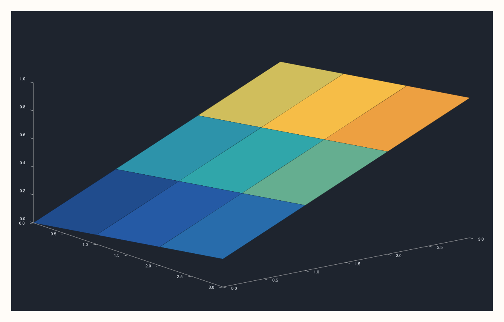
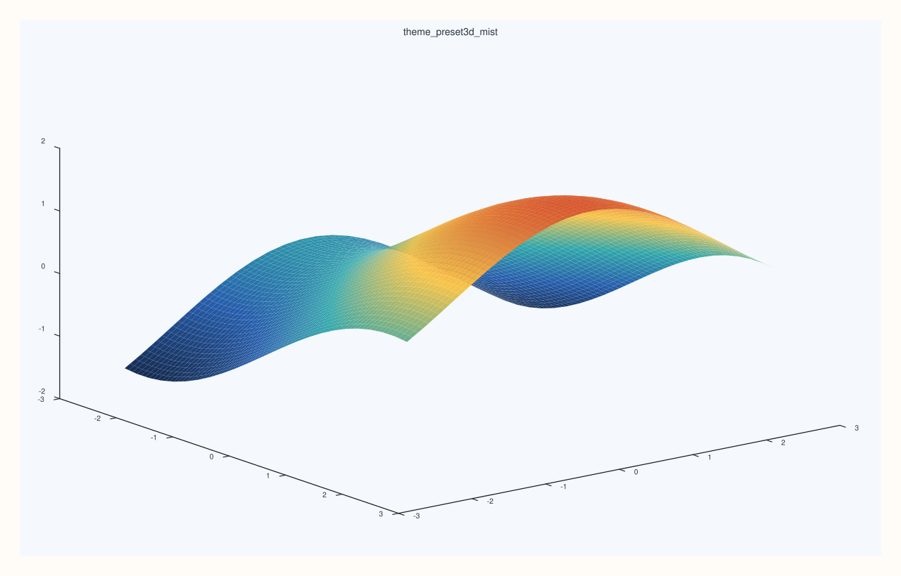

<!-- pluss-hand-authored -->

# flash::theme_preset3d

[Back to flash API Reference](../../flash_api_reference)

## Signature

```cpp
Pane& flash::theme_preset3d(Pane& pane, ThemePreset3D preset)
```

## What It Does

Applies one of four named theme presets to a pane via
[`Pane::theme_tokens()`](../pane/theme_tokens.md). `Paper` and `Ocean` assign the
existing [`Theme::paper()`](../studio/theme.md)/`Theme::ocean()` factories directly;
`Graphite` and `Mist` are new, 3D-specific dark/light variants built by copying the pane's
*current* theme's accents and surface palette but overriding its background/foreground
colors to a fixed pair.

| Preset | Source | Background | Foreground |
|---|---|---|---|
| `Paper` | `Theme::paper()` | (theme default) | (theme default) |
| `Ocean` | `Theme::ocean()` | (theme default) | (theme default) |
| `Graphite` | current theme's accents/surface palette | `Rgba::from_u8(30, 36, 46)` (dark) | `Rgba::from_u8(232, 237, 243)` (light) |
| `Mist` | current theme's accents/surface palette | `Rgba::from_u8(245, 248, 252)` (light) | `Rgba::from_u8(42, 52, 66)` (dark) |

```{important} Graphite/Mist read the pane's CURRENT theme before overwriting it
Unlike Paper/Ocean (which assign a complete, independent Theme factory value outright),
Graphite and Mist first read pane.theme_tokens() to capture whatever accents()/
surface_palette() the pane already has, then construct a NEW Theme reusing those two
pieces alongside their own fixed background/foreground pair. Calling theme_preset3d
with Graphite/Mist on a pane that already has a heavily customized theme carries that
customization's accents/surface palette forward; Paper/Ocean do not (they fully replace
the theme).
```

## Parameters

**pane** (`Pane&`)
    The target pane whose `Theme` is mutated.

**preset** (`ThemePreset3D`)
    Which named theme to apply — see the table above.

## Returns

`Pane&`
    A reference to the same pane, for chaining.

## Examples

Example 1. `Paper` — the light, default-adjacent theme.

```cpp
using namespace pluss::pl;

auto fig = studio("flash_theme_preset3d_paper");
auto& pane = fig.pane3();
pane.sheet(std::vector<double>{0.0, 1.0, 2.0, 3.0}, std::vector<double>{0.0, 1.0, 2.0, 3.0}, pluss::series::linspace(0.0, 1.0, 16, pluss::ScalarType::Float64).reshape({4, 4}));
flash::theme_preset3d(pane, flash::ThemePreset3D::Paper);
fig.show();
```


Example 2 (a comparison, not a new picture). `Graphite` renders differently from `Paper`.

```cpp
using namespace pluss::pl;

auto fig1 = studio("flash_theme_preset3d_paper_cmp");
auto& pane1 = fig1.pane3();
pane1.sheet(std::vector<double>{0.0, 1.0, 2.0, 3.0}, std::vector<double>{0.0, 1.0, 2.0, 3.0}, pluss::series::linspace(0.0, 1.0, 16, pluss::ScalarType::Float64).reshape({4, 4}));
flash::theme_preset3d(pane1, flash::ThemePreset3D::Paper);

auto fig2 = studio("flash_theme_preset3d_slate");
auto& pane2 = fig2.pane3();
pane2.sheet(std::vector<double>{0.0, 1.0, 2.0, 3.0}, std::vector<double>{0.0, 1.0, 2.0, 3.0}, pluss::series::linspace(0.0, 1.0, 16, pluss::ScalarType::Float64).reshape({4, 4}));
flash::theme_preset3d(pane2, flash::ThemePreset3D::Graphite);

std::cout << "theme_preset3d Paper vs Graphite differ: " << (fig1.to_svg() != fig2.to_svg()) << "\n";
fig2.show();
```

Output:

```text
theme_preset3d Paper vs Graphite differ: 1
```



Example 3. `Mist` gives you the light preset counterpart to `Graphite`: bright background,
dark foreground, but still keeping the pane's existing accent and surface palette.

```cpp
using namespace pluss::pl;

auto fig = studio("flash_theme_preset3d_mist");
auto& pane = fig.pane3();
auto gx = pluss::series::linspace(-2.5, 2.5, 24, pluss::ScalarType::Float64);
auto gy = pluss::series::linspace(-2.5, 2.5, 24, pluss::ScalarType::Float64);
auto gz = gx.reshape({1, 24}).repeat({24, 1}).mul(0.6).sin()
            .add(gy.reshape({24, 1}).repeat({1, 24}).mul(0.7).cos());

flash::theme_preset3d(pane, flash::ThemePreset3D::Mist);
auto& trace = pane.sheet(gx, gy, gz);
flash::trace_preset3d(trace, flash::TracePreset3D::Surface);
fig.show();
```



## Notes

- Not `noexcept`.
- `Graphite`/`Mist` construct a new `Theme` with an explicit name (`"flash3d_graphite"` /
  `"flash3d_mist"`), separate from whatever the source theme's own name was.
- See the important callout above — `Graphite`/`Mist` carry the current theme's
  accents/surface palette forward; `Paper`/`Ocean` replace the theme entirely.

## See Also

- [`Pane::theme_tokens`](../pane/theme_tokens.md): the underlying accessor mutated
  here.
- [`Studio::theme`](../studio/theme.md): the figure-wide theme setter, and
  `Theme::paper()`/`Theme::ocean()`'s own source.
- [`flash::scene_preset3d`](scene_preset3d.md): composes one of these theme presets
  alongside a camera/lighting preset.

<div class="pluss-inline-prev-next">
  <a class="prev-link" href="lighting3d.html">
    <span class="label">Previous</span>
    <span class="title">lighting3d</span>
  </a>
  <a class="next-link" href="scene_preset3d.html">
    <span class="label">Next</span>
    <span class="title">scene_preset3d</span>
  </a>
</div>
