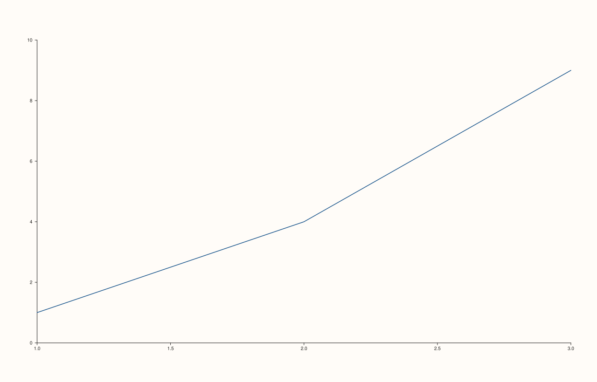
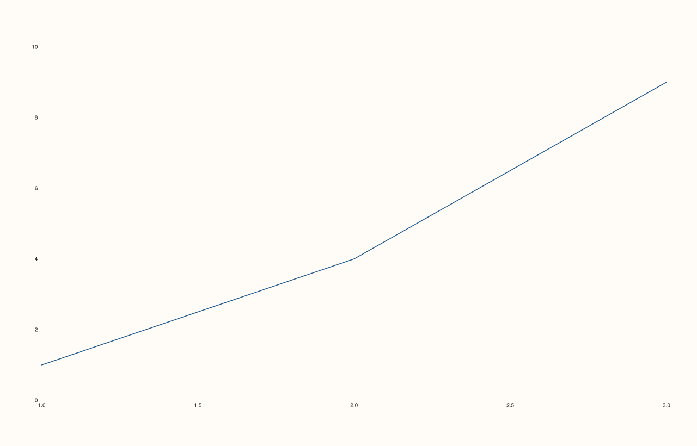

<!-- pluss-hand-authored -->

# flash::tickless

[Back to flash API Reference](../../flash_api_reference)

## Signature

```cpp
Pane& flash::tickless(Pane& pane, bool enable = true)
```

## What It Does

Hides a pane's axes frame while explicitly keeping tick labels enabled (via
[`Pane::x_tick_labels`](../pane/x_tick_labels.md)/`y_tick_labels`/`z_tick_labels`, all
set `true`, plus [`Pane::axes_visible`](../pane/axes_visible.md) set `false`) — a
clean look of numbers/labels floating with no surrounding box or axis lines.
Calling it with `enable = false` restores the axes frame and re-confirms tick labels are
visible, effectively undoing a prior `tickless(pane)` call.

## Parameters

**pane** (`Pane&`)
    The pane to toggle.

**enable** (`bool`, default `true`)
    `true`: hide the axes frame, keep tick labels. `false`: show the axes frame, keep
    tick labels (both branches leave tick labels visible — only `axes_visible` actually
    changes between the two).

## Returns

`Pane&`
    A reference to `pane`, for chaining.

## Examples

Example 1. Default rendering (axes visible, for comparison).

```cpp
using namespace pluss::pl;

auto fig1 = studio("flash_tickless_off");
auto& p1 = fig1.pane2();
p1.trend(std::vector<double>{1, 2, 3}, std::vector<double>{1, 4, 9});
fig1.show();
```



Example 2. `tickless(pane)` — axes frame hidden, tick labels retained — confirmed to
render genuinely differently from Example 1 via direct SVG comparison.

```cpp
using namespace pluss::pl;

auto fig1 = studio("flash_tickless_off");
auto& p1 = fig1.pane2();
p1.trend(std::vector<double>{1, 2, 3}, std::vector<double>{1, 4, 9});

auto fig2 = studio("flash_tickless_on");
auto& p2 = fig2.pane2();
p2.trend(std::vector<double>{1, 2, 3}, std::vector<double>{1, 4, 9});
flash::tickless(p2);
std::cout << "tickless(default true) differs from default: " << (fig1.to_svg() != fig2.to_svg()) << "\n";
fig2.show();
```

Output:

```text
tickless(default true) differs from default: 1
```



Example 3 (edge case). `tickless(pane, false)` is byte-identical to the untouched
default — confirming the `false` branch is a genuine restore, not a distinct third
look.

```cpp
using namespace pluss::pl;

auto fig1 = studio("flash_tickless_off");
auto& p1 = fig1.pane2();
p1.trend(std::vector<double>{1, 2, 3}, std::vector<double>{1, 4, 9});

auto fig3 = studio("flash_tickless_explicit_false");
auto& p3 = fig3.pane2();
p3.trend(std::vector<double>{1, 2, 3}, std::vector<double>{1, 4, 9});
flash::tickless(p3, false);
std::cout << "tickless(false) vs default: " << (fig1.to_svg() == fig3.to_svg()) << "\n";
```

Output:

```text
tickless(false) vs default: 1
```

## Notes

- Not `noexcept`.
- Unlike [`flash::despine`](despine.md), this function genuinely does something —
  it is a real, verified wrapper around `Pane::axes_visible` and the three
  `*_tick_labels` setters.
- Both branches always end with tick labels visible; there is no argument combination
  through this function alone that hides tick labels.

## See Also

- [`flash::despine`](despine.md): a related but currently-inert function; unlike this
  one, it changes nothing.
- [`Pane::axes_visible`](../pane/axes_visible.md): the coarse frame-visibility toggle
  this function's `enable` argument controls directly.
- [`flash::set_theme`](set_theme.md)'s `borderless` option: a similar but distinct
  effect — `borderless` also calls `axes_visible(false)` but does not explicitly force
  tick labels on the way this function does.

<div class="pluss-inline-prev-next">
  <a class="prev-link" href="despine.html">
    <span class="label">Previous</span>
    <span class="title">despine</span>
  </a>
  <a class="next-link" href="horizontal_grid.html">
    <span class="label">Next</span>
    <span class="title">horizontal_grid</span>
  </a>
</div>
