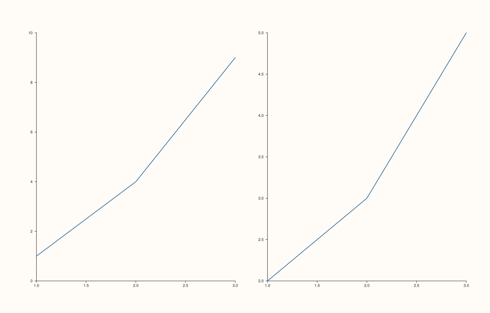

<!-- pluss-hand-authored -->

# flash::tight_layout

[Back to flash API Reference](../../flash_api_reference)

## Signature

```cpp
Studio& flash::tight_layout(Studio& studio, double padding = 6.0)
```

## What It Does

A thin, familiar-naming wrapper: forwards straight to
[`Studio::tight_layout`](../studio/tight_layout.md) with `enable = true` and the given
`padding` — i.e. it can only turn tight-layout **on**, never off, unlike
`Studio::tight_layout`'s own two-argument `(bool, double)` signature.

## Parameters

**studio** (`Studio&`)
    The figure to enable tight, auto-computed pane spacing on.

**padding** (`double`, default `6.0`)
    Forwarded as `Studio::tight_layout`'s own `padding` argument — see that page for
    the full spacing-computation description.

## Returns

`Studio&`
    A reference to `studio`, for chaining.

## Examples

Example 1. Default padding on a two-pane mosaic.

```cpp
using namespace pluss::pl;

auto fig = studio("flash_tight_layout_default");
fig.mosaic(1, 2);
fig.pane2().trend(std::vector<double>{1, 2, 3}, std::vector<double>{1, 4, 9});
fig.pane2().trend(std::vector<double>{1, 2, 3}, std::vector<double>{2, 3, 5});
flash::tight_layout(fig);
fig.show();
```

Example 2. Wider `padding = 24.0` — confirmed to render genuinely differently from
Example 1's default via direct SVG comparison.

```cpp
using namespace pluss::pl;

auto fig1 = studio("flash_tight_layout_default");
fig1.mosaic(1, 2);
fig1.pane2().trend(std::vector<double>{1, 2, 3}, std::vector<double>{1, 4, 9});
fig1.pane2().trend(std::vector<double>{1, 2, 3}, std::vector<double>{2, 3, 5});
flash::tight_layout(fig1);

auto fig2 = studio("flash_tight_layout_wide_pad");
fig2.mosaic(1, 2);
fig2.pane2().trend(std::vector<double>{1, 2, 3}, std::vector<double>{1, 4, 9});
fig2.pane2().trend(std::vector<double>{1, 2, 3}, std::vector<double>{2, 3, 5});
flash::tight_layout(fig2, 24.0);
std::cout << "tight_layout(default) vs tight_layout(pad=24) differ: " << (fig1.to_svg() != fig2.to_svg()) << "\n";
fig2.show();
```

Output:

```text
tight_layout(default) vs tight_layout(pad=24) differ: 1
```



## Notes

- Not `noexcept`.
- There is no way to *disable* tight layout through this wrapper — call
  [`Studio::tight_layout(false)`](../studio/tight_layout.md) directly for that.
- `padding`'s default here (`6.0`) matches `Studio::tight_layout`'s own default.

## See Also

- [`Studio::tight_layout`](../studio/tight_layout.md): the underlying two-argument
  method this function forwards to with `enable` hardcoded to `true`.
- [`Studio::mosaic`](../studio/mosaic.md): the layout grid tight-layout adjusts spacing
  within.

<div class="pluss-inline-prev-next">
  <a class="prev-link" href="legend_frame.html">
    <span class="label">Previous</span>
    <span class="title">legend_frame</span>
  </a>
  <a class="next-link" href="despine.html">
    <span class="label">Next</span>
    <span class="title">despine</span>
  </a>
</div>
