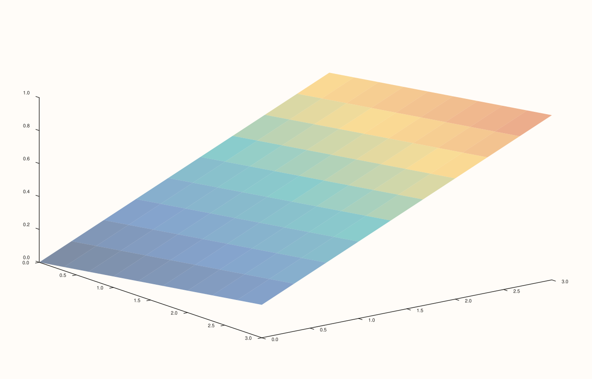
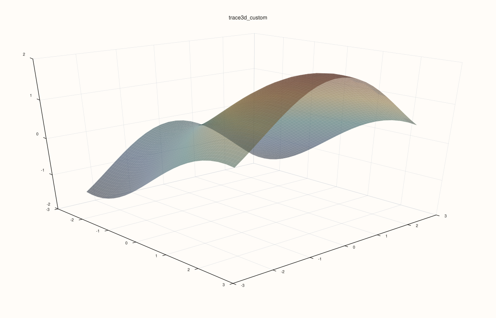
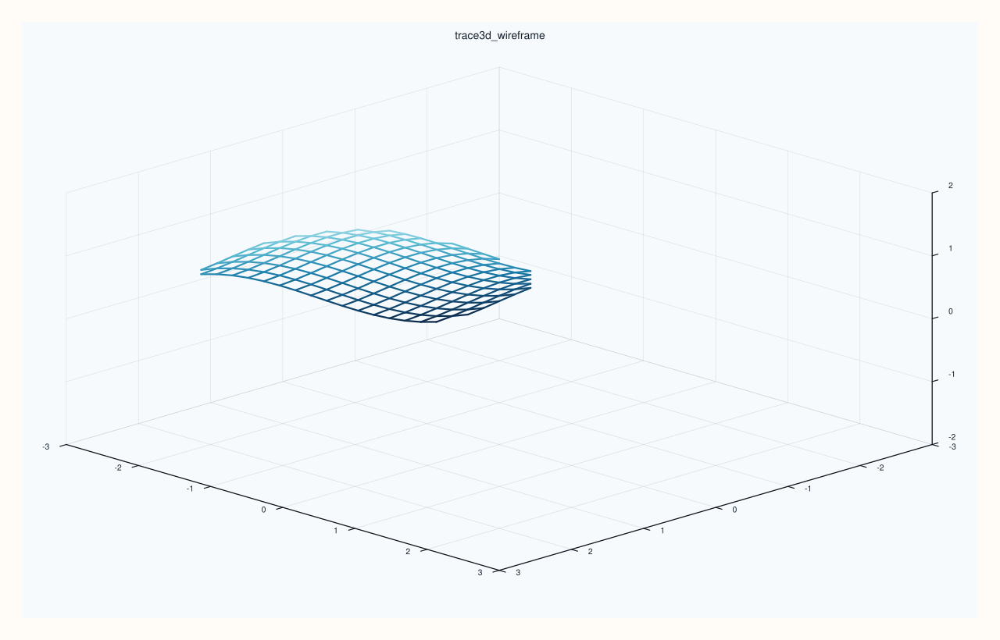

<!-- pluss-hand-authored -->

# flash::trace3d

[Back to flash API Reference](../../flash_api_reference)

## Signature

```cpp
struct Trace3DOptions {
  std::optional<TracePreset3D> preset{std::nullopt};
  std::optional<ShadeMode> shade{std::nullopt};
  std::optional<LightingMode> lighting{std::nullopt};
  std::optional<MaterialProfile> material{std::nullopt};
  std::optional<float> line_width{std::nullopt};
  std::optional<bool> transparent{std::nullopt};
};

Trace& flash::trace3d(Trace& trace, const Trace3DOptions& options)
```

## What It Does

The fully composable sibling of [`flash::trace_preset3d`](trace_preset3d.md): every
field is a `std::optional`, applied — in this fixed order — only when set: `preset`
([`trace_preset3d`](trace_preset3d.md)) → `shade`
([`Trace::shade`](../trace/shade.md)) → `lighting`
([`Trace::lighting`](../trace/lighting.md)) → `material`
([`Trace::material`](../trace/material.md)) → `line_width`
([`Trace::width`](../trace/width.md)) → `transparent`
([`Trace::transparent`](../trace/transparent.md)).

Because `preset` runs first, setting both `preset` and one of the individual fields lets
you start from a named style and override just the pieces you want changed — the same
pattern [`flash::scene3d`](scene3d.md) uses for pane-level scene configuration. Directly
verified: `Trace3DOptions{.preset = Surface}` alone renders byte-identical to a direct
`flash::trace_preset3d(trace, TracePreset3D::Surface)` call.

## Parameters

**trace** (`Trace&`)
    The target trace to restyle.

**options** (`const Trace3DOptions&`)
    See the field table below.

## `Trace3DOptions` fields

**preset** (`std::optional<TracePreset3D>`, default `std::nullopt`)
    Applies [`flash::trace_preset3d`](trace_preset3d.md) first, when set.

**shade** (`std::optional<ShadeMode>`, default `std::nullopt`)
    Applies [`Trace::shade`](../trace/shade.md) when set — after `preset`.

**lighting** (`std::optional<LightingMode>`, default `std::nullopt`)
    Applies [`Trace::lighting`](../trace/lighting.md) when set — after `shade`.

**material** (`std::optional<MaterialProfile>`, default `std::nullopt`)
    Applies [`Trace::material`](../trace/material.md) when set — after `lighting`.

**line_width** (`std::optional<float>`, default `std::nullopt`)
    Applies [`Trace::width`](../trace/width.md) when set — after `material`.

**transparent** (`std::optional<bool>`, default `std::nullopt`)
    Applies [`Trace::transparent`](../trace/transparent.md) when set — applied last.

## Returns

`Trace&`
    A reference to the same trace, for chaining.

## Examples

Example 1 (verification, not a distinct rendering). `Trace3DOptions{.preset = Surface}`
alone renders byte-identical to `flash::trace_preset3d(trace, TracePreset3D::Surface)`.

```cpp
using namespace pluss::pl;

auto fig1 = studio("flash_trace3d_preset");
auto& pane1 = fig1.pane3();
auto& trace1 = pane1.sheet(std::vector<double>{0.0, 1.0, 2.0, 3.0}, std::vector<double>{0.0, 1.0, 2.0, 3.0}, pluss::series::linspace(0.0, 1.0, 16, pluss::ScalarType::Float64).reshape({4, 4}));
flash::Trace3DOptions opts;
opts.preset = flash::TracePreset3D::Surface;
flash::trace3d(trace1, opts);

auto fig2 = studio("flash_trace3d_cmp");
auto& pane2 = fig2.pane3();
auto& trace2 = pane2.sheet(std::vector<double>{0.0, 1.0, 2.0, 3.0}, std::vector<double>{0.0, 1.0, 2.0, 3.0}, pluss::series::linspace(0.0, 1.0, 16, pluss::ScalarType::Float64).reshape({4, 4}));
flash::trace_preset3d(trace2, flash::TracePreset3D::Surface);

std::cout << "trace3d(preset=Surface, no override) == trace_preset3d(Surface): " << (fig1.to_svg() == fig2.to_svg()) << "\n";
fig1.show();
```

Output:

```text
trace3d(preset=Surface, no override) == trace_preset3d(Surface): 1
```



Example 2. Start from `Surface`, then override just the material and transparency. This
shows the intended usage pattern when you want most of a preset but still need a small
local restyle.

```cpp
using namespace pluss::pl;

auto fig = studio("flash_trace3d_custom");
auto& pane = fig.pane3();
auto gx = pluss::series::linspace(-2.5, 2.5, 24, pluss::ScalarType::Float64);
auto gy = pluss::series::linspace(-2.5, 2.5, 24, pluss::ScalarType::Float64);
auto gz = gx.reshape({1, 24}).tile({24, 1}).mul(0.6).sin()
            .add(gy.reshape({24, 1}).tile({1, 24}).mul(0.7).cos());

flash::scene_preset3d(pane, flash::ScenePreset3D::Presentation);
auto& trace = pane.sheet(gx, gy, gz);
flash::Trace3DOptions opts;
opts.preset = flash::TracePreset3D::Surface;
opts.material = MaterialProfile::Metal;
opts.transparent = true;
flash::trace3d(trace, opts);
fig.show();
```



Example 3. Use `trace3d(...)` on a wireframe-style trace and override the width after
the preset has run. Because `line_width` is applied after `preset`, it wins cleanly.

```cpp
using namespace pluss::pl;

auto fig = studio("flash_trace3d_wireframe");
auto& pane = fig.pane3();
auto gx = pluss::series::linspace(-2.5, 2.5, 24, pluss::ScalarType::Float64);
auto gy = pluss::series::linspace(-2.5, 2.5, 24, pluss::ScalarType::Float64);
auto gz = gx.reshape({1, 24}).tile({24, 1}).mul(0.6).sin()
            .add(gy.reshape({24, 1}).tile({1, 24}).mul(0.7).cos());

flash::scene_preset3d(pane, flash::ScenePreset3D::Survey);
auto& trace = pane.lattice(gx, gy, gz);
flash::Trace3DOptions opts;
opts.preset = flash::TracePreset3D::Wireframe;
opts.line_width = 2.2F;
flash::trace3d(trace, opts);
fig.show();
```



## Notes

- Not `noexcept`.
- With every field left `std::nullopt` (a default-constructed `Trace3DOptions{}`), this
  function is a no-op.
- Shares its "`preset` applied first, individual fields override afterward" pattern
  exactly with [`flash::scene3d`](scene3d.md).

## See Also

- [`flash::trace_preset3d`](trace_preset3d.md): the fixed, non-composable sibling this
  function's `preset` field applies.
- [`Trace::shade`](../trace/shade.md), [`Trace::lighting`](../trace/lighting.md),
  [`Trace::material`](../trace/material.md), [`Trace::width`](../trace/width.md),
  [`Trace::transparent`](../trace/transparent.md): the five native mutators this
  function composes.
- [`flash::scene3d`](scene3d.md): the pane-level, `std::optional`-composed counterpart.

<div class="pluss-inline-prev-next">
  <a class="prev-link" href="trace_preset3d.html">
    <span class="label">Previous</span>
    <span class="title">trace_preset3d</span>
  </a>
  <a class="next-link" href="path4.html">
    <span class="label">Next</span>
    <span class="title">path4</span>
  </a>
</div>
