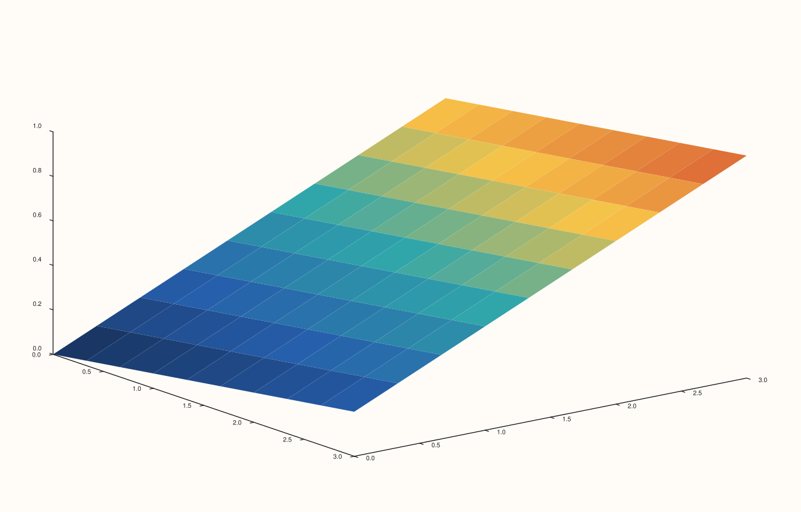
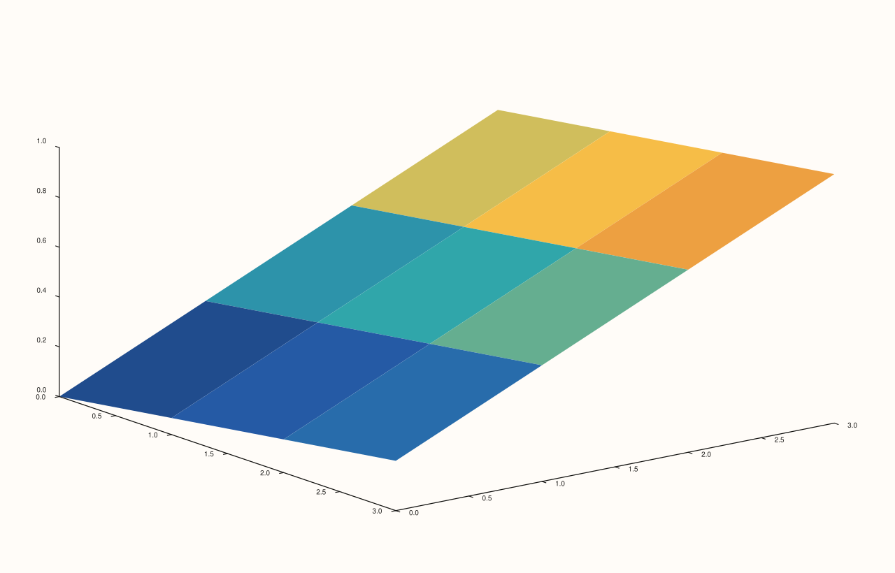
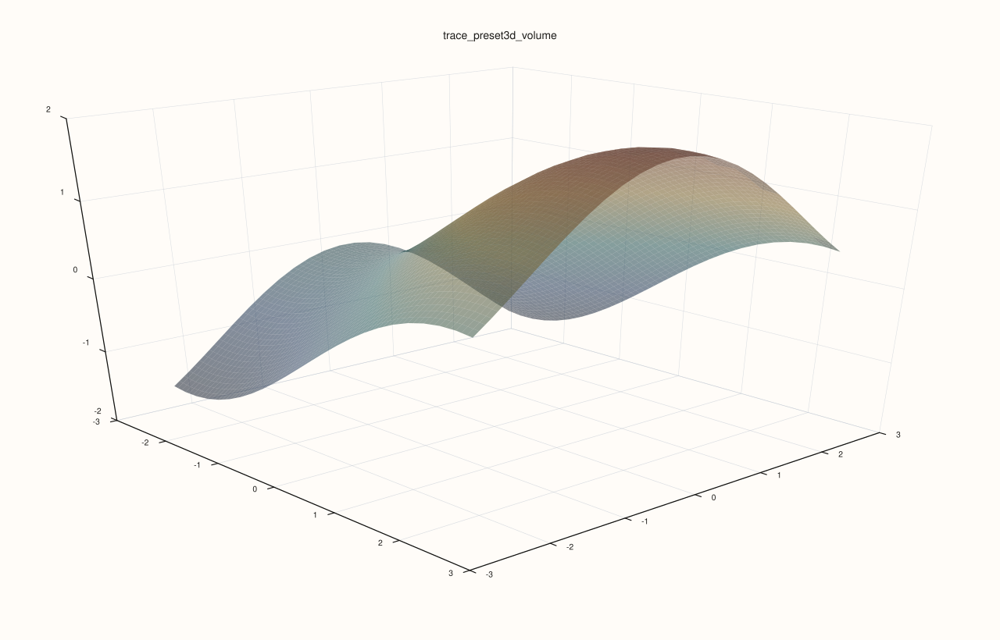

<!-- pluss-hand-authored -->

# flash::trace_preset3d

[Back to flash API Reference](../../flash_api_reference)

## Signature

```cpp
Trace& flash::trace_preset3d(Trace& trace, TracePreset3D preset)
```

## What It Does

Applies one of six named trace-styling presets — each a fixed combination of
[`Trace::shade`](../trace/shade.md), [`Trace::lighting`](../trace/lighting.md),
[`Trace::material`](../trace/material.md), and (for `Path`/`Wireframe`)
[`Trace::width`](../trace/width.md) or [`Trace::transparent`](../trace/transparent.md)
(for `Cloud`/`Volume`).

| Preset | shade | lighting | material | extra |
|---|---|---|---|---|
| `Path` | `Flat` | `None` | `Default` | `width(2.0F)` |
| `Cloud` | `Smooth` | `Gouraud` | `Dull` | `transparent(true)` |
| `Surface` | `Smooth` | `Gouraud` | `Shiny` | — |
| `Wireframe` | `Flat` | `Flat` | `Dull` | `width(1.2F)` |
| `Spire` | `Faceted` | `Flat` | `Metal` | — |
| `Volume` | `Smooth` | `Gouraud` | `Metal` | `transparent(true)` |

Note the preset names correspond conceptually to the 3D-native trace kinds
([`flash::path3`](path3.md), [`flash::cloud3`](cloud3.md), [`flash::sheet`](sheet.md),
[`flash::lattice`](lattice.md), [`flash::spire3`](spire3.md)) but this function itself is
purely a styling helper — it doesn't create or select a trace kind, only restyles
whatever trace you already have.

```{important} Surface/Cloud/Volume are the only presets that set LightingMode::Gouraud
Per flash::lighting3d's own important callout, a trace's LightingMode must be
Gouraud or Flat (not the ::None default) for any Pane::lights() configuration to have
a visible effect. Only Surface, Cloud, and Volume set Gouraud here; Path sets ::None
explicitly, and Wireframe/Spire set ::Flat. Pick Surface/Cloud/Volume (or set
LightingMode::Gouraud/::Flat by hand) if you need flash::lighting3d/flash::scene3d's
lighting configuration to actually be visible on this trace.
```

## Parameters

**trace** (`Trace&`)
    The target trace to restyle.

**preset** (`TracePreset3D`)
    Which named preset to apply — see the table above.

## Returns

`Trace&`
    A reference to the same trace, for chaining.

## Examples

Example 1. `Surface` — smooth shading, Gouraud lighting, shiny material.

```cpp
using namespace pluss::pl;

auto fig = studio("flash_trace_preset3d_surface");
auto& pane = fig.pane3();
auto& trace = pane.sheet(std::vector<double>{0.0, 1.0, 2.0, 3.0}, std::vector<double>{0.0, 1.0, 2.0, 3.0}, pluss::series::linspace(0.0, 1.0, 16, pluss::ScalarType::Float64).reshape({4, 4}));
flash::trace_preset3d(trace, flash::TracePreset3D::Surface);
fig.show();
```



Example 2 (a comparison, not a new picture). `Wireframe` renders differently from `Surface` on the same underlying trace.

```cpp
using namespace pluss::pl;

auto fig1 = studio("flash_trace_preset3d_surface_cmp");
auto& pane1 = fig1.pane3();
auto& trace1 = pane1.sheet(std::vector<double>{0.0, 1.0, 2.0, 3.0}, std::vector<double>{0.0, 1.0, 2.0, 3.0}, pluss::series::linspace(0.0, 1.0, 16, pluss::ScalarType::Float64).reshape({4, 4}));
flash::trace_preset3d(trace1, flash::TracePreset3D::Surface);

auto fig2 = studio("flash_trace_preset3d_wireframe");
auto& pane2 = fig2.pane3();
auto& trace2 = pane2.sheet(std::vector<double>{0.0, 1.0, 2.0, 3.0}, std::vector<double>{0.0, 1.0, 2.0, 3.0}, pluss::series::linspace(0.0, 1.0, 16, pluss::ScalarType::Float64).reshape({4, 4}));
flash::trace_preset3d(trace2, flash::TracePreset3D::Wireframe);

std::cout << "trace_preset3d Surface vs Wireframe differ: " << (fig1.to_svg() != fig2.to_svg()) << "\n";
fig2.show();
```

Output:

```text
trace_preset3d Surface vs Wireframe differ: 1
```



Example 3. `Volume` keeps the smooth/Gouraud family but changes the material profile and
transparency. It is useful when you want a surface-like trace to sit more lightly in a
scene instead of reading as a fully opaque slab.

```cpp
using namespace pluss::pl;

auto fig = studio("flash_trace_preset3d_volume");
auto& pane = fig.pane3();
auto gx = pluss::series::linspace(-2.5, 2.5, 24, pluss::ScalarType::Float64);
auto gy = pluss::series::linspace(-2.5, 2.5, 24, pluss::ScalarType::Float64);
auto gz = gx.reshape({1, 24}).repeat({24, 1}).mul(0.6).sin()
            .add(gy.reshape({24, 1}).repeat({1, 24}).mul(0.7).cos());

flash::scene_preset3d(pane, flash::ScenePreset3D::Presentation);
auto& trace = pane.sheet(gx, gy, gz);
flash::trace_preset3d(trace, flash::TracePreset3D::Volume);
fig.show();
```



## Notes

- Not `noexcept`.
- Works on any `Trace`, regardless of its actual `TraceKind` — this is purely a
  shading/lighting/material/width/transparency styling helper, with no validation tying
  a given preset name to a matching trace kind.
- See the important callout above for which presets set `LightingMode::Gouraud`/`Flat`
  vs. `None`.

## See Also

- [`Trace::shade`](../trace/shade.md), [`Trace::lighting`](../trace/lighting.md),
  [`Trace::material`](../trace/material.md), [`Trace::width`](../trace/width.md),
  [`Trace::transparent`](../trace/transparent.md): the five native mutators every
  preset here composes.
- [`flash::trace3d`](trace3d.md): the more granular, `std::optional`-composed sibling —
  can apply a preset *and* override individual pieces afterward.
- [`flash::lighting3d`](lighting3d.md): the pane-level lighting configuration this
  function's `LightingMode` choice interacts with.

<div class="pluss-inline-prev-next">
  <a class="prev-link" href="scene3d.html">
    <span class="label">Previous</span>
    <span class="title">scene3d</span>
  </a>
  <a class="next-link" href="trace3d.html">
    <span class="label">Next</span>
    <span class="title">trace3d</span>
  </a>
</div>
