<!-- pluss-hand-authored -->

# flash::triplot

[Back to flash API Reference](../../flash_api_reference)

## Signatures

```cpp
enum class TriplotKind : std::uint8_t { Cloud, Path, Sheet, Lattice, Spire, Ridge };

struct TriplotOptions {
  TriplotKind kind{TriplotKind::Cloud};
  std::vector<std::string> labels{};
  std::vector<std::int64_t> feature_indices{};
  std::vector<std::string> feature_names{};
  std::int64_t max_features{0};
  std::int64_t max_panels{9};
  std::int64_t rows{0};
  std::int64_t cols{0};
  std::int64_t max_points{2500};
  std::int64_t ridge_levels{8};
  bool show_grid{true};
  bool auto_size{true};
  double min_width{1280.0};
  double min_height{900.0};
  double cell_width{360.0};
  double cell_height{300.0};
  double outer_pad_x{100.0};
  double outer_pad_y{100.0};
  double grid_gap_x{10.0};
  double grid_gap_y{10.0};
};

Studio& flash::triplot(Studio& studio, pluss::msharp::RangeView::Series columns,
                        const TriplotOptions& options = {})

Studio& flash::triplot(Studio& studio, std::initializer_list<Series> columns,
                        const TriplotOptions& options = {})

Studio& flash::triplot(Studio& studio, const Dataset& data,
                        const TriplotOptions& options = {})

Studio& flash::triplot(Studio& studio, const Series& matrix,
                        const MatrixFrameOptions& frame_options,
                        const TriplotOptions& options = {})

Studio& flash::triplot(Studio& studio, const Series& matrix,
                        pluss::msharp::RangeView::Of<std::string_view> feature_names,
                        Axis feature_axis, const TriplotOptions& options = {})

Studio& flash::triplot(Studio& studio, const Series& matrix,
                        const std::vector<std::string>& feature_names,
                        Axis feature_axis, const TriplotOptions& options = {})

Studio& flash::triplot(Studio& studio, const Series& matrix,
                        std::initializer_list<std::string_view> feature_names,
                        Axis feature_axis, const TriplotOptions& options = {})

Studio& flash::triplot(Studio& studio, const Series& matrix,
                        const TriplotOptions& options = {})
```

## What It Does

Builds one 3D panel per *triplet* of features — where [`flash::pairplot`](pairplot.md)
exhaustively compares every *pair*, `triplot` exhaustively compares every combination of
*three* features, one per [`Studio::pane3`](../studio/pane3.md) (`Volumetric`) panel. With
`n` selected features, it generates `C(n, 3)` triplets (in lexicographic index order) up
to `max_panels`, auto-resolves a grid shape for them via the same
[`flash::resolve_grid_shape`](FacetGrid.md) mechanics
[`flash::relgridplot`](relgridplot.md) uses, then draws each triplet with one of six
`TriplotKind` glyphs. The overload shape (eight overloads: `RangeView::Series`,
initializer list, `Dataset` (see the [`flash::pairplot`](pairplot.md) page), and four
matrix forms) exactly mirrors [`flash::pairplot`](pairplot.md)'s.

```{important} Genuine bug fixed at the source: Sheet/Lattice/Spire/Ridge used to crash unconditionally
Of the six TriplotKind values, only Cloud and Path draw from three flat, unstructured
observation columns -- the underlying Pane methods for the other four
(sheet()/lattice()/spire3()/ridge3()) all require z to be an actual rank-2 grid matrix,
with x/y as separate per-axis coordinate vectors (the same contract documented on their
own pages). Earlier, triplot passed its three selected columns into those four functions
positionally as flat (x, y, z) triples -- which do not satisfy that contract -- so calling
triplot with kind set to Sheet, Lattice, Spire, or Ridge crashed unconditionally with an
uncaught std::invalid_argument, on every input, no matter what data was passed. This has
been fixed: triplot now bins the two axis features of the triplet into a square grid over
their observed [min, max] range (grid_size = clamp(ceil(sqrt(row_count)), 2, 20)) and
averages the third feature within each cell, producing a genuine coordinate-grid triplet
that these four functions can render. Cells with no observations fall back to the
triplet's overall mean rather than leaving gaps. All four kinds were directly verified,
post-fix, to render real surfaces/bar-forests/contours rather than crashing -- see
Examples 8-11 below.
```

## `TriplotOptions` fields

**Content & selection**

**kind** (`TriplotKind`, default `Cloud`)
    Which glyph draws each triplet's panel: `Cloud` → a 3D scatter
    ([`Pane::cloud3`](../pane/cloud3.md)); `Path` → a connected 3D line
    ([`Pane::path3`](../pane/path3.md)); `Sheet` → a filled surface
    ([`Pane::sheet`](../pane/sheet.md)); `Lattice` → a wireframe surface
    ([`Pane::lattice`](../pane/lattice.md)); `Spire` → a 3D bar-forest
    ([`Pane::spire3`](../pane/spire3.md)); `Ridge` → elevated contour lines
    ([`Pane::ridge3`](../pane/ridge3.md)). `Sheet`/`Lattice`/`Spire`/`Ridge` all draw over
    the binned surface described in the important callout above, not the raw triplet.

**labels** (`std::vector<std::string>`, default empty)
    Per-feature names. Falls back to `detail::default_feature_labels`'s `"x1"`, `"x2"`, …
    scheme when its length doesn't match the feature count — identical fallback rule to
    [`flash::pairplot`](pairplot.md)'s `columns`-overloads (no underscore, unlike the
    matrix-overload fallback used elsewhere).

**feature_indices** (`std::vector<std::int64_t>`, default empty)
    Explicit 0-based indices (into the full, unfiltered feature list) to restrict the
    triplet search to. Out-of-range indices throw. Duplicates are silently de-duplicated,
    keeping first occurrence order. Takes priority over `feature_names` when both are set.

**feature_names** (`std::vector<std::string>`, default empty)
    Explicit feature names (matched against `labels`) to restrict the search to. An
    unrecognized name throws `"flash::triplot unknown feature name: " + name`. Only
    consulted when `feature_indices` is empty.

**max_features** (`std::int64_t`, default `0`)
    When positive and the selected feature count exceeds it, truncates the selection down
    to the first `max_features` (in whatever order `feature_indices`/`feature_names`/the
    default full-list order established). `0` means "no cap."

**max_panels** (`std::int64_t`, default `9`)
    Caps how many of the generated `C(n, 3)` triplets actually get a panel — truncates the
    triplet-generation loop early rather than filtering after the fact, so it always keeps
    the *first* `max_panels` triplets in lexicographic order, not a random or evenly-spaced
    subset.

**Grid shape & sampling**

**rows**, **cols** (`std::int64_t`, default `0` each)
    Explicit panel-grid shape hints — `0` means "auto," resolved via the same
    [`flash::resolve_grid_shape`](FacetGrid.md) rule documented on
    [`flash::relgridplot`](relgridplot.md), including the `rows*cols < triplet_count`
    error.

**max_points** (`std::int64_t`, default `2500`)
    Row-count cap. Feature columns exceeding this are deterministically downsampled to an
    evenly-strided subset, same mechanism as [`flash::pairplot`](pairplot.md)'s
    `max_points`.

**ridge_levels** (`std::int64_t`, default `8`)
    Contour-level count forwarded to [`Pane::ridge3`](../pane/ridge3.md) when `kind ==
    Ridge`. Clamped to at least `3`. Unused for every other kind.

**Sizing & layout**

**show_grid** (`bool`, default `true`)
    Whether each panel gets `GridStyle::Major` gridlines (`true`) or `GridStyle::None`
    (`false`) — note `triplot`'s default is `true`, the opposite of
    [`flash::pairplot`](pairplot.md)'s `show_grid` default.

**auto_size** (`bool`, default `true`)
    Whether `triplot` calls `Studio::size()` itself from `cell_width`/`cell_height`/
    `grid_gap_x`/`grid_gap_y`/`outer_pad_x`/`outer_pad_y` and the resolved grid shape,
    clamped to at least `min_width`×`min_height` — the same pattern as
    [`flash::pairplot`](pairplot.md)'s `auto_size`, just computed from the *panel* grid
    shape rather than the feature count directly.

**min_width**, **min_height** (`double`, default `1280.0`, `900.0`)
    The floor `Studio::size()` is clamped to when `auto_size` is `true`.

**cell_width**, **cell_height** (`double`, default `360.0`, `300.0`)
    The per-panel size (in points) used by the `auto_size` computation — larger than
    [`flash::pairplot`](pairplot.md)'s `210.0`/`210.0`, since each `triplot` panel is a
    full 3D view rather than a small pairwise thumbnail.

**outer_pad_x**, **outer_pad_y** (`double`, default `100.0` each)
    Extra margin (in points) added once to the `auto_size` computation.

**grid_gap_x**, **grid_gap_y** (`double`, default `10.0` each)
    The gutter between panels, forwarded to the internal
    [`flash::FacetGrid`](FacetGrid.md)-equivalent layout call.

## Parameters

**studio** (`Studio&`)
    The figure to lay out and populate.

**columns** (`pluss::msharp::RangeView::Series` or `std::initializer_list<Series>`)
    One entry per feature. Must contain at least three features, or `triplot` throws
    (message: `"flash::triplot requires at least three numeric features"`), and every
    column must be the same length.

**data** (`const Dataset&`, Dataset overload only)
    See `flash::make_dataset` on the [`flash::pairplot`](pairplot.md) page. Its `numeric_names`
    become `options.labels` automatically when `options.labels` is empty.

**matrix** (`const Series&`, matrix overloads only)
    A rank-2 `Series`, split into feature columns exactly like
    [`flash::pairplot`](pairplot.md)'s matrix overloads (`Axis::Cols` default: each column
    is a feature).

**frame_options** (`const MatrixFrameOptions&`, one matrix overload only)
    `{ Axis feature_axis; std::vector<std::string> feature_names; }`.

**feature_names** (`RangeView::Of<std::string_view>`, `const std::vector<std::string>&`,
or `std::initializer_list<std::string_view>`, three matrix overloads)
    Per-feature names for these overloads' outer parameter — **not** the same as
    `TriplotOptions::feature_names`, which restricts *which* features participate rather
    than naming them. This parameter is forwarded into `options.labels`.

**feature_axis** (`Axis`, matrix overloads with explicit names)
    `Axis::Cols` or `Axis::Rows` — which matrix axis holds the features.

**options** (`const TriplotOptions&`, optional)
    See the field table above.

## Returns

`Studio&`
    A reference to the same figure, for chaining.

## Examples

Example 1. Default overload — three features, default `Cloud` kind, one panel (`C(3,3) =
1` triplet).

```cpp
using namespace pluss::pl;

auto fig = studio("flash_triplot_cloud");
std::vector<pluss::Series> cols{
    pluss::make_series(std::vector<double>{1.0, 2.0, 3.0, 4.0, 5.0, 6.0, 7.0, 8.0}, {8}),
    pluss::make_series(std::vector<double>{8.0, 6.0, 7.0, 5.0, 4.0, 3.0, 2.0, 1.0}, {8}),
    pluss::make_series(std::vector<double>{2.0, 3.0, 1.0, 4.0, 6.0, 5.0, 8.0, 7.0}, {8})};
flash::triplot(fig, pluss::msharp::RangeView::Series(cols));
fig.show();
```

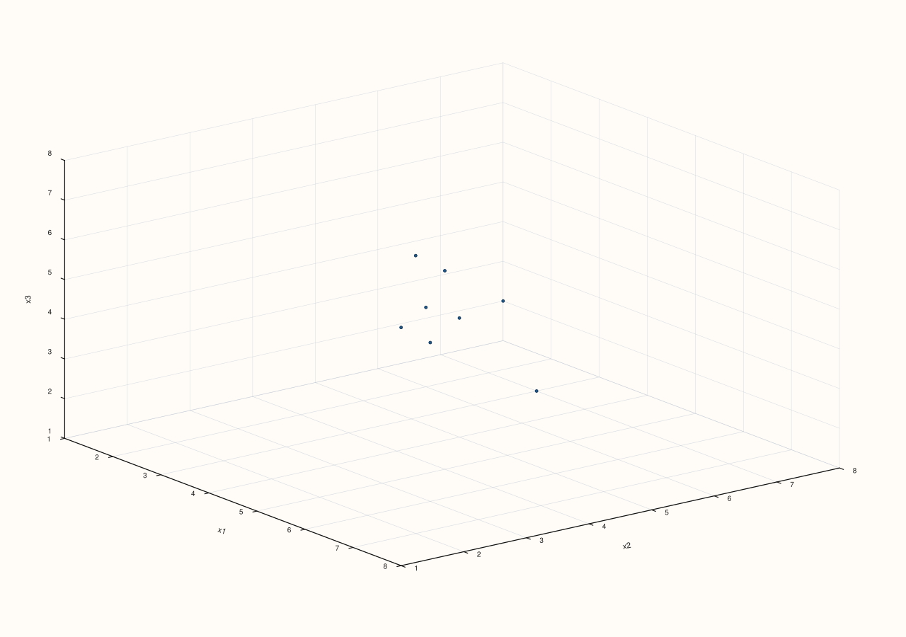

Example 2. `std::initializer_list<Series>` overload — verified byte-identical to the
`RangeView::Series` form given the same data.

```cpp
using namespace pluss::pl;

auto x1 = pluss::make_series(std::vector<double>{1.0, 2.0, 3.0, 4.0, 5.0, 6.0, 7.0, 8.0}, {8});
auto x2 = pluss::make_series(std::vector<double>{8.0, 6.0, 7.0, 5.0, 4.0, 3.0, 2.0, 1.0}, {8});
auto x3 = pluss::make_series(std::vector<double>{2.0, 3.0, 1.0, 4.0, 6.0, 5.0, 8.0, 7.0}, {8});
auto fig = studio("flash_triplot_il");
flash::triplot(fig, {x1, x2, x3});
fig.show();
```


Example 3. `Dataset` overload, via `flash::make_dataset`.

```cpp
using namespace pluss::pl;

auto fig = studio("flash_triplot_dataset");
auto data = flash::make_dataset(
    {pluss::make_series(std::vector<double>{1.0, 2.0, 3.0, 4.0, 5.0, 6.0, 7.0, 8.0}, {8}),
     pluss::make_series(std::vector<double>{8.0, 6.0, 7.0, 5.0, 4.0, 3.0, 2.0, 1.0}, {8}),
     pluss::make_series(std::vector<double>{2.0, 3.0, 1.0, 4.0, 6.0, 5.0, 8.0, 7.0}, {8})},
    {"alpha", "beta", "gamma"});
flash::triplot(fig, data);
fig.show();
```


Example 4. Matrix + `MatrixFrameOptions` overload.

```cpp
using namespace pluss::pl;

std::vector<double> a{1.0, 2.0, 3.0, 4.0, 5.0, 6.0, 7.0, 8.0};
std::vector<double> b{8.0, 6.0, 7.0, 5.0, 4.0, 3.0, 2.0, 1.0};
std::vector<double> c{2.0, 3.0, 1.0, 4.0, 6.0, 5.0, 8.0, 7.0};
std::vector<double> flat;
for (std::size_t i = 0; i < a.size(); ++i) { flat.push_back(a[i]); flat.push_back(b[i]); flat.push_back(c[i]); }
auto matrix = pluss::make_series(flat, {8, 3});

auto fig = studio("flash_triplot_matrix_frame");
flash::MatrixFrameOptions frame_opts;
frame_opts.feature_names = {"alpha", "beta", "gamma"};
flash::triplot(fig, matrix, frame_opts);
fig.show();
```


Example 5. Matrix + `RangeView::Of<std::string_view>` feature names + explicit `Axis`
overload.

```cpp
using namespace pluss::pl;

std::vector<double> a{1.0, 2.0, 3.0, 4.0, 5.0, 6.0, 7.0, 8.0};
std::vector<double> b{8.0, 6.0, 7.0, 5.0, 4.0, 3.0, 2.0, 1.0};
std::vector<double> c{2.0, 3.0, 1.0, 4.0, 6.0, 5.0, 8.0, 7.0};
std::vector<double> flat;
for (std::size_t i = 0; i < a.size(); ++i) { flat.push_back(a[i]); flat.push_back(b[i]); flat.push_back(c[i]); }
auto matrix = pluss::make_series(flat, {8, 3});

auto fig = studio("flash_triplot_matrix_names_axis");
flash::triplot(fig, matrix, {"alpha", "beta", "gamma"}, flash::Axis::Cols);
fig.show();
```

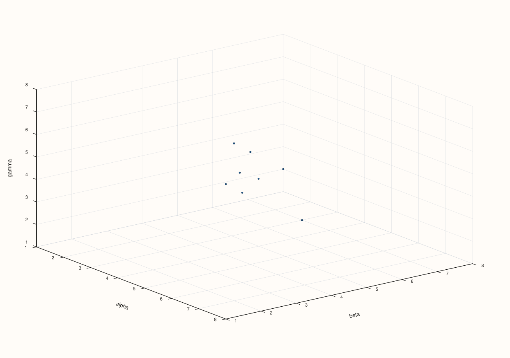

Example 6. Bare matrix overload — no names, auto-generated `"x1"`/`"x2"`/`"x3"` labels.

```cpp
using namespace pluss::pl;

std::vector<double> a{1.0, 2.0, 3.0, 4.0, 5.0, 6.0, 7.0, 8.0};
std::vector<double> b{8.0, 6.0, 7.0, 5.0, 4.0, 3.0, 2.0, 1.0};
std::vector<double> c{2.0, 3.0, 1.0, 4.0, 6.0, 5.0, 8.0, 7.0};
std::vector<double> flat;
for (std::size_t i = 0; i < a.size(); ++i) { flat.push_back(a[i]); flat.push_back(b[i]); flat.push_back(c[i]); }
auto matrix = pluss::make_series(flat, {8, 3});

auto fig = studio("flash_triplot_matrix_bare");
flash::triplot(fig, matrix);
fig.show();
```

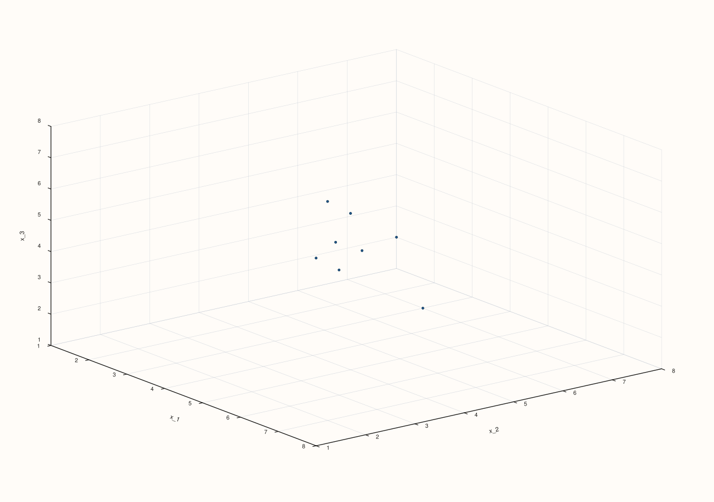

Example 7. `kind = Path` — a connected 3D line through the triplet.

```cpp
using namespace pluss::pl;

auto fig = studio("flash_triplot_path");
std::vector<pluss::Series> cols{
    pluss::make_series(std::vector<double>{1.0, 2.0, 3.0, 4.0, 5.0, 6.0, 7.0, 8.0}, {8}),
    pluss::make_series(std::vector<double>{8.0, 6.0, 7.0, 5.0, 4.0, 3.0, 2.0, 1.0}, {8}),
    pluss::make_series(std::vector<double>{2.0, 3.0, 1.0, 4.0, 6.0, 5.0, 8.0, 7.0}, {8})};
flash::TriplotOptions opts;
opts.kind = flash::TriplotKind::Path;
flash::triplot(fig, pluss::msharp::RangeView::Series(cols), opts);
fig.show();
```

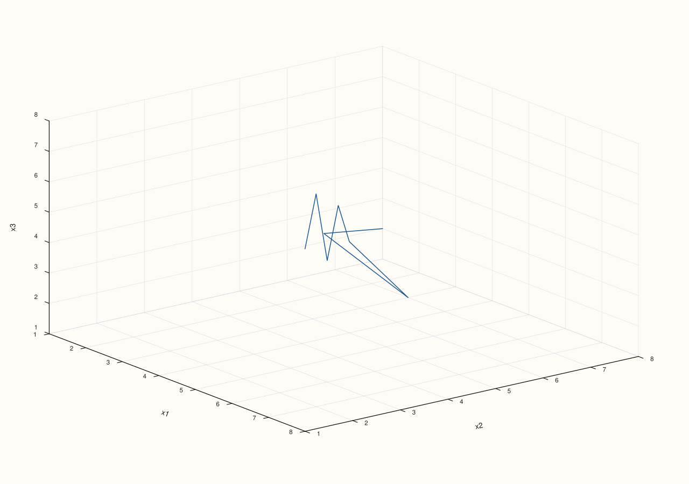

Example 8. `kind = Sheet` — a filled surface over the binned grid (see the important
callout above; directly verified to render, not crash, post-fix).

```cpp
using namespace pluss::pl;

auto fig = studio("flash_triplot_sheet");
std::vector<pluss::Series> cols{
    pluss::make_series(std::vector<double>{1.0, 2.0, 3.0, 4.0, 5.0, 6.0, 7.0, 8.0}, {8}),
    pluss::make_series(std::vector<double>{8.0, 6.0, 7.0, 5.0, 4.0, 3.0, 2.0, 1.0}, {8}),
    pluss::make_series(std::vector<double>{2.0, 3.0, 1.0, 4.0, 6.0, 5.0, 8.0, 7.0}, {8})};
flash::TriplotOptions opts;
opts.kind = flash::TriplotKind::Sheet;
flash::triplot(fig, pluss::msharp::RangeView::Series(cols), opts);
fig.show();
```

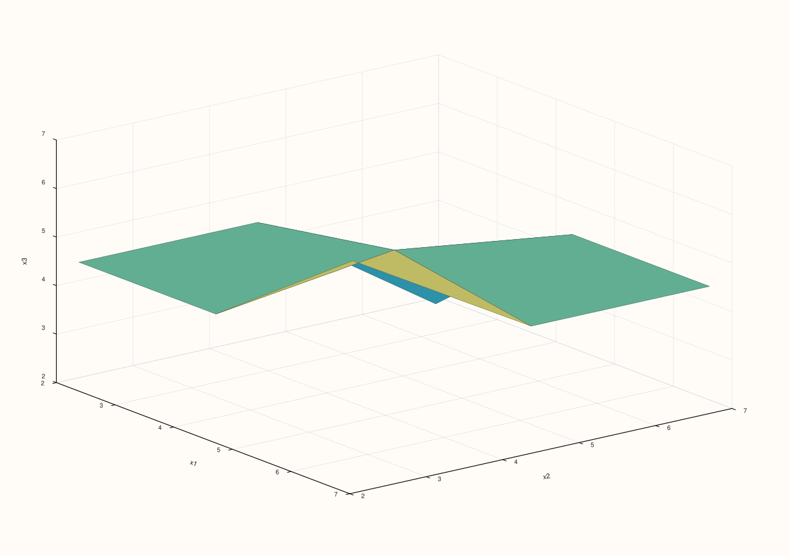

Example 9. `kind = Lattice` — a wireframe surface over the same binned grid.

```cpp
using namespace pluss::pl;

auto fig = studio("flash_triplot_lattice");
std::vector<pluss::Series> cols{
    pluss::make_series(std::vector<double>{1.0, 2.0, 3.0, 4.0, 5.0, 6.0, 7.0, 8.0}, {8}),
    pluss::make_series(std::vector<double>{8.0, 6.0, 7.0, 5.0, 4.0, 3.0, 2.0, 1.0}, {8}),
    pluss::make_series(std::vector<double>{2.0, 3.0, 1.0, 4.0, 6.0, 5.0, 8.0, 7.0}, {8})};
flash::TriplotOptions opts;
opts.kind = flash::TriplotKind::Lattice;
flash::triplot(fig, pluss::msharp::RangeView::Series(cols), opts);
fig.show();
```

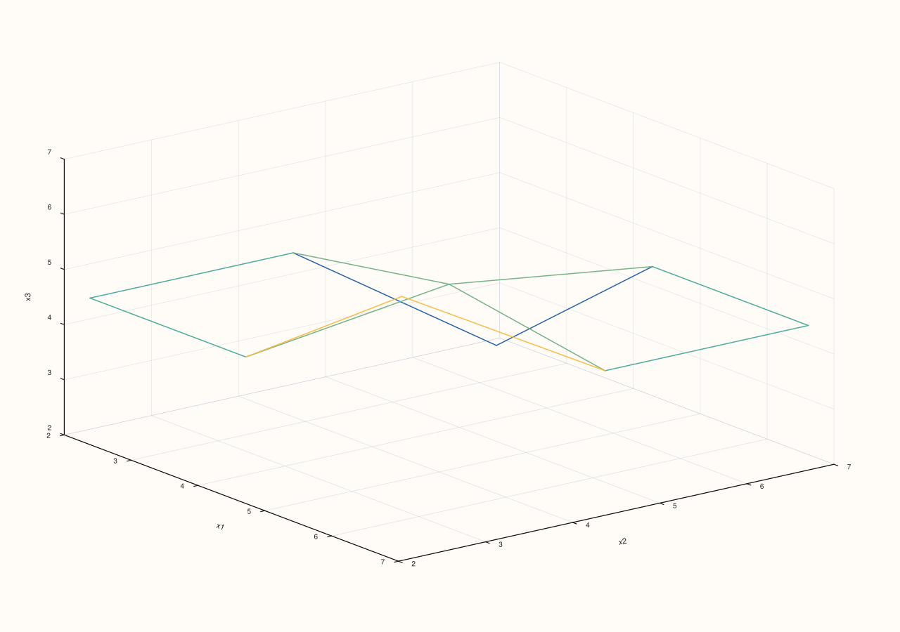

Example 10. `kind = Spire` — one vertical bar per grid cell.

```cpp
using namespace pluss::pl;

auto fig = studio("flash_triplot_spire");
std::vector<pluss::Series> cols{
    pluss::make_series(std::vector<double>{1.0, 2.0, 3.0, 4.0, 5.0, 6.0, 7.0, 8.0}, {8}),
    pluss::make_series(std::vector<double>{8.0, 6.0, 7.0, 5.0, 4.0, 3.0, 2.0, 1.0}, {8}),
    pluss::make_series(std::vector<double>{2.0, 3.0, 1.0, 4.0, 6.0, 5.0, 8.0, 7.0}, {8})};
flash::TriplotOptions opts;
opts.kind = flash::TriplotKind::Spire;
flash::triplot(fig, pluss::msharp::RangeView::Series(cols), opts);
fig.show();
```

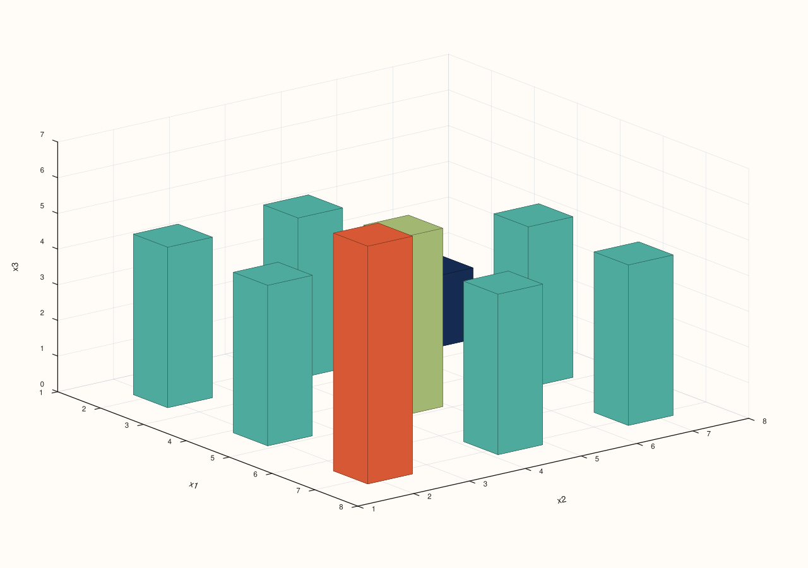

Example 11. `kind = Ridge` with a reduced `ridge_levels`.

```cpp
using namespace pluss::pl;

auto fig = studio("flash_triplot_ridge");
std::vector<pluss::Series> cols{
    pluss::make_series(std::vector<double>{1.0, 2.0, 3.0, 4.0, 5.0, 6.0, 7.0, 8.0}, {8}),
    pluss::make_series(std::vector<double>{8.0, 6.0, 7.0, 5.0, 4.0, 3.0, 2.0, 1.0}, {8}),
    pluss::make_series(std::vector<double>{2.0, 3.0, 1.0, 4.0, 6.0, 5.0, 8.0, 7.0}, {8})};
flash::TriplotOptions opts;
opts.kind = flash::TriplotKind::Ridge;
opts.ridge_levels = 6;
flash::triplot(fig, pluss::msharp::RangeView::Series(cols), opts);
fig.show();
```

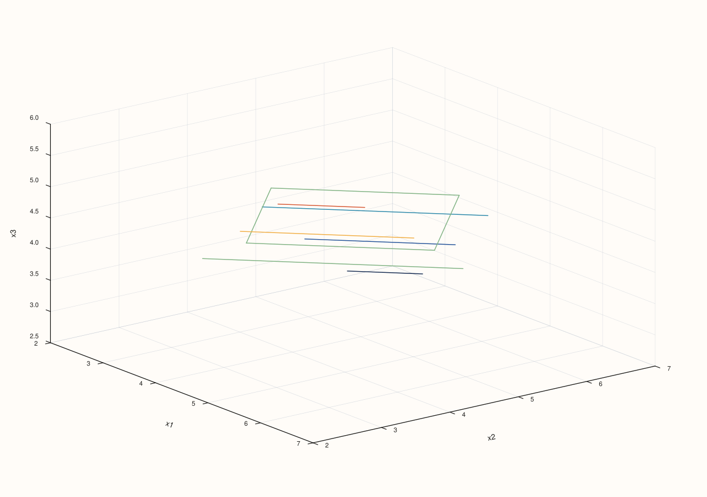

Example 12. Four features — `C(4,3) = 4` triplets, auto-resolved to a grid of 4 panels.

```cpp
using namespace pluss::pl;

auto fig = studio("flash_triplot_four_features");
std::vector<pluss::Series> cols{
    pluss::make_series(std::vector<double>{1.0, 2.0, 3.0, 4.0, 5.0, 6.0, 7.0, 8.0}, {8}),
    pluss::make_series(std::vector<double>{8.0, 6.0, 7.0, 5.0, 4.0, 3.0, 2.0, 1.0}, {8}),
    pluss::make_series(std::vector<double>{2.0, 3.0, 1.0, 4.0, 6.0, 5.0, 8.0, 7.0}, {8}),
    pluss::make_series(std::vector<double>{5.0, 4.0, 6.0, 3.0, 7.0, 2.0, 8.0, 1.0}, {8})};
flash::TriplotOptions opts;
opts.labels = {"alpha", "beta", "gamma", "delta"};
flash::triplot(fig, pluss::msharp::RangeView::Series(cols), opts);
std::cout << "4 features -> C(4,3)=4 triplet panels, pane count: " << fig.pane_count() << "\n";
fig.show();
```

Output:

```text
4 features -> C(4,3)=4 triplet panels, pane count: 4
```

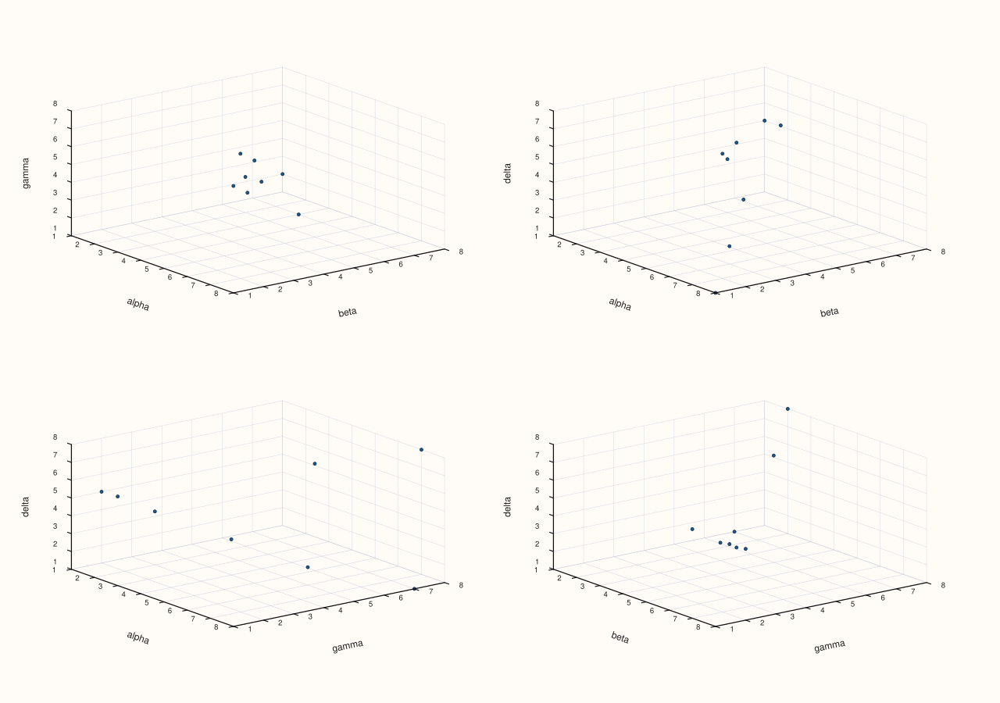

Example 13. `max_panels = 2` on the same 4 features — only the first 2 of the 4 possible
triplets (in lexicographic order) get a panel.

```cpp
using namespace pluss::pl;

auto fig = studio("flash_triplot_max_panels");
std::vector<pluss::Series> cols{
    pluss::make_series(std::vector<double>{1.0, 2.0, 3.0, 4.0, 5.0, 6.0, 7.0, 8.0}, {8}),
    pluss::make_series(std::vector<double>{8.0, 6.0, 7.0, 5.0, 4.0, 3.0, 2.0, 1.0}, {8}),
    pluss::make_series(std::vector<double>{2.0, 3.0, 1.0, 4.0, 6.0, 5.0, 8.0, 7.0}, {8}),
    pluss::make_series(std::vector<double>{5.0, 4.0, 6.0, 3.0, 7.0, 2.0, 8.0, 1.0}, {8})};
flash::TriplotOptions opts;
opts.max_panels = 2;
flash::triplot(fig, pluss::msharp::RangeView::Series(cols), opts);
std::cout << "4 features, max_panels=2 -> pane count: " << fig.pane_count() << "\n";
fig.show();
```

Output:

```text
4 features, max_panels=2 -> pane count: 2
```

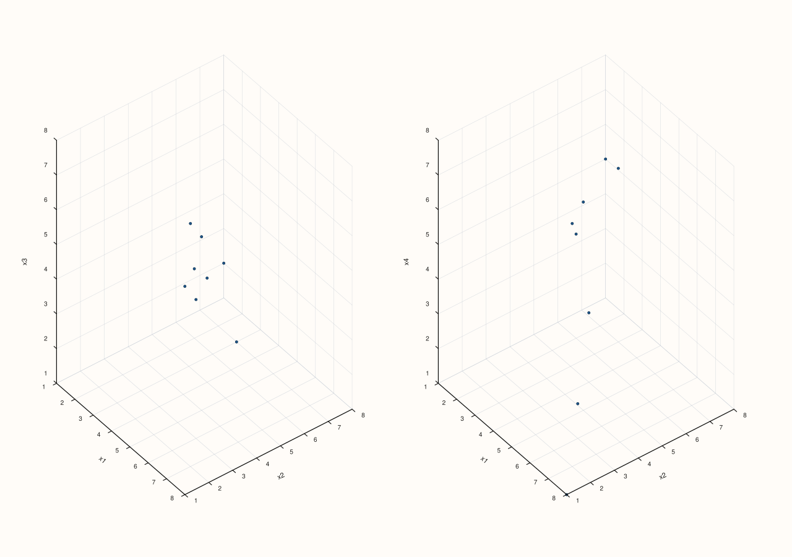

Example 14. `feature_indices` — restrict the search to features `0`, `1`, `3` (skipping
feature `2`), producing exactly one triplet from those three.

```cpp
using namespace pluss::pl;

auto fig = studio("flash_triplot_feature_indices");
std::vector<pluss::Series> cols{
    pluss::make_series(std::vector<double>{1.0, 2.0, 3.0, 4.0, 5.0, 6.0, 7.0, 8.0}, {8}),
    pluss::make_series(std::vector<double>{8.0, 6.0, 7.0, 5.0, 4.0, 3.0, 2.0, 1.0}, {8}),
    pluss::make_series(std::vector<double>{2.0, 3.0, 1.0, 4.0, 6.0, 5.0, 8.0, 7.0}, {8}),
    pluss::make_series(std::vector<double>{5.0, 4.0, 6.0, 3.0, 7.0, 2.0, 8.0, 1.0}, {8})};
flash::TriplotOptions opts;
opts.labels = {"alpha", "beta", "gamma", "delta"};
opts.feature_indices = {0, 1, 3};
flash::triplot(fig, pluss::msharp::RangeView::Series(cols), opts);
fig.show();
```

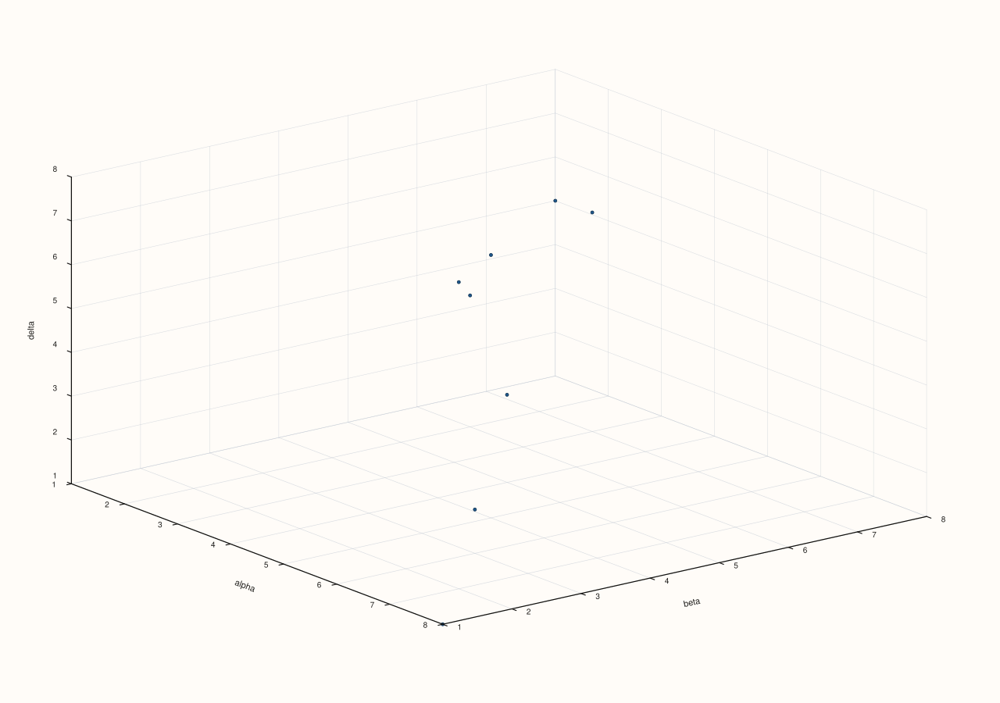

Example 15. `feature_names` — the name-based equivalent of Example 14, selecting `alpha`,
`gamma`, `delta`.

```cpp
using namespace pluss::pl;

auto fig = studio("flash_triplot_feature_names");
std::vector<pluss::Series> cols{
    pluss::make_series(std::vector<double>{1.0, 2.0, 3.0, 4.0, 5.0, 6.0, 7.0, 8.0}, {8}),
    pluss::make_series(std::vector<double>{8.0, 6.0, 7.0, 5.0, 4.0, 3.0, 2.0, 1.0}, {8}),
    pluss::make_series(std::vector<double>{2.0, 3.0, 1.0, 4.0, 6.0, 5.0, 8.0, 7.0}, {8}),
    pluss::make_series(std::vector<double>{5.0, 4.0, 6.0, 3.0, 7.0, 2.0, 8.0, 1.0}, {8})};
flash::TriplotOptions opts;
opts.labels = {"alpha", "beta", "gamma", "delta"};
opts.feature_names = {"alpha", "gamma", "delta"};
flash::triplot(fig, pluss::msharp::RangeView::Series(cols), opts);
fig.show();
```

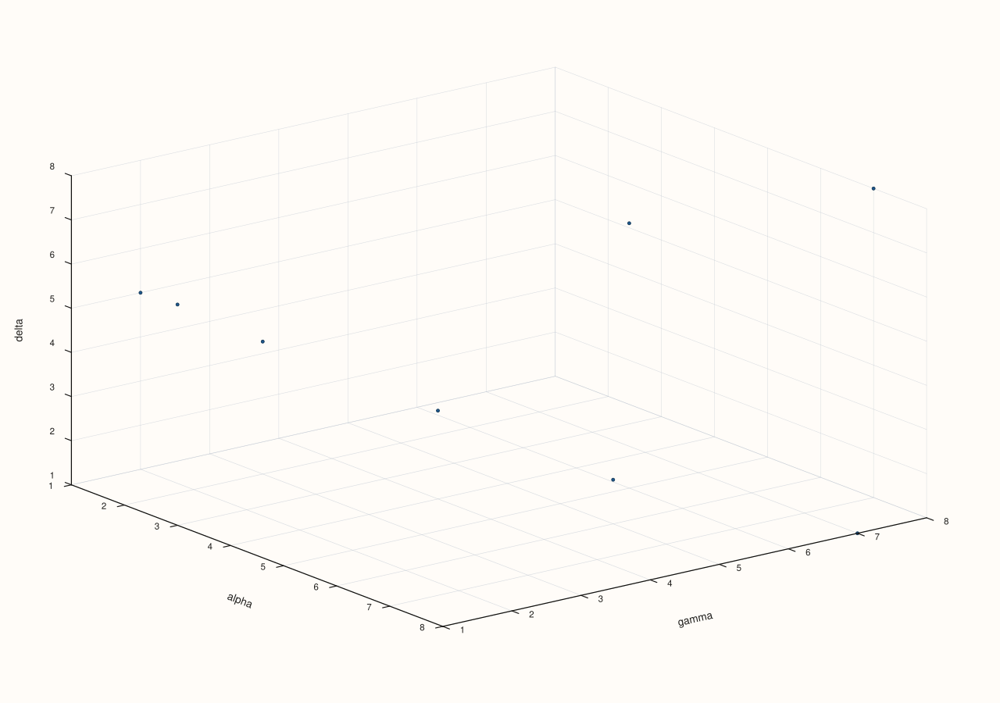

Example 16. Explicit `rows`/`cols` — a `1×4` strip instead of the auto-resolved shape.

```cpp
using namespace pluss::pl;

auto fig = studio("flash_triplot_rows_cols");
std::vector<pluss::Series> cols{
    pluss::make_series(std::vector<double>{1.0, 2.0, 3.0, 4.0, 5.0, 6.0, 7.0, 8.0}, {8}),
    pluss::make_series(std::vector<double>{8.0, 6.0, 7.0, 5.0, 4.0, 3.0, 2.0, 1.0}, {8}),
    pluss::make_series(std::vector<double>{2.0, 3.0, 1.0, 4.0, 6.0, 5.0, 8.0, 7.0}, {8}),
    pluss::make_series(std::vector<double>{5.0, 4.0, 6.0, 3.0, 7.0, 2.0, 8.0, 1.0}, {8})};
flash::TriplotOptions opts;
opts.rows = 1;
opts.cols = 4;
flash::triplot(fig, pluss::msharp::RangeView::Series(cols), opts);
fig.show();
```

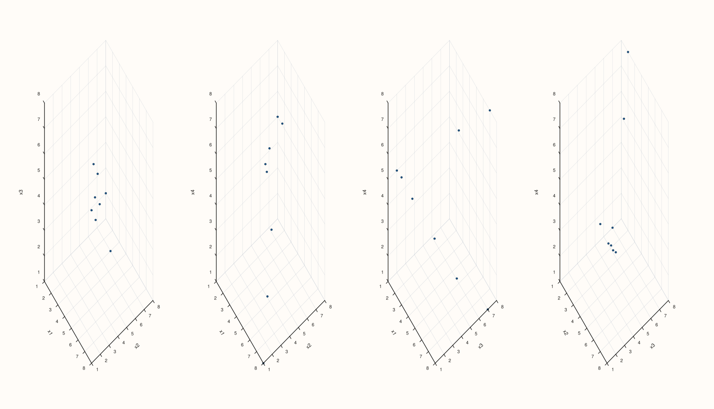

Example 17 (edge case). Fewer than three features throws.

```cpp
using namespace pluss::pl;

auto fig = studio("flash_triplot_too_few");
std::vector<pluss::Series> cols{
    pluss::make_series(std::vector<double>{1.0, 2.0, 3.0, 4.0, 5.0, 6.0, 7.0, 8.0}, {8}),
    pluss::make_series(std::vector<double>{8.0, 6.0, 7.0, 5.0, 4.0, 3.0, 2.0, 1.0}, {8})};
try {
  flash::triplot(fig, pluss::msharp::RangeView::Series(cols));
} catch (const pluss::Error& e) {
  std::string msg(e.what());
  std::cout << "triplot(2 features) threw: " << msg.substr(0, msg.find('\n')) << "\n";
}
```

Output:

```text
triplot(2 features) threw: flash::triplot requires at least three numeric features
```

Example 18 (edge case). An unrecognized `feature_names` entry throws.

```cpp
using namespace pluss::pl;

auto fig = studio("flash_triplot_bad_name");
std::vector<pluss::Series> cols{
    pluss::make_series(std::vector<double>{1.0, 2.0, 3.0, 4.0, 5.0, 6.0, 7.0, 8.0}, {8}),
    pluss::make_series(std::vector<double>{8.0, 6.0, 7.0, 5.0, 4.0, 3.0, 2.0, 1.0}, {8}),
    pluss::make_series(std::vector<double>{2.0, 3.0, 1.0, 4.0, 6.0, 5.0, 8.0, 7.0}, {8})};
flash::TriplotOptions opts;
opts.labels = {"alpha", "beta", "gamma"};
opts.feature_names = {"alpha", "nonexistent"};
try {
  flash::triplot(fig, pluss::msharp::RangeView::Series(cols), opts);
} catch (const pluss::Error& e) {
  std::string msg(e.what());
  std::cout << "triplot(unknown feature name) threw: " << msg.substr(0, msg.find('\n')) << "\n";
}
```

Output:

```text
triplot(unknown feature name) threw: flash::triplot unknown feature name: nonexistent
```

## Notes

- Not `noexcept`.
- Unlike [`flash::pairplot`](pairplot.md), which throws `std::invalid_argument` directly,
  `triplot`'s feature-count/index/name validation goes through the internal
  `PLUSS_CHECK` macro, which throws `pluss::Error` (a `std::runtime_error` subclass) with
  the check message as the first line of `e.what()`, followed by a stack trace — catch
  `pluss::Error` (or `std::exception`) for these, not `std::invalid_argument`; the
  examples above extract just the first line for a stable, reproducible message.
- Every panel is a [`Studio::pane3`](../studio/pane3.md) (`Volumetric`) pane, regardless
  of `kind` — including `Cloud`/`Path`, which draw unstructured points/lines rather than
  a surface.
- `feature_indices` takes priority over `feature_names` when both are set; with neither
  set, every available feature participates (subject to `max_features`).
- Grid-shape resolution (`rows`/`cols` auto-sizing, the `rows*cols < triplet_count` error)
  is shared with [`flash::relgridplot`](relgridplot.md)'s family — see that page for
  directly-verified examples of the underlying mechanics.

## See Also

- [`flash::pairplot`](pairplot.md): the exhaustive pairwise sibling, and the
  `Dataset`/`make_dataset` helpers this page's Dataset overload also uses.
- [`Pane::cloud3`](../pane/cloud3.md), [`Pane::path3`](../pane/path3.md),
  [`Pane::sheet`](../pane/sheet.md), [`Pane::lattice`](../pane/lattice.md),
  [`Pane::spire3`](../pane/spire3.md), [`Pane::ridge3`](../pane/ridge3.md): the six native
  per-panel drawing methods dispatched by `kind`.
- [`flash::FacetGrid`](FacetGrid.md), [`flash::relgridplot`](relgridplot.md): the
  grid-shape-resolution mechanics shared by this function.

<div class="pluss-inline-prev-next">
  <a class="prev-link" href="pairplot.html">
    <span class="label">Previous</span>
    <span class="title">pairplot</span>
  </a>
  <a class="next-link" href="parallelplot.html">
    <span class="label">Next</span>
    <span class="title">parallelplot</span>
  </a>
</div>
