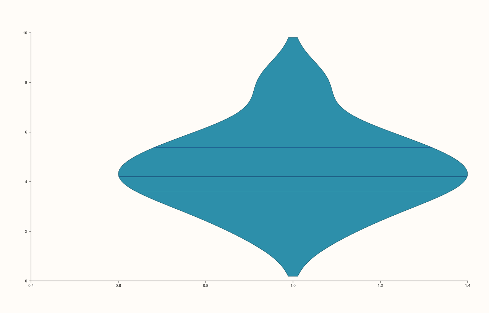
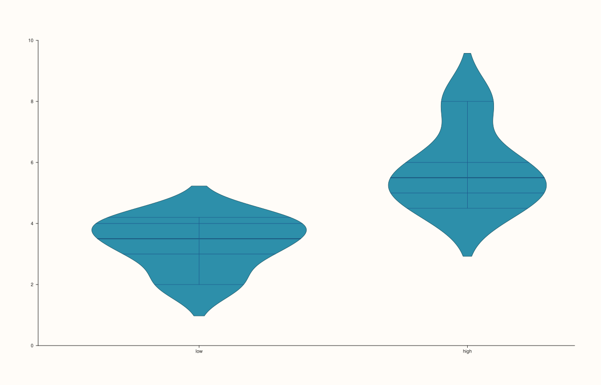
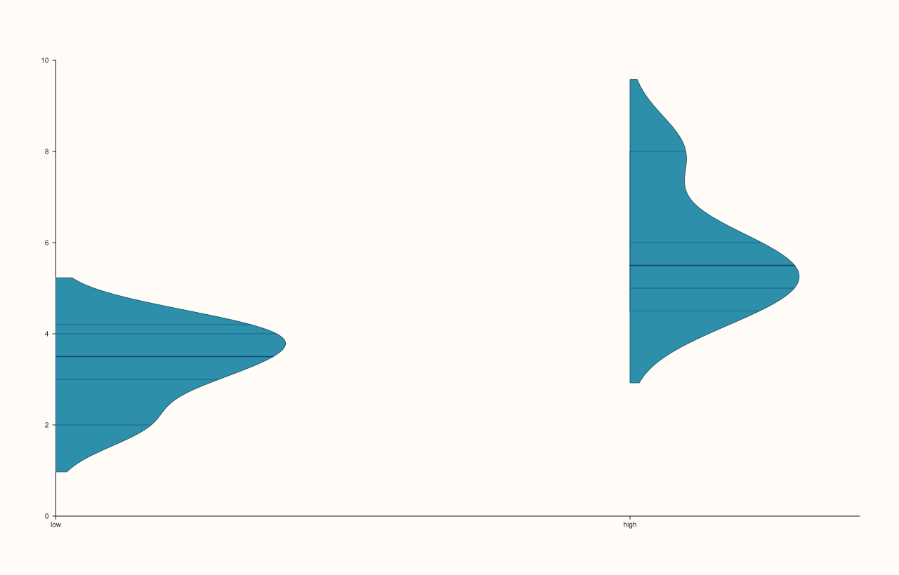
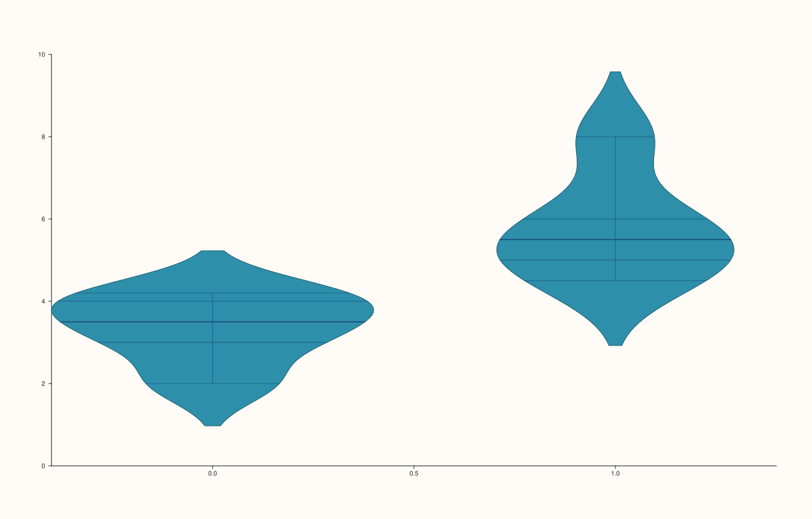
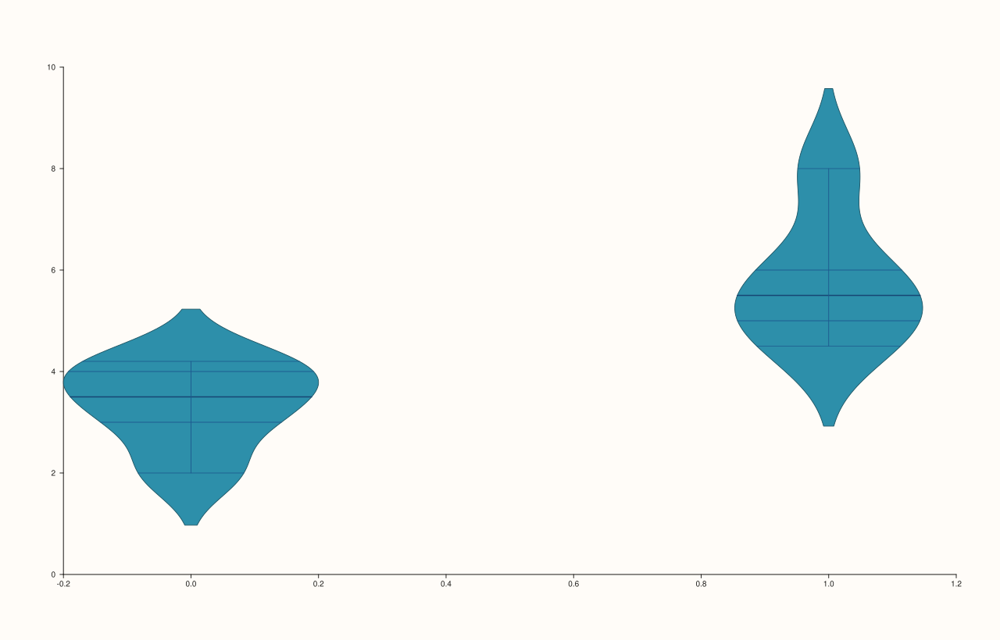

<!-- pluss-hand-authored -->

# flash::violinplot

[Back to flash API Reference](../../flash_api_reference)

## Signatures

```cpp
template <class Values>
Trace& flash::violinplot(Pane& pane, Values&& values)

template <class Values>
Trace& flash::violinplot(Pane& pane, Values&& values, const ViolinOptions& options)

Trace& flash::violinplot(Pane& pane, const Note& categories, const Series& values)

Trace& flash::violinplot(Pane& pane, const Note& categories, const Series& values,
                          const ViolinOptions& options)

template <class Group, class Values>
Trace& flash::violinplot(Pane& pane, Group&& group, Values&& values)

template <class Group, class Values>
Trace& flash::violinplot(Pane& pane, Group&& group, Values&& values,
                          const ViolinOptions& options)
```

## What It Does

Draws a KDE-based distribution shape (a mirrored density curve, optionally with an inner
quartile/box/stick/point summary) via [`Pane::violin`](../pane/violin.md). Six overloads,
mirroring [`flash::boxplot`](boxplot.md)'s three grouping shapes (ungrouped, `Note`,
numeric-group), each available both with and without a trailing `const ViolinOptions&`:

- **`violinplot(pane, values[, options])`** — a single ungrouped violin, summarizing the
  entire `values` series as one distribution.
- **`violinplot(pane, categories, values[, options])`** where `categories` is a
  [`Note`](../pane/x_categories.md) — one violin per distinct category label, **with real
  text tick labels set on the x-axis**.
- **`violinplot(pane, group, values[, options])`** where `group` is any other
  series-convertible value — one violin per distinct numeric `group` value, but **no
  category-label setup** — the same `Note`-vs-numeric-group split as `boxplot()` and
  `stripplot()`.

`ViolinOptions` (default-constructible; every field has a default):

**width** (`double`, default `0.8`)
    The violin's maximum half-width, in x-axis units, at its widest point.

**bw_adjust** (`double`, default `1.0`)
    A multiplier on the KDE bandwidth — larger values produce a smoother/wider density
    estimate, smaller values track the raw data more tightly.

**cut** (`double`, default `2.0`)
    How far past the data's min/max the density curve's evaluation grid extends, in
    bandwidth units.

**scale** (`ViolinScale`, default `ViolinScale::Area`)
    How multiple violins are scaled relative to one another — `Area` (equal area under
    each curve), `Count` (area proportional to each group's observation count), or `Width`
    (equal peak width for every group regardless of density or count).

**inner** (`ViolinInner`, default `ViolinInner::Box`)
    The inner summary overlay drawn inside the violin body — `None`, `Box` (a thin
    box-and-whisker), `Quartile` (three reference lines at Q1/median/Q3), `Stick` (one line
    per raw observation), or `Point` (one dot per raw observation).

**side** (`ViolinSide`, default `ViolinSide::Full`)
    Which half of the mirrored density curve to draw — `Full` (both halves, the classic
    symmetric violin shape), `Left`, or `Right` (a single half only — useful for
    side-by-side split-violin comparisons between two groups sharing an x position).

```{important} Fixed: violinplot(values, options) previously failed to compile
Earlier, the two-argument-after-pane form violinplot(pane, values, options) was
unreachable: overload resolution incorrectly preferred the unconstrained
template<Group, Values> violinplot(Pane&, Group&&, Values&&) overload, because
nothing excluded ViolinOptions from binding to that overload's Values slot
(only Note was excluded from its Group slot). Passing a ViolinOptions as the
third positional argument to that overload, then trying to use it as a
values series, failed to compile. This has been fixed at the source in
flash.h by adding an explicit
!std::same_as<std::remove_cvref_t<Values>, ViolinOptions> exclusion to that
overload's requires clause -- verified via a regression check exercising all
six overload shapes, including this exact previously-broken call.
```

```{important} Same Note-vs-numeric-group category-labeling split as boxplot()/stripplot()
Only the Note overloads call Pane::x_categories() to set real text tick
labels. The numeric-group overloads skip that step entirely -- see
flash::boxplot's page for a directly-verified genuine-rendering-difference
example of the same split.
```

## Parameters

**pane** (`Pane&`)
    The target pane. Must be `Planar` (2D) — this wraps `Pane::violin`, which requires it.

**values** (series-convertible, or `const Series&` for the `Note` overloads)
    The observation values to summarize.

**categories** (`const Note&`, third/fourth overloads only)
    The categorical grouping variable. Distinct labels become x-axis category tick text,
    in first-seen order.

**group** (series-convertible, fifth/sixth overloads only)
    A numeric grouping variable, paired with `values` by index. No category-label setup is
    performed.

**options** (`const ViolinOptions&`, optional on every grouping shape)
    Styling and statistical controls — see the field table above. Omitting it uses every
    default (`width=0.8`, `bw_adjust=1.0`, `cut=2.0`, `scale=Area`, `inner=Box`,
    `side=Full`).

## Returns

`Trace&`
    A reference to the newly created (violin) trace.

## Examples

Example 1. Ungrouped, default options.

```cpp
using namespace pluss::pl;

auto fig = studio("flash_violinplot_values");
auto& pane = fig.pane2();
std::vector<double> values{2.0, 3.0, 3.5, 4.0, 4.2, 4.5, 5.0, 5.5, 6.0, 8.0};
flash::violinplot(pane, values);
fig.show();
```


Example 2. Ungrouped, with `ViolinOptions` — `inner = ViolinInner::Quartile`. This is the
previously-broken call shape (see the important callout above); it now compiles and runs
correctly.

```cpp
using namespace pluss::pl;

auto fig = studio("flash_violinplot_values_options");
auto& pane = fig.pane2();
std::vector<double> values{2.0, 3.0, 3.5, 4.0, 4.2, 4.5, 5.0, 5.5, 6.0, 8.0};
ViolinOptions opts;
opts.inner = ViolinInner::Quartile;
flash::violinplot(pane, values, opts);
fig.show();
```



Example 3. Grouped by a [`Note`](../pane/x_categories.md), default options — real text
category labels on the x-axis, one violin per label.

```cpp
using namespace pluss::pl;

auto fig = studio("flash_violinplot_note");
auto& pane = fig.pane2();
auto grp = pluss::note::make({"low", "low", "low", "low", "low", "high", "high", "high", "high", "high"});
std::vector<double> values{2.0, 3.0, 3.5, 4.0, 4.2, 4.5, 5.0, 5.5, 6.0, 8.0};
flash::violinplot(pane, grp, pluss::make_series(values, {10}));
fig.show();
```



Example 4. Grouped by a `Note`, with `ViolinOptions` — `side = ViolinSide::Right`, drawing
only the right half of each mirrored density curve.

```cpp
using namespace pluss::pl;

auto fig = studio("flash_violinplot_note_options");
auto& pane = fig.pane2();
auto grp = pluss::note::make({"low", "low", "low", "low", "low", "high", "high", "high", "high", "high"});
std::vector<double> values{2.0, 3.0, 3.5, 4.0, 4.2, 4.5, 5.0, 5.5, 6.0, 8.0};
ViolinOptions opts;
opts.side = ViolinSide::Right;
flash::violinplot(pane, grp, pluss::make_series(values, {10}), opts);
fig.show();
```



Example 5. Grouped by a numeric variable, default options — no category-label setup.

```cpp
using namespace pluss::pl;

auto fig = studio("flash_violinplot_group");
auto& pane = fig.pane2();
std::vector<double> group{0.0, 0.0, 0.0, 0.0, 0.0, 1.0, 1.0, 1.0, 1.0, 1.0};
std::vector<double> values{2.0, 3.0, 3.5, 4.0, 4.2, 4.5, 5.0, 5.5, 6.0, 8.0};
flash::violinplot(pane, group, values);
fig.show();
```



Example 6. Grouped by a numeric variable, with `ViolinOptions` — `width = 0.4`, narrower
violins.

```cpp
using namespace pluss::pl;

auto fig = studio("flash_violinplot_group_options");
auto& pane = fig.pane2();
std::vector<double> group{0.0, 0.0, 0.0, 0.0, 0.0, 1.0, 1.0, 1.0, 1.0, 1.0};
std::vector<double> values{2.0, 3.0, 3.5, 4.0, 4.2, 4.5, 5.0, 5.5, 6.0, 8.0};
ViolinOptions opts;
opts.width = 0.4;
flash::violinplot(pane, group, values, opts);
fig.show();
```



## Notes

- Not `noexcept`.
- [`flash::boxplot`](boxplot.md) shares this exact three-grouping-shape structure (values-only,
  `Note`, numeric-group) but summarizes with quartiles/whiskers instead of a KDE density
  curve, and has no options-struct overloads.
- `ViolinSide::Left`/`ViolinSide::Right` are most useful in combination with a second
  `violinplot()` call at the same category position using the opposite side, to build a
  split-violin comparison — `flash::violinplot()` itself does not automate pairing two
  groups onto opposite sides; you draw each half yourself.

## See Also

- [`Pane::violin`](../pane/violin.md): the underlying method all six overloads call.
- [`Pane::x_categories`](../pane/x_categories.md): what the `Note` overloads call
  internally to label the x-axis.
- [`flash::boxplot`](boxplot.md), [`flash::stripplot`](stripplot.md): other categorical
  functions sharing the same `Note`-vs-numeric-group overload split.
- [`flash::boxenplot`](boxenplot.md): a pure alias of `boxplot()`'s ungrouped overload —
  unrelated to `violinplot()` but often reached for interchangeably.

<div class="pluss-inline-prev-next">
  <a class="prev-link" href="boxplot.html">
    <span class="label">Previous</span>
    <span class="title">boxplot</span>
  </a>
  <a class="next-link" href="boxenplot.html">
    <span class="label">Next</span>
    <span class="title">boxenplot</span>
  </a>
</div>
