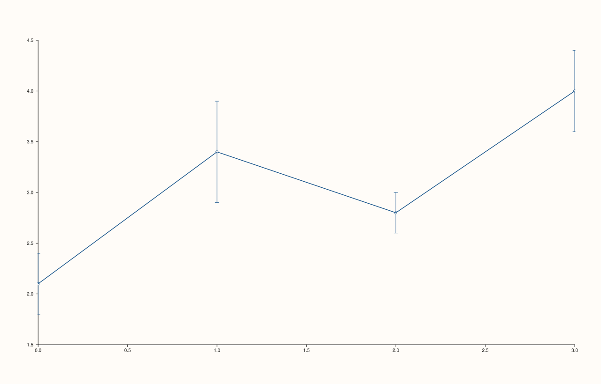
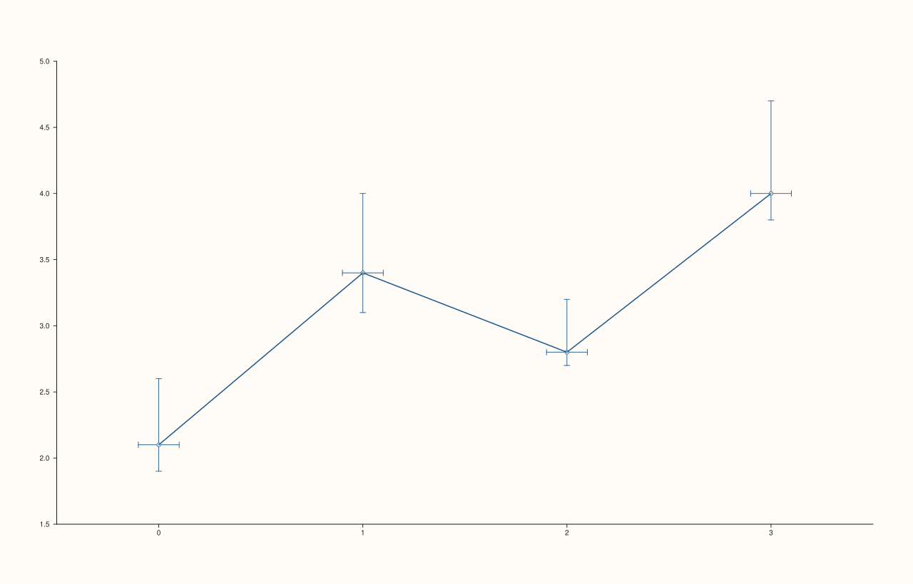

<!-- pluss-hand-authored -->

# flash::whiskplot

[Back to flash API Reference](../../flash_api_reference)

## Signatures

```cpp
template <class X, class Y, class Err>
Trace& flash::whiskplot(Pane& pane, X&& x, Y&& y, Err&& err)

template <class X, class Y, class YNeg, class YPos, class XNeg, class XPos>
Trace& flash::whiskplot(Pane& pane, X&& x, Y&& y, YNeg&& yneg, YPos&& ypos,
                         XNeg&& xneg, XPos&& xpos)
```

## What It Does

Draws error/whisker bars via [`Pane::whisk`](../pane/whisk.md) — no connecting line (unlike
[`flash::pointplot`](pointplot.md), which draws both). Two overloads:

- **`whiskplot(pane, x, y, err)`** — one symmetric vertical error magnitude per point,
  applied identically above and below (`y ± err`).
- **`whiskplot(pane, x, y, yneg, ypos, xneg, xpos)`** — full independent error bars in all
  four directions: `yneg`/`ypos` for the lower/upper vertical extents, `xneg`/`xpos` for
  the left/right horizontal extents.

```{important} Only 2 of Pane::whisk's 4 overload shapes are reachable through whiskplot()
Pane::whisk itself has four overloads: whisk(y, err) (auto x-index, symmetric
y-only), whisk(x, y, err) (explicit x, symmetric y-only), whisk(x, y, neg,
pos) (explicit x, ASYMMETRIC y-only -- independent upper/lower magnitudes),
and whisk(x, y, yneg, ypos, xneg, xpos) (full asymmetric x AND y).
flash::whiskplot only wraps the second and fourth of these -- there is no
whiskplot() shape for "auto x-index" or for "asymmetric y-only, symmetric/absent
x error". If you need either of those two shapes, call Pane::whisk directly
instead of going through flash::whiskplot.
```

## Parameters

**pane** (`Pane&`)
    The target pane. Must be `Planar` (2D).

**x** (series-convertible)
    The x-axis positions.

**y** (series-convertible)
    The y-axis values.

**err** (series-convertible, first overload only)
    The symmetric error magnitude — applied identically above and below each point.

**yneg**, **ypos** (series-convertible, second overload only)
    The independent lower/upper vertical error extents.

**xneg**, **xpos** (series-convertible, second overload only)
    The independent left/right horizontal error extents.

## Returns

`Trace&`
    A reference to the newly created (whisk) trace.

## Examples

Example 1. Symmetric vertical error bars — the common case.

```cpp
using namespace pluss::pl;

auto fig = studio("flash_whiskplot_symmetric");
auto& pane = fig.pane2();
std::vector<double> x{0.0, 1.0, 2.0, 3.0};
std::vector<double> y{2.1, 3.4, 2.8, 4.0};
std::vector<double> err{0.3, 0.5, 0.2, 0.4};
flash::whiskplot(pane, x, y, err);
fig.show();
```



Example 2. Full asymmetric error bars in all four directions — independently sized upper,
lower, left, and right extents at every point.

```cpp
using namespace pluss::pl;

auto fig = studio("flash_whiskplot_asymmetric");
auto& pane = fig.pane2();
std::vector<double> x{0.0, 1.0, 2.0, 3.0};
std::vector<double> y{2.1, 3.4, 2.8, 4.0};
std::vector<double> yneg{0.2, 0.3, 0.1, 0.2};
std::vector<double> ypos{0.5, 0.6, 0.4, 0.7};
std::vector<double> xneg{0.1, 0.1, 0.1, 0.1};
std::vector<double> xpos{0.1, 0.1, 0.1, 0.1};
flash::whiskplot(pane, x, y, yneg, ypos, xneg, xpos);
fig.show();
```



## Notes

- Not `noexcept`.
- The second overload's parameter order is `(x, y, yneg, ypos, xneg, xpos)` — vertical
  extents come before horizontal extents, matching `Pane::whisk`'s own parameter order
  exactly (no reordering across the wrapper).
- See the important callout above for the two `Pane::whisk` shapes `whiskplot()` does not
  expose.

## See Also

- [`Pane::whisk`](../pane/whisk.md): the underlying method, with two additional overload
  shapes not reachable through `whiskplot()`.
- [`flash::pointplot`](pointplot.md): the symmetric-error shape plus an automatic
  connecting line.

<div class="pluss-inline-prev-next">
  <a class="prev-link" href="pointplot.html">
    <span class="label">Previous</span>
    <span class="title">pointplot</span>
  </a>
  <a class="next-link" href="barplot.html">
    <span class="label">Next</span>
    <span class="title">barplot</span>
  </a>
</div>
