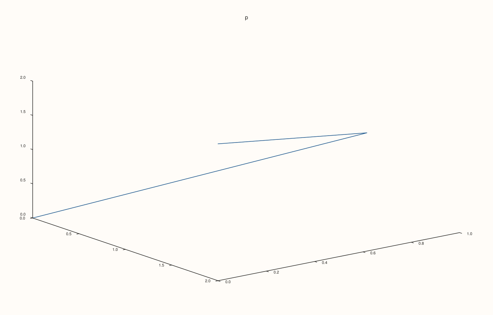
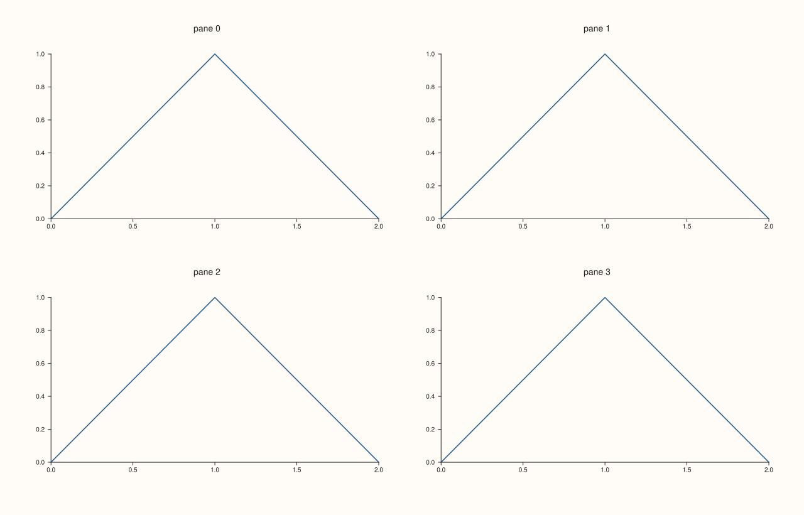
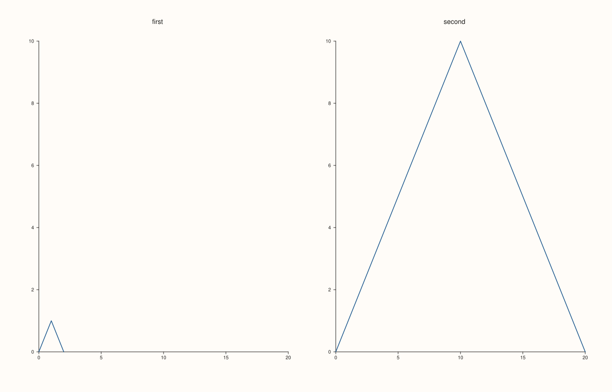

<!-- pluss-hand-authored -->

# Pane::x_align_group, y_align_group, z_align_group

[Back to Pane API Reference](../../pane_api_reference)

## Signature

```cpp
const std::string& Pane::x_align_group() const noexcept
const std::string& Pane::y_align_group() const noexcept
const std::string& Pane::z_align_group() const noexcept
```

## What It Does

Read the alignment group of one axis of the pane: the name set by [`align_x`](align_x.md), [`align_y`](align_y.md), [`align_z`](align_z.md), [`align_xy`](align_xy.md) or [`align_xyz`](align_xyz.md). The string is empty when the axis is in no group, which is the state of a new pane and the state after a `clear_*_align` call.

Call them to check which panes share a range (a mistyped group name shows up here as a group of one), to find the panes of a group in code that builds figures from a list, and to copy one pane's grouping onto another. They report the name only; the shared range is worked out when the figure is drawn.

## Parameters

*(none)*

## Returns

`const std::string&`
    The group name of that axis, empty for none. The reference is to the pane's own string and follows later calls; copy it to keep the value.

## Examples

Example 1. A new pane is in no group on any axis.

```cpp
auto fig = studio("accessors_new");
auto& pane = fig.pane2("p");
pane.trend(std::vector<double>{0, 1, 2}, std::vector<double>{0, 1, 0});
std::cout << "x '" << pane.x_align_group() << "', y '" << pane.y_align_group() << "', z '" << pane.z_align_group() << "'\n";
fig.save_svg("figure.svg");
```

### Output

```text
x '', y '', z ''
```


Example 2. Each axis has its own name. The three setters put the axes in three groups, and each accessor returns its own axis's name.

```cpp
auto fig = studio("accessors_axes");
auto& pane = fig.pane3("p");
pane.path3(std::vector<double>{0, 1, 2}, std::vector<double>{0, 1, 0}, std::vector<double>{0, 1, 2});
pane.align_x("columns").align_y("rows").align_z("depth");
std::cout << pane.x_align_group() << " " << pane.y_align_group() << " " << pane.z_align_group() << "\n";
fig.save_svg("figure.svg");
```

### Output

```text
columns rows depth
```



Example 3. Finding the members of a group. Panes are listed by `Studio::panes()`, so the panes of a group are found by comparing names; this is also the quickest check that two panes really share one.

```cpp
auto fig = studio("accessors_members");
fig.mosaic(2, 2);
const char* groups[] = {"a", "b", "a", ""};
for (int i = 0; i < 4; ++i) {
  auto& pane = fig.pane2("pane " + std::to_string(i));
  pane.trend(std::vector<double>{0, 1, 2}, std::vector<double>{0, 1, 0});
  pane.align_x(groups[i]);
}
for (const auto& pane : fig.panes()) {
  std::cout << pane.title_text() << ": '" << pane.x_align_group() << "'\n";
}
fig.save_svg("figure.svg");
```

### Output

```text
pane 0: 'a'
pane 1: 'b'
pane 2: 'a'
pane 3: ''
```



Example 4. Copying a grouping. The names read from one pane are given to another, which then shares the range. The accessors return references, so the values are copied into strings first.

```cpp
auto fig = studio("accessors_copy");
fig.mosaic(1, 2);
auto& first = fig.pane2("first");
first.trend(std::vector<double>{0, 1, 2}, std::vector<double>{0, 1, 0});
first.align_xy("shared");
auto& second = fig.pane2("second");
second.trend(std::vector<double>{0, 10, 20}, std::vector<double>{0, 10, 0});
second.align_x(std::string(first.x_align_group())).align_y(std::string(first.y_align_group()));
std::cout << "second: '" << second.x_align_group() << "' '" << second.y_align_group() << "'\n";
fig.save_svg("figure.svg");
```

### Output

```text
second: 'shared' 'shared'
```



## Notes

- All three are `noexcept` and do not change the pane.
- An unset group is the empty string, never an error.

## See Also

- [`Pane::align_x`](align_x.md), [`align_y`](align_y.md), [`align_z`](align_z.md): set a group.
- [`Pane::clear_align`](clear_align.md): leave all groups.

<div class="pluss-inline-prev-next">
  <a class="next-link" href="align_x.html">
    <span class="label">Next</span>
    <span class="title">align_x</span>
  </a>
</div>
