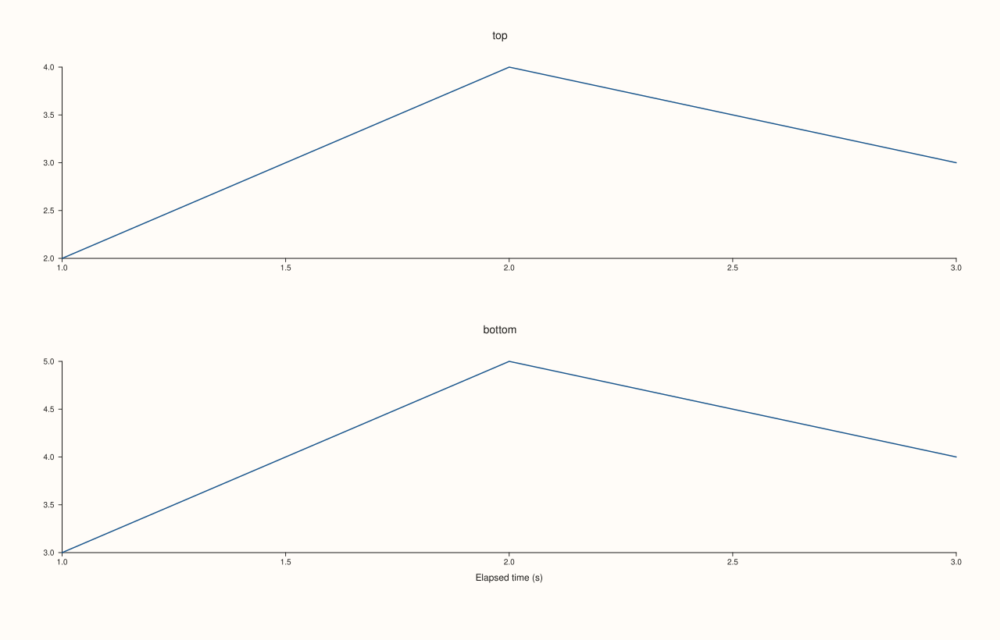

<!-- pluss-hand-authored -->

# Pane::align_x

[Back to Pane API Reference](../../pane_api_reference)

## Signatures

```cpp
Pane& Pane::align_x(std::string group)          // opts into an alignment group
Pane& Pane::clear_x_align() noexcept             // opts back out (empty group)
```

## What It Does

Opts this pane's x-axis into a named **alignment group** — a plain string with no
validation, no format requirement, and no registry to check against. Its sole practical
purpose throughout this API is being matched against
[`Studio::x_caption(group, text)`](../studio/x_caption.md): a figure-wide caption for a
given `group` string only renders when at least one pane's `align_x()` group matches it
exactly. `clear_x_align()` resets the group back to empty (equivalent to `align_x("")`),
opting the pane back out.

```{important} No validation, no side effect beyond matching a caption
`align_x("anything")` always succeeds — there's no registry of "valid" groups, and calling
it with a group that no `x_caption()` matches has no error, no throw, and (for this
setter itself) no rendering side effect either — see
[`Studio::x_caption`](../studio/x_caption.md)'s own important callout for what an
*unmatched caption* does (it still reserves layout space even without a matching pane).
This page's `align_x()` side is purely "does the string match," nothing more.
```

## Parameters

**group** (`std::string`, setter only)
    The alignment-group key. Matched by string equality against
    [`Studio::x_caption`](../studio/x_caption.md)'s own `group` argument.

## Returns

`Pane&`
    A reference to the same pane, for chaining (both `align_x()` and `clear_x_align()`).

## Examples

Example 1. Two panes opted into the same x-align group, paired with a matching
`Studio::x_caption()` — the caption renders once, shared across both.

```cpp
using namespace pluss::pl;

auto fig = studio("align_x_grouped");
fig.mosaic(2, 1);
fig.x_caption("time_group", "Elapsed time (s)");

auto& top = fig.pane2("top");
top.trend(std::vector<double>{1.0, 2.0, 3.0}, std::vector<double>{2.0, 4.0, 3.0});
top.align_x("time_group");
std::string top_group = top.x_align_group();

auto& bottom = fig.pane2("bottom");
bottom.trend(std::vector<double>{1.0, 2.0, 3.0}, std::vector<double>{3.0, 5.0, 4.0});
bottom.align_x("time_group");
std::string bottom_group = bottom.x_align_group();

fig.show();

std::cout << top_group << "\n";
std::cout << bottom_group << "\n";
```

### Output

```text
time_group
time_group
```



Example 2. Default (empty) group, and `clear_x_align()` resetting an explicit one back to
empty.

```cpp
using namespace pluss::pl;

auto fig = studio("align_x_check");
auto& pane = fig.pane2();
pane.trend(std::vector<double>{1.0, 2.0, 3.0}, std::vector<double>{2.0, 4.0, 3.0});
std::cout << pane.x_align_group().empty() << "\n";

pane.align_x("some_group");
pane.clear_x_align();
std::cout << pane.x_align_group().empty() << "\n";
```

### Output

```text
1
1
```

## Notes

- Not marked `noexcept` (moves a `std::string`); `clear_x_align()` **is** `noexcept`.
- No validation — any string, including one that matches nothing, is accepted silently.
- Capture the group value *immediately* after each pane's own creation, before creating
  the next one — the same `Pane&`-invalidation rule as everywhere else on this class; see
  Example 1, which follows exactly that pattern.

## See Also

- [`Pane::align_y`](align_y.md) / [`Pane::align_z`](align_z.md): the y- and z-axis
  equivalents.
- [`Pane::align_xy`](align_xy.md) / [`Pane::align_xyz`](align_xyz.md): convenience
  wrappers setting multiple axes' groups to the same string in one call.
- [`Studio::x_caption`](../studio/x_caption.md): the figure-wide caption this group string
  is matched against.
- [`Pane::x_align_group`](align_group_accessors.md): reads back the current value.

<div class="pluss-inline-prev-next">
  <a class="prev-link" href="pins.html">
    <span class="label">Previous</span>
    <span class="title">pins</span>
  </a>
  <a class="next-link" href="align_y.html">
    <span class="label">Next</span>
    <span class="title">align_y</span>
  </a>
</div>
