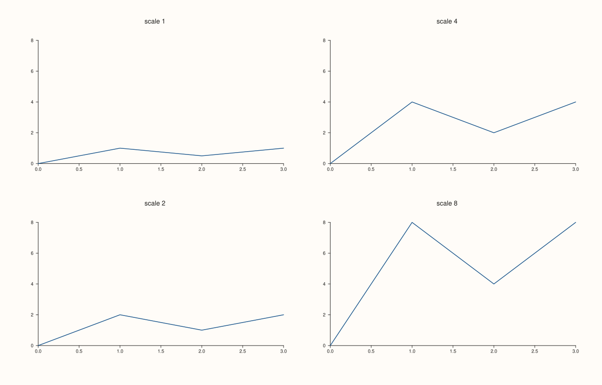
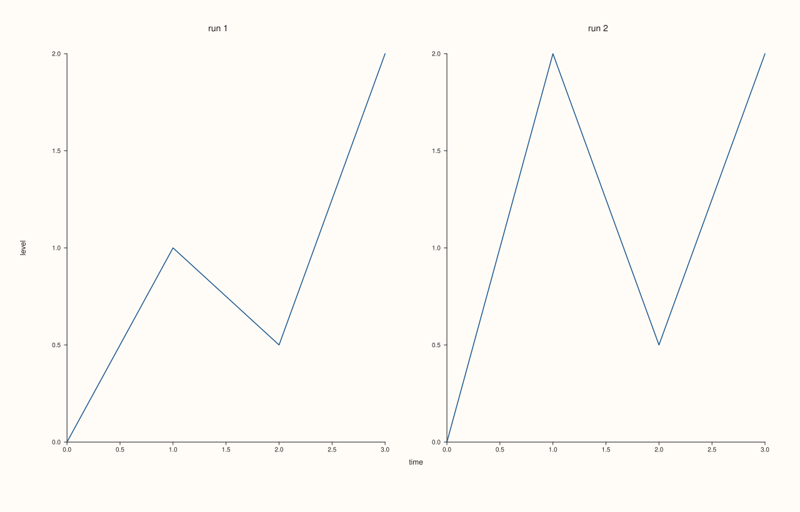

<!-- pluss-hand-authored -->

# Pane::align_xy

[Back to Pane API Reference](../../pane_api_reference)

## Signature

```cpp
Pane& Pane::align_xy(std::string group)
```

## What It Does

Puts both the x and the y axis of the pane into the alignment group `group`: the one call for panes whose rows and columns should line up.

The call is the same as [`align_x(group)`](align_x.md) and [`align_y(group)`](align_y.md): each axis joins the group `group`, and everything [`align_x`](align_x.md) says about a group (a shared range, hand-set limits winning, one shared caption) holds for each axis separately. The axes are independent groups that happen to carry the same name, so a caption for the x group and one for the y group are two captions, written by [`x_caption`](../studio/x_caption.md) and [`y_caption`](../studio/y_caption.md).

Use it for panes that are copies of one another in layout (small multiples), where every axis should line up. When only one axis should line up, call the single-axis form; when the axes need different names, call each form with its own name.

## Parameters

**group** (`std::string`)
    The name given to the groups of the x and y axes. An empty string leaves all of them.

## Returns

`Pane&`
    The same pane, for chaining.

## Examples

Example 1. The same name on every covered axis. After the call, the group of each axis reads back as `group`; an axis the call does not cover is untouched.

```cpp
auto fig = studio("align_xy_readback");
auto& pane = fig.pane2("p");
pane.trend(std::vector<double>{0, 1, 2}, std::vector<double>{0, 1, 0});
pane.align_z("depth");
pane.align_xy("g");
std::cout << "x '" << pane.x_align_group() << "', y '" << pane.y_align_group() << "', z (not covered) '" << pane.z_align_group() << "'\n";
fig.save_svg("figure.svg");
```

### Output

```text
x 'g', y 'g', z (not covered) 'depth'
```


Example 2. Small multiples. Four panes of a 2x2 mosaic with different data all call `align_xy("grid")`: the whole figure shares one x range and one y range, and the panes line up.

```cpp
auto fig = studio("align_xy_grid");
fig.mosaic(2, 2);
const double scales[] = {1.0, 4.0, 2.0, 8.0};
for (int i = 0; i < 4; ++i) {
  auto& pane = fig.pane2("scale " + std::to_string(static_cast<int>(scales[i])));
  pane.trend(std::vector<double>{0, 1, 2, 3}, std::vector<double>{0, scales[i], scales[i] / 2, scales[i]});
  pane.align_xy("grid");
}
fig.save_svg("figure.svg");
```



Example 3. Captions follow the axes. One `x_caption` and one `y_caption` for the same group name each appear once for the whole figure; both match because the call set both axes' groups.

```cpp
auto fig = studio("align_xy_captions");
fig.mosaic(1, 2);
fig.x_caption("grid", "time");
fig.y_caption("grid", "level");
for (int i = 0; i < 2; ++i) {
  auto& pane = fig.pane2("run " + std::to_string(i + 1));
  pane.trend(std::vector<double>{0, 1, 2, 3}, std::vector<double>{0, 1.0 + i, 0.5, 2.0});
  pane.align_xy("grid");
}
std::cout << "x captions: " << fig.x_captions().size() << ", y captions: " << fig.y_captions().size() << "\n";
fig.save_svg("figure.svg");
```

### Output

```text
x captions: 1, y captions: 1
```



Example 4. Mixing with the single-axis calls. Calling `align_xy` and then `align_y` with another name changes only the y group; the x group keeps the shared name.

```cpp
auto fig = studio("align_xy_override");
auto& pane = fig.pane2("p");
pane.trend(std::vector<double>{0, 1, 2}, std::vector<double>{0, 1, 0});
pane.align_xy("g");
pane.align_y("other");
std::cout << "x '" << pane.x_align_group() << "', y '" << pane.y_align_group() << "'\n";
fig.save_svg("figure.svg");
```

### Output

```text
x 'g', y 'other'
```


## Notes

- Equivalent to the single-axis calls with the same name; nothing else changes on the pane.
- Not `noexcept`. Any string is accepted; the empty string leaves the groups.
- On a planar pane a z group is stored but there is no z axis to share, so it has no visible effect.

## See Also

- [`Pane::align_x`](align_x.md), [`align_y`](align_y.md), [`align_z`](align_z.md): one axis at a time, with the full account of what a group does.
- [`Pane::clear_align`](clear_align.md): leave all groups.
- [`Pane::x_align_group`](align_group_accessors.md): read a group back.

<div class="pluss-inline-prev-next">
  <a class="prev-link" href="align_x.html">
    <span class="label">Previous</span>
    <span class="title">align_x</span>
  </a>
  <a class="next-link" href="align_xyz.html">
    <span class="label">Next</span>
    <span class="title">align_xyz</span>
  </a>
</div>
