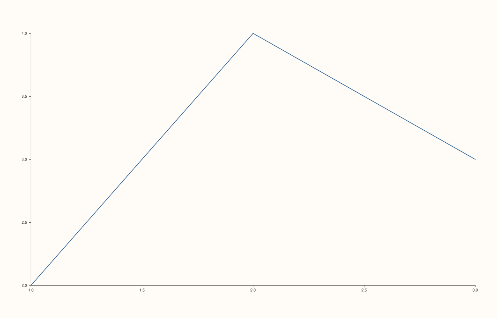

<!-- pluss-hand-authored -->

# Pane::align_xy

[Back to Pane API Reference](../../pane_api_reference)

## Signature

```cpp
Pane& Pane::align_xy(std::string group)
```

## What It Does

A convenience wrapper that sets both [`align_x(group)`](align_x.md) and
[`align_y(group)`](align_y.md) to the **same** `group` string in one call — for the common
case of a pane whose x- and y-axes should both align/share a caption with the same group
of panes.

```{important} Not the same as calling align_x() then align_y() with different groups
`align_xy(group)` unconditionally sets *both* `x_align_group()` and `y_align_group()` to
the identical string — there is no way to give x and y slightly different group names
through this one call. Call [`align_x()`](align_x.md) and [`align_y()`](align_y.md)
separately if the two axes need different groups.
```

## Parameters

**group** (`std::string`)
    The alignment-group key applied to both the x- and y-axes.

## Returns

`Pane&`
    A reference to the same pane, for chaining.

## Examples

Example 1. Both axes' groups become the same string.

```cpp
using namespace pluss::pl;

auto fig = studio("align_xy_check");
auto& pane = fig.pane2();
pane.trend(std::vector<double>{1.0, 2.0, 3.0}, std::vector<double>{2.0, 4.0, 3.0});
pane.align_xy("shared");
fig.show();

std::cout << pane.x_align_group() << " " << pane.y_align_group() << "\n";
```

### Output

```text
shared shared
```



## Notes

- Not `noexcept` (constructs/copies the `group` string twice internally).
- Sets `x_align_group()` and `y_align_group()` to an identical value — no way to
  differentiate them through this call.
- [`clear_x_align()`](align_x.md)/[`clear_y_align()`](align_y.md) (or
  [`clear_align()`](clear_align.md), which also clears z) are still the way to undo
  either half.

## See Also

- [`Pane::align_x`](align_x.md) / [`Pane::align_y`](align_y.md): the individual setters
  this wraps.
- [`Pane::align_xyz`](align_xyz.md): the three-axis version, additionally setting z.

<div class="pluss-inline-prev-next">
  <a class="prev-link" href="align_z.html">
    <span class="label">Previous</span>
    <span class="title">align_z</span>
  </a>
  <a class="next-link" href="align_xyz.html">
    <span class="label">Next</span>
    <span class="title">align_xyz</span>
  </a>
</div>
