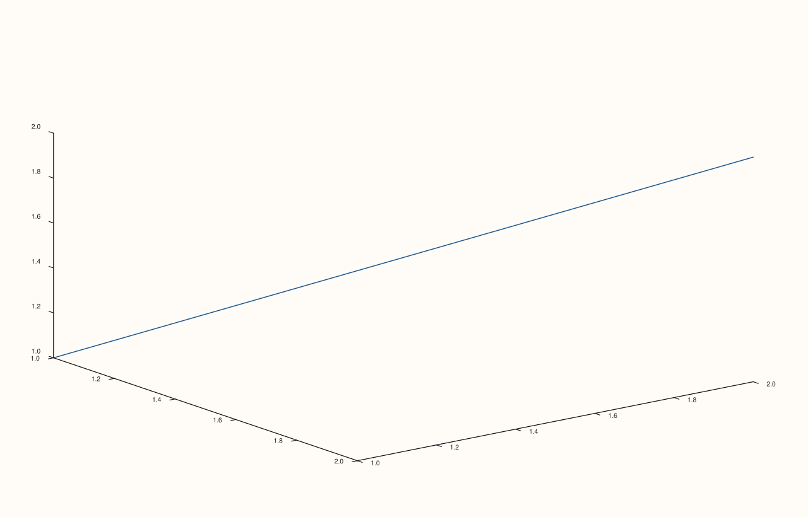

<!-- pluss-hand-authored -->

# Pane::align_xyz

[Back to Pane API Reference](../../pane_api_reference)

## Signature

```cpp
Pane& Pane::align_xyz(std::string group)
```

## What It Does

The three-axis counterpart of [`align_xy()`](align_xy.md): sets
[`align_x(group)`](align_x.md), [`align_y(group)`](align_y.md), *and*
[`align_z(group)`](align_z.md) to the same `group` string in one call — meaningful
primarily on 3D (`Volumetric`) panes, where all three axes might need to share a caption
group.

## Parameters

**group** (`std::string`)
    The alignment-group key applied to all three axes.

## Returns

`Pane&`
    A reference to the same pane, for chaining.

## Examples

Example 1. All three axes' groups become the same string, on a 3D pane.

```cpp
using namespace pluss::pl;

auto fig = studio("align_xyz_check");
auto& pane = fig.pane3();
pane.path3(std::vector<double>{1.0, 2.0}, std::vector<double>{1.0, 2.0}, std::vector<double>{1.0, 2.0});
pane.align_xyz("all_shared");
fig.show();

std::cout << pane.x_align_group() << " " << pane.y_align_group() << " " << pane.z_align_group() << "\n";
```

### Output

```text
all_shared all_shared all_shared
```



## Notes

- Not `noexcept`.
- Sets all three axis groups to an identical value — no way to differentiate them through
  this call.
- [`clear_align()`](clear_align.md) is the matching all-three-at-once way to undo it.

## See Also

- [`Pane::align_x`](align_x.md) / [`Pane::align_y`](align_y.md) / [`Pane::align_z`](align_z.md):
  the individual setters this wraps.
- [`Pane::align_xy`](align_xy.md): the two-axis version.
- [`Pane::clear_align`](clear_align.md): clears all three at once.

<div class="pluss-inline-prev-next">
  <a class="prev-link" href="align_xy.html">
    <span class="label">Previous</span>
    <span class="title">align_xy</span>
  </a>
  <a class="next-link" href="clear_align.html">
    <span class="label">Next</span>
    <span class="title">clear_align</span>
  </a>
</div>
