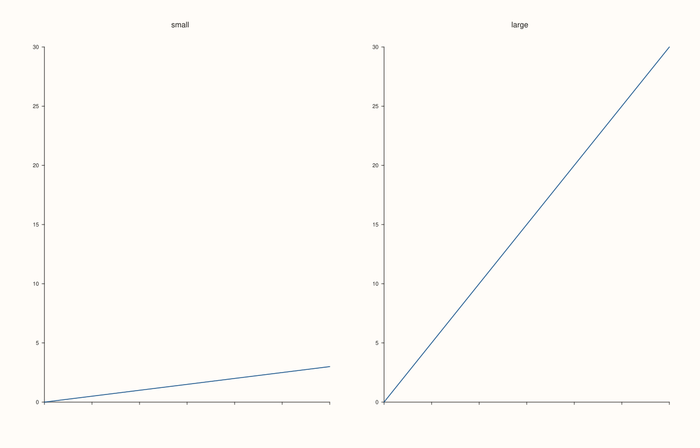
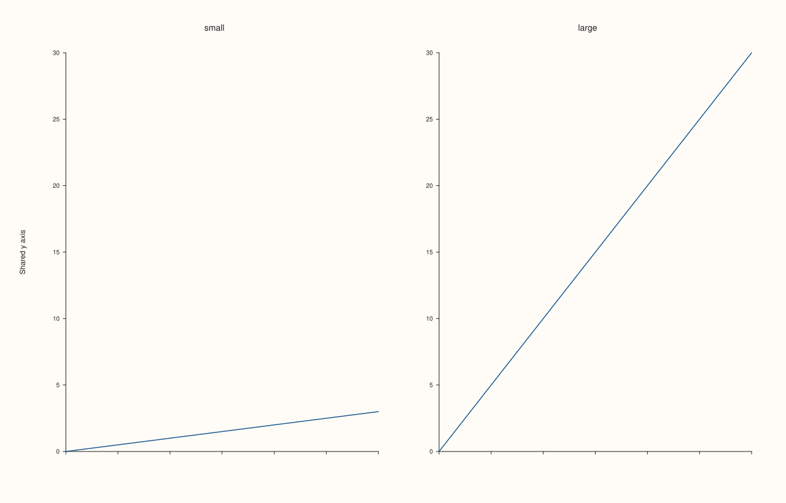
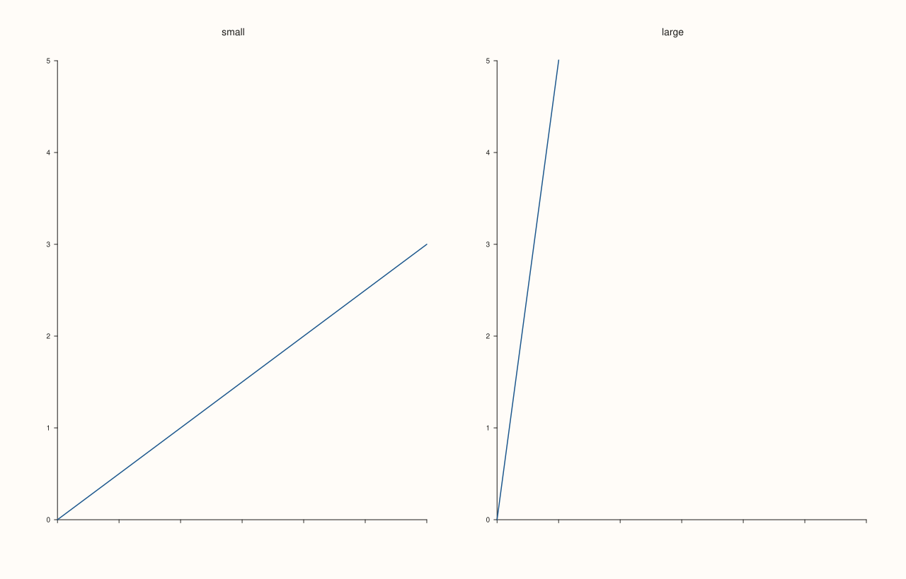
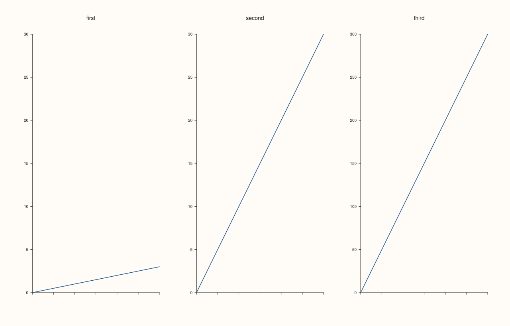
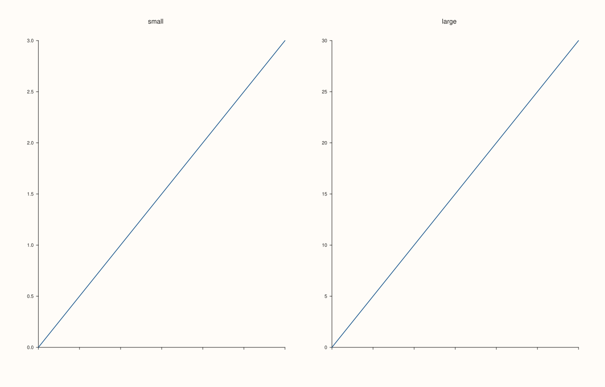

<!-- pluss-hand-authored -->

# Pane::align_y

[Back to Pane API Reference](../../pane_api_reference)

## Signature

```cpp
Pane& Pane::align_y(std::string group)
Pane& Pane::clear_y_align() noexcept
```

## What It Does

Puts the y axis of this pane into a named **alignment group**, and `clear_y_align()` takes it out again. Panes whose y axes are in the same group are drawn as one: they share the same y range, and a figure-level caption can be written once for the whole group.

What a group does, in full:

| Effect | When |
|---|---|
| The panes share one y range, so equal values sit at equal ticks in every pane. | Always. The range is the union of the ranges the members would have on their own. |
| If a member sets its y limits by hand ([`y_limits`](y_limits.md)), the group shares the union of the hand-set limits instead, and the data of the other members is clipped to it. | A hand-set limit is the choice of window; the data of another pane never overrides it. |
| One caption is drawn for the group by [`Studio::y_caption`](../studio/y_caption.md). | The caption's group name matches and at least one member is visible. |

The group is only a name: any string is accepted, and a name that no other pane uses makes a group of one. The match is exact and case-sensitive. The empty string means "no group", which is the state of a new pane. The group ties the panes in no other way: titles, the other axes, the format of ticks and the grid stay each pane's own.

Joining a group does not change the settings of the axis. Leaving it (`clear_y_align()` or `align_y("")`) restores the range the pane has on its own.

## Parameters

**group** (`std::string`, setter only)
    The name of the group. Panes with the same name share the y range. An empty string leaves the group.

## Returns

`Pane&`
    The same pane, for chaining. Both calls return it; `clear_y_align()` is `noexcept`.

## Examples

Example 1. Sharing a range. Two panes with y ranges 0..3 and 0..30. Alone, each has ticks for its own data. In one group, both show the same ticks over 0..30, so a value of 3 sits at the same place in both.

```cpp
auto build = [&](bool grouped) {
  auto fig = studio("align_y");
  fig.mosaic(1, 2);
  auto& small = fig.pane2("small");
  small.trend(std::vector<double>{0, 1, 2, 3}, std::vector<double>{0, 1, 2, 3});
  small.x_tick_labels(false);
  auto& large = fig.pane2("large");
  large.trend(std::vector<double>{0, 1, 2, 3}, std::vector<double>{0, 10, 20, 30});
  large.x_tick_labels(false);
  if (grouped) {
    small.align_y("range");
    large.align_y("range");
  }
  return fig.to_svg();
};
auto texts = [](const std::string& svg) {
  std::string out;
  for (std::size_t at = svg.find("<text"); at != std::string::npos; at = svg.find("<text", at + 1)) {
    const auto gt = svg.find('>', at);
    out += svg.substr(gt + 1, svg.find("</text>", gt) - gt - 1) + " ";
  }
  return out;
};
std::cout << "alone:   " << texts(build(false)) << "\n";
std::cout << "grouped: " << texts(build(true)) << "\n";
auto fig = studio("align_y");
fig.mosaic(1, 2);
auto& small = fig.pane2("small");
small.trend(std::vector<double>{0, 1, 2, 3}, std::vector<double>{0, 1, 2, 3});
small.x_tick_labels(false);
auto& large = fig.pane2("large");
large.trend(std::vector<double>{0, 1, 2, 3}, std::vector<double>{0, 10, 20, 30});
large.x_tick_labels(false);
small.align_y("range");
large.align_y("range");
fig.save_svg("figure.svg");
```

### Output

```text
alone:   small 0.0 0.5 1.0 1.5 2.0 2.5 3.0 large 0 5 10 15 20 25 30 
grouped: small 0 5 10 15 20 25 30 large 0 5 10 15 20 25 30 
```



Example 2. One caption for the group. Both panes are in the group `range`; [`Studio::y_caption`](../studio/y_caption.md) writes its text once, for the group, instead of once for each pane.

```cpp
auto fig = studio("align_y");
fig.mosaic(1, 2);
auto& small = fig.pane2("small");
small.trend(std::vector<double>{0, 1, 2, 3}, std::vector<double>{0, 1, 2, 3});
small.x_tick_labels(false);
auto& large = fig.pane2("large");
large.trend(std::vector<double>{0, 1, 2, 3}, std::vector<double>{0, 10, 20, 30});
large.x_tick_labels(false);
small.align_y("range");
large.align_y("range");
fig.y_caption("range", "Shared y axis");
const std::string svg = fig.to_svg();
std::cout << "members: " << small.y_align_group() << ", " << large.y_align_group() << "\n";
std::cout << "caption drawn once: " << (svg.find(">Shared y axis<") == svg.rfind(">Shared y axis<")) << "\n";
fig.save_svg("figure.svg");
```

### Output

```text
members: range, range
caption drawn once: 1
```



Example 3. A limit set by hand wins. `small` sets its y limits to 0..5; the group shares that window, and the data of `large`, which runs to 30, is clipped to it. The window is the choice the limit expresses, and the data of other members does not widen it.

```cpp
auto build = [&](bool manual) {
  auto fig = studio("align_y");
  fig.mosaic(1, 2);
  auto& small = fig.pane2("small");
  small.trend(std::vector<double>{0, 1, 2, 3}, std::vector<double>{0, 1, 2, 3});
  small.x_tick_labels(false);
  auto& large = fig.pane2("large");
  large.trend(std::vector<double>{0, 1, 2, 3}, std::vector<double>{0, 10, 20, 30});
  large.x_tick_labels(false);
  small.align_y("range");
  large.align_y("range");
  if (manual) small.y_limits(Range1d{0.0, 5.0});
  return fig.to_svg();
};
auto texts = [](const std::string& svg) {
  std::string out;
  for (std::size_t at = svg.find("<text"); at != std::string::npos; at = svg.find("<text", at + 1)) {
    const auto gt = svg.find('>', at);
    out += svg.substr(gt + 1, svg.find("</text>", gt) - gt - 1) + " ";
  }
  return out;
};
std::cout << "data only:     " << texts(build(false)) << "\n";
std::cout << "hand-set 0..5: " << texts(build(true)) << "\n";
auto fig = studio("align_y");
fig.mosaic(1, 2);
auto& small = fig.pane2("small");
small.trend(std::vector<double>{0, 1, 2, 3}, std::vector<double>{0, 1, 2, 3});
small.x_tick_labels(false);
auto& large = fig.pane2("large");
large.trend(std::vector<double>{0, 1, 2, 3}, std::vector<double>{0, 10, 20, 30});
large.x_tick_labels(false);
small.align_y("range");
large.align_y("range");
small.y_limits(Range1d{0.0, 5.0});
fig.save_svg("figure.svg");
```

### Output

```text
data only:     small 0 5 10 15 20 25 30 large 0 5 10 15 20 25 30 
hand-set 0..5: small 0 1 2 3 4 5 large 0 1 2 3 4 5 
```



Example 4. Groups are separate from each other. The first two panes share the group `pair`; the third has its own range and is not in it. Only the members of one group are tied.

```cpp
auto fig = studio("align_y_groups");
fig.mosaic(1, 3);
auto& first = fig.pane2("first");
first.trend(std::vector<double>{0, 1, 2, 3}, std::vector<double>{0, 1, 2, 3});
first.x_tick_labels(false);
auto& second = fig.pane2("second");
second.trend(std::vector<double>{0, 1, 2, 3}, std::vector<double>{0, 10, 20, 30});
second.x_tick_labels(false);
auto& third = fig.pane2("third");
third.trend(std::vector<double>{0, 1, 2, 3}, std::vector<double>{0, 100, 200, 300});
third.x_tick_labels(false);
first.align_y("pair");
second.align_y("pair");
auto texts = [](const std::string& svg) {
  std::string out;
  for (std::size_t at = svg.find("<text"); at != std::string::npos; at = svg.find("<text", at + 1)) {
    const auto gt = svg.find('>', at);
    out += svg.substr(gt + 1, svg.find("</text>", gt) - gt - 1) + " ";
  }
  return out;
};
std::cout << texts(fig.to_svg()) << "\n";
fig.save_svg("figure.svg");
```

### Output

```text
first 0 5 10 15 20 25 30 second 0 5 10 15 20 25 30 third 0 50 100 150 200 250 300 
```



Example 5. Leaving a group. `clear_y_align()` and `align_y("")` are the same: the pane is in no group and has its own range again, and the group string reads back empty. The figure is then exactly the figure of panes that never joined.

```cpp
auto build = [&](int mode) {
  auto fig = studio("align_y");
  fig.mosaic(1, 2);
  auto& small = fig.pane2("small");
  small.trend(std::vector<double>{0, 1, 2, 3}, std::vector<double>{0, 1, 2, 3});
  small.x_tick_labels(false);
  auto& large = fig.pane2("large");
  large.trend(std::vector<double>{0, 1, 2, 3}, std::vector<double>{0, 10, 20, 30});
  large.x_tick_labels(false);
  if (mode >= 1) {
    small.align_y("range");
    large.align_y("range");
  }
  if (mode == 2) {
    small.clear_y_align();
    large.align_y("");
  }
  return fig.to_svg();
};
std::cout << "left == never joined: " << (build(2) == build(0)) << "\n";
std::cout << "joined == never joined: " << (build(1) == build(0)) << "\n";
auto fig = studio("align_y");
fig.mosaic(1, 2);
auto& small = fig.pane2("small");
small.trend(std::vector<double>{0, 1, 2, 3}, std::vector<double>{0, 1, 2, 3});
small.x_tick_labels(false);
auto& large = fig.pane2("large");
large.trend(std::vector<double>{0, 1, 2, 3}, std::vector<double>{0, 10, 20, 30});
large.x_tick_labels(false);
small.align_y("range");
std::cout << "group: '" << small.y_align_group() << "'\n";
small.clear_y_align();
std::cout << "group after clear: '" << small.y_align_group() << "'\n";
fig.save_svg("figure.svg");
```

### Output

```text
left == never joined: 1
joined == never joined: 0
group: 'range'
group after clear: ''
```


Example 6. A group of one is harmless. A name nobody else uses ties the pane to nothing, no error is raised, and the pane keeps its own range; the name only matters once a second pane or a caption uses it.

```cpp
auto build = [&](bool named) {
  auto fig = studio("align_y");
  fig.mosaic(1, 2);
  auto& small = fig.pane2("small");
  small.trend(std::vector<double>{0, 1, 2, 3}, std::vector<double>{0, 1, 2, 3});
  small.x_tick_labels(false);
  auto& large = fig.pane2("large");
  large.trend(std::vector<double>{0, 1, 2, 3}, std::vector<double>{0, 10, 20, 30});
  large.x_tick_labels(false);
  if (named) small.align_y("only_me");
  return fig.to_svg();
};
std::cout << "same figure as without a group: " << (build(true) == build(false)) << "\n";
auto fig = studio("align_y");
fig.mosaic(1, 2);
auto& small = fig.pane2("small");
small.trend(std::vector<double>{0, 1, 2, 3}, std::vector<double>{0, 1, 2, 3});
small.x_tick_labels(false);
auto& large = fig.pane2("large");
large.trend(std::vector<double>{0, 1, 2, 3}, std::vector<double>{0, 10, 20, 30});
large.x_tick_labels(false);
small.align_y("only_me");
fig.save_svg("figure.svg");
```

### Output

```text
same figure as without a group: 1
```



## Notes

- Any string is a valid group; there is no registry and nothing to throw. A slip in a group name makes a group of one, and the panes then do not share a range: read the name back with [`y_align_group`](align_group_accessors.md) to check.
- The group shares the y range before the axis is drawn, so ticks, grid lines and tick labels of every member agree. The other settings of the axis (`y_ticks`, `y_tick_format`, `y_scale`) stay each pane's own.
- A hidden pane ([`visible`](visible.md)) draws nothing and takes no part in the group: the range is that of the panes that are drawn, and the caption is placed under them.
- `align_y` is not `noexcept` (it stores a string); `clear_y_align()` is.

## See Also

- [`Pane::align_x`](align_x.md): the same for the x axis.
- [`Pane::align_z`](align_z.md): the same for the z axis.
- [`Pane::align_xy`](align_xy.md), [`align_xyz`](align_xyz.md): join several axes in one call.
- [`Pane::clear_align`](clear_align.md): leave every group at once.
- [`Pane::y_align_group`](align_group_accessors.md): read the group back.
- [`Studio::y_caption`](../studio/y_caption.md): the caption a group shares.
- [`Pane::y_limits`](y_limits.md): hand-set limits, which win in a group.

<div class="pluss-inline-prev-next">
  <a class="prev-link" href="align_xyz.html">
    <span class="label">Previous</span>
    <span class="title">align_xyz</span>
  </a>
  <a class="next-link" href="align_z.html">
    <span class="label">Next</span>
    <span class="title">align_z</span>
  </a>
</div>
