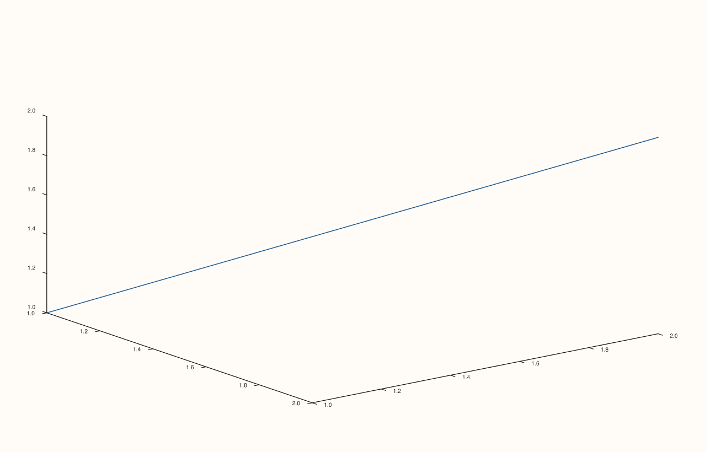

<!-- pluss-hand-authored -->

# Pane::align_z

[Back to Pane API Reference](../../pane_api_reference)

## Signatures

```cpp
Pane& Pane::align_z(std::string group)          // opts into an alignment group
Pane& Pane::clear_z_align() noexcept             // opts back out (empty group)
```

## What It Does

The z-axis counterpart of [`align_x()`](align_x.md)/[`align_y()`](align_y.md), matched
against [`Studio::z_caption(group, text)`](../studio/z_caption.md) and meaningful
primarily on 3D (`Volumetric`) panes. Every detail carries over unchanged — see
[`align_x()`](align_x.md) for the full worked-example set.

## Parameters

**group** (`std::string`, setter only)
    The alignment-group key.

## Returns

`Pane&`
    A reference to the same pane, for chaining.

## Examples

Example 1. Setting and clearing a z-align group on a 3D pane.

```cpp
using namespace pluss::pl;

auto fig = studio("align_z_check");
auto& pane = fig.pane3();
pane.path3(std::vector<double>{1.0, 2.0}, std::vector<double>{1.0, 2.0}, std::vector<double>{1.0, 2.0});
pane.align_z("depth_group");
std::cout << pane.z_align_group() << "\n";

pane.clear_z_align();
std::cout << pane.z_align_group().empty() << "\n";
fig.show();
```

### Output

```text
depth_group
1
```



## Notes

See [`align_x()`](align_x.md)'s Notes — every detail applies identically here. Most
useful on 3D panes; on 2D panes the z-axis alignment group exists but is inert (no z-axis
rendering to align).

## See Also

- [`Pane::align_x`](align_x.md) / [`Pane::align_y`](align_y.md): the x- and y-axis
  equivalents, with the full worked-example set.
- [`Pane::align_xyz`](align_xyz.md): sets all three axes' groups to the same string at
  once.
- [`Studio::z_caption`](../studio/z_caption.md): the figure-wide caption this group string
  is matched against.

<div class="pluss-inline-prev-next">
  <a class="prev-link" href="align_y.html">
    <span class="label">Previous</span>
    <span class="title">align_y</span>
  </a>
  <a class="next-link" href="align_xy.html">
    <span class="label">Next</span>
    <span class="title">align_xy</span>
  </a>
</div>
