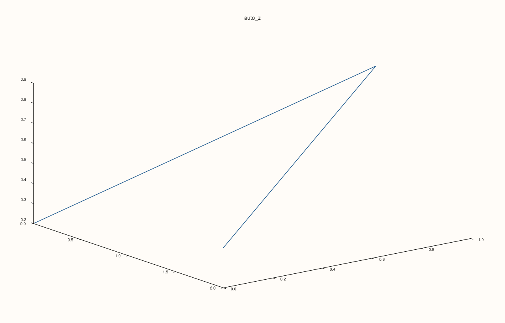

<!-- pluss-hand-authored -->

# Pane::auto_z

[Back to Pane API Reference](../../pane_api_reference)

## Signature

```cpp
Pane& Pane::auto_z() noexcept
```

## What It Does

Returns the z axis of a 3D pane to **automatic fitting**: it discards a manual range set with [`z_limits`](z_limits.md) and puts the axis back in `LimitMode::AutoFit`, so the range is fitted to the data again by the axis's [`LimitMethod`](../types/LimitMethod.md). It is the way back from a manual range; there is no other call that clears one.

The method that was chosen with [`z_limit_method`](z_limit_method.md) is not touched, so it applies again as soon as fitting is automatic. On an axis that is already automatic the call does nothing, and it never throws. It acts on a pane of either kind, but only a 3D pane draws a z axis.

## Parameters

*(none)*

## Returns

`Pane&`
    A reference to the same pane, for chaining.

## Examples

Example 1. A manual range, then `auto_z()`. The mode is `AutoFit` at the start, `Manual` after `z_limits`, and `AutoFit` again after `auto_z()`.

```cpp
auto fig = studio("auto_z_back");
auto& pane = fig.pane3("auto_z");
pane.path3(std::vector<double>{0, 1, 2}, std::vector<double>{0, 1, 0}, std::vector<double>{0.2, 0.9, 0.4});
auto mode = [&]() { return static_cast<int>(pane.z_axis().limit_mode); };
std::cout << "AutoFit = 0, Manual = 1\n";
std::cout << "at the start:   " << mode() << "\n";
pane.z_limits(Range1d{-5.0, 5.0});
std::cout << "after z_limits: " << mode() << "\n";
pane.auto_z();
std::cout << "after auto_z:  " << mode() << ", limits cleared: " << !pane.z_axis().limits.has_value() << "\n";
fig.save_svg("figure.svg");
```

### Output

```text
AutoFit = 0, Manual = 1
at the start:   0
after z_limits: 1
after auto_z:  0, limits cleared: 1
```



Example 2. After `auto_z()` the figure is the figure of a pane that never had a manual range: the SVG text of the two is identical.

```cpp
std::string svg[2];
for (int i = 0; i < 2; ++i) {
  auto fig = studio("auto_z_identical");
  auto& pane = fig.pane3("auto_z");
  pane.path3(std::vector<double>{0, 1, 2}, std::vector<double>{0, 1, 0}, std::vector<double>{0.2, 0.9, 0.4});
  if (i == 1) {
    pane.z_limits(Range1d{-5.0, 5.0});
    pane.auto_z();
  }
  svg[i] = fig.to_svg();
}
std::cout << "never set == set and cleared: " << (svg[0] == svg[1]) << "\n";
auto fig = studio("auto_z_identical_out");
auto& pane = fig.pane3("auto_z");
pane.path3(std::vector<double>{0, 1, 2}, std::vector<double>{0, 1, 0}, std::vector<double>{0.2, 0.9, 0.4});
fig.save_svg("figure.svg");
```

### Output

```text
never set == set and cleared: 1
```


Example 3. The fitting method survives the round trip. `Tight` is set, a manual range replaces it, and after `auto_z()` the axis is fitted `Tight` again, as the printed method shows.

```cpp
auto fig = studio("auto_z_method");
auto& pane = fig.pane3("auto_z");
pane.path3(std::vector<double>{0, 1, 2}, std::vector<double>{0, 1, 0}, std::vector<double>{0.2, 0.9, 0.4});
pane.z_limit_method(LimitMethod::Tight);
pane.z_limits(Range1d{-5.0, 5.0});
std::cout << "while manual, method: " << static_cast<int>(pane.z_axis().limit_method) << " (TickAligned = 0, Tight = 1, Padded = 2)\n";
pane.auto_z();
std::cout << "after auto_z, method: " << static_cast<int>(pane.z_axis().limit_method) << ", mode " << static_cast<int>(pane.z_axis().limit_mode) << "\n";
fig.save_svg("figure.svg");
```

### Output

```text
while manual, method: 1 (TickAligned = 0, Tight = 1, Padded = 2)
after auto_z, method: 1, mode 0
```


## Notes

- `auto_z()` returns the pane, so it chains: `pane.auto_z().z_limit_method(LimitMethod::Padded)`.
- A manual range set with `z_limits` is validated against the axis scale ([`ScalePolicy`](../types/ScalePolicy.md)); `auto_z()` has nothing to validate.
- The mode and the limits are read back through `Pane::z_axis()` ([`axis_accessors`](axis_accessors.md)).

## See Also

- [`Pane::z_limits`](z_limits.md): sets a manual range.
- [`Pane::z_limit_method`](z_limit_method.md): chooses how an automatic range is fitted.
- [`LimitMethod`](../types/LimitMethod.md): the three methods, with a rendered comparison.

<div class="pluss-inline-prev-next">
  <a class="prev-link" href="auto_y.html">
    <span class="label">Previous</span>
    <span class="title">auto_y</span>
  </a>
  <a class="next-link" href="axes_visible.html">
    <span class="label">Next</span>
    <span class="title">axes_visible</span>
  </a>
</div>
