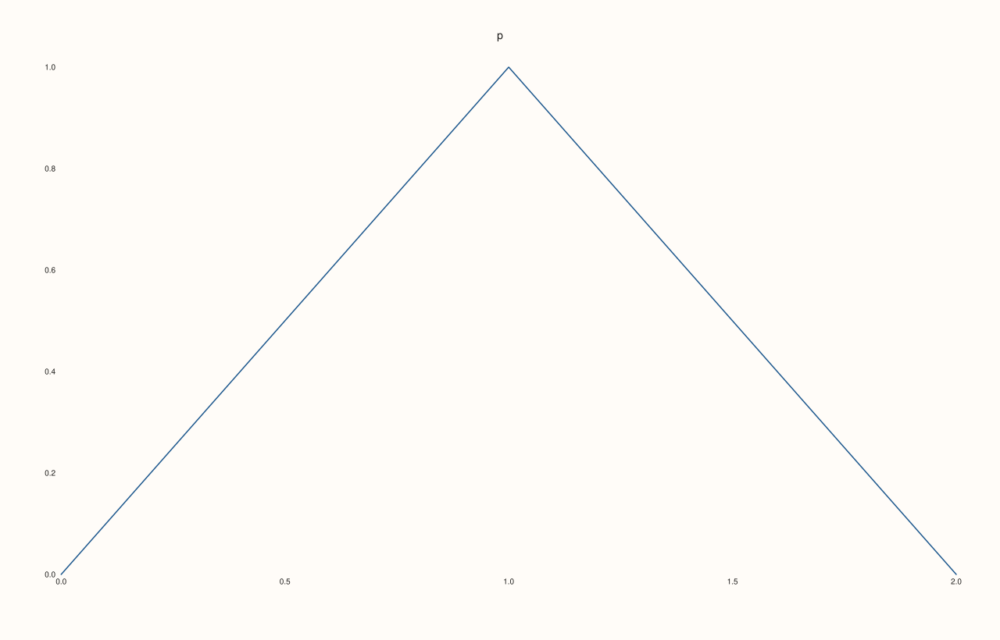
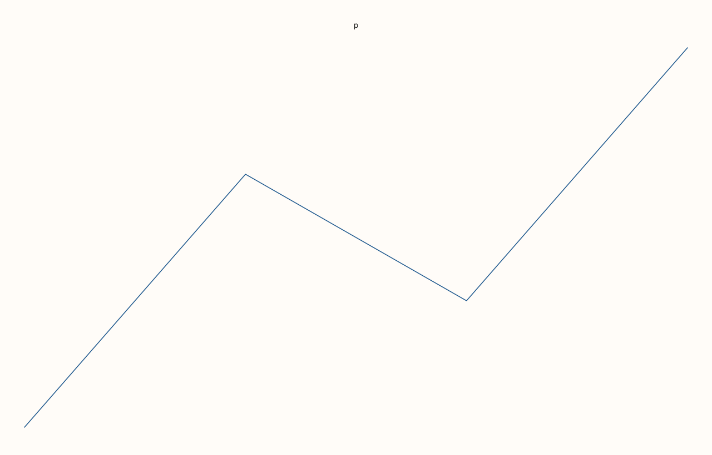
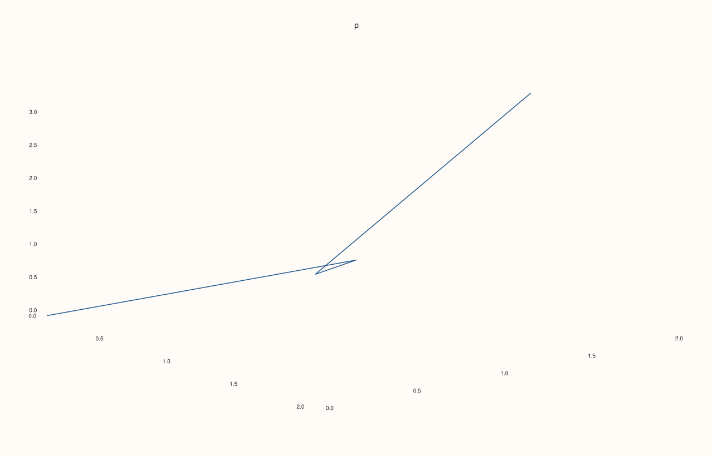
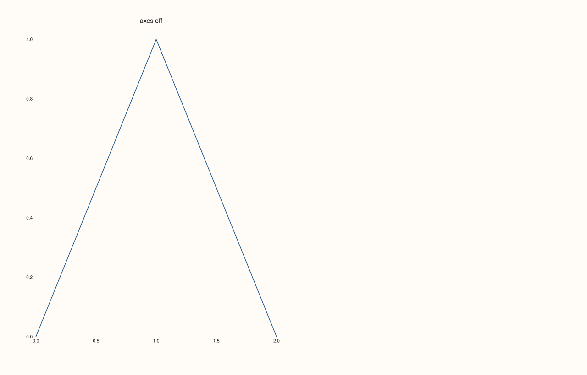

<!-- pluss-hand-authored -->

# Pane::axes_visible

[Back to Pane API Reference](../../pane_api_reference)

## Signature

```cpp
Pane& Pane::axes_visible(bool enable) noexcept
bool Pane::axes_visible() const noexcept
```

## What It Does

Controls whether the pane draws its axis lines and tick marks. With `false` the data, the grid, the tick labels and the axis labels are still drawn; only the lines of the axes and the marks on them go. The pane keeps its place, and the plot area becomes the room for the data. A new pane has its axes visible.

For a figure with no axis furniture at all (a sparkline, an inset, a picture-like plot) turn off the axes and the tick labels together with [`x_tick_labels`](x_tick_labels.md) and [`y_tick_labels`](y_tick_labels.md); a pane left with nothing around the plot uses the narrow margins of a bare plot, and fits more of the figure to the data. To remove the whole pane use [`visible`](visible.md).

The setter requires its argument, so `pane.axes_visible()` always reads.

## Parameters

**enable** (`bool`, setter only)
    `true` to draw axis lines and ticks, `false` to leave them out.

## Returns

**Setter:** `Pane&`, the same pane.
**Getter:** `bool`, whether the axes are drawn.

## Examples

Example 1. The default is visible; the setter changes the state and the getter reads it.

```cpp
auto fig = studio("axes_default");
auto& pane = fig.pane2("p");
pane.trend(std::vector<double>{0, 1, 2}, std::vector<double>{0, 1, 0});
std::cout << "default: " << pane.axes_visible() << "\n";
pane.axes_visible(false);
std::cout << "after false: " << pane.axes_visible() << "\n";
pane.axes_visible(true);
fig.save_svg("figure.svg");
```

### Output

```text
default: 1
after false: 0
```


Example 2. Without the axes. The line of the axes and the tick marks are gone and the tick labels stay, so the figure is different but the same numbers are written on it.

```cpp
auto fig = studio("axes_hidden");
auto& pane = fig.pane2("p");
pane.trend(std::vector<double>{0, 1, 2}, std::vector<double>{0, 1, 0});
const std::string with_axes = fig.to_svg();
pane.axes_visible(false);
const std::string without = fig.to_svg();
std::cout << "figures differ: " << (with_axes != without) << "\n";
std::cout << "tick label 1.0 still drawn: " << (without.find(">1.0<") != std::string::npos) << "\n";
fig.save_svg("figure.svg");
```

### Output

```text
figures differ: 1
tick label 1.0 still drawn: 1
```



Example 3. A bare plot. With the axes and the tick labels all turned off and no axis label, nothing is left around the plot, and the plot takes narrow margins: the data fills more of the figure.

```cpp
auto build = [&](bool bare) {
  auto fig = studio("axes_bare");
  auto& pane = fig.pane2("p");
  pane.trend(std::vector<double>{0, 1, 2, 3}, std::vector<double>{0, 2, 1, 3});
  if (bare) pane.axes_visible(false).x_tick_labels(false).y_tick_labels(false);
  return fig.to_svg();
};
auto texts = [](const std::string& svg) {
  std::string out;
  for (std::size_t at = svg.find("<text"); at != std::string::npos; at = svg.find("<text", at + 1)) {
    const auto gt = svg.find('>', at);
    out += svg.substr(gt + 1, svg.find("</text>", gt) - gt - 1) + " ";
  }
  return out;
};
const auto framed = build(false), bare = build(true);
std::cout << "bare figure has no tick text: " << (texts(bare).find("0.5") == std::string::npos) << "\n";
auto fig = studio("axes_bare_out");
auto& pane = fig.pane2("p");
pane.trend(std::vector<double>{0, 1, 2, 3}, std::vector<double>{0, 2, 1, 3});
pane.axes_visible(false).x_tick_labels(false).y_tick_labels(false);
fig.save_svg("figure.svg");
```

### Output

```text
bare figure has no tick text: 1
```



Example 4. On a volumetric pane the same switch removes the box of axes around the data.

```cpp
auto build = [&](bool visible) {
  auto fig = studio("axes_3d");
  auto& pane = fig.pane3("p");
  pane.path3(std::vector<double>{0, 1, 2, 1}, std::vector<double>{0, 1, 0, 2}, std::vector<double>{0, 1, 2, 3});
  pane.axes_visible(visible);
  return fig.to_svg();
};
std::cout << "differ: " << (build(true) != build(false)) << "\n";
auto fig = studio("axes_3d_out");
auto& pane = fig.pane3("p");
pane.path3(std::vector<double>{0, 1, 2, 1}, std::vector<double>{0, 1, 0, 2}, std::vector<double>{0, 1, 2, 3});
pane.axes_visible(false);
fig.save_svg("figure.svg");
```

### Output

```text
differ: 1
```



Example 5. Not the same as hiding the pane. With the axes off the traces are drawn; with the pane hidden nothing is.

```cpp
auto fig = studio("axes_vs_visible");
fig.mosaic(1, 2);
auto& axes_off = fig.pane2("axes off");
axes_off.trend(std::vector<double>{0, 1, 2}, std::vector<double>{0, 1, 0});
axes_off.axes_visible(false);
auto& hidden = fig.pane2("hidden");
hidden.trend(std::vector<double>{0, 1, 2}, std::vector<double>{0, 1, 0});
hidden.hide();
const std::string svg = fig.to_svg();
std::cout << "axes-off title drawn: " << (svg.find(">axes off<") != std::string::npos) << ", hidden title drawn: " << (svg.find(">hidden<") != std::string::npos) << "\n";
fig.save_svg("figure.svg");
```

### Output

```text
axes-off title drawn: 1, hidden title drawn: 0
```



## Notes

- Both forms are `noexcept`.
- The axes' labels ([`x_label`](x_label.md)) and the tick labels are separate settings and stay as they are.

## See Also

- [`Pane::visible`](visible.md): hide the whole pane.
- [`Pane::x_tick_labels`](x_tick_labels.md), [`y_tick_labels`](y_tick_labels.md): the tick labels.
- [`Pane::grid`](grid.md): the grid lines.

<div class="pluss-inline-prev-next">
  <a class="prev-link" href="auto_z.html">
    <span class="label">Previous</span>
    <span class="title">auto_z</span>
  </a>
  <a class="next-link" href="axis_accessors.html">
    <span class="label">Next</span>
    <span class="title">axis_accessors</span>
  </a>
</div>
