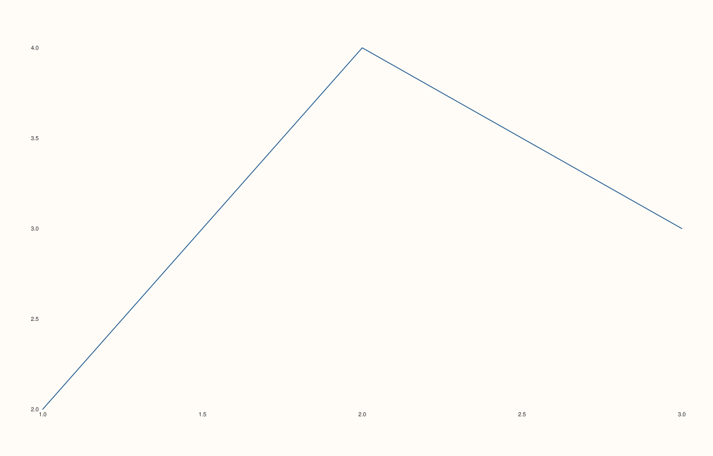

<!-- pluss-hand-authored -->

# Pane::axes_visible

[Back to Pane API Reference](../../pane_api_reference)

## Signatures

```cpp
Pane& Pane::axes_visible(bool enable) noexcept   // setter -- enable is now required
bool Pane::axes_visible() const noexcept          // getter -- always safe to call bare
```

## What It Does

Controls whether this pane's axis lines, ticks, and tick labels are drawn — `false` hides
just the axis furniture while the plotted traces themselves still render normally,
distinct from [`visible(false)`](visible.md), which skips the *entire* pane.

```{important} Fixed: enable is now required, not defaulted
axes_visible() had the identical shape as visible() -- a setter with a default
argument (bool enable = true) sharing its name with a const getter. Calling the
bare, zero-argument pane.axes_visible() on a non-const Pane& used to resolve to
the SETTER (default enable = true), not a read -- directly verified the same
way as visible()'s own reproduction. It has since been fixed at the source:
enable is now required, so pane.axes_visible() (zero arguments) always
resolves to the getter. See visible()'s important callout for the full
explanation of why this was a hazard.
```

## Parameters

**enable** (`bool`, required, setter only)
    `true` to show axis furniture, `false` to hide it.

## Returns

**Setter:** `Pane&` — a reference to the same pane, for chaining.

**Getter:** `bool` — whether axis furniture currently renders. Always safe to call bare.

## Examples

Example 1. The default: visible.

```cpp
using namespace pluss::pl;

auto fig = studio("axes_visible_default");
auto& pane = fig.pane2();
pane.trend(std::vector<double>{1.0, 2.0, 3.0}, std::vector<double>{2.0, 4.0, 3.0});
fig.show();

std::cout << pane.axes_visible() << "\n";
```

### Output

```text
1
```


Example 2. Hidden — the trace still renders, but no axis lines, ticks, or tick labels
appear.

```cpp
using namespace pluss::pl;

auto fig = studio("axes_visible_off");
auto& pane = fig.pane2();
pane.trend(std::vector<double>{1.0, 2.0, 3.0}, std::vector<double>{2.0, 4.0, 3.0});
pane.axes_visible(false);
bool off = pane.axes_visible();
fig.show();

std::cout << off << "\n";
```

### Output

```text
0
```



## Notes

- Both overloads are `noexcept`.
- `enable`'s default argument was removed specifically to eliminate the overload-resolution
  hazard — see the important callout above.
- Distinct from `visible()`: `axes_visible(false)` still draws the trace itself;
  `visible(false)` skips the entire pane, trace included.

## See Also

- [`Pane::visible`](visible.md): the full-pane visibility toggle, which received the
  identical fix, explained in full.
- [`Pane::parallel_xy_labels`](parallel_xy_labels.md): another setter/getter pair that
  received the same fix.

<div class="pluss-inline-prev-next">
  <a class="prev-link" href="visible.html">
    <span class="label">Previous</span>
    <span class="title">visible</span>
  </a>
  <a class="next-link" href="parallel_xy_labels.html">
    <span class="label">Next</span>
    <span class="title">parallel_xy_labels</span>
  </a>
</div>
