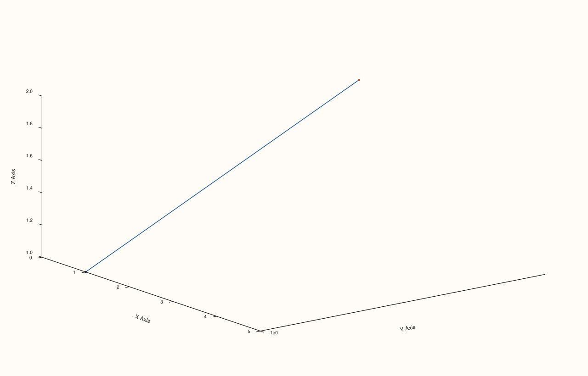

<!-- pluss-hand-authored -->

# Pane::x_axis / y_axis / z_axis / color_axis

[Back to Pane API Reference](../../pane_api_reference)

## Signatures

```cpp
const AxisState& Pane::x_axis() const noexcept
const AxisState& Pane::y_axis() const noexcept
const AxisState& Pane::z_axis() const noexcept
const AxisState& Pane::color_axis() const noexcept
```

## What It Does

Four read-only accessors, one per axis, each returning the full `AxisState` struct that
every other axis-related setter documented in this reference ultimately writes into —
[`scale_x`](scale_x.md)/[`scale_y`](scale_y.md)/[`scale_z`](scale_z.md),
[`x_limits`](x_limits.md)/[`y_limits`](y_limits.md)/[`z_limits`](z_limits.md)/[`color_limits`](color_limits.md),
[`x_limit_method`](x_limit_method.md) and its siblings, [`x_label`](x_label.md) and its
siblings, tick formatting, tick rotation, label gaps, and more all read from and write to
one of these four `AxisState` objects. Rather than exposing a separate accessor per
individual field (`x_scale()`, `x_limits_value()`, `x_tick_format_value()`, ...), the whole
struct is returned at once — this page is the single place to see every field together.

`AxisState`'s fields, in declaration order:

| Field | Type | Set by |
|---|---|---|
| `scale` | `ScalePolicy` | [`scale_x`](scale_x.md) et al. |
| `limit_mode` | `LimitMode` | [`x_limits`](x_limits.md)/`auto_x` et al. |
| `limit_method` | `LimitMethod` | [`x_limit_method`](x_limit_method.md) et al. |
| `tick_format` | `TickFormat` | `x_tick_format` |
| `auto_tick_decimals` | `std::optional<int>` | `x_auto_tick_decimals`/`clear_x_auto_tick_decimals` |
| `limits` | `std::optional<Range1d>` | [`x_limits`](x_limits.md)/`auto_x` et al. |
| `label` | `std::string` | [`x_label`](x_label.md) et al. |
| `ticks` | `std::optional<AxisTicks>` | `x_ticks`/`clear_x_ticks` |
| `tick_rotation_deg` | `std::optional<double>` | `x_tick_rotation`/`clear_x_tick_rotation` |
| `label_rotation_deg` | `std::optional<double>` | `x_label_rotation`/`clear_x_label_rotation` |
| `tick_label_gap` | `std::optional<double>` | `x_tick_label_gap`/`clear_x_tick_label_gap` |
| `label_gap` | `std::optional<double>` | `x_label_gap`/`clear_x_label_gap` |
| `label_centered_on_axis` | `bool` | `y_label_centered` (y-axis only) |
| `label_centered_explicit` | `bool` | set alongside `label_centered_on_axis` |
| `tick_labels_visible` | `bool` | `x_tick_labels` et al. |
| `major_grid` | `bool` | `x_major_grid` et al. |
| `minor_grid` | `bool` | `x_minor_grid` et al. |

## Parameters

*(none)*

## Returns

`const AxisState&`
    A reference to the requested axis's full state.

## Examples

Example 1. A mix of settings across all four axes, all read back through their respective
accessors in one place.

```cpp
using namespace pluss::pl;

auto fig = studio("axis_accessors_check");
auto& pane = fig.pane3();
pane.path3(std::vector<double>{1.0, 2.0}, std::vector<double>{1.0, 2.0}, std::vector<double>{1.0, 2.0});

pane.x_label("X Axis").y_label("Y Axis").z_label("Z Axis");
pane.x_limits(Range1d{0.0, 5.0});
pane.scale_y(ScalePolicy::log10());
pane.cloud3(std::vector<double>{1.0, 2.0}, std::vector<double>{1.0, 2.0}, std::vector<double>{1.0, 2.0},
            std::vector<double>{5.0, 8.0}, std::vector<double>{0.2, 0.9});
pane.color_limits(Range1d{0.0, 1.0});
fig.show();

std::cout << pane.x_axis().label << "\n";
std::cout << pane.x_axis().limits->low << " " << pane.x_axis().limits->high << "\n";
std::cout << (pane.y_axis().scale.kind == ScaleKind::Log10) << "\n";
std::cout << pane.z_axis().label << "\n";
std::cout << pane.color_axis().limits->low << " " << pane.color_axis().limits->high << "\n";
```

### Output

```text
X Axis
0 5
1
Z Axis
0 1
```



## Notes

- All four accessors are `noexcept` and return `const` references — read-only views into
  the pane's own storage.
- There is no mutable overload (unlike [`theme_tokens()`](theme_tokens.md)/
  [`lens()`](lens.md)/[`lights()`](lights.md)) — every field of `AxisState` is written
  exclusively through its own dedicated setter method (`x_label()`, `x_limits()`, ...),
  never by mutating the struct returned here directly.
- `std::optional` fields (`limits`, `auto_tick_decimals`, `ticks`,
  `tick_rotation_deg`, `label_rotation_deg`, `tick_label_gap`, `label_gap`) are unset
  (`std::nullopt`) unless their corresponding setter has been called — dereferencing an
  unset optional (`.limits->low` when `limits` has no value) is undefined behavior, so
  check `.has_value()` first when the calling code can't otherwise guarantee the field was
  set.
- `label_centered_on_axis`/`label_centered_explicit` are only ever set by
  [`y_label_centered()`](y_label_centered.md) — the x- and z-axis `AxisState`s carry these
  fields too (the struct is shared across all axes) but nothing ever writes to them there.

## See Also

- [`Pane::scale_x`](scale_x.md) / [`Pane::x_limits`](x_limits.md) /
  [`Pane::x_limit_method`](x_limit_method.md) / [`Pane::x_label`](x_label.md): a
  representative sample of the many setters that write into the `AxisState` this page
  reads back.
- [`Pane::color_limits`](color_limits.md): the color axis's own range control, read back
  via `color_axis()` here.

<div class="pluss-inline-prev-next">
  <a class="prev-link" href="color_limit_method.html">
    <span class="label">Previous</span>
    <span class="title">color_limit_method</span>
  </a>
  <a class="next-link" href="x_label.html">
    <span class="label">Next</span>
    <span class="title">x_label</span>
  </a>
</div>
