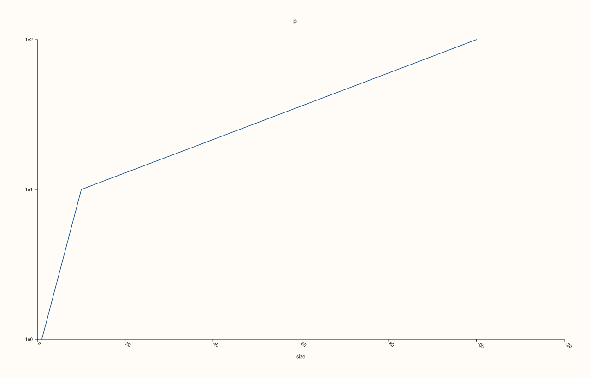
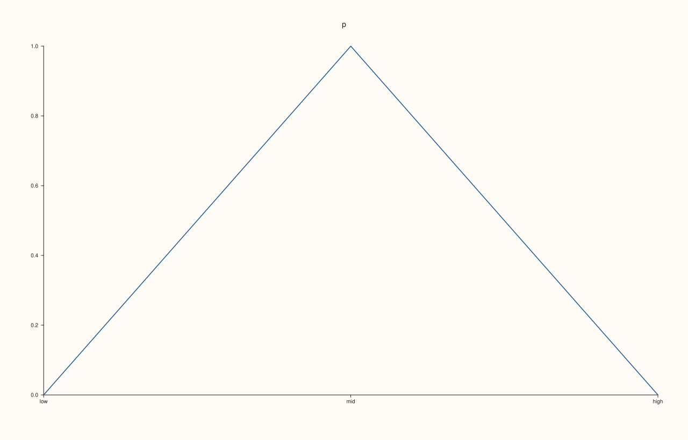
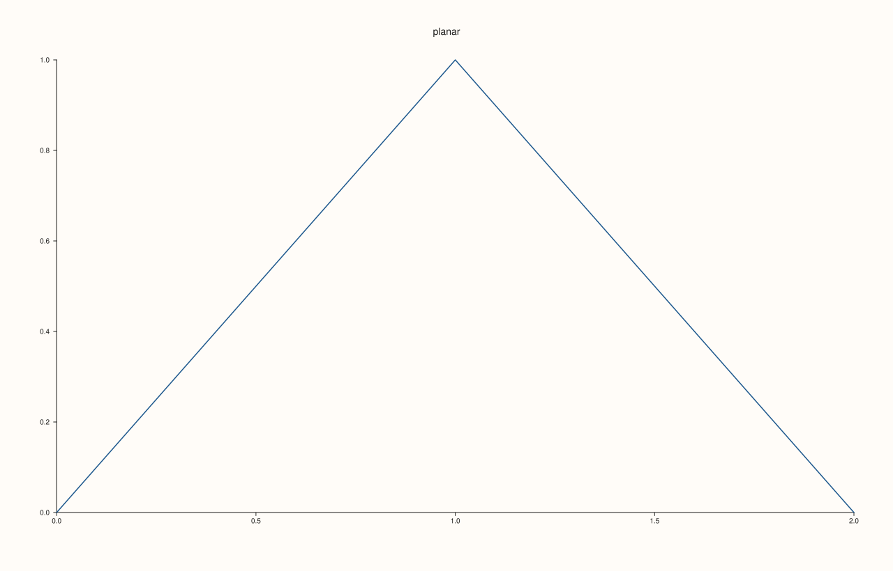

<!-- pluss-hand-authored -->

# Pane::x_axis, y_axis, z_axis, color_axis

[Back to Pane API Reference](../../pane_api_reference)

## Signature

```cpp
const AxisState& Pane::x_axis() const noexcept
const AxisState& Pane::y_axis() const noexcept
const AxisState& Pane::z_axis() const noexcept
const AxisState& Pane::color_axis() const noexcept
```

## What It Does

Read the whole state of one axis of the pane: the three position axes and the colour axis. Every axis setting ([`x_limits`](x_limits.md), [`x_label`](x_label.md), [`x_ticks`](x_ticks.md), [`scale_x`](scale_x.md), ...) is written into one of these four `AxisState` values, and these accessors return it as a read-only value. They are what to use to inspect a pane that was built elsewhere, or to check what a setting did.

| Field | Type | Holds | Set by |
|---|---|---|---|
| `scale` | `ScalePolicy` | Linear, log or symmetric-log scale. | [`scale_x`](scale_x.md) |
| `limit_mode` | `LimitMode` | `AutoFit` (from the data) or `Manual`. | [`x_limits`](x_limits.md), [`auto_x`](auto_x.md) |
| `limit_method` | `LimitMethod` | How an automatic range is widened. | [`x_limit_method`](x_limit_method.md) |
| `limits` | `std::optional<Range1d>` | The range set by hand, if any. | [`x_limits`](x_limits.md) |
| `tick_format` | `TickFormat` | How tick numbers are written. | [`x_tick_format`](x_tick_format.md) |
| `auto_tick_decimals` | `std::optional<int>` | A fixed number of decimals for automatic ticks. | [`x_auto_tick_decimals`](x_auto_tick_decimals.md) |
| `label` | `std::string` | The axis label. | [`x_label`](x_label.md) |
| `ticks` | `std::optional<AxisTicks>` | Ticks given by hand: positions and labels. | [`x_ticks`](x_ticks.md), [`x_categories`](x_categories.md) |
| `tick_rotation_deg` | `std::optional<double>` | Rotation of the tick labels. | [`x_tick_rotation`](x_tick_rotation.md) |
| `label_rotation_deg` | `std::optional<double>` | Rotation of the axis label. | [`x_label_rotation`](x_label_rotation.md) |
| `tick_label_gap` | `std::optional<double>` | Distance of tick labels from the axis, in points. | [`x_tick_label_gap`](x_tick_label_gap.md) |
| `label_gap` | `std::optional<double>` | Distance of the axis label from the tick labels. | [`x_label_gap`](x_label_gap.md) |
| `label_centered_on_axis` | `bool` | The y label stands vertical, centred on the axis. | [`y_label_centered`](y_label_centered.md) |
| `tick_labels_visible` | `bool` | Whether tick labels are drawn. | [`x_tick_labels`](x_tick_labels.md) |
| `major_grid`, `minor_grid` | `bool` | The grid lines of the axis. | [`x_major_grid`](x_major_grid.md), [`x_minor_grid`](x_minor_grid.md) |

An optional field is empty until its setter is called, which means "use the default for the figure"; the clear calls (`clear_x_tick_rotation`, ...) empty it again. The colour axis uses the limit fields only: [`color_limits`](color_limits.md), [`color_limit_method`](color_limit_method.md).

## Parameters

*(none)*

## Returns

`const AxisState&`
    The state of the axis. The reference is to the pane's own state and follows later calls; copy the value to keep a snapshot.

## Examples

Example 1. A new axis. Nothing is set by hand: the limits come from the data, the label is empty and every optional field is empty.

```cpp
auto fig = studio("axis_defaults");
auto& pane = fig.pane2("p");
pane.trend(std::vector<double>{0, 1, 2}, std::vector<double>{0, 1, 0});
const AxisState& axis = pane.x_axis();
std::cout << "AutoFit: " << (axis.limit_mode == LimitMode::AutoFit) << ", limits set: " << axis.limits.has_value() << ", label '" << axis.label << "'\n";
std::cout << "limit method TickAligned: " << (axis.limit_method == LimitMethod::TickAligned) << ", tick labels visible: " << axis.tick_labels_visible << ", grid: " << axis.major_grid << axis.minor_grid << "\n";
std::cout << "rotation set: " << axis.tick_rotation_deg.has_value() << ", gaps set: " << axis.tick_label_gap.has_value() << axis.label_gap.has_value() << ", ticks by hand: " << axis.ticks.has_value() << "\n";
fig.save_svg("figure.svg");
```

### Output

```text
AutoFit: 1, limits set: 0, label ''
limit method TickAligned: 1, tick labels visible: 1, grid: 00
rotation set: 0, gaps set: 00, ticks by hand: 0
```


Example 2. After the setters. The state reads back what was set: limits by hand, a label, a log scale on the y axis, and a rotation.

```cpp
auto fig = studio("axis_after");
auto& pane = fig.pane2("p");
pane.trend(std::vector<double>{1, 10, 100}, std::vector<double>{1, 10, 100});
pane.x_limits(Range1d{0.0, 120.0}).x_label("size").x_tick_rotation(30.0).scale_y(ScalePolicy{ScaleKind::Log10});
const AxisState& x = pane.x_axis();
std::cout << "x: Manual " << (x.limit_mode == LimitMode::Manual) << ", limits " << x.limits->low << " .. " << x.limits->high << ", label '" << x.label << "', rotation " << *x.tick_rotation_deg << "\n";
std::cout << "y: Log10 " << (pane.y_axis().scale.kind == ScaleKind::Log10) << "\n";
fig.save_svg("figure.svg");
```

### Output

```text
x: Manual 1, limits 0 .. 120, label 'size', rotation 30
y: Log10 1
```



Example 3. Clearing a setting empties its field again.

```cpp
auto fig = studio("axis_clear");
auto& pane = fig.pane2("p");
pane.trend(std::vector<double>{0, 1, 2}, std::vector<double>{0, 1, 0});
pane.x_tick_rotation(45.0).x_label_gap(12.0);
std::cout << "set: " << pane.x_axis().tick_rotation_deg.has_value() << pane.x_axis().label_gap.has_value() << "\n";
pane.clear_x_tick_rotation().clear_x_label_gap();
std::cout << "cleared: " << pane.x_axis().tick_rotation_deg.has_value() << pane.x_axis().label_gap.has_value() << "\n";
fig.save_svg("figure.svg");
```

### Output

```text
set: 11
cleared: 00
```


Example 4. Ticks given by hand are in the state with their labels.

```cpp
auto fig = studio("axis_ticks");
auto& pane = fig.pane2("p");
pane.trend(std::vector<double>{0, 1, 2}, std::vector<double>{0, 1, 0});
pane.x_ticks(std::vector<double>{0, 1, 2}, {"low", "mid", "high"});
const AxisState& axis = pane.x_axis();
std::cout << "by hand: " << axis.ticks.has_value() << ", labels:";
for (const auto& label : axis.ticks->labels) std::cout << " " << label;
std::cout << "\n";
fig.save_svg("figure.svg");
```

### Output

```text
by hand: 1, labels: low mid high
```



Example 5. The colour axis keeps the range of the colour scale. Its method starts as `Tight`; `color_limits` makes it manual.

```cpp
auto fig = studio("axis_color");
auto& pane = fig.pane2("p");
pane.trend(std::vector<double>{0, 1, 2}, std::vector<double>{0, 1, 0});
std::cout << "method Tight: " << (pane.color_axis().limit_method == LimitMethod::Tight) << ", manual: " << (pane.color_axis().limit_mode == LimitMode::Manual) << "\n";
pane.color_limits(Range1d{0.0, 5.0});
std::cout << "after color_limits: manual " << (pane.color_axis().limit_mode == LimitMode::Manual) << ", " << pane.color_axis().limits->low << " .. " << pane.color_axis().limits->high << "\n";
fig.save_svg("figure.svg");
```

### Output

```text
method Tight: 1, manual: 0
after color_limits: manual 1, 0 .. 5
```


Example 6. `z_axis` exists on a planar pane too; it simply has no axis to draw, so its settings have no visible effect there.

```cpp
auto fig = studio("axis_z");
auto& planar = fig.pane2("planar");
planar.trend(std::vector<double>{0, 1, 2}, std::vector<double>{0, 1, 0});
planar.z_label("never drawn");
std::cout << "z label stored on a planar pane: '" << planar.z_axis().label << "', drawn: " << (fig.to_svg().find(">never drawn<") != std::string::npos) << "\n";
fig.save_svg("figure.svg");
```

### Output

```text
z label stored on a planar pane: 'never drawn', drawn: 0
```



## Notes

- All four are `noexcept` and read only; change an axis through its setters.
- The state is returned as it is stored; the range actually drawn (widened by the limit method, snapped to ticks) is worked out when the figure is drawn and is not in it.

## See Also

- [`Pane::x_limits`](x_limits.md), [`x_label`](x_label.md), [`x_ticks`](x_ticks.md), [`scale_x`](scale_x.md): the setters, one page each.
- [`Pane::color_limits`](color_limits.md): the colour axis.

<div class="pluss-inline-prev-next">
  <a class="prev-link" href="axes_visible.html">
    <span class="label">Previous</span>
    <span class="title">axes_visible</span>
  </a>
  <a class="next-link" href="axis_label_font_scale.html">
    <span class="label">Next</span>
    <span class="title">axis_label_font_scale</span>
  </a>
</div>
