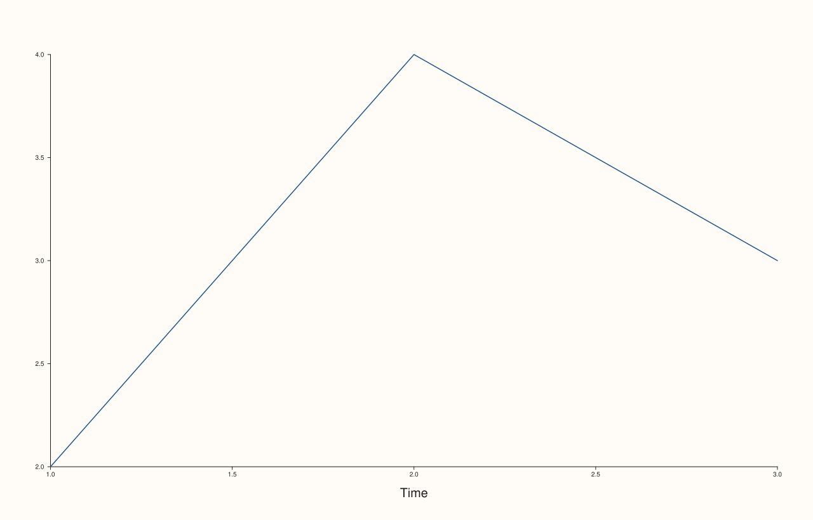

<!-- pluss-hand-authored -->

# Pane::axis_label_font_scale

[Back to Pane API Reference](../../pane_api_reference)

## Signatures

```cpp
Pane& Pane::axis_label_font_scale(double scale)          // setter
double Pane::axis_label_font_scale() const noexcept        // getter
```

## What It Does

The axis-label counterpart of [`tick_font_scale()`](tick_font_scale.md): scales the font
size used for axis labels (set via [`x_label()`](x_label.md)/etc.) on this pane,
multiplicatively. Every new pane starts with whatever
[`Studio::context_scales()`](../studio/context_scales.md) most recently set as the
figure's default `axis_label_font_scale`, at the moment the pane was created. Every
validation detail carries over unchanged from `tick_font_scale()` — finite and positive,
same throw message shape with `"axis_label_font_scale"` in place of `"tick_font_scale"`.

```{note} No overload-resolution ambiguity, same reasoning as tick_font_scale()
The setter requires an explicit `scale` with no default, so `pane.axis_label_font_scale()`
with zero arguments can only match the `const` getter — see
[`tick_font_scale()`](tick_font_scale.md)'s note for the contrast with
[`visible()`](visible.md)/[`axes_visible()`](axes_visible.md)/
[`parallel_xy_labels()`](parallel_xy_labels.md).
```

## Parameters

**scale** (`double`, setter only)
    The multiplicative scale factor. Must be finite and positive.

## Returns

**Setter:** `Pane&` — a reference to the same pane, for chaining.

**Getter:** `double` — the current scale factor.

## Examples

Example 1. A larger scale on the axis label specifically (tick labels stay their normal
size).

```cpp
using namespace pluss::pl;

auto fig = studio("axis_label_font_scale_large");
auto& pane = fig.pane2();
pane.trend(std::vector<double>{1.0, 2.0, 3.0}, std::vector<double>{2.0, 4.0, 3.0});
pane.x_label("Time");
pane.axis_label_font_scale(1.8);
fig.show();

std::cout << pane.axis_label_font_scale() << "\n";
```

### Output

```text
1.8
```



Example 2. A non-finite value throws.

```cpp
using namespace pluss::pl;

auto fig = studio("axis_label_font_scale_failure");
auto& pane = fig.pane2();
pane.trend(std::vector<double>{1.0, 2.0}, std::vector<double>{1.0, 2.0});

try {
  pane.axis_label_font_scale(std::numeric_limits<double>::quiet_NaN());
} catch (const std::invalid_argument& e) {
  std::cout << e.what() << "\n";
}
```

### Output

```text
axis_label_font_scale: scale must be finite and positive
```

## Notes

- The setter is not `noexcept`; the getter **is** `noexcept`.
- Snapshotted from [`Studio::context_scales()`](../studio/context_scales.md) at
  pane-creation time.
- Scales the axis *label* specifically — see [`tick_font_scale()`](tick_font_scale.md) for
  the equivalent affecting tick labels instead.

## See Also

- [`Pane::tick_font_scale`](tick_font_scale.md): the equivalent for tick labels.
- [`Studio::context_scales`](../studio/context_scales.md): the figure-wide default this is
  initialized from.

<div class="pluss-inline-prev-next">
  <a class="prev-link" href="tick_font_scale.html">
    <span class="label">Previous</span>
    <span class="title">tick_font_scale</span>
  </a>
  <a class="next-link" href="trend.html">
    <span class="label">Next</span>
    <span class="title">trend</span>
  </a>
</div>
