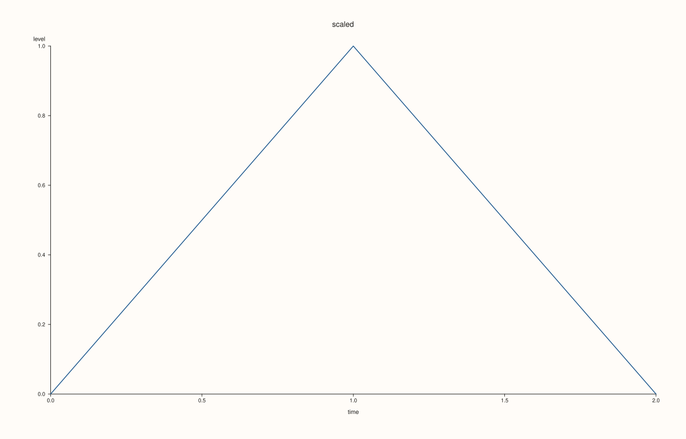
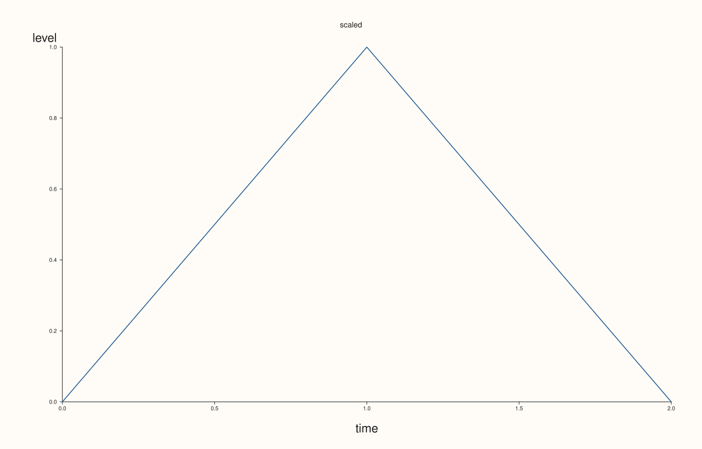
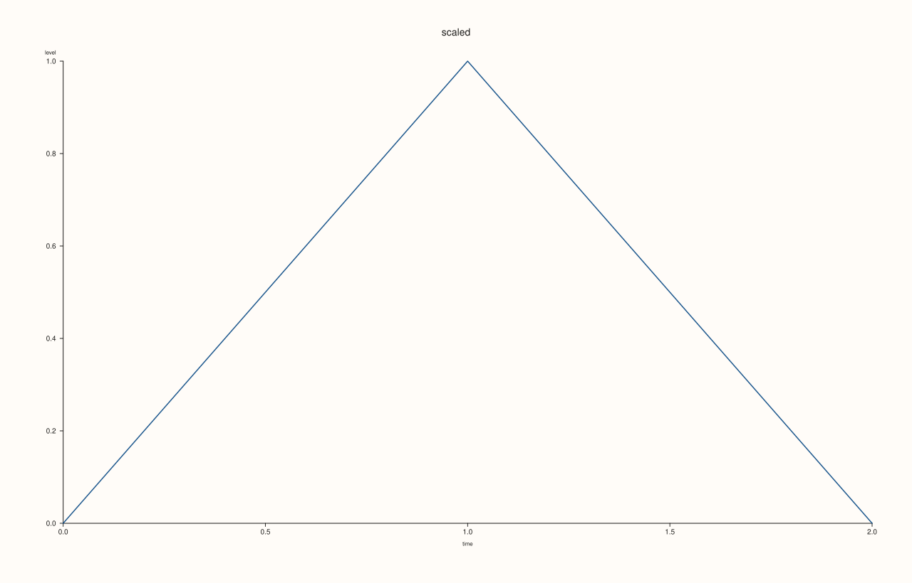
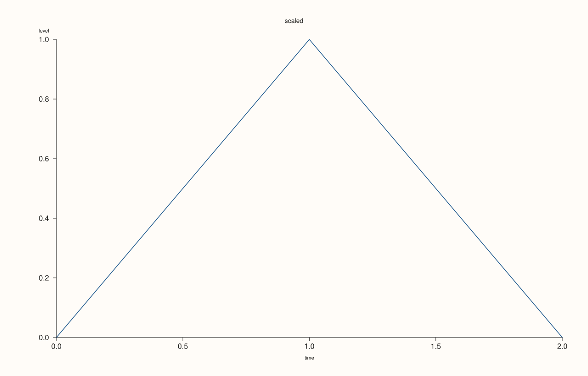
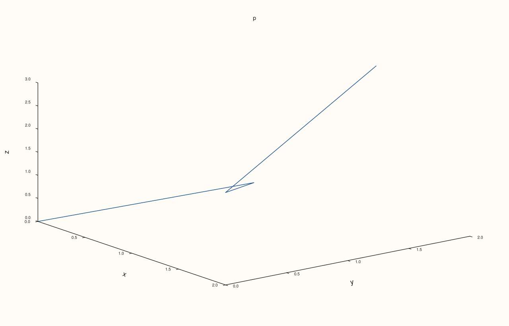

<!-- pluss-hand-authored -->

# Pane::axis_label_font_scale

[Back to Pane API Reference](../../pane_api_reference)

## Signature

```cpp
Pane& Pane::axis_label_font_scale(double scale)
double Pane::axis_label_font_scale() const noexcept
```

## What It Does

Scales the font of the axis labels ([`x_label`](x_label.md), [`y_label`](y_label.md), [`z_label`](z_label.md)) of the pane, all axes at once. The scale is a factor on the default label size: 1 is the default, 2 doubles it. The room for the labels follows the size.

The scale must be finite and positive; anything else throws. It applies to the axis labels only; the tick labels have their own scale ([`tick_font_scale`](tick_font_scale.md)), and the title and legend are unaffected. The getter takes no argument.

## Parameters

**scale** (`double`, setter only)
    The factor on the default axis label size. Finite and strictly positive.

## Returns

**Setter:** `Pane&`, the same pane.
**Getter:** `double`, the scale in force; `1.0` for a new pane.

## Examples

Example 1. The default is 1, and the axis labels are a little larger than the tick labels.

```cpp
auto fig = studio("labelfont_default");
auto& pane = fig.pane2("p");
pane.trend(std::vector<double>{0, 1, 2}, std::vector<double>{0, 1, 0});
pane.x_label("time").y_label("level").title("scaled");
auto size_of = [](const std::string& svg, const std::string& text) {
  const auto hit = svg.find(">" + text + "<");
  if (hit == std::string::npos) return std::string("absent");
  const auto open = svg.rfind("<text", hit);
  const auto k = svg.find("font-size=\"", open) + 11;
  return svg.substr(k, svg.find('"', k) - k);
};
const std::string svg = fig.to_svg();
std::cout << "scale: " << pane.axis_label_font_scale() << ", axis label size: " << size_of(svg, "time") << ", tick size: " << size_of(svg, "1.0") << "\n";
fig.save_svg("figure.svg");
```

### Output

```text
scale: 1, axis label size: 11.0000, tick size: 10.0000
```



Example 2. A scale of 2 doubles both axis labels and leaves the ticks and the title alone.

```cpp
auto fig = studio("labelfont_larger");
auto& pane = fig.pane2("p");
pane.trend(std::vector<double>{0, 1, 2}, std::vector<double>{0, 1, 0});
pane.x_label("time").y_label("level").title("scaled");
auto size_of = [](const std::string& svg, const std::string& text) {
  const auto hit = svg.find(">" + text + "<");
  if (hit == std::string::npos) return std::string("absent");
  const auto open = svg.rfind("<text", hit);
  const auto k = svg.find("font-size=\"", open) + 11;
  return svg.substr(k, svg.find('"', k) - k);
};
pane.axis_label_font_scale(2.0);
const std::string svg = fig.to_svg();
std::cout << "x label: " << size_of(svg, "time") << ", y label: " << size_of(svg, "level") << ", tick: " << size_of(svg, "1.0") << ", title: " << size_of(svg, "scaled") << "\n";
fig.save_svg("figure.svg");
```

### Output

```text
x label: 22.0000, y label: 22.0000, tick: 10.0000, title: 14.0000
```



Example 3. A scale below 1 gives quieter labels.

```cpp
auto fig = studio("labelfont_smaller");
auto& pane = fig.pane2("p");
pane.trend(std::vector<double>{0, 1, 2}, std::vector<double>{0, 1, 0});
pane.x_label("time").y_label("level").title("scaled");
auto size_of = [](const std::string& svg, const std::string& text) {
  const auto hit = svg.find(">" + text + "<");
  if (hit == std::string::npos) return std::string("absent");
  const auto open = svg.rfind("<text", hit);
  const auto k = svg.find("font-size=\"", open) + 11;
  return svg.substr(k, svg.find('"', k) - k);
};
pane.axis_label_font_scale(0.7);
std::cout << "x label: " << size_of(fig.to_svg(), "time") << "\n";
fig.save_svg("figure.svg");
```

### Output

```text
x label: 7.7000
```



Example 4. The two scales are independent. Here the tick labels are enlarged and the axis labels kept: only the tick size changes.

```cpp
auto fig = studio("labelfont_independent");
auto& pane = fig.pane2("p");
pane.trend(std::vector<double>{0, 1, 2}, std::vector<double>{0, 1, 0});
pane.x_label("time").y_label("level").title("scaled");
auto size_of = [](const std::string& svg, const std::string& text) {
  const auto hit = svg.find(">" + text + "<");
  if (hit == std::string::npos) return std::string("absent");
  const auto open = svg.rfind("<text", hit);
  const auto k = svg.find("font-size=\"", open) + 11;
  return svg.substr(k, svg.find('"', k) - k);
};
pane.tick_font_scale(1.6);
const std::string svg = fig.to_svg();
std::cout << "axis scale " << pane.axis_label_font_scale() << ": x label " << size_of(svg, "time") << ", tick " << size_of(svg, "1.0") << "\n";
fig.save_svg("figure.svg");
```

### Output

```text
axis scale 1: x label 11.0000, tick 16.0000
```



Example 5. On a volumetric pane the labels of all three axes take the scale.

```cpp
auto fig = studio("labelfont_3d");
auto& pane = fig.pane3("p");
pane.path3(std::vector<double>{0, 1, 2, 1}, std::vector<double>{0, 1, 0, 2}, std::vector<double>{0, 1, 2, 3});
pane.x_label("x").y_label("y").z_label("z");
pane.axis_label_font_scale(1.6);
fig.save_svg("figure.svg");
```



Example 6. Zero, negative and non-finite scales throw, and the scale is left as it was.

```cpp
auto fig = studio("labelfont_errors");
auto& pane = fig.pane2("p");
pane.trend(std::vector<double>{0, 1}, std::vector<double>{0, 1});
for (double bad : {0.0, -2.0, std::numeric_limits<double>::quiet_NaN()}) {
  try {
    pane.axis_label_font_scale(bad);
  } catch (const pluss::Error& e) {
    std::cout << e.message() << "\n";
  }
}
std::cout << "still " << pane.axis_label_font_scale() << "\n";
fig.save_svg("figure.svg");
```

### Output

```text
axis_label_font_scale: scale must be finite and positive
axis_label_font_scale: scale must be finite and positive
axis_label_font_scale: scale must be finite and positive
still 1
```


## Notes

- The setter throws `pluss::Error` for a scale that is not finite and positive; the getter is `noexcept`.

## See Also

- [`Pane::tick_font_scale`](tick_font_scale.md): the same for the tick labels.
- [`Pane::x_label`](x_label.md): the labels this scales.
- [`Pane::x_label_gap`](x_label_gap.md): the distance of a label from the ticks.

<div class="pluss-inline-prev-next">
  <a class="prev-link" href="axis_accessors.html">
    <span class="label">Previous</span>
    <span class="title">axis_accessors</span>
  </a>
  <a class="next-link" href="band_x.html">
    <span class="label">Next</span>
    <span class="title">band_x</span>
  </a>
</div>
