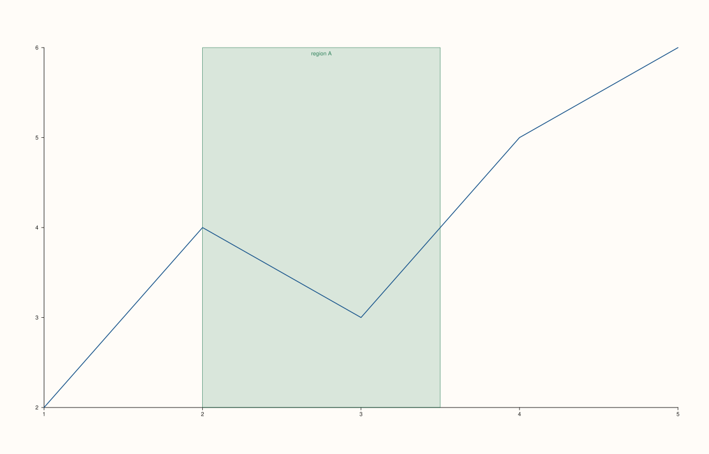
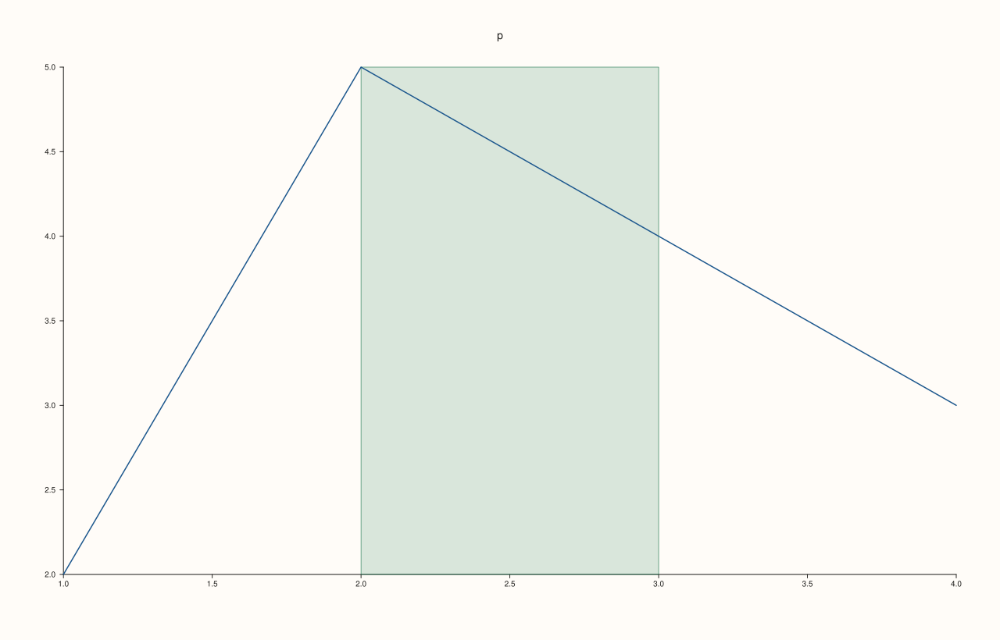
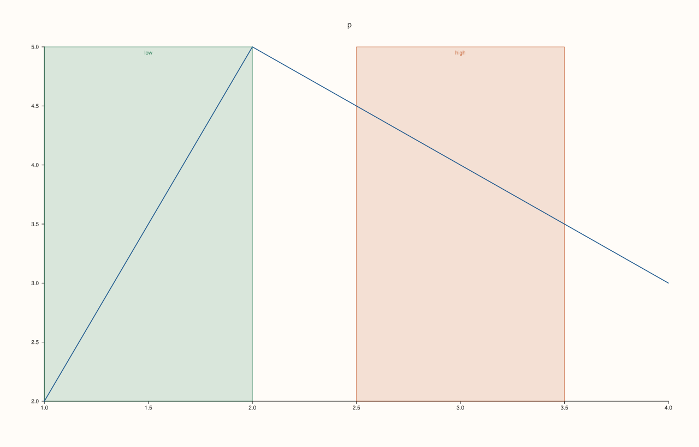
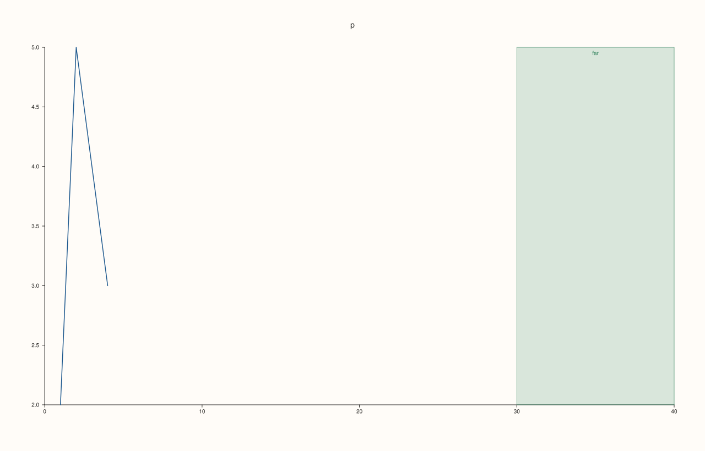
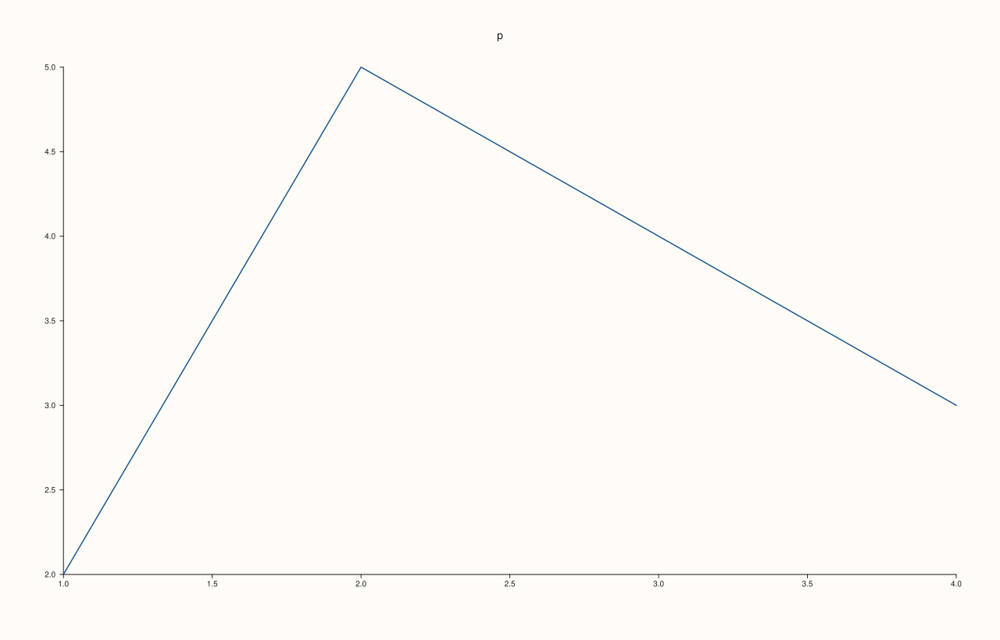

<!-- pluss-hand-authored -->

# Pane::band_x

[Back to Pane API Reference](../../pane_api_reference)

## Signature

```cpp
Pane& Pane::band_x(Range1d span, std::string label = {})
```

## What It Does

Adds a shaded band across the plane from x = `span.low` to `span.high`, with an optional `label`. A band marks a range (an acceptable tolerance, a recession, a season) the way a [rule](rule_x.md) marks a position: it is not a trace and is not in the legend, and it takes its colours from the pane's theme. Each call adds one band; they are kept in order and listed by [`bands`](bands.md).

The span must be finite and strictly increasing (`low < high`); anything else throws `pluss::Error` and nothing is added. A band takes part in the automatic range of its axis, so one outside the data widens the axis to keep it visible. A manual range ([`x_limits`](x_limits.md)) is never changed by it: a band partly inside the range is trimmed to it, and one entirely outside is not drawn. It is drawn when the figure is rendered.

## Parameters

**span** (`Range1d`)
    The range, `{low, high}`, in data units. Finite and strictly increasing.

**label** (`std::string`, default empty)
    Text written on the band. Empty draws no text.

## Returns

`Pane&`
    The same pane, for chaining.

## Examples

Example 1. A shaded range. A band from x = 2 to 3 with the label `target zone`; it is stored with its axis, span and label, and the label is drawn on the band.

```cpp
auto fig = studio("band_x_basic");
auto& pane = fig.pane2("p");
pane.trend(std::vector<double>{1, 2, 3, 4}, std::vector<double>{2, 5, 4, 3});
pane.band_x(Range1d{2.0, 3.0}, "target zone");
const auto& band = pane.bands().front();
std::cout << "stored: axis " << static_cast<int>(band.axis) << ", span " << band.span.low << " .. " << band.span.high << ", label '" << band.label << "'\n";
std::cout << "label drawn: " << (fig.to_svg().find(">target zone<") != std::string::npos) << "\n";
fig.save_svg("figure.svg");
```

### Output

```text
stored: axis 0, span 2 .. 3, label 'target zone'
label drawn: 1
```



Example 2. Without a label. The label is optional; the band is drawn without text and adds shapes to the figure.

```cpp
auto paths = [](const std::string& svg) {
  std::size_t n = 0;
  for (auto at = svg.find("<path"); at != std::string::npos; at = svg.find("<path", at + 1)) ++n;
  return n;
};
auto build = [&](bool with_band) {
  auto fig = studio("band_x_nolabel");
  auto& pane = fig.pane2("p");
  pane.trend(std::vector<double>{1, 2, 3, 4}, std::vector<double>{2, 5, 4, 3});
  if (with_band) pane.band_x(Range1d{2.0, 3.0});
  return fig.to_svg();
};
std::cout << "paths without: " << paths(build(false)) << ", with: " << paths(build(true)) << "\n";
auto fig = studio("band_x_nolabel_out");
auto& pane = fig.pane2("p");
pane.trend(std::vector<double>{1, 2, 3, 4}, std::vector<double>{2, 5, 4, 3});
pane.band_x(Range1d{2.0, 3.0});
fig.save_svg("figure.svg");
```

### Output

```text
paths without: 19, with: 20
```



Example 3. Several bands. Bands are kept in the order added and each is drawn, so a pane can show a normal range and a warning range together.

```cpp
auto fig = studio("band_x_several");
auto& pane = fig.pane2("p");
pane.trend(std::vector<double>{1, 2, 3, 4}, std::vector<double>{2, 5, 4, 3});
pane.band_x(Range1d{1.0, 2.0}, "low").band_x(Range1d{2.5, 3.5}, "high");
std::cout << "bands: " << pane.bands().size() << ":";
for (const auto& b : pane.bands()) std::cout << " " << b.label << " [" << b.span.low << ", " << b.span.high << "]";
std::cout << "\n";
fig.save_svg("figure.svg");
```

### Output

```text
bands: 2: low [1, 2] high [2.5, 3.5]
```



Example 4. Bands and the x range. A band far outside the data widens an automatic range so it stays visible; with a manual range the axis stays where it was set, a band partly inside is trimmed to the range, and one entirely outside is not drawn.

```cpp
auto texts = [](const std::string& svg) {
  std::string out;
  for (std::size_t at = svg.find("<text"); at != std::string::npos; at = svg.find("<text", at + 1)) {
    const auto gt = svg.find('>', at);
    out += svg.substr(gt + 1, svg.find("</text>", gt) - gt - 1) + " ";
  }
  return out;
};
auto build = [&](bool manual) {
  auto fig = studio("band_x_range");
  auto& pane = fig.pane2("p");
  pane.trend(std::vector<double>{1, 2, 3, 4}, std::vector<double>{2, 5, 4, 3});
  pane.y_tick_labels(false);
  pane.z_tick_labels(false);
  if (manual) pane.x_limits(Range1d{0.0, 5.0});
  pane.band_x(Range1d{30.0, 40.0}, "far");
  return fig.to_svg();
};
std::cout << "automatic range: " << texts(build(false)) << "\n";
std::cout << "manual 0 to 5:   " << texts(build(true)) << "\n";
auto fig = studio("band_x_range_out");
auto& pane = fig.pane2("p");
pane.trend(std::vector<double>{1, 2, 3, 4}, std::vector<double>{2, 5, 4, 3});
pane.band_x(Range1d{30.0, 40.0}, "far");
fig.save_svg("figure.svg");
```

### Output

```text
automatic range: p 0 10 20 30 40 far 
manual 0 to 5:   p 0 1 2 3 4 5 
```



Example 5. The span must be finite and strictly increasing. A reversed span, an empty one and a NaN end each throw `pluss::Error`, and no band is added.

```cpp
auto fig = studio("band_x_invalid");
auto& pane = fig.pane2("p");
pane.trend(std::vector<double>{1, 2, 3, 4}, std::vector<double>{2, 5, 4, 3});
const double nan = std::numeric_limits<double>::quiet_NaN();
const Range1d bad[] = {{3.0, 2.0}, {2.0, 2.0}, {nan, 2.0}};
for (const Range1d& span : bad) {
  try {
    pane.band_x(span, "never");
  } catch (const pluss::Error& e) {
    std::cout << span.low << " .. " << span.high << ": " << e.message() << "\n";
  }
}
std::cout << "bands added: " << pane.bands().size() << "\n";
fig.save_svg("figure.svg");
```

### Output

```text
3 .. 2: band_x: range must be finite and strictly increasing
2 .. 2: band_x: range must be finite and strictly increasing
nan .. 2: band_x: range must be finite and strictly increasing
bands added: 0
```



## Notes

- Not `noexcept`: it throws for an invalid span.

## See Also

- [`Pane::rule_x`](rule_x.md): a single position.
- [`Pane::bands`](bands.md): the bands of the pane.
- [`Pane::band_y`](band_y.md): the same for the y axis.
- [`Pane::band_z`](band_z.md): the same for the z axis.

<div class="pluss-inline-prev-next">
  <a class="prev-link" href="axis_label_font_scale.html">
    <span class="label">Previous</span>
    <span class="title">axis_label_font_scale</span>
  </a>
  <a class="next-link" href="band_y.html">
    <span class="label">Next</span>
    <span class="title">band_y</span>
  </a>
</div>
