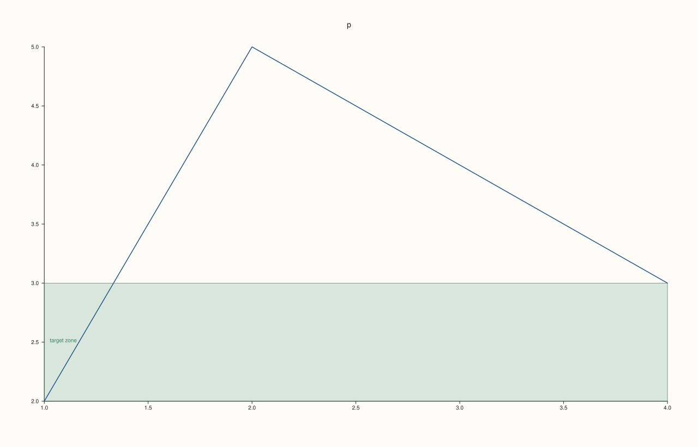

<!-- pluss-hand-authored -->

# Pane::band_y

[Back to Pane API Reference](../../pane_api_reference)

## Signature

```cpp
Pane& Pane::band_y(Range1d span, std::string label = {})
```

## What It Does

The y-axis counterpart of [`band_x()`](band_x.md): draws a shaded reference band spanning
a range on the y-axis. Appends to the exact same shared [`bands()`](bands.md) list, tagged
with `CueAxis::Y`. Every validation detail carries over unchanged — see
[`band_x()`](band_x.md) for the full worked-example set, including the reversed-range
failure.

## Parameters

**span** (`Range1d`)
    The `{low, high}` range to shade. Must be finite and strictly increasing.

**label** (`std::string`, default `{}`)
    Optional text drawn alongside the band.

## Returns

`Pane&`
    A reference to the same pane, for chaining.

## Examples

Example 1. A labeled band spanning part of the y-axis.

```cpp
using namespace pluss::pl;

auto fig = studio("band_y_basic");
auto& pane = fig.pane2();
pane.trend(std::vector<double>{1.0, 2.0, 3.0, 4.0, 5.0}, std::vector<double>{2.0, 4.0, 3.0, 5.0, 6.0});
pane.band_y(Range1d{3.0, 5.0}, "safe zone");
fig.show();

std::cout << pane.bands().size() << "\n";
```

### Output

```text
1
```



## Notes

See [`band_x()`](band_x.md)'s Notes — every detail applies identically here.

## See Also

- [`Pane::band_x`](band_x.md): the x-axis equivalent, with the full worked-example set.
- [`Pane::band_z`](band_z.md): the z-axis equivalent.
- [`Pane::bands`](bands.md): reads back every band added so far.
- [`Pane::rule_y`](rule_y.md): a single-value reference line on the y-axis.

<div class="pluss-inline-prev-next">
  <a class="prev-link" href="band_x.html">
    <span class="label">Previous</span>
    <span class="title">band_x</span>
  </a>
  <a class="next-link" href="band_z.html">
    <span class="label">Next</span>
    <span class="title">band_z</span>
  </a>
</div>
