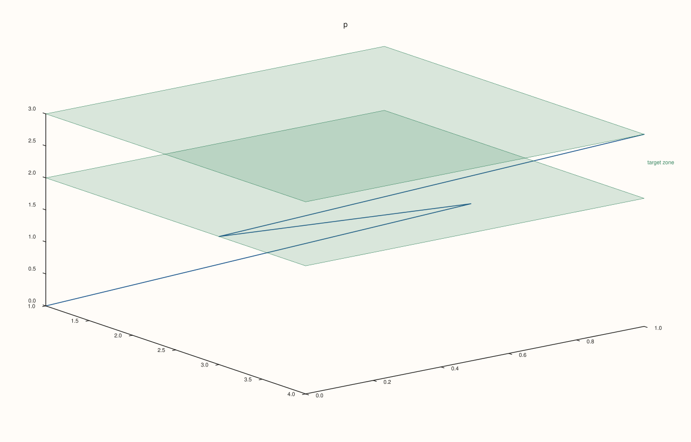

<!-- pluss-hand-authored -->

# Pane::band_z

[Back to Pane API Reference](../../pane_api_reference)

## Signature

```cpp
Pane& Pane::band_z(Range1d span, std::string label = {})
```

## What It Does

The z-axis counterpart of [`band_x()`](band_x.md)/[`band_y()`](band_y.md), meaningful
primarily on 3D (`Volumetric`) panes. Appends to the exact same shared
[`bands()`](bands.md) list, tagged with `CueAxis::Z`. Every validation detail carries over
unchanged — see [`band_x()`](band_x.md) for the full worked-example set.

## Parameters

**span** (`Range1d`)
    The `{low, high}` range to shade. Must be finite and strictly increasing.

**label** (`std::string`, default `{}`)
    Optional text drawn alongside the band.

## Returns

`Pane&`
    A reference to the same pane, for chaining.

## Examples

Example 1. A labeled band spanning part of the z-axis on a 3D pane.

```cpp
using namespace pluss::pl;

auto fig = studio("band_z_basic");
auto& pane = fig.pane3();
pane.path3(std::vector<double>{1.0, 2.0, 3.0}, std::vector<double>{1.0, 2.0, 3.0}, std::vector<double>{1.0, 2.0, 3.0});
pane.band_z(Range1d{1.0, 2.0}, "layer");
fig.show();

std::cout << pane.bands().size() << "\n";
```

### Output

```text
1
```



## Notes

See [`band_x()`](band_x.md)'s Notes — every detail applies identically here. Most useful
on 3D panes; on 2D panes the z-axis state exists but is inert.

## See Also

- [`Pane::band_x`](band_x.md) / [`Pane::band_y`](band_y.md): the x- and y-axis
  equivalents, with the full worked-example set.
- [`Pane::bands`](bands.md): reads back every band added so far.
- [`Pane::rule_z`](rule_z.md): a single-value reference line on the z-axis.

<div class="pluss-inline-prev-next">
  <a class="prev-link" href="band_y.html">
    <span class="label">Previous</span>
    <span class="title">band_y</span>
  </a>
  <a class="next-link" href="pin.html">
    <span class="label">Next</span>
    <span class="title">pin</span>
  </a>
</div>
