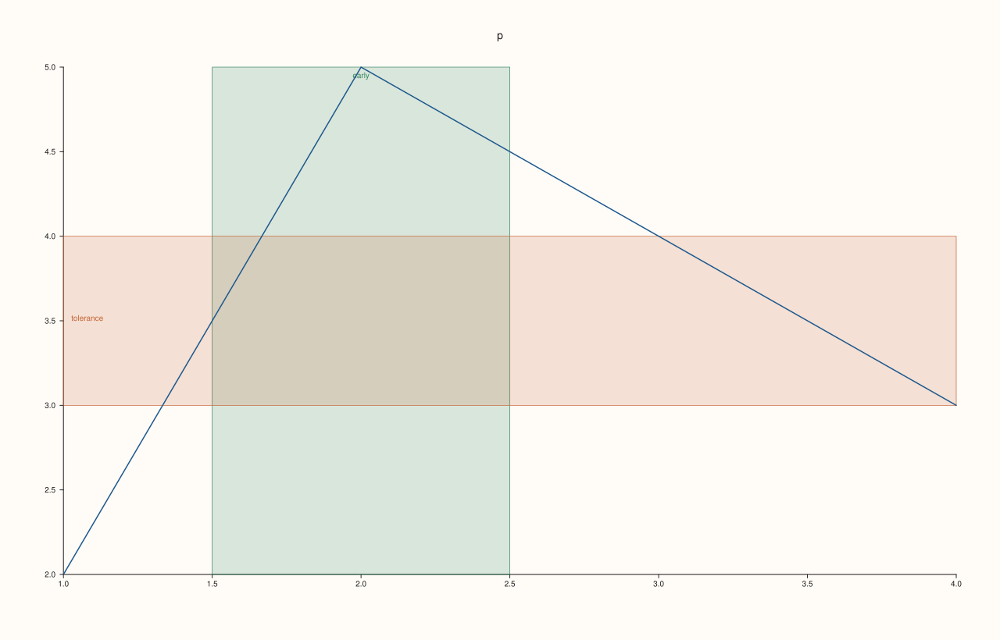
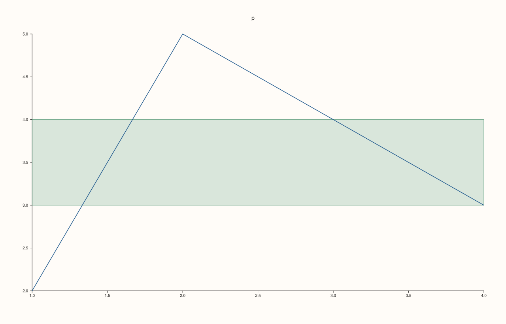
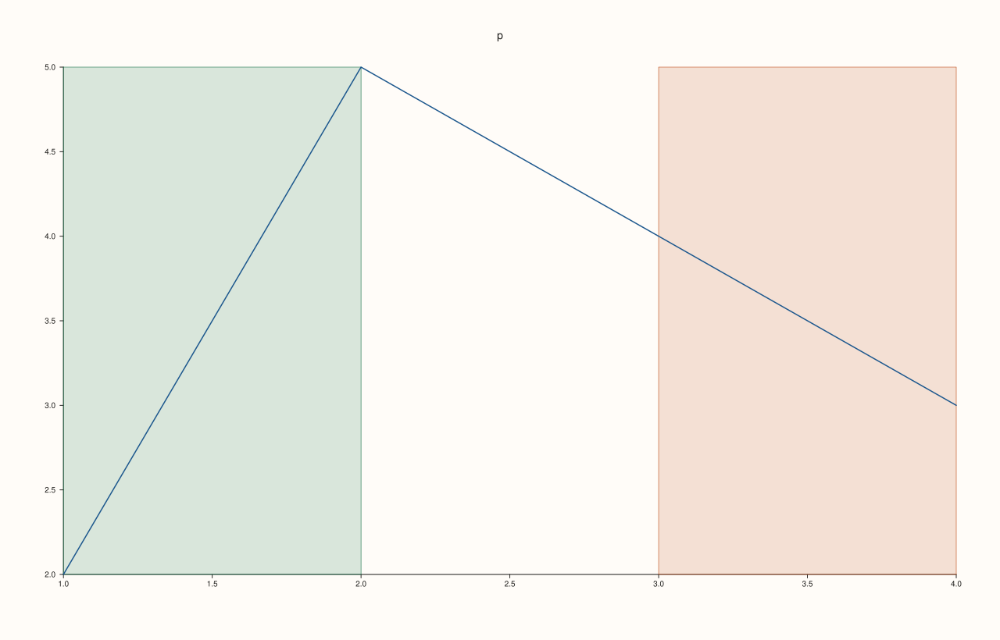

<!-- pluss-hand-authored -->

# Pane::bands

[Back to Pane API Reference](../../pane_api_reference)

## Signature

```cpp
const std::vector<BandCue>& Pane::bands() const noexcept
```

## What It Does

Returns the shaded ranges of the pane, in the order added by [`band_x`](band_x.md), [`band_y`](band_y.md) and [`band_z`](band_z.md), as a read-only vector of `BandCue`:

| Field | Meaning | Default |
|---|---|---|
| `axis` | `CueAxis::X`, `Y` or `Z`: which axis the band spans. | Y |
| `span` | The range, `{low, high}`, in data units. | empty range |
| `label` | The text written on the band; empty for none. | empty |
| `stroke` | The stored outline colour. | an accent |
| `fill` | The stored fill colour, translucent; the figure draws bands in the accents of the pane's theme. | an accent |

The vector is empty for a pane with no bands. It lists what was added, including a z band on a planar pane, which has no axis to draw it on, and it only grows. The reference is to the pane's own vector, so copy it to keep a snapshot.

## Parameters

*(none)*

## Returns

`const std::vector<BandCue>&`
    The bands, oldest first.

## Examples

Example 1. Listing the bands. Bands of the x and y axes are in one list in the order added, each with its axis, span and label.

```cpp
auto fig = studio("bands_list");
auto& pane = fig.pane2("p");
pane.trend(std::vector<double>{1, 2, 3, 4}, std::vector<double>{2, 5, 4, 3});
std::cout << "none yet: " << pane.bands().empty() << "\n";
pane.band_x(Range1d{1.5, 2.5}, "early").band_y(Range1d{3.0, 4.0}, "tolerance");
const char* axes[] = {"x", "y", "z"};
for (const auto& band : pane.bands()) std::cout << axes[static_cast<int>(band.axis)] << " [" << band.span.low << ", " << band.span.high << "]  '" << band.label << "'\n";
fig.save_svg("figure.svg");
```

### Output

```text
none yet: 1
x [1.5, 2.5]  'early'
y [3, 4]  'tolerance'
```



Example 2. Colours. A band carries a translucent fill and an outline, so what lies behind it still shows; the fill is more transparent than opaque.

```cpp
auto fig = studio("bands_colours");
auto& pane = fig.pane2("p");
pane.trend(std::vector<double>{1, 2, 3, 4}, std::vector<double>{2, 5, 4, 3});
pane.band_y(Range1d{3.0, 4.0});
const BandCue& band = pane.bands().front();
std::cout << "fill alpha < 1: " << (band.fill.alpha < 1.0) << ", has a stroke colour: " << (band.stroke.alpha > 0.0) << "\n";
fig.save_svg("figure.svg");
```

### Output

```text
fill alpha < 1: 1, has a stroke colour: 1
```



Example 3. A snapshot needs a copy. The reference follows the pane, so a copy taken earlier keeps the old list.

```cpp
auto fig = studio("bands_snapshot");
auto& pane = fig.pane2("p");
pane.trend(std::vector<double>{1, 2, 3, 4}, std::vector<double>{2, 5, 4, 3});
pane.band_x(Range1d{1.0, 2.0});
const auto snapshot = pane.bands();
const auto& live = pane.bands();
pane.band_x(Range1d{3.0, 4.0});
std::cout << "snapshot: " << snapshot.size() << ", live: " << live.size() << "\n";
fig.save_svg("figure.svg");
```

### Output

```text
snapshot: 1, live: 2
```



## Notes

- `noexcept`, and has no effect on the figure.
- Bands are added with [`band_x`](band_x.md), [`band_y`](band_y.md) and [`band_z`](band_z.md); there is no call that removes one.

## See Also

- [`Pane::band_x`](band_x.md), [`band_y`](band_y.md), [`band_z`](band_z.md): add a band.
- [`Pane::rules`](rules.md), [`pins`](pins.md): the other cues.

<div class="pluss-inline-prev-next">
  <a class="prev-link" href="band_z.html">
    <span class="label">Previous</span>
    <span class="title">band_z</span>
  </a>
  <a class="next-link" href="bucket.html">
    <span class="label">Next</span>
    <span class="title">bucket</span>
  </a>
</div>
