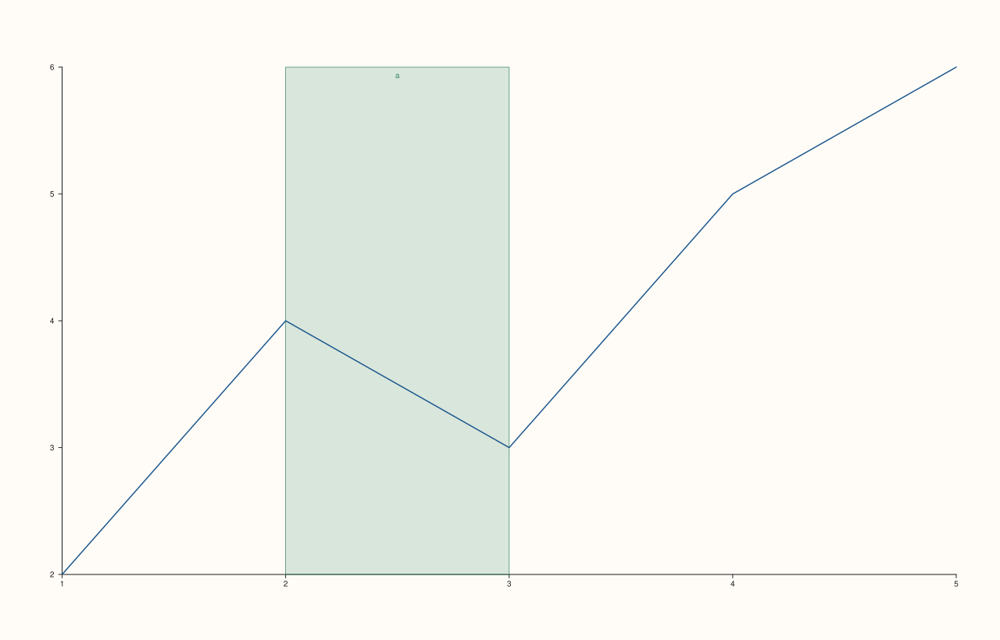

<!-- pluss-hand-authored -->

# Pane::bands

[Back to Pane API Reference](../../pane_api_reference)

## Signature

```cpp
const std::vector<BandCue>& Pane::bands() const noexcept
```

## What It Does

Returns every shaded reference band added so far via [`band_x()`](band_x.md)/
[`band_y()`](band_y.md)/[`band_z()`](band_z.md), in the order they were added. Each
`BandCue` carries its `axis`, `span` (a `Range1d`), `label`, and rendering
`stroke`/`fill` colors (both defaulted).

## Parameters

*(none)*

## Returns

`const std::vector<BandCue>&`
    Every band added so far, in insertion order.

## Examples

Example 1. Empty by default; growing as bands are added.

```cpp
using namespace pluss::pl;

auto fig = studio("bands_check");
auto& pane = fig.pane2();
pane.trend(std::vector<double>{1.0, 2.0, 3.0, 4.0, 5.0}, std::vector<double>{2.0, 4.0, 3.0, 5.0, 6.0});
std::cout << pane.bands().empty() << "\n";

pane.band_x(Range1d{2.0, 3.0}, "a");
std::cout << pane.bands().size() << "\n";
std::cout << (pane.bands()[0].axis == CueAxis::X) << "\n";
fig.show();
```

### Output

```text
1
1
1
```



## Notes

- `noexcept`, `const` — read-only.
- Reflects bands added across all three axis methods in one shared, insertion-ordered
  list.
- No removal API exists — this list only ever grows.

## See Also

- [`Pane::band_x`](band_x.md) / [`Pane::band_y`](band_y.md) / [`Pane::band_z`](band_z.md):
  the only ways to add entries.
- [`Pane::rules`](rules.md) / [`Pane::pins`](pins.md): the other two accumulating
  annotation lists.

<div class="pluss-inline-prev-next">
  <a class="prev-link" href="rules.html">
    <span class="label">Previous</span>
    <span class="title">rules</span>
  </a>
  <a class="next-link" href="pins.html">
    <span class="label">Next</span>
    <span class="title">pins</span>
  </a>
</div>
