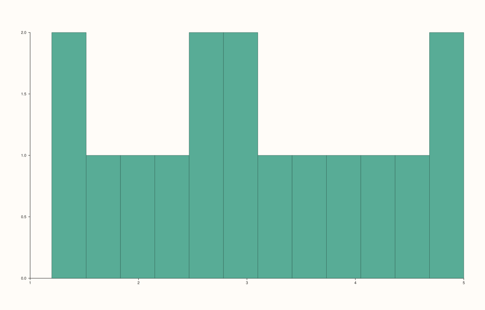
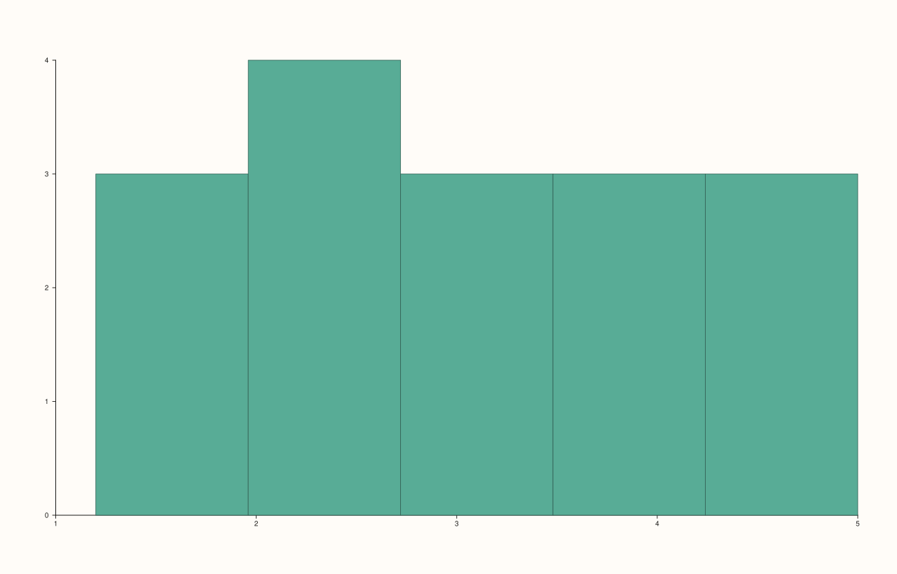
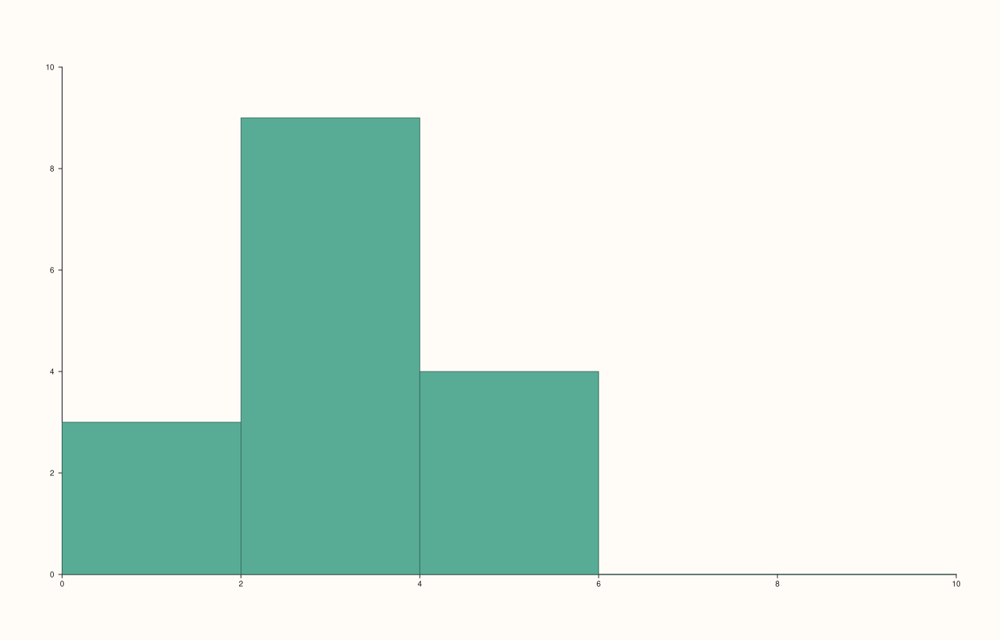

<!-- pluss-hand-authored -->

# Pane::bucket

[Back to Pane API Reference](../../pane_api_reference)

## Signatures

```cpp
template <class Values>
Trace& Pane::bucket(Values&& values, int bins = 12)

template <class Values>
Trace& Pane::bucket(Values&& values, int bins, Range1d range)
```

## What It Does

Adds a histogram trace — the low-level primitive behind `flash::histplot`. Unlike
[`columns()`](columns.md), which draws bars at heights supplied directly, `bucket()`
takes raw, ungrouped `values` and computes the bar heights itself by binning them:

- **`bucket(values, bins = 12)`** — bins the data's own observed range into `bins`
  equal-width buckets (12 by default).
- **`bucket(values, bins, range)`** — bins an explicit `range` instead of the data's own
  observed range, letting bins extend beyond (or be narrower than) what the data actually
  spans.

```{important} Requires a Planar pane
Calling `bucket()` on a `Volumetric` pane throws
`std::logic_error("bucket requires a planar pane")`.
```

## Parameters

**values** (series-convertible)
    The raw, ungrouped observations to bin.

**bins** (`int`, default `12`)
    The number of equal-width bins.

**range** (`Range1d`, third-parameter overload only)
    An explicit range to bin over, instead of the data's own observed min/max.

## Returns

`Trace&`
    A reference to the newly created trace, for chaining.

## Examples

Example 1. The default 12 bins, over the data's own observed range.

```cpp
using namespace pluss::pl;

auto fig = studio("bucket_default_bins");
auto& pane = fig.pane2();
std::vector<double> raw{1.2, 1.5, 1.8, 2.1, 2.3, 2.5, 2.6, 2.8, 3.0, 3.2, 3.5, 3.9, 4.1, 4.4, 4.8, 5.0};
pane.bucket(raw);
fig.show();
```



Example 2. A custom, coarser bin count — verified via direct SVG diff to render genuinely
different bar boundaries from Example 1.

```cpp
using namespace pluss::pl;

auto fig = studio("bucket_custom_bins");
auto& pane = fig.pane2();
std::vector<double> raw{1.2, 1.5, 1.8, 2.1, 2.3, 2.5, 2.6, 2.8, 3.0, 3.2, 3.5, 3.9, 4.1, 4.4, 4.8, 5.0};
pane.bucket(raw, 5);
fig.show();
```



Example 3. An explicit range wider than the data's own observed span — verified
genuinely different again.

```cpp
using namespace pluss::pl;

auto fig = studio("bucket_custom_range");
auto& pane = fig.pane2();
std::vector<double> raw{1.2, 1.5, 1.8, 2.1, 2.3, 2.5, 2.6, 2.8, 3.0, 3.2, 3.5, 3.9, 4.1, 4.4, 4.8, 5.0};
pane.bucket(raw, 5, Range1d{0.0, 10.0});
fig.show();
```



## Notes

- Not `noexcept`.
- Computes bar heights from raw observations, unlike [`columns()`](columns.md), which
  takes pre-computed heights directly.
- `range` has no validity check of its own visible at this layer — an unusual (e.g.
  reversed) range would be expected to surface as a downstream rendering issue rather
  than a clean `bucket()`-level exception, though this wasn't specifically exercised here.
- `flash::histplot` is a convenience wrapper around this exact method.

## See Also

- [`Pane::columns`](columns.md): takes pre-computed bar heights directly, rather than
  binning raw observations.
- [`Pane::quartet`](quartet.md): another statistics-summarizing trace kind, computing
  quartile-based box/whisker statistics instead of a binned count.

<div class="pluss-inline-prev-next">
  <a class="prev-link" href="columns_h.html">
    <span class="label">Previous</span>
    <span class="title">columns_h</span>
  </a>
  <a class="next-link" href="quartet.html">
    <span class="label">Next</span>
    <span class="title">quartet</span>
  </a>
</div>
