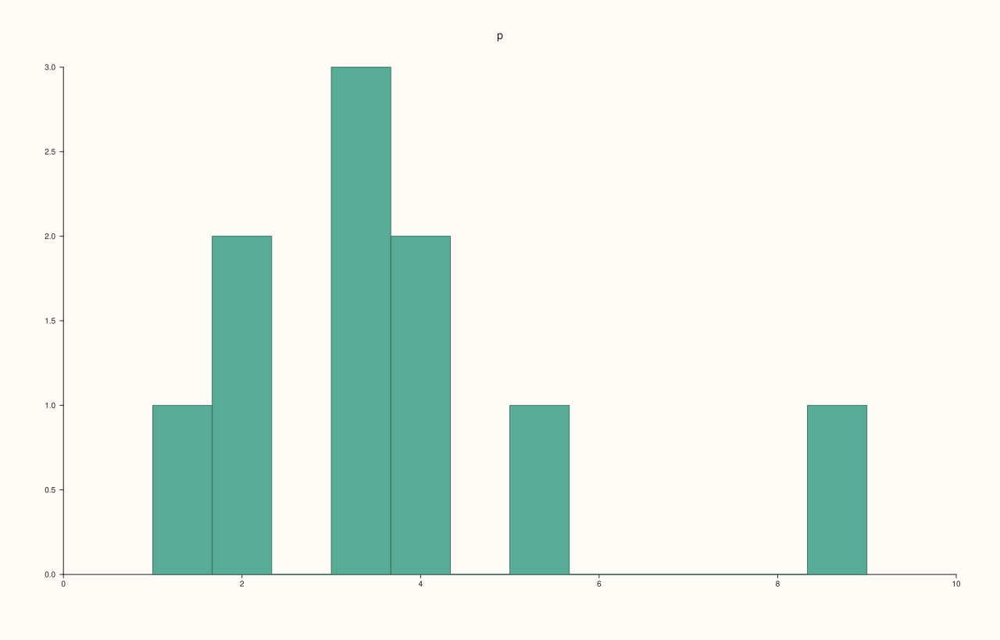
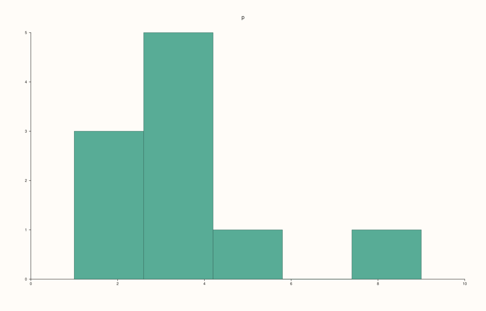
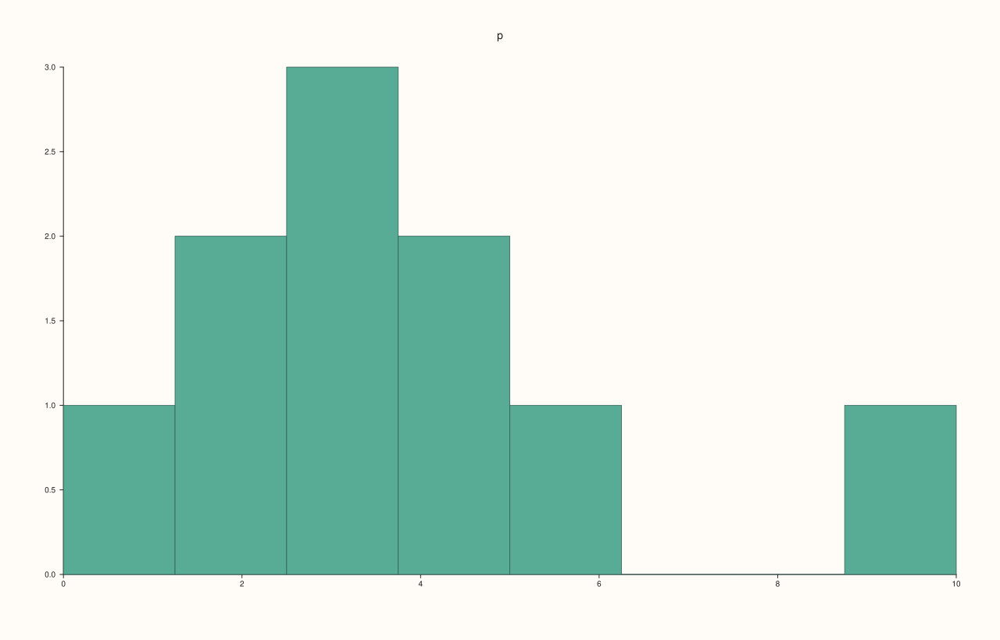
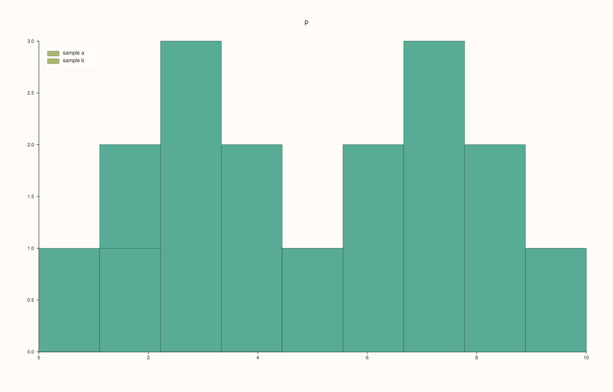
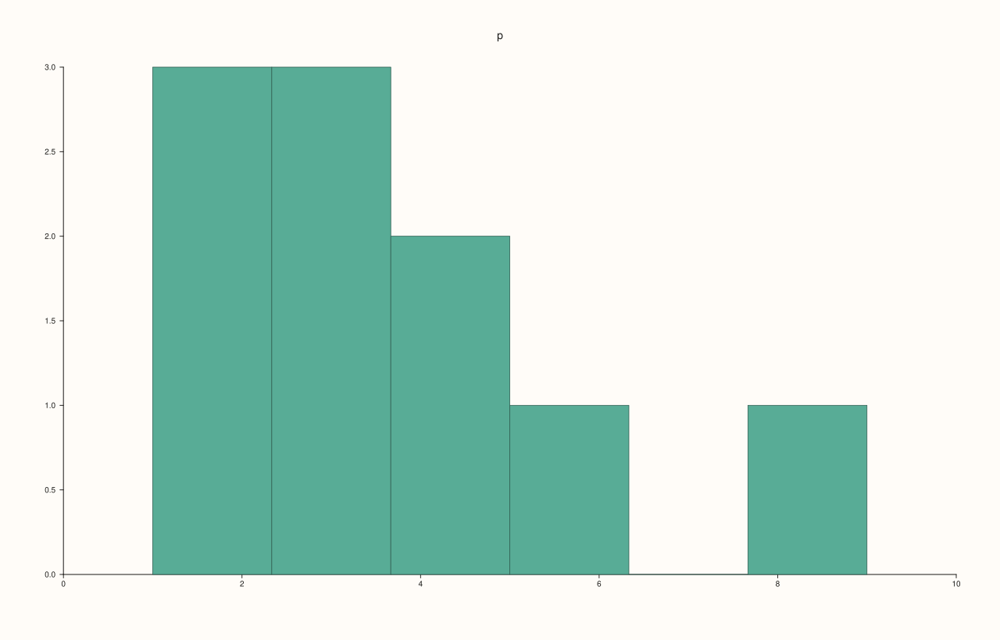

<!-- pluss-hand-authored -->

# Pane::bucket

[Back to Pane API Reference](../../pane_api_reference)

## Signature

```cpp
Trace& Pane::bucket(Series values, int bins = 12)
Trace& Pane::bucket(Series values, int bins, Range1d range)
```

## What It Does

Adds a **histogram**: the raw `values` are counted into equal-width bins and a bar is drawn for the count of each. Where [`columns`](columns.md) draws bars of heights you give, `bucket` finds the heights itself.

| Call | Bins |
|---|---|
| `bucket(values, bins = 12)` | `bins` bins of equal width over the range of the data. |
| `bucket(values, bins, range)` | `bins` bins of equal width over `range`, which may be wider or narrower than the data. |

`bins` must be positive, `range` finite with `low` below `high`, and there must be at least one value; otherwise the call throws. The y axis shows counts. Use an explicit `range` and `bins` whenever two histograms are to be compared, so that their bars line up.

## Parameters

**values** (`Series`-convertible)
    The data to count. Not empty.

**bins** (`int`, default 12)
    The number of bins. Positive.

**range** (`Range1d`, optional)
    The interval to divide into bins. `low` below `high`, both finite.

## Returns

`Trace&`
    The new trace.

## Examples

Example 1. Ten values counted into 12 bins by default. The bins span the data's own range, 1 to 9.

```cpp
auto fig = studio("bucket_default");
auto& pane = fig.pane2("p");
pane.bucket(std::vector<double>{1, 2, 2, 3, 3, 3, 4, 4, 5, 9});
fig.save_svg("figure.svg");
```



Example 2. The number of bins is the second argument. Five bins gives wider bars with larger counts, and the tallest bar is read from the axis.

```cpp
auto build = [&](int bins) {
  auto fig = studio("bucket_bins");
  auto& pane = fig.pane2("p");
  pane.x_tick_labels(false);
  pane.bucket(std::vector<double>{1, 2, 2, 3, 3, 3, 4, 4, 5, 9}, bins);
  return fig.to_svg();
};
auto texts = [](const std::string& svg) {
  std::string out;
  for (std::size_t at = svg.find("<text"); at != std::string::npos; at = svg.find("<text", at + 1)) {
    const auto gt = svg.find('>', at);
    out += svg.substr(gt + 1, svg.find("</text>", gt) - gt - 1) + " ";
  }
  return out;
};
std::cout << "3 bins:  " << texts(build(3)) << "\n";
std::cout << "12 bins: " << texts(build(12)) << "\n";
auto fig = studio("bucket_bins_out");
auto& pane = fig.pane2("p");
pane.bucket(std::vector<double>{1, 2, 2, 3, 3, 3, 4, 4, 5, 9}, 5);
fig.save_svg("figure.svg");
```

### Output

```text
3 bins:  p 0 1 2 3 4 5 6 
12 bins: p 0.0 0.5 1.0 1.5 2.0 2.5 3.0 
```



Example 3. An explicit range replaces the data's own: the bins divide the range given. Here 8 bins span 0 to 10, a little wider than the data, and the bars stand in their places on that scale.

```cpp
auto fig = studio("bucket_range");
auto& pane = fig.pane2("p");
pane.bucket(std::vector<double>{1, 2, 2, 3, 3, 3, 4, 4, 5, 9}, 8, Range1d{0.0, 10.0});
fig.save_svg("figure.svg");
```



Example 4. To compare two samples on one scale, give both the same range and the same number of bins.

```cpp
auto fig = studio("bucket_two");
auto& pane = fig.pane2("p");
pane.bucket(std::vector<double>{1, 2, 2, 3, 3, 3, 4, 4, 5, 9}, 9, Range1d{0.0, 10.0}).label("sample a");
pane.bucket(std::vector<double>{5, 6, 6, 7, 7, 7, 8, 8, 9, 2}, 9, Range1d{0.0, 10.0}).label("sample b");
pane.legend(KeyPlace::NorthWest);
fig.save_svg("figure.svg");
```



Example 5. Integer data is accepted as it is.

```cpp
auto fig = studio("bucket_ints");
auto& pane = fig.pane2("p");
pane.bucket(std::vector<int>{1, 2, 2, 3, 3, 3, 4, 4, 5, 9}, 6);
fig.save_svg("figure.svg");
```



Example 6. Inputs that cannot be drawn are refused when the trace is added, and the message names the method and the problem. The pane keeps the traces it had.

```cpp
auto report = [](const char* what, auto&& call) {
  auto fig = studio("bucket_errors");
  auto& pane = fig.pane2("p");
  try {
    call(pane);
    std::cout << what << ": accepted\n";
  } catch (const pluss::Error& e) {
    std::cout << what << ": " << e.message() << "\n";
  }
};
report("no bins", [](Pane& pane) { pane.bucket(std::vector<double>{1, 2, 3}, 0); });
report("negative bins", [](Pane& pane) { pane.bucket(std::vector<double>{1, 2, 3}, -3); });
report("range reversed", [](Pane& pane) { pane.bucket(std::vector<double>{1, 2, 3}, 4, Range1d{3.0, 1.0}); });
report("no values", [](Pane& pane) { pane.bucket(std::vector<double>{}, 4); });
auto fig = studio("bucket_errors_out");
auto& pane = fig.pane2("p");
pane.trend(std::vector<double>{0, 1}, std::vector<double>{0, 1});
fig.save_svg("figure.svg");
```

### Output

```text
no bins: bucket: bins must be positive
negative bins: bucket: bins must be positive
range reversed: bucket: range must be finite and increasing
no values: bucket: values must be a non-empty vector
```


Example 7. `bucket` needs a planar pane. On a volumetric pane it throws at once, naming the kind it needs, and nothing is added.

```cpp
auto fig = studio("bucket_wrong_pane");
auto& pane = fig.pane3("p");
try {
  pane.bucket(std::vector<double>{1, 2, 3});
} catch (const pluss::Error& e) {
  std::cout << e.message() << "\n";
}
std::cout << "traces: " << pane.trace_count() << "\n";
fig.save_svg("figure.svg");
```

### Output

```text
bucket requires a planar pane
traces: 0
```


## Notes

- Returns the new [`Trace&`](../trace/label.md); the reference stays valid for the life of the pane, and the style calls of the trace ([`label`](../trace/label.md), [`stroke`](../trace/stroke.md), [`width`](../trace/width.md), ...) chain off it.
- The data is copied into the trace when it is added, so changing the vector afterwards does not change the figure.

## See Also

- [`Pane::columns`](columns.md): bars of heights you supply.
- [`Pane::violin`](violin.md), [`Pane::quartet`](quartet.md): other summaries of a sample.

<div class="pluss-inline-prev-next">
  <a class="prev-link" href="bands.html">
    <span class="label">Previous</span>
    <span class="title">bands</span>
  </a>
  <a class="next-link" href="caption.html">
    <span class="label">Next</span>
    <span class="title">caption</span>
  </a>
</div>
