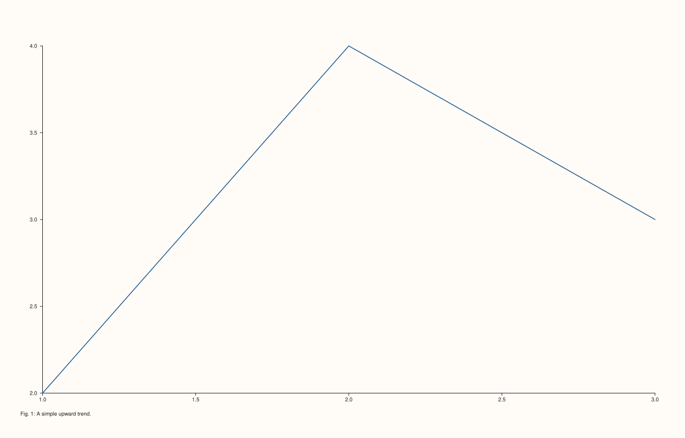

<!-- pluss-hand-authored -->

# Pane::caption

[Back to Pane API Reference](../../pane_api_reference)

## Signature

```cpp
Pane& Pane::caption(std::string text)
```

## What It Does

Sets a caption for this pane specifically — text drawn once, scoped to this pane, distinct
from every other text-bearing element on a pane: not the [`title()`](title.md) (drawn
above the plot area), not an axis's own [`x_label()`](x_label.md)/etc. (drawn alongside an
axis), and not [`Studio`'s shared captions](../studio/x_caption.md) (which require
per-pane align-group opt-in and are shared across multiple aligned panes). This per-pane
caption has none of that machinery — it always renders for exactly this one pane, with no
opt-in required. No validation; an empty string clears it.

## Parameters

**text** (`std::string`)
    The caption text. An empty string clears any existing caption.

## Returns

`Pane&`
    A reference to the same pane, for chaining.

## Examples

Example 1. The default: no caption.

```cpp
using namespace pluss::pl;

auto fig = studio("caption_default");
auto& pane = fig.pane2();
pane.trend(std::vector<double>{1.0, 2.0, 3.0}, std::vector<double>{2.0, 4.0, 3.0});
fig.show();

std::cout << pane.caption_text().empty() << "\n";
```

### Output

```text
1
```


Example 2. An explicit caption.

```cpp
using namespace pluss::pl;

auto fig = studio("caption_set");
auto& pane = fig.pane2();
pane.trend(std::vector<double>{1.0, 2.0, 3.0}, std::vector<double>{2.0, 4.0, 3.0});
pane.caption("Fig. 1: A simple upward trend.");
fig.show();

std::cout << pane.caption_text() << "\n";
```

### Output

```text
Fig. 1: A simple upward trend.
```



Example 3. Clearing with an empty string.

```cpp
using namespace pluss::pl;

auto fig = studio("caption_cleared");
auto& pane = fig.pane2();
pane.trend(std::vector<double>{1.0, 2.0, 3.0}, std::vector<double>{2.0, 4.0, 3.0});
pane.caption("Will be cleared");
pane.caption("");

std::cout << pane.caption_text().empty() << "\n";
```

### Output

```text
1
```

## Notes

- Not marked `noexcept`, though it only fails via `std::string`'s own allocation failure —
  no argument validation of its own.
- An empty string is a legitimate way to clear the caption, not an error.
- Entirely independent of [`Studio`'s shared captions](../studio/x_caption.md) — this one
  needs no align-group opt-in and always applies to exactly this pane.

## See Also

- [`Pane::caption_text`](caption_text.md): reads back the current value.
- [`Pane::title`](title.md): the pane's own title, a separate text element.
- [`Studio::x_caption`](../studio/x_caption.md) / [`y_caption`](../studio/y_caption.md) /
  [`z_caption`](../studio/z_caption.md): the figure-wide, align-group-scoped alternative.

<div class="pluss-inline-prev-next">
  <a class="prev-link" href="scale_guide.html">
    <span class="label">Previous</span>
    <span class="title">scale_guide</span>
  </a>
  <a class="next-link" href="caption_text.html">
    <span class="label">Next</span>
    <span class="title">caption_text</span>
  </a>
</div>
