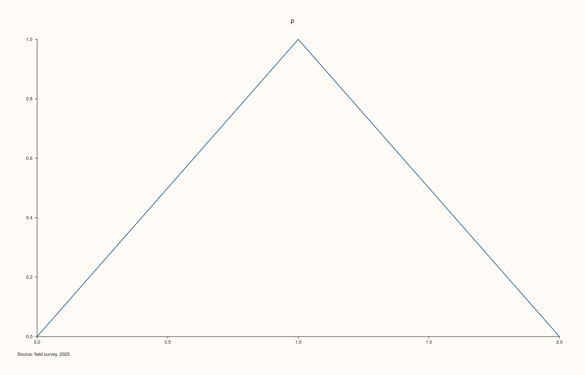
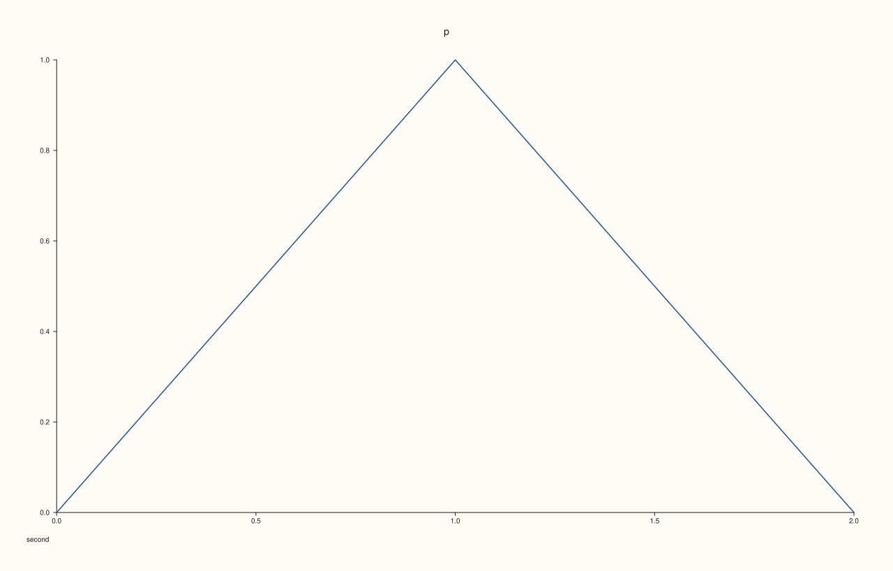
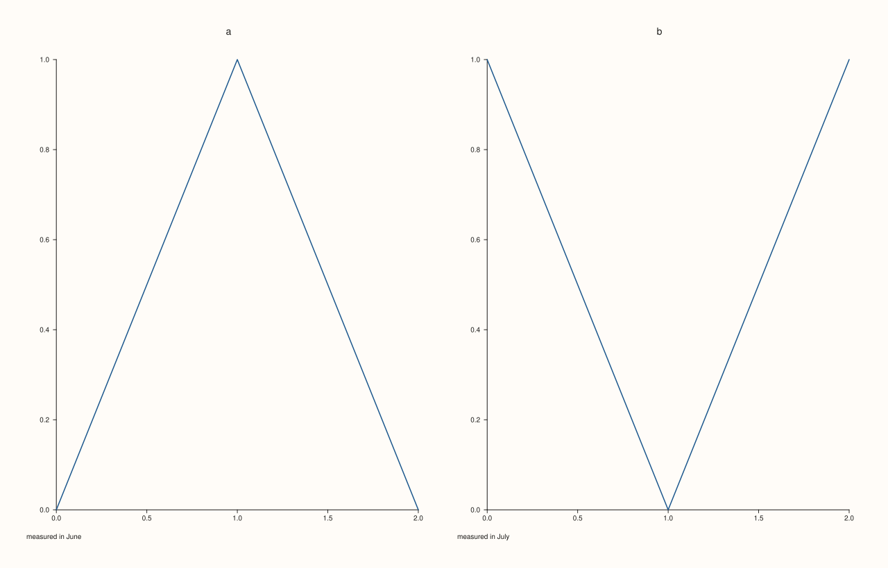
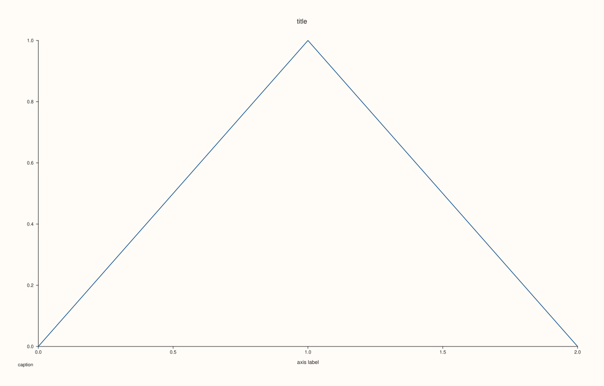
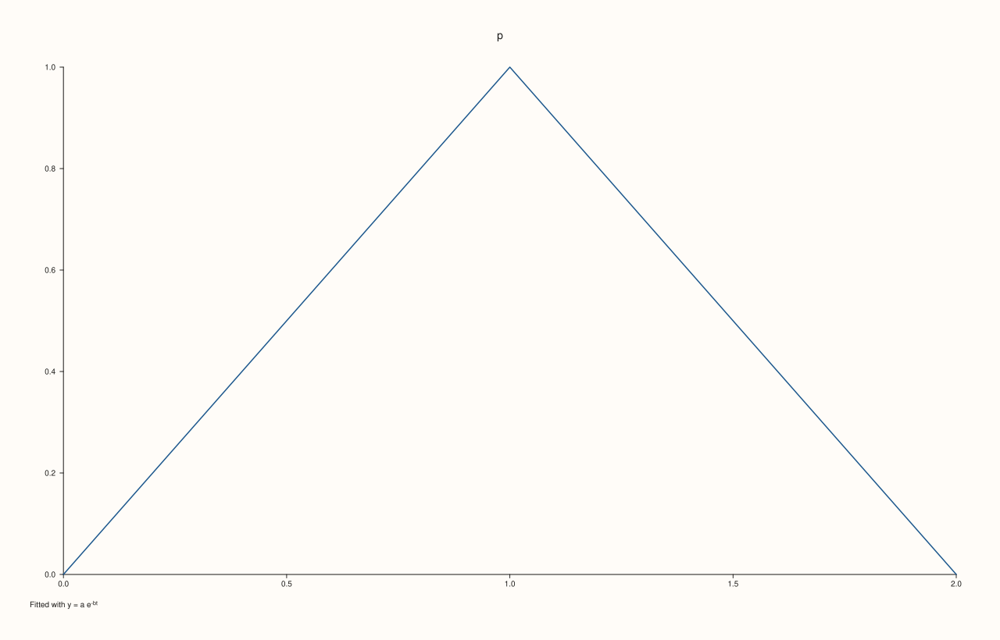

<!-- pluss-hand-authored -->

# Pane::caption

[Back to Pane API Reference](../../pane_api_reference)

## Signature

```cpp
Pane& Pane::caption(std::string text)
```

## What It Does

Sets a caption for this pane: a line of text written below its plot, for a source, a unit, a note on how the data was made. An empty string removes it.

A caption belongs to one pane and needs nothing else. The figure-level captions written once for a group of panes are [`Studio::x_caption`](../studio/x_caption.md) and its y and z forms, which panes join by [alignment group](align_x.md); a pane's [`title`](title.md) is above the plot and an axis label is beside an axis. The pane keeps room for its caption only while it has one.

## Parameters

**text** (`std::string`)
    The caption. Empty for none.

## Returns

`Pane&`
    The same pane, for chaining.

## Examples

Example 1. A caption written below the plot, and read back with `caption_text()`.

```cpp
auto fig = studio("caption_set");
auto& pane = fig.pane2("p");
pane.trend(std::vector<double>{0, 1, 2}, std::vector<double>{0, 1, 0});
pane.caption("Source: field survey, 2025");
std::cout << pane.caption_text() << "\n";
std::cout << "drawn: " << (fig.to_svg().find(">Source: field survey, 2025<") != std::string::npos) << "\n";
fig.save_svg("figure.svg");
```

### Output

```text
Source: field survey, 2025
drawn: 1
```



Example 2. A second call replaces the caption and an empty string removes it; with it removed the figure is the figure of a pane that never had one.

```cpp
auto build = [&](int mode) {
  auto fig = studio("caption_clear");
  auto& pane = fig.pane2("p");
  pane.trend(std::vector<double>{0, 1, 2}, std::vector<double>{0, 1, 0});
  if (mode >= 1) pane.caption("first");
  if (mode == 2) pane.caption("second").caption("");
  return fig.to_svg();
};
std::cout << "first drawn: " << (build(1).find(">first<") != std::string::npos) << "\n";
std::cout << "cleared == never set: " << (build(2) == build(0)) << "\n";
auto fig = studio("caption_clear_out");
auto& pane = fig.pane2("p");
pane.trend(std::vector<double>{0, 1, 2}, std::vector<double>{0, 1, 0});
pane.caption("second");
fig.save_svg("figure.svg");
```

### Output

```text
first drawn: 1
cleared == never set: 1
```



Example 3. Each pane has its own caption, written under its own plot.

```cpp
auto fig = studio("caption_each");
fig.mosaic(1, 2);
auto& a = fig.pane2("a");
a.trend(std::vector<double>{0, 1, 2}, std::vector<double>{0, 1, 0});
a.caption("measured in June");
auto& b = fig.pane2("b");
b.trend(std::vector<double>{0, 1, 2}, std::vector<double>{1, 0, 1});
b.caption("measured in July");
fig.save_svg("figure.svg");
```



Example 4. A caption is not a title and not an axis label; all three are drawn, each where it belongs.

```cpp
auto fig = studio("caption_distinct");
auto& pane = fig.pane2("p");
pane.trend(std::vector<double>{0, 1, 2}, std::vector<double>{0, 1, 0});
pane.title("title").caption("caption").x_label("axis label");
const std::string svg = fig.to_svg();
std::cout << "title, caption and label all drawn: " << (svg.find(">title<") != std::string::npos && svg.find(">caption<") != std::string::npos && svg.find(">axis label<") != std::string::npos) << "\n";
fig.save_svg("figure.svg");
```

### Output

```text
title, caption and label all drawn: 1
```



Example 5. Mathematics between dollar signs is typeset.

```cpp
auto fig = studio("caption_math");
auto& pane = fig.pane2("p");
pane.trend(std::vector<double>{0, 1, 2}, std::vector<double>{0, 1, 0});
pane.caption("Fitted with $y = a e^{-bt}$");
fig.save_svg("figure.svg");
```



## Notes

- Any string is accepted; the empty string clears the caption.

## See Also

- [`Pane::caption_text`](caption_text.md): read it back.
- [`Pane::title`](title.md): the text above the plot.
- [`Studio::x_caption`](../studio/x_caption.md): a caption shared by a group of panes.

<div class="pluss-inline-prev-next">
  <a class="prev-link" href="bucket.html">
    <span class="label">Previous</span>
    <span class="title">bucket</span>
  </a>
  <a class="next-link" href="caption_text.html">
    <span class="label">Next</span>
    <span class="title">caption_text</span>
  </a>
</div>
