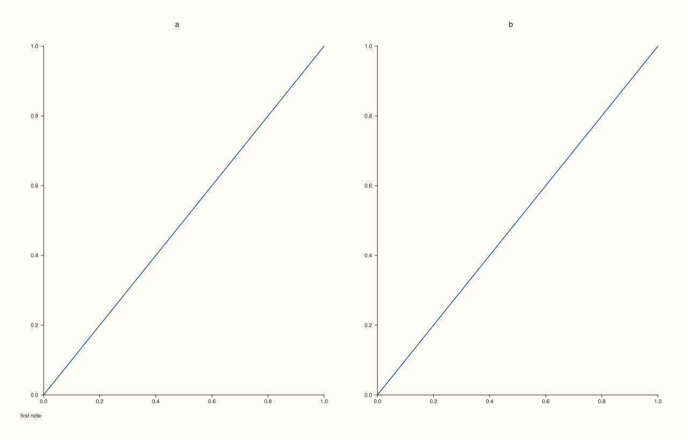

<!-- pluss-hand-authored -->

# Pane::caption_text

[Back to Pane API Reference](../../pane_api_reference)

## Signature

```cpp
const std::string& Pane::caption_text() const noexcept
```

## What It Does

Returns the pane's caption, as set by [`caption`](caption.md); an empty string means none. A new pane has none.

Use it to check what a pane carries before changing it, or to collect the captions of a figure's panes into a note. The reference is to the pane's own string and follows later calls; copy it to keep the value.

## Parameters

*(none)*

## Returns

`const std::string&`
    The caption, empty for none.

## Examples

Example 1. A new pane has no caption.

```cpp
auto fig = studio("caption_text_default");
auto& pane = fig.pane2("p");
pane.trend(std::vector<double>{0, 1, 2}, std::vector<double>{0, 1, 0});
std::cout << "empty: " << pane.caption_text().empty() << "\n";
fig.save_svg("figure.svg");
```

### Output

```text
empty: 1
```


Example 2. After `caption()` it returns the text; after clearing it, the empty string.

```cpp
auto fig = studio("caption_text_after");
auto& pane = fig.pane2("p");
pane.trend(std::vector<double>{0, 1, 2}, std::vector<double>{0, 1, 0});
pane.caption("a note");
std::cout << "'" << pane.caption_text() << "'\n";
pane.caption("");
std::cout << "'" << pane.caption_text() << "'\n";
fig.save_svg("figure.svg");
```

### Output

```text
'a note'
''
```


Example 3. Collecting the captions of a figure.

```cpp
auto fig = studio("caption_text_collect");
fig.mosaic(1, 2);
auto& a = fig.pane2("a");
a.trend(std::vector<double>{0, 1}, std::vector<double>{0, 1});
a.caption("first note");
auto& b = fig.pane2("b");
b.trend(std::vector<double>{0, 1}, std::vector<double>{0, 1});
for (const auto& pane : fig.panes()) {
  std::cout << pane.title_text() << ": " << (pane.caption_text().empty() ? "(none)" : pane.caption_text()) << "\n";
}
fig.save_svg("figure.svg");
```

### Output

```text
a: first note
b: (none)
```



## Notes

- `noexcept`; reads only.

## See Also

- [`Pane::caption`](caption.md): set the caption.
- [`Pane::title_text`](title_text.md): the title.

<div class="pluss-inline-prev-next">
  <a class="prev-link" href="caption.html">
    <span class="label">Previous</span>
    <span class="title">caption</span>
  </a>
  <a class="next-link" href="clear_align.html">
    <span class="label">Next</span>
    <span class="title">clear_align</span>
  </a>
</div>
