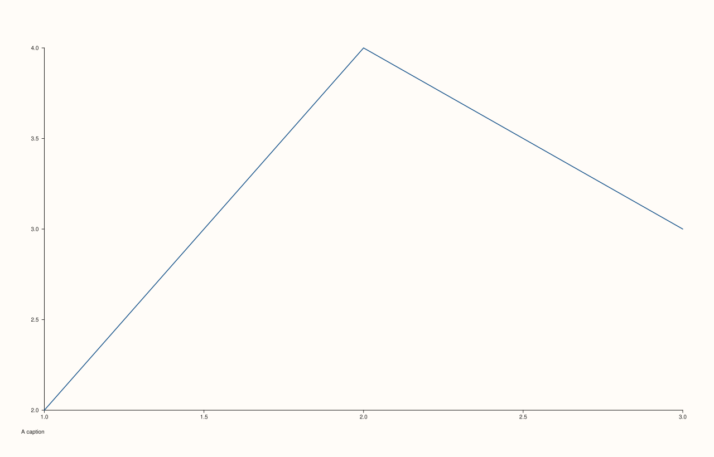

<!-- pluss-hand-authored -->

# Pane::caption_text

[Back to Pane API Reference](../../pane_api_reference)

## Signature

```cpp
const std::string& Pane::caption_text() const noexcept
```

## What It Does

Returns this pane's current caption — whatever [`caption()`](caption.md) most recently set
it to. Empty by default.

## Parameters

*(none)*

## Returns

`const std::string&`
    The pane's current caption text.

## Examples

Example 1. Empty by default, then set.

```cpp
using namespace pluss::pl;

auto fig = studio("caption_text_check");
auto& pane = fig.pane2();
pane.trend(std::vector<double>{1.0, 2.0, 3.0}, std::vector<double>{2.0, 4.0, 3.0});
std::cout << pane.caption_text().empty() << "\n";

pane.caption("A caption");
std::cout << pane.caption_text() << "\n";
fig.show();
```

### Output

```text
1
A caption
```



## Notes

- `noexcept`, `const`.
- Empty is a well-defined default, not an error state.

## See Also

- [`Pane::caption`](caption.md): the only way to change this.

<div class="pluss-inline-prev-next">
  <a class="prev-link" href="caption.html">
    <span class="label">Previous</span>
    <span class="title">caption</span>
  </a>
  <a class="next-link" href="rule_x.html">
    <span class="label">Next</span>
    <span class="title">rule_x</span>
  </a>
</div>
