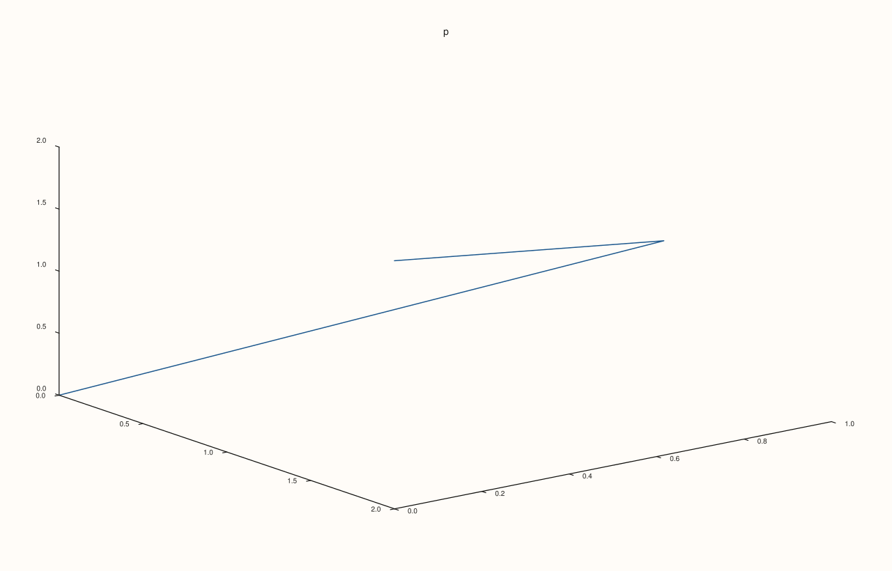
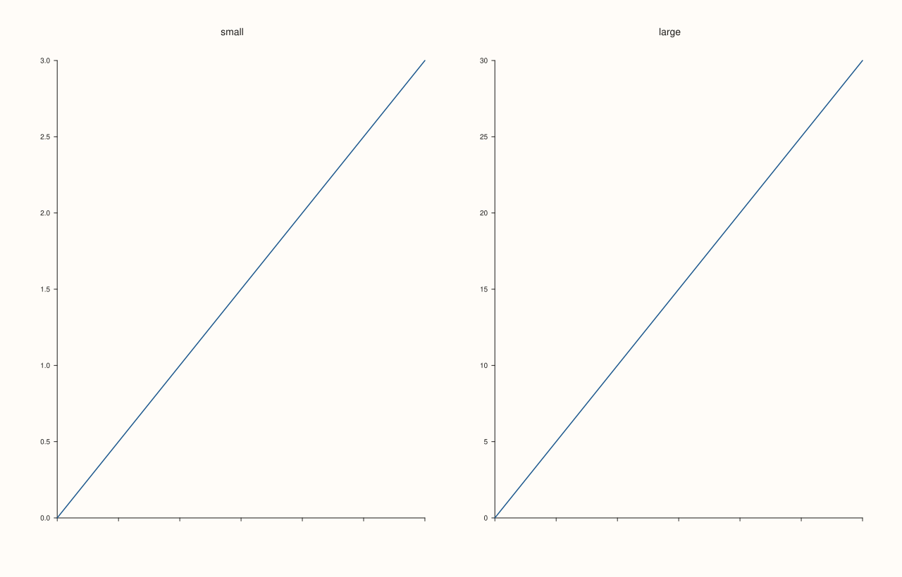
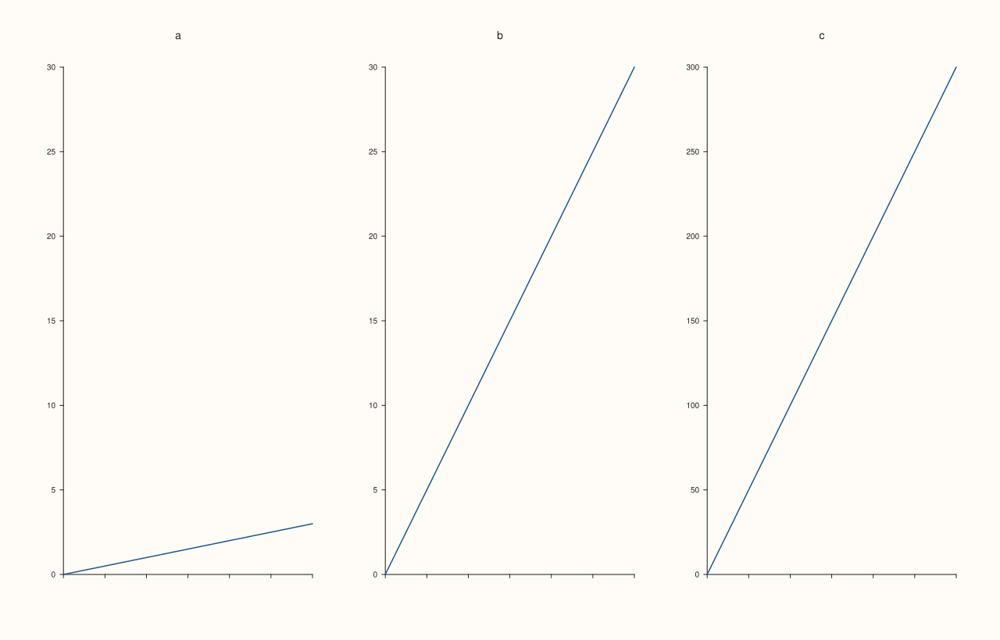

<!-- pluss-hand-authored -->

# Pane::clear_align

[Back to Pane API Reference](../../pane_api_reference)

## Signature

```cpp
Pane& Pane::clear_align() noexcept
```

## What It Does

Takes the pane out of every alignment group at once: the x, y and z groups all become empty. It undoes [`align_xyz`](align_xyz.md) and [`align_xy`](align_xy.md), and it undoes any mix of `align_x`, `align_y` and `align_z`, whatever names they used.

The pane then has the ranges its own data and limits give it, and no shared caption is drawn for it. Other panes are unaffected: if the group had other members, they keep sharing among themselves, and the range they share no longer includes this pane's data.

## Parameters

*(none)*

## Returns

`Pane&`
    The same pane, for chaining.

## Examples

Example 1. All three groups are left. A 3D pane in groups on all three axes reads back empty on all of them.

```cpp
auto fig = studio("clear_align_all");
auto& pane = fig.pane3("p");
pane.path3(std::vector<double>{0, 1, 2}, std::vector<double>{0, 1, 0}, std::vector<double>{0, 1, 2});
pane.align_xyz("g");
std::cout << "before: '" << pane.x_align_group() << "' '" << pane.y_align_group() << "' '" << pane.z_align_group() << "'\n";
pane.clear_align();
std::cout << "after:  '" << pane.x_align_group() << "' '" << pane.y_align_group() << "' '" << pane.z_align_group() << "'\n";
fig.save_svg("figure.svg");
```

### Output

```text
before: 'g' 'g' 'g'
after:  '' '' ''
```



Example 2. Different names, one call. The three axes were put in groups with three different names; `clear_align()` does not need to know them.

```cpp
auto fig = studio("clear_align_mixed");
auto& pane = fig.pane2("p");
pane.trend(std::vector<double>{0, 1, 2}, std::vector<double>{0, 1, 0});
pane.align_x("columns").align_y("rows").align_z("depth");
pane.clear_align();
std::cout << "'" << pane.x_align_group() << "' '" << pane.y_align_group() << "' '" << pane.z_align_group() << "'\n";
fig.save_svg("figure.svg");
```

### Output

```text
'' '' ''
```


Example 3. The effect on the figure. Two panes share their ranges through the group `g`; after both call `clear_align()`, each shows the range of its own data again, and the figure is the figure of panes that never joined.

```cpp
auto build = [&](int mode) {
  auto fig = studio("clear_align_effect");
  fig.mosaic(1, 2);
  auto& small = fig.pane2("small");
  small.trend(std::vector<double>{0, 1, 2, 3}, std::vector<double>{0, 1, 2, 3});
  small.x_tick_labels(false);
  auto& large = fig.pane2("large");
  large.trend(std::vector<double>{0, 1, 2, 3}, std::vector<double>{0, 10, 20, 30});
  large.x_tick_labels(false);
  if (mode >= 1) {
    small.align_y("g");
    large.align_y("g");
  }
  if (mode == 2) {
    small.clear_align();
    large.clear_align();
  }
  return fig.to_svg();
};
auto texts = [](const std::string& svg) {
  std::string out;
  for (std::size_t at = svg.find("<text"); at != std::string::npos; at = svg.find("<text", at + 1)) {
    const auto gt = svg.find('>', at);
    out += svg.substr(gt + 1, svg.find("</text>", gt) - gt - 1) + " ";
  }
  return out;
};
std::cout << "joined:  " << texts(build(1)) << "\n";
std::cout << "cleared: " << texts(build(2)) << "\n";
std::cout << "cleared == never joined: " << (build(2) == build(0)) << "\n";
auto fig = studio("clear_align_effect_out");
fig.mosaic(1, 2);
auto& small = fig.pane2("small");
small.trend(std::vector<double>{0, 1, 2, 3}, std::vector<double>{0, 1, 2, 3});
small.x_tick_labels(false);
auto& large = fig.pane2("large");
large.trend(std::vector<double>{0, 1, 2, 3}, std::vector<double>{0, 10, 20, 30});
large.x_tick_labels(false);
fig.save_svg("figure.svg");
```

### Output

```text
joined:  small 0 5 10 15 20 25 30 large 0 5 10 15 20 25 30 
cleared: small 0.0 0.5 1.0 1.5 2.0 2.5 3.0 large 0 5 10 15 20 25 30 
cleared == never joined: 1
```



Example 4. Only this pane leaves. Of three panes in the group `g`, one calls `clear_align()`; the other two keep sharing a range, which no longer covers the one that left.

```cpp
auto fig = studio("clear_align_partial");
fig.mosaic(1, 3);
auto& a = fig.pane2("a");
a.trend(std::vector<double>{0, 1, 2, 3}, std::vector<double>{0, 1, 2, 3});
a.x_tick_labels(false);
auto& b = fig.pane2("b");
b.trend(std::vector<double>{0, 1, 2, 3}, std::vector<double>{0, 10, 20, 30});
b.x_tick_labels(false);
auto& c = fig.pane2("c");
c.trend(std::vector<double>{0, 1, 2, 3}, std::vector<double>{0, 100, 200, 300});
c.x_tick_labels(false);
a.align_y("g");
b.align_y("g");
c.align_y("g");
c.clear_align();
auto texts = [](const std::string& svg) {
  std::string out;
  for (std::size_t at = svg.find("<text"); at != std::string::npos; at = svg.find("<text", at + 1)) {
    const auto gt = svg.find('>', at);
    out += svg.substr(gt + 1, svg.find("</text>", gt) - gt - 1) + " ";
  }
  return out;
};
std::cout << texts(fig.to_svg()) << "\n";
fig.save_svg("figure.svg");
```

### Output

```text
a 0 5 10 15 20 25 30 b 0 5 10 15 20 25 30 c 0 50 100 150 200 250 300 
```



Example 5. Nothing to clear is fine. On a pane in no group the call does nothing, and it can be called any number of times.

```cpp
auto fig = studio("clear_align_noop");
auto& pane = fig.pane2("p");
pane.trend(std::vector<double>{0, 1, 2}, std::vector<double>{0, 1, 0});
pane.clear_align().clear_align();
std::cout << "empty: " << (pane.x_align_group().empty() && pane.y_align_group().empty() && pane.z_align_group().empty()) << "\n";
fig.save_svg("figure.svg");
```

### Output

```text
empty: 1
```


## Notes

- `noexcept`. The single-axis forms are [`clear_x_align`](align_x.md), [`clear_y_align`](align_y.md) and [`clear_z_align`](align_z.md).
- Clearing a group changes only this pane; it never removes the group from other panes or deletes a caption.

## See Also

- [`Pane::align_xyz`](align_xyz.md), [`align_xy`](align_xy.md): join groups.
- [`Pane::align_x`](align_x.md): the single-axis forms and the full account of what a group does.

<div class="pluss-inline-prev-next">
  <a class="prev-link" href="caption_text.html">
    <span class="label">Previous</span>
    <span class="title">caption_text</span>
  </a>
  <a class="next-link" href="cloud.html">
    <span class="label">Next</span>
    <span class="title">cloud</span>
  </a>
</div>
