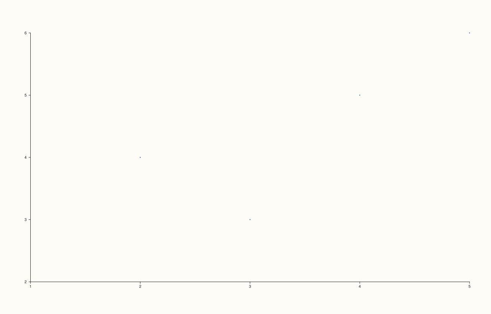
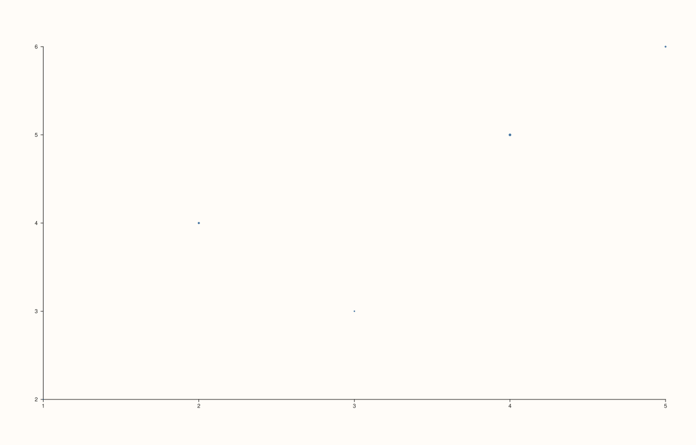
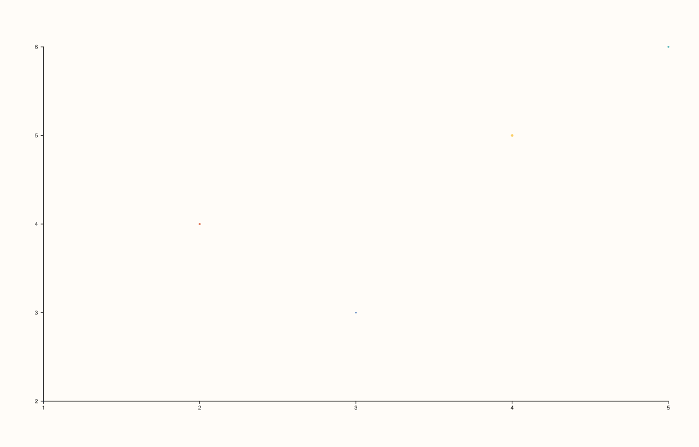

<!-- pluss-hand-authored -->

# Pane::cloud

[Back to Pane API Reference](../../pane_api_reference)

## Signatures

```cpp
template <class X, class Y>
Trace& Pane::cloud(X&& x, Y&& y)

template <class X, class Y, class Size>
Trace& Pane::cloud(X&& x, Y&& y, Size&& size)

template <class X, class Y, class Size, class Color>
Trace& Pane::cloud(X&& x, Y&& y, Size&& size, Color&& color)
```

## What It Does

Adds an unconnected scatter-point trace — the low-level primitive behind
`flash::scatterplot`. Three overloads progressively add per-point styling data, each
building on the last:

- **`cloud(x, y)`** — plain points at each `(x, y)` coordinate, uniform size and color.
- **`cloud(x, y, size)`** — `size` supplies a per-point size value (a third data
  dimension, commonly used for "bubble chart" style plots).
- **`cloud(x, y, size, color)`** — `color` additionally supplies a per-point value mapped
  to color (a fourth data dimension).

All parameters accept anything series-convertible.

```{important} Requires a Planar pane
Like every 2D-only trace method, calling `cloud()` on a `Volumetric` pane throws
`std::logic_error("cloud requires a planar pane")`. See Example 4.
```

## Parameters

**x**, **y** (series-convertible)
    The point coordinates.

**size** (series-convertible, second and third overloads)
    Per-point size values.

**color** (series-convertible, third overload only)
    Per-point values mapped to color.

## Returns

`Trace&`
    A reference to the newly created trace, for chaining.

## Examples

Example 1. Plain scatter points.

```cpp
using namespace pluss::pl;

auto fig = studio("cloud_xy");
auto& pane = fig.pane2();
pane.cloud(std::vector<double>{1.0, 2.0, 3.0, 4.0, 5.0}, std::vector<double>{2.0, 4.0, 3.0, 5.0, 6.0});
fig.show();
```



Example 2. Adding per-point size — verified via direct SVG diff to render genuinely
different marker sizes from Example 1.

```cpp
using namespace pluss::pl;

auto fig = studio("cloud_xy_size");
auto& pane = fig.pane2();
pane.cloud(std::vector<double>{1.0, 2.0, 3.0, 4.0, 5.0}, std::vector<double>{2.0, 4.0, 3.0, 5.0, 6.0},
           std::vector<double>{10.0, 40.0, 20.0, 60.0, 30.0});
fig.show();
```



Example 3. Adding per-point color on top of size — verified genuinely different again.

```cpp
using namespace pluss::pl;

auto fig = studio("cloud_xy_size_color");
auto& pane = fig.pane2();
pane.cloud(std::vector<double>{1.0, 2.0, 3.0, 4.0, 5.0}, std::vector<double>{2.0, 4.0, 3.0, 5.0, 6.0},
           std::vector<double>{10.0, 40.0, 20.0, 60.0, 30.0}, std::vector<double>{0.1, 0.9, 0.3, 0.7, 0.5});
fig.show();
```



Example 4. Calling `cloud()` on a 3D pane throws.

```cpp
using namespace pluss::pl;

auto fig = studio("cloud_wrong_kind");
auto& pane = fig.pane3();

try {
  pane.cloud(std::vector<double>{1.0, 2.0}, std::vector<double>{1.0, 2.0});
} catch (const std::logic_error& e) {
  std::cout << e.what() << "\n";
}
```

### Output

```text
cloud requires a planar pane
```

## Notes

- Not `noexcept`.
- Each additional overload argument (`size`, then `color`) is purely additive — there's
  no way to supply `color` without also supplying `size`, since the shorter overloads
  simply don't have that parameter slot.
- `flash::scatterplot` is a convenience wrapper around this exact method.

## See Also

- [`Pane::cloud3`](cloud3.md): the 3D counterpart.
- [`Pane::trend`](trend.md): the connected-line counterpart.
- [`Trace::label`](../trace/label.md): the most common thing chained off the return value.

<div class="pluss-inline-prev-next">
  <a class="prev-link" href="trend.html">
    <span class="label">Previous</span>
    <span class="title">trend</span>
  </a>
  <a class="next-link" href="columns.html">
    <span class="label">Next</span>
    <span class="title">columns</span>
  </a>
</div>
