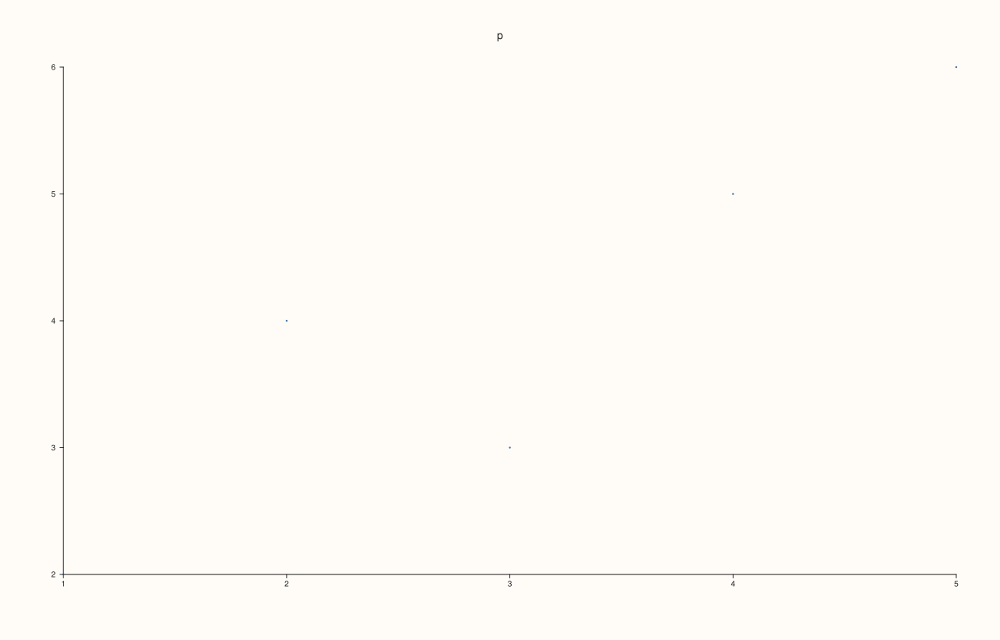
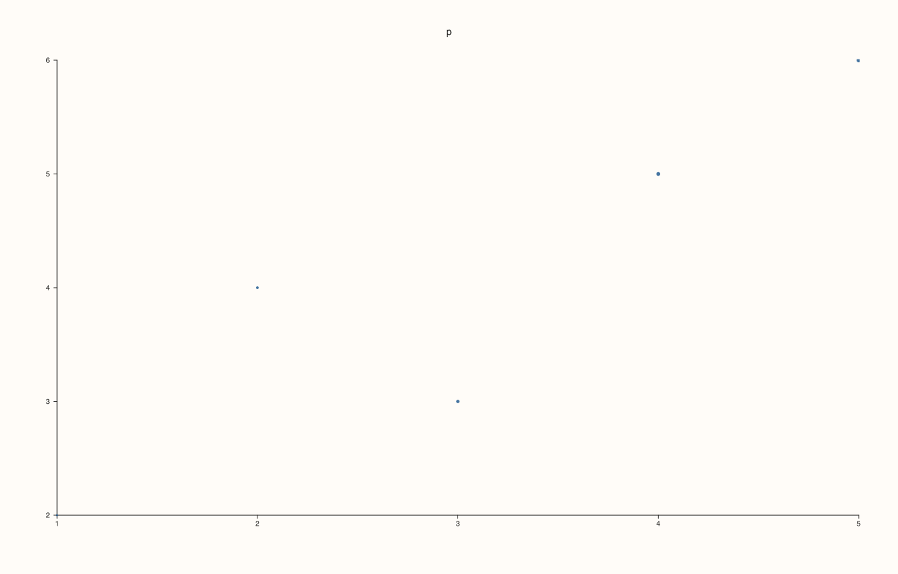
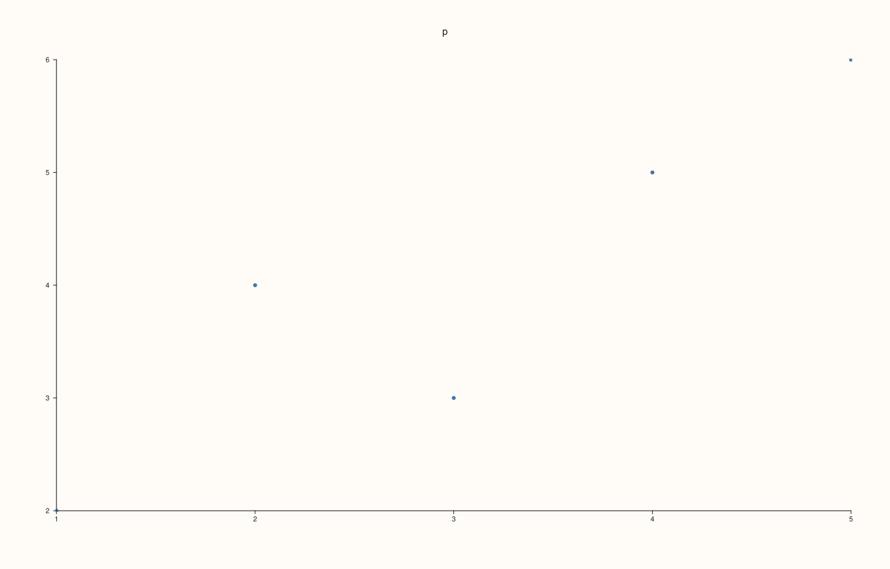
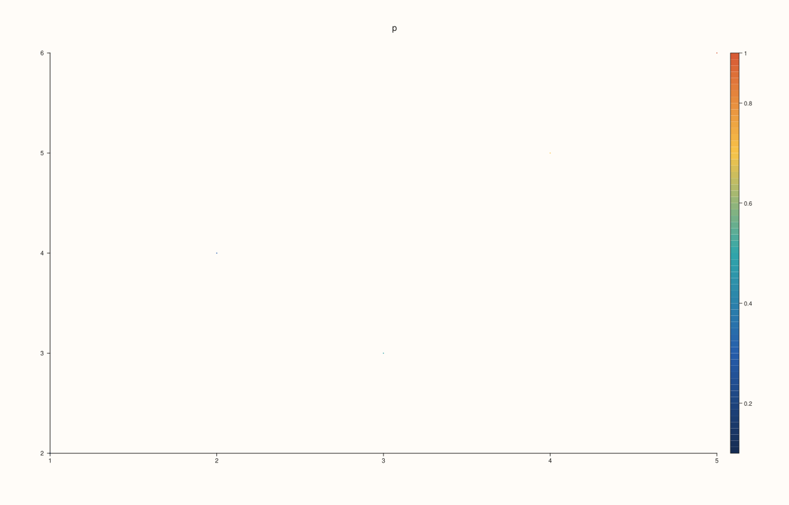
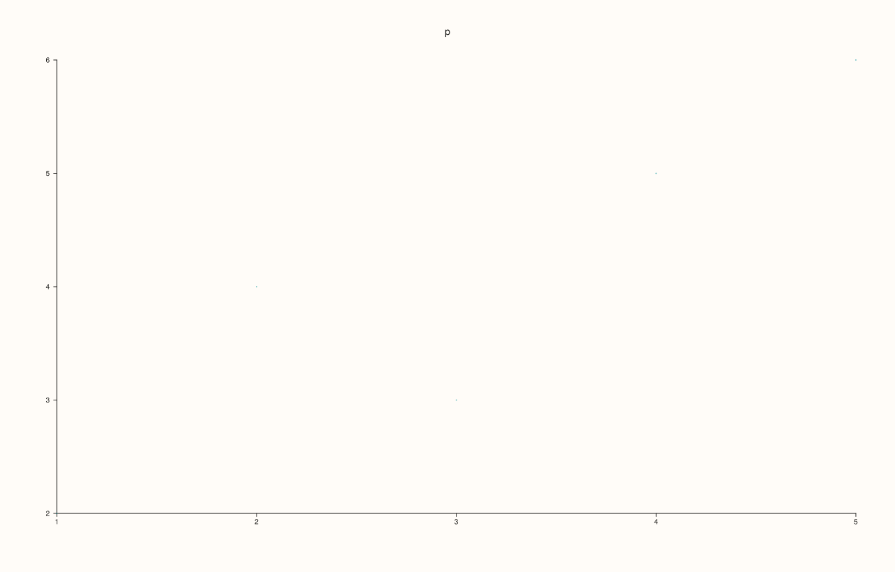

<!-- pluss-hand-authored -->

# Pane::cloud

[Back to Pane API Reference](../../pane_api_reference)

## Signature

```cpp
Trace& Pane::cloud(Series x, Series y)
Trace& Pane::cloud(Series x, Series y, Series size)
Trace& Pane::cloud(Series x, Series y, Series size, Series color)
```

## What It Does

Adds a **cloud**: a marker at each point `(x[i], y[i])`, with nothing joining them. It is a scatter plot, and with the optional series it carries two more quantities in the size and the colour of the markers.

| Call | Adds |
|---|---|
| `cloud(x, y)` | Markers of one size and one colour. |
| `cloud(x, y, size)` | A size for each marker (or one size for all). |
| `cloud(x, y, size, color)` | A colour for each marker too (or one for all), taken from the palette over the range of `color`. |

There is no call with a colour and no size: pass a single size to keep one marker size for all. The range the colours are mapped over is the data's own, unless [`color_limits`](color_limits.md) or [`color_limit_method`](color_limit_method.md) says otherwise; the palette is the trace's ([`Trace::palette`](../trace/palette.md)).  
The size is the area of the marker, so the radius grows as its square root; the radius is `0.31 * sqrt(size)` points. A marker is never smaller than a visible dot, about one point in radius. When the sizes of a trace are small, their scale is raised together so that the smallest positive size reaches that dot and the sizes still differ in the same ratio; a single size (one value for all) is drawn at least that big. All series have the same length, or length 1.

## Parameters

**x**, **y** (`Series`-convertible)
    The positions.

**size** (`Series`-convertible, optional)
    The size of each marker, or one size for all.

**color** (`Series`-convertible, optional)
    The value that colours each marker, or one value for all.

## Returns

`Trace&`
    The new trace.

## Examples

Example 1. Points at `(x[i], y[i])`, all of one size and colour.

```cpp
auto fig = studio("cloud_plain");
auto& pane = fig.pane2("p");
pane.cloud(std::vector<double>{1, 2, 3, 4, 5}, std::vector<double>{2, 4, 3, 5, 6});
fig.save_svg("figure.svg");
```



Example 2. A third series gives each point its own size: a bubble chart. The size is an area: a point of size 100 has the area of four points of size 25, and so twice their radius. Here the sizes grow from 20 to 100.

```cpp
auto fig = studio("cloud_size");
auto& pane = fig.pane2("p");
pane.cloud(std::vector<double>{1, 2, 3, 4, 5}, std::vector<double>{2, 4, 3, 5, 6}, std::vector<double>{20, 40, 60, 80, 100});
fig.save_svg("figure.svg");
```



Example 3. A single size is repeated for every point, so a series of equal markers can be larger or smaller than the default. Sizes 25 and 100 are two and one scale.

```cpp
auto build = [&](double size) {
  auto fig = studio("cloud_size_scalar");
  auto& pane = fig.pane2("p");
  pane.cloud(std::vector<double>{1, 2, 3, 4, 5}, std::vector<double>{2, 4, 3, 5, 6}, std::vector<double>{size});
  return fig.to_svg();
};
std::cout << "size 25 != size 100: " << (build(25.0) != build(100.0)) << "\n";
auto fig = studio("cloud_size_scalar_out");
auto& pane = fig.pane2("p");
pane.cloud(std::vector<double>{1, 2, 3, 4, 5}, std::vector<double>{2, 4, 3, 5, 6}, std::vector<double>{100.0});
fig.save_svg("figure.svg");
```

### Output

```text
size 25 != size 100: 1
```



Example 4. A fourth series colours the points through the palette, from its lowest value to its highest. The colour guide, switched on with [`scale_guide`](scale_guide.md), shows which value each colour stands for.

```cpp
auto fig = studio("cloud_color");
auto& pane = fig.pane2("p");
pane.cloud(std::vector<double>{1, 2, 3, 4, 5}, std::vector<double>{2, 4, 3, 5, 6}, std::vector<double>{3, 3, 3, 3, 3}, std::vector<double>{0.1, 0.3, 0.5, 0.7, 0.9});
pane.scale_guide(true);
fig.save_svg("figure.svg");
```



Example 5. Size and colour together: two more quantities on the same plot.

```cpp
auto fig = studio("cloud_both");
auto& pane = fig.pane2("p");
pane.cloud(std::vector<double>{1, 2, 3, 4, 5}, std::vector<double>{2, 4, 3, 5, 6}, std::vector<double>{5, 4, 3, 2, 1}, std::vector<double>{10, 20, 30, 40, 50});
pane.scale_guide(true);
fig.save_svg("figure.svg");
```


Example 6. A single colour value is repeated: every point takes the same place in the palette.

```cpp
auto fig = studio("cloud_color_scalar");
auto& pane = fig.pane2("p");
pane.cloud(std::vector<double>{1, 2, 3, 4, 5}, std::vector<double>{2, 4, 3, 5, 6}, std::vector<double>{3}, std::vector<double>{0.8});
fig.save_svg("figure.svg");
```



Example 7. Inputs that cannot be drawn are refused when the trace is added, and the message names the method and the problem. The pane keeps the traces it had.

```cpp
auto report = [](const char* what, auto&& call) {
  auto fig = studio("cloud_errors");
  auto& pane = fig.pane2("p");
  try {
    call(pane);
    std::cout << what << ": accepted\n";
  } catch (const pluss::Error& e) {
    std::cout << what << ": " << e.message() << "\n";
  }
};
report("x and y differ", [](Pane& pane) { pane.cloud(std::vector<double>{1, 2, 3}, std::vector<double>{1, 2}); });
report("size differs", [](Pane& pane) { pane.cloud(std::vector<double>{1, 2, 3}, std::vector<double>{1, 2, 3}, std::vector<double>{1, 2}); });
report("color differs", [](Pane& pane) { pane.cloud(std::vector<double>{1, 2, 3}, std::vector<double>{1, 2, 3}, std::vector<double>{1, 1, 1}, std::vector<double>{1, 2}); });
auto fig = studio("cloud_errors_out");
auto& pane = fig.pane2("p");
pane.trend(std::vector<double>{0, 1}, std::vector<double>{0, 1});
fig.save_svg("figure.svg");
```

### Output

```text
x and y differ: cloud: series lengths must match or broadcast from scalar
size differs: cloud: size length must match the plotted point count or be scalar
color differs: cloud: color length must match the plotted point count or be scalar
```


Example 8. `cloud` needs a planar pane. On a volumetric pane it throws at once, naming the kind it needs, and nothing is added.

```cpp
auto fig = studio("cloud_wrong_pane");
auto& pane = fig.pane3("p");
try {
  pane.cloud(std::vector<double>{0, 1}, std::vector<double>{0, 1});
} catch (const pluss::Error& e) {
  std::cout << e.message() << "\n";
}
std::cout << "traces: " << pane.trace_count() << "\n";
fig.save_svg("figure.svg");
```

### Output

```text
cloud requires a planar pane
traces: 0
```


## Notes

- Returns the new [`Trace&`](../trace/label.md); the reference stays valid for the life of the pane, and the style calls of the trace ([`label`](../trace/label.md), [`stroke`](../trace/stroke.md), [`width`](../trace/width.md), ...) chain off it.
- The data is copied into the trace when it is added, so changing the vector afterwards does not change the figure.

## See Also

- [`Pane::cloud3`](cloud3.md): markers in three dimensions.
- [`Pane::scale_guide`](scale_guide.md): the key to the colours.
- [`Pane::color_limits`](color_limits.md): the range of the colours.
- [`Pane::trend`](trend.md): the line through points.

<div class="pluss-inline-prev-next">
  <a class="prev-link" href="clear_align.html">
    <span class="label">Previous</span>
    <span class="title">clear_align</span>
  </a>
  <a class="next-link" href="cloud3.html">
    <span class="label">Next</span>
    <span class="title">cloud3</span>
  </a>
</div>
