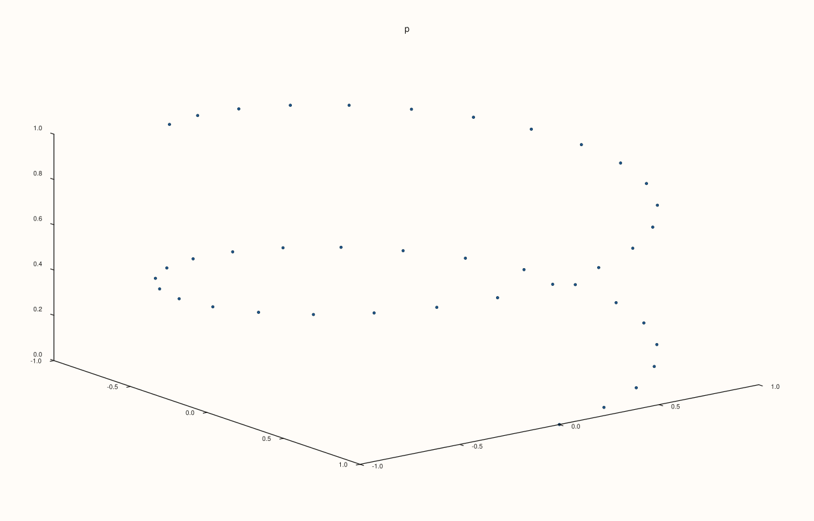
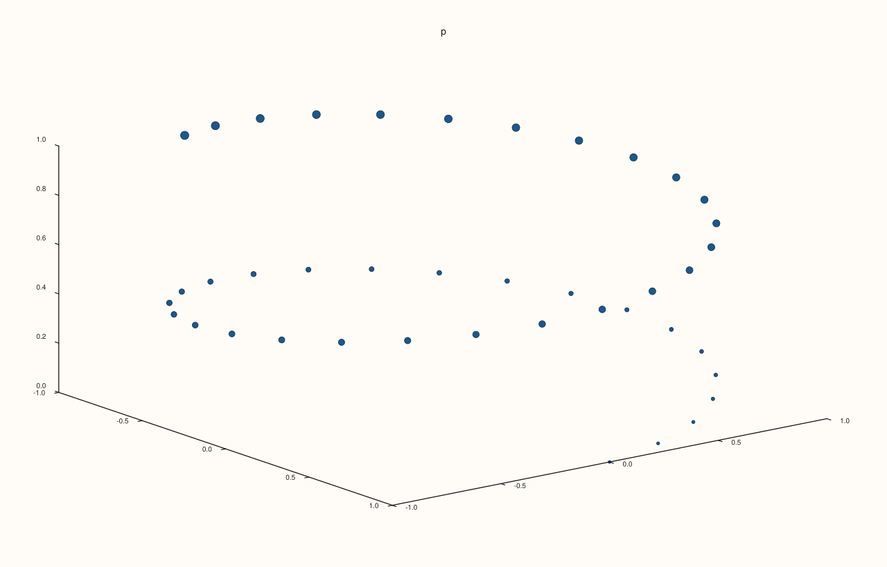
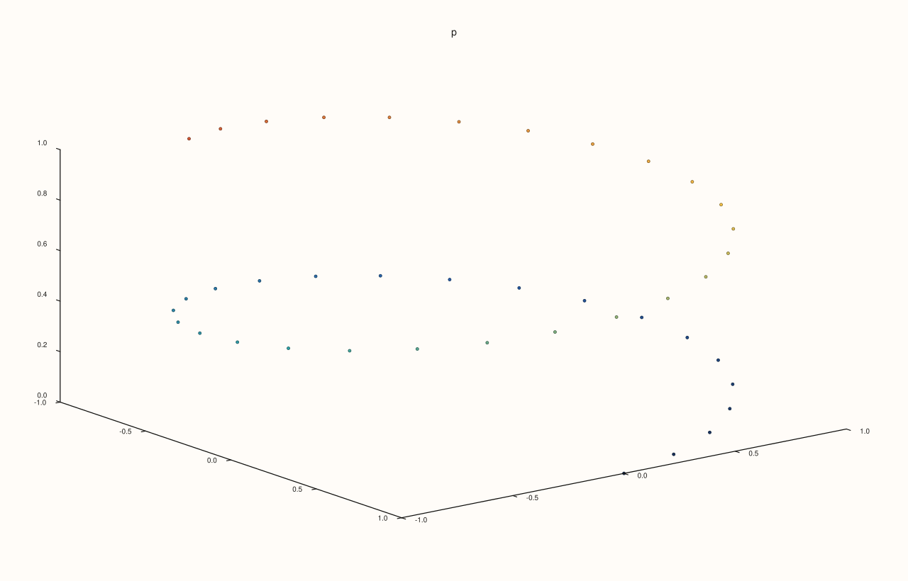
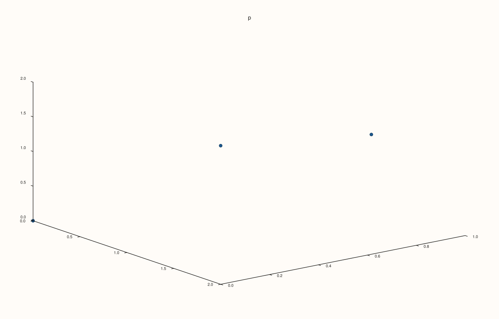
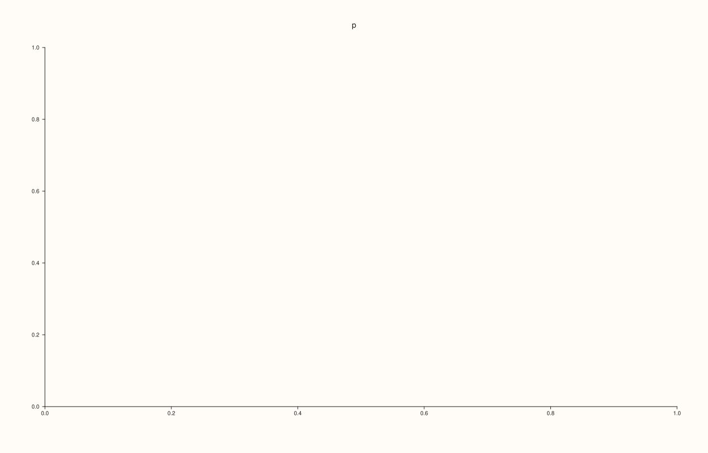

<!-- pluss-hand-authored -->

# Pane::cloud3

[Back to Pane API Reference](../../pane_api_reference)

## Signature

```cpp
Trace& Pane::cloud3(Series x, Series y, Series z)
Trace& Pane::cloud3(Series x, Series y, Series z, Series size)
Trace& Pane::cloud3(Series x, Series y, Series z, Series size, Series color)
```

## What It Does

Adds a **cloud in three dimensions**: a marker at each point `(x[i], y[i], z[i])`, with nothing joining them. It is the three-dimensional [`cloud`](cloud.md), a scatter plot in space, and with the optional series it carries a size and a colour for each marker.

| Call | Adds |
|---|---|
| `cloud3(x, y, z)` | Markers of one size and colour. |
| `cloud3(x, y, z, size)` | A size for each marker. |
| `cloud3(x, y, z, size, color)` | And a colour for each, from the palette over the range of `color`. |

As for `cloud`, there is no call with a colour and no size. All series have the same length, or length 1.

## Parameters

**x**, **y**, **z** (`Series`-convertible)
    The positions.

**size**, **color** (`Series`-convertible, optional)
    Size and colour value of each marker, or one for all.

## Returns

`Trace&`
    The new trace.

## Examples

Example 1. A marker at each point of the helix.

```cpp
auto fig = studio("cloud3_plain");
auto& pane = fig.pane3("p");
std::vector<double> hx, hy, hz;
for (int i = 0; i <= 40; ++i) {
  const double t = 0.25 * i;
  hx.push_back(std::cos(t));
  hy.push_back(std::sin(t));
  hz.push_back(0.1 * t);
}
pane.cloud3(hx, hy, hz);
fig.save_svg("figure.svg");
```



Example 2. A fourth series gives each marker its own size: here they grow along the helix.

```cpp
auto fig = studio("cloud3_size");
auto& pane = fig.pane3("p");
std::vector<double> hx, hy, hz;
for (int i = 0; i <= 40; ++i) {
  const double t = 0.25 * i;
  hx.push_back(std::cos(t));
  hy.push_back(std::sin(t));
  hz.push_back(0.1 * t);
}
std::vector<double> size;
for (std::size_t i = 0; i < hx.size(); ++i) size.push_back(10.0 + 2.0 * i);
pane.cloud3(hx, hy, hz, size);
fig.save_svg("figure.svg");
```



Example 3. A fifth series colours the markers through the palette, with the guide to say what the colours mean. A single size keeps the markers equal.

```cpp
auto fig = studio("cloud3_color");
auto& pane = fig.pane3("p");
std::vector<double> hx, hy, hz;
for (int i = 0; i <= 40; ++i) {
  const double t = 0.25 * i;
  hx.push_back(std::cos(t));
  hy.push_back(std::sin(t));
  hz.push_back(0.1 * t);
}
pane.cloud3(hx, hy, hz, std::vector<double>{3}, hz);
pane.scale_guide(true);
fig.save_svg("figure.svg");
```



Example 4. A single size or colour is repeated for every point.

```cpp
auto build = [&](double size) {
  auto fig = studio("cloud3_scalar");
  auto& pane = fig.pane3("p");
  pane.cloud3(std::vector<double>{0, 1, 2}, std::vector<double>{0, 1, 0}, std::vector<double>{0, 1, 2}, std::vector<double>{size});
  return fig.to_svg();
};
std::cout << "size 50 != size 150: " << (build(50.0) != build(150.0)) << "\n";
auto fig = studio("cloud3_scalar_out");
auto& pane = fig.pane3("p");
pane.cloud3(std::vector<double>{0, 1, 2}, std::vector<double>{0, 1, 0}, std::vector<double>{0, 1, 2}, std::vector<double>{150});
fig.save_svg("figure.svg");
```

### Output

```text
size 50 != size 150: 1
```



Example 5. Inputs that cannot be drawn are refused when the trace is added, and the message names the method and the problem. The pane keeps the traces it had.

```cpp
auto report = [](const char* what, auto&& call) {
  auto fig = studio("cloud3_errors");
  auto& pane = fig.pane3("p");
  try {
    call(pane);
    std::cout << what << ": accepted\n";
  } catch (const pluss::Error& e) {
    std::cout << what << ": " << e.message() << "\n";
  }
};
report("z differs", [](Pane& pane) { pane.cloud3(std::vector<double>{1, 2, 3}, std::vector<double>{1, 2, 3}, std::vector<double>{1, 2}); });
report("size differs", [](Pane& pane) { pane.cloud3(std::vector<double>{1, 2, 3}, std::vector<double>{1, 2, 3}, std::vector<double>{1, 2, 3}, std::vector<double>{1, 2}); });
auto fig = studio("cloud3_errors_out");
auto& pane = fig.pane3("p");
pane.path3(std::vector<double>{0, 1}, std::vector<double>{0, 1}, std::vector<double>{0, 1});
fig.save_svg("figure.svg");
```

### Output

```text
z differs: cloud3: z length must match broadcasted x/y length
size differs: cloud3: size length must match the plotted point count or be scalar
```


Example 6. `cloud3` needs a volumetric pane. On a planar pane it throws at once, naming the kind it needs, and nothing is added.

```cpp
auto fig = studio("cloud3_wrong_pane");
auto& pane = fig.pane2("p");
try {
  pane.cloud3(std::vector<double>{0, 1}, std::vector<double>{0, 1}, std::vector<double>{0, 1});
} catch (const pluss::Error& e) {
  std::cout << e.message() << "\n";
}
std::cout << "traces: " << pane.trace_count() << "\n";
fig.save_svg("figure.svg");
```

### Output

```text
cloud3 requires a volumetric pane
traces: 0
```



## Notes

- Returns the new [`Trace&`](../trace/label.md); the reference stays valid for the life of the pane, and the style calls of the trace ([`label`](../trace/label.md), [`stroke`](../trace/stroke.md), [`width`](../trace/width.md), ...) chain off it.
- The data is copied into the trace when it is added, so changing the vector afterwards does not change the figure.

## See Also

- [`Pane::cloud`](cloud.md): the planar form.
- [`Pane::path3`](path3.md): a line through points.
- [`Pane::scale_guide`](scale_guide.md): the key to the colours.

<div class="pluss-inline-prev-next">
  <a class="prev-link" href="cloud.html">
    <span class="label">Previous</span>
    <span class="title">cloud</span>
  </a>
  <a class="next-link" href="color_limit_method.html">
    <span class="label">Next</span>
    <span class="title">color_limit_method</span>
  </a>
</div>
