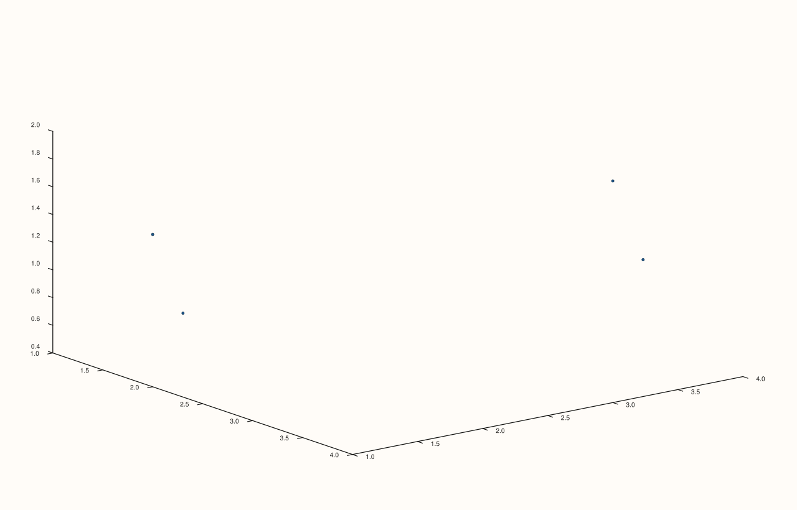
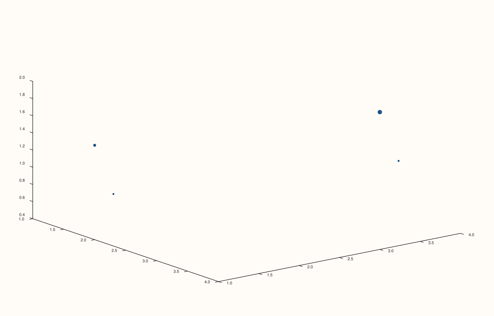
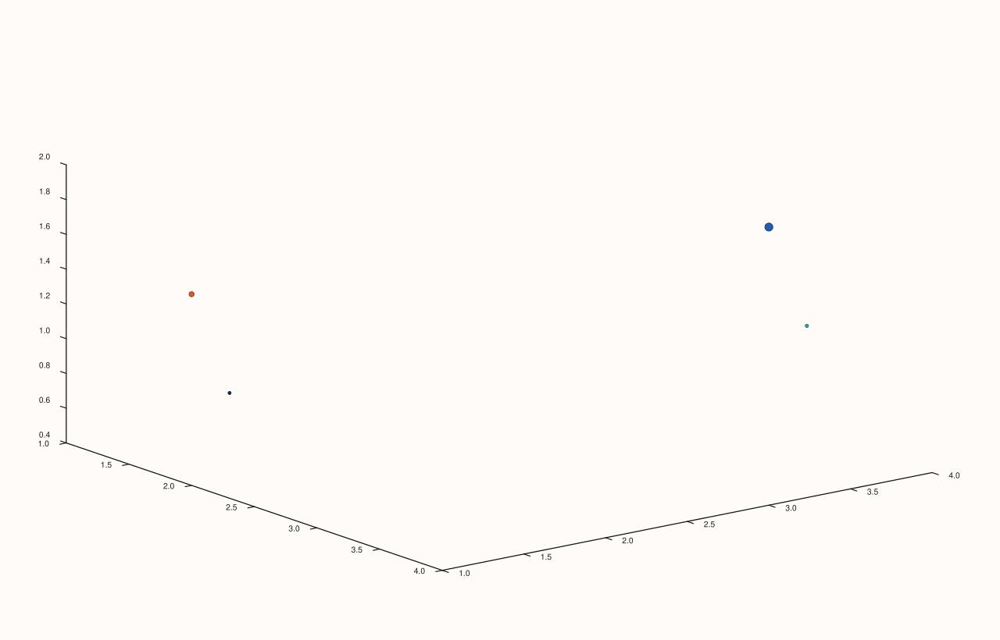

<!-- pluss-hand-authored -->

# Pane::cloud3

[Back to Pane API Reference](../../pane_api_reference)

## Signatures

```cpp
template <class X, class Y, class Z>
Trace& Pane::cloud3(X&& x, Y&& y, Z&& z)

template <class X, class Y, class Z, class Size>
Trace& Pane::cloud3(X&& x, Y&& y, Z&& z, Size&& size)

template <class X, class Y, class Z, class Size, class Color>
Trace& Pane::cloud3(X&& x, Y&& y, Z&& z, Size&& size, Color&& color)
```

## What It Does

Adds a 3D scatter trace — one marker per `(x[i], y[i], z[i])` point. The 3D counterpart of
[`Pane::cloud`](cloud.md), sharing its exact three-overload progressive-enrichment shape:

- **`cloud3(x, y, z)`** — plain markers, uniform default size and color.
- **`cloud3(x, y, z, size)`** — per-point marker size, driven by a fourth series.
- **`cloud3(x, y, z, size, color)`** — per-point marker size *and* color, both driven by
  their own series.

There is no overload that supplies `color` without `size` — exactly like `cloud()`,
`color` is only reachable alongside an explicit `size` series.

```{important} Requires a Volumetric pane
Calling `cloud3()` on a `Planar` pane throws
`std::logic_error("cloud3 requires a volumetric pane")`.
```

## Parameters

**x**, **y**, **z** (series-convertible)
    The 3D coordinates of each point.

**size** (series-convertible, two- and three-argument overloads)
    A per-point marker-size value, paired with `x`/`y`/`z` by index.

**color** (series-convertible, three-argument overload only)
    A per-point color value, paired with `x`/`y`/`z`/`size` by index.

## Returns

`Trace&`
    A reference to the newly created trace, for chaining.

## Examples

Example 1. Plain 3D markers, uniform size and color.

```cpp
using namespace pluss::pl;

auto fig = studio("cloud3_xyz");
auto& pane = fig.pane3();
pane.cloud3(std::vector<double>{1.0, 2.0, 3.0, 4.0}, std::vector<double>{2.0, 1.0, 4.0, 3.0}, std::vector<double>{0.5, 1.5, 1.0, 2.0});
fig.show();
```



Example 2. Per-point marker size. Verified via direct SVG diff to render genuinely
different from Example 1 — a narrow size range (tried first) rendered byte-for-byte
identically to the no-size overload, so a wide range (`1` to `250`) was used instead to
produce a genuinely visible difference, the same magnitude-dependent pattern documented on
[`Pane::x_tick_format`](x_tick_format.md) for `TickFormat::Auto` vs. `Plain`.

```cpp
using namespace pluss::pl;

auto fig = studio("cloud3_xyz_size");
auto& pane = fig.pane3();
pane.cloud3(std::vector<double>{1.0, 2.0, 3.0, 4.0}, std::vector<double>{2.0, 1.0, 4.0, 3.0}, std::vector<double>{0.5, 1.5, 1.0, 2.0},
            std::vector<double>{1.0, 100.0, 40.0, 250.0});
fig.show();
```



Example 3. Per-point size and color together. Verified via direct SVG diff to render
genuinely different from Example 2.

```cpp
using namespace pluss::pl;

auto fig = studio("cloud3_xyz_size_color");
auto& pane = fig.pane3();
pane.cloud3(std::vector<double>{1.0, 2.0, 3.0, 4.0}, std::vector<double>{2.0, 1.0, 4.0, 3.0}, std::vector<double>{0.5, 1.5, 1.0, 2.0},
            std::vector<double>{1.0, 100.0, 40.0, 250.0}, std::vector<double>{0.1, 0.9, 0.5, 0.3});
fig.show();
```



## Notes

- Not `noexcept`.
- Marker size differences only render visibly when the `size` series spans a wide enough
  relative range — verified directly (see Example 2's callout above).
- `flash::scatter3d` (if present) is a convenience wrapper around this exact method.

## See Also

- [`Pane::cloud`](cloud.md): the 2D counterpart, identical progressive-enrichment overload
  shape, on a `Planar` pane instead.
- [`Pane::path3`](path3.md): a connected-line 3D trace, for showing a trajectory rather
  than discrete unordered points.

<div class="pluss-inline-prev-next">
  <a class="prev-link" href="fieldmap.html">
    <span class="label">Previous</span>
    <span class="title">fieldmap</span>
  </a>
  <a class="next-link" href="path3.html">
    <span class="label">Next</span>
    <span class="title">path3</span>
  </a>
</div>
