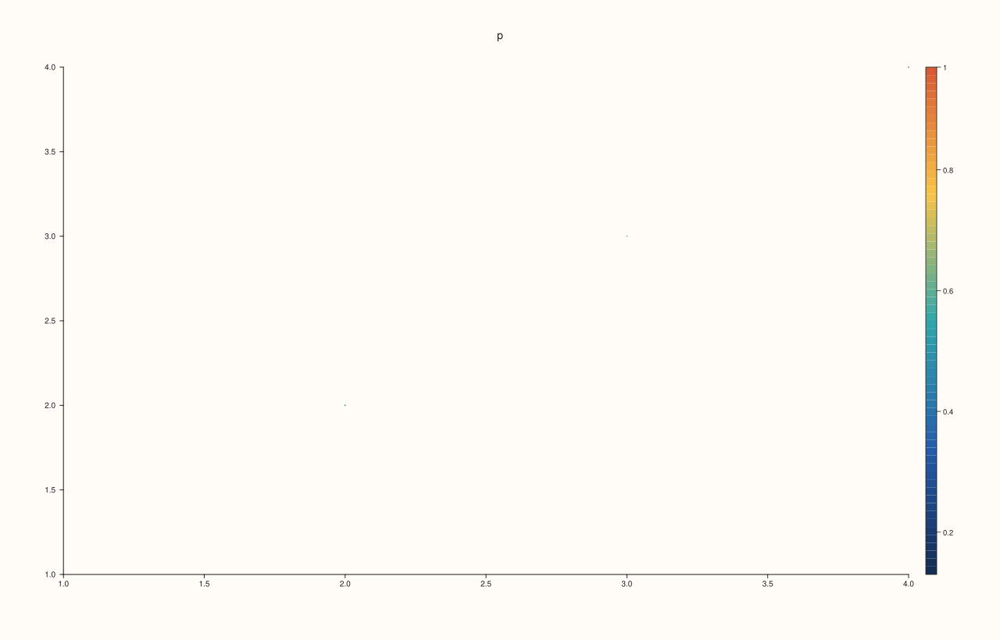
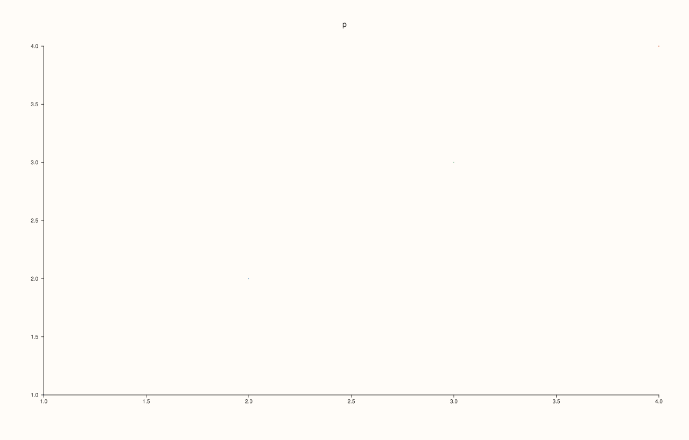
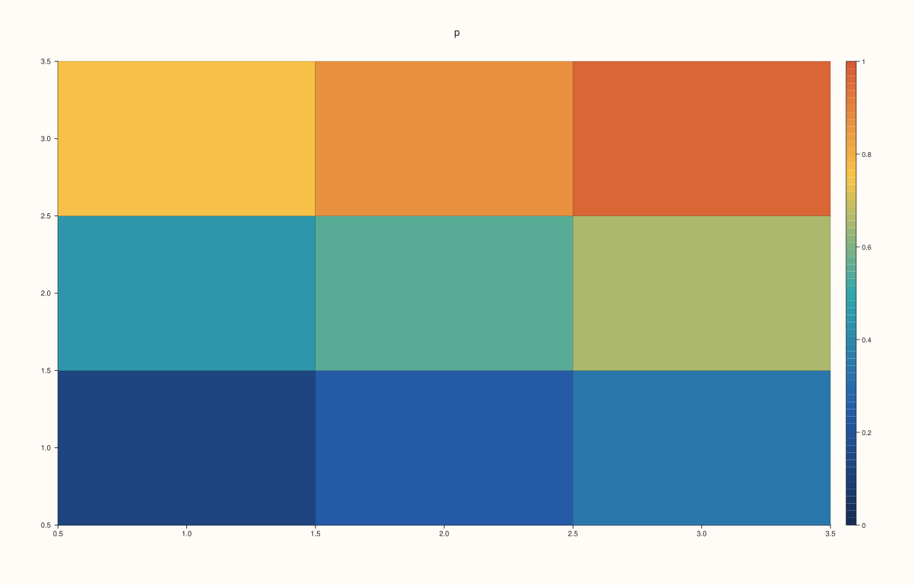

<!-- pluss-hand-authored -->

# Pane::color_limit_method

[Back to Pane API Reference](../../pane_api_reference)

## Signature

```cpp
Pane& Pane::color_limit_method(LimitMethod method) noexcept
```

## What It Does

Chooses how the range of the colour scale is derived from the data when it is not set by hand ([`color_limits`](color_limits.md) overrides the method). It is the colour-scale counterpart of [`x_limit_method`](x_limit_method.md).

| `LimitMethod` | Range |
|---|---|
| `Tight` | Exactly the extremes of the data: the lowest value gets the lowest colour and the highest value the highest colour. The default. |
| `TickAligned` | The extremes widened outwards to round numbers, the ones a bar's ticks would fall on. |
| `Padded` | The extremes widened by a small share of the range on each side, so no value sits at the very end of the palette. |

When all values are equal the range is widened by 0.5 each way whatever the method, so that the palette has some width. A trace's own limits ([`Trace::color_limits`](../trace/color_limits.md)) take precedence over everything here.

## Parameters

**method** (`LimitMethod`)
    `Tight`, `TickAligned` or `Padded`.

## Returns

`Pane&`
    The same pane, for chaining.

## Examples

Example 1. The default is `Tight`: the data runs from 0.13 to 0.97, and the guide's ticks fall inside that range.

```cpp
auto build = [&](LimitMethod method) {
  auto fig = studio("color_method");
  auto& pane = fig.pane2("p");
  pane.cloud(std::vector<double>{1, 2, 3, 4}, std::vector<double>{1, 2, 3, 4}, std::vector<double>{5, 5, 5, 5}, std::vector<double>{0.13, 0.4, 0.62, 0.97});
  pane.scale_guide(true);
  pane.color_limit_method(method);
  return fig.to_svg();
};
auto texts = [](const std::string& svg) {
  std::string out;
  for (std::size_t at = svg.find("<text"); at != std::string::npos; at = svg.find("<text", at + 1)) {
    const auto gt = svg.find('>', at);
    out += svg.substr(gt + 1, svg.find("</text>", gt) - gt - 1) + " ";
  }
  return out;
};
std::cout << "tight: " << texts(build(LimitMethod::Tight)) << "\n";
auto fig = studio("color_method_default");
auto& pane = fig.pane2("p");
pane.cloud(std::vector<double>{1, 2, 3, 4}, std::vector<double>{1, 2, 3, 4}, std::vector<double>{5, 5, 5, 5}, std::vector<double>{0.13, 0.4, 0.62, 0.97});
pane.scale_guide(true);
std::cout << "default is Tight: " << (pane.color_axis().limit_method == LimitMethod::Tight) << "\n";
fig.save_svg("figure.svg");
```

### Output

```text
tight: p 1.0 1.5 2.0 2.5 3.0 3.5 4.0 1.0 1.5 2.0 2.5 3.0 3.5 4.0 0.2 0.4 0.6 0.8 1 
default is Tight: 1
```



Example 2. `TickAligned` widens the range to round numbers: the same data now spans 0 to 1, and the bar's ticks begin at 0.

```cpp
auto build = [&](LimitMethod method) {
  auto fig = studio("color_method");
  auto& pane = fig.pane2("p");
  pane.cloud(std::vector<double>{1, 2, 3, 4}, std::vector<double>{1, 2, 3, 4}, std::vector<double>{5, 5, 5, 5}, std::vector<double>{0.13, 0.4, 0.62, 0.97});
  pane.scale_guide(true);
  pane.color_limit_method(method);
  return fig.to_svg();
};
auto texts = [](const std::string& svg) {
  std::string out;
  for (std::size_t at = svg.find("<text"); at != std::string::npos; at = svg.find("<text", at + 1)) {
    const auto gt = svg.find('>', at);
    out += svg.substr(gt + 1, svg.find("</text>", gt) - gt - 1) + " ";
  }
  return out;
};
std::cout << "tick-aligned: " << texts(build(LimitMethod::TickAligned)) << "\n";
auto fig = studio("color_method_tick");
auto& pane = fig.pane2("p");
pane.cloud(std::vector<double>{1, 2, 3, 4}, std::vector<double>{1, 2, 3, 4}, std::vector<double>{5, 5, 5, 5}, std::vector<double>{0.13, 0.4, 0.62, 0.97});
pane.scale_guide(true).color_limit_method(LimitMethod::TickAligned);
fig.save_svg("figure.svg");
```

### Output

```text
tick-aligned: p 1.0 1.5 2.0 2.5 3.0 3.5 4.0 1.0 1.5 2.0 2.5 3.0 3.5 4.0 0 0.2 0.4 0.6 0.8 1 
```


Example 3. `Padded` leaves a margin at both ends of the palette, so the extreme values are not drawn in the extreme colours.

```cpp
auto build = [&](LimitMethod method) {
  auto fig = studio("color_method");
  auto& pane = fig.pane2("p");
  pane.cloud(std::vector<double>{1, 2, 3, 4}, std::vector<double>{1, 2, 3, 4}, std::vector<double>{5, 5, 5, 5}, std::vector<double>{0.13, 0.4, 0.62, 0.97});
  pane.scale_guide(true);
  pane.color_limit_method(method);
  return fig.to_svg();
};
auto texts = [](const std::string& svg) {
  std::string out;
  for (std::size_t at = svg.find("<text"); at != std::string::npos; at = svg.find("<text", at + 1)) {
    const auto gt = svg.find('>', at);
    out += svg.substr(gt + 1, svg.find("</text>", gt) - gt - 1) + " ";
  }
  return out;
};
std::cout << "padded: " << texts(build(LimitMethod::Padded)) << "\n";
auto fig = studio("color_method_padded");
auto& pane = fig.pane2("p");
pane.cloud(std::vector<double>{1, 2, 3, 4}, std::vector<double>{1, 2, 3, 4}, std::vector<double>{5, 5, 5, 5}, std::vector<double>{0.13, 0.4, 0.62, 0.97});
pane.scale_guide(true).color_limit_method(LimitMethod::Padded);
fig.save_svg("figure.svg");
```

### Output

```text
padded: p 1.0 1.5 2.0 2.5 3.0 3.5 4.0 1.0 1.5 2.0 2.5 3.0 3.5 4.0 0.2 0.4 0.6 0.8 1 
```


Example 4. The three methods give three different figures.

```cpp
auto build = [&](LimitMethod method) {
  auto fig = studio("color_method");
  auto& pane = fig.pane2("p");
  pane.cloud(std::vector<double>{1, 2, 3, 4}, std::vector<double>{1, 2, 3, 4}, std::vector<double>{5, 5, 5, 5}, std::vector<double>{0.13, 0.4, 0.62, 0.97});
  pane.scale_guide(true);
  pane.color_limit_method(method);
  return fig.to_svg();
};
const auto tight = build(LimitMethod::Tight), aligned = build(LimitMethod::TickAligned), padded = build(LimitMethod::Padded);
std::cout << "tight != aligned: " << (tight != aligned) << ", tight != padded: " << (tight != padded) << ", aligned != padded: " << (aligned != padded) << "\n";
auto fig = studio("color_method_three");
auto& pane = fig.pane2("p");
pane.cloud(std::vector<double>{1, 2, 3, 4}, std::vector<double>{1, 2, 3, 4}, std::vector<double>{5, 5, 5, 5}, std::vector<double>{0.13, 0.4, 0.62, 0.97});
fig.save_svg("figure.svg");
```

### Output

```text
tight != aligned: 1, tight != padded: 1, aligned != padded: 1
```



Example 5. Limits set by hand take over. With `color_limits(0, 10)` set, the method makes no difference.

```cpp
auto build = [&](LimitMethod method) {
  auto fig = studio("color_method_manual");
  auto& pane = fig.pane2("p");
  pane.cloud(std::vector<double>{1, 2, 3, 4}, std::vector<double>{1, 2, 3, 4}, std::vector<double>{5, 5, 5, 5}, std::vector<double>{0.13, 0.4, 0.62, 0.97});
  pane.scale_guide(true).color_limits(Range1d{0.0, 10.0});
  pane.color_limit_method(method);
  return fig.to_svg();
};
std::cout << "Tight == Padded with limits set: " << (build(LimitMethod::Tight) == build(LimitMethod::Padded)) << "\n";
auto fig = studio("color_method_manual_out");
auto& pane = fig.pane2("p");
pane.cloud(std::vector<double>{1, 2, 3, 4}, std::vector<double>{1, 2, 3, 4}, std::vector<double>{5, 5, 5, 5}, std::vector<double>{0.13, 0.4, 0.62, 0.97});
pane.color_limits(Range1d{0.0, 10.0});
fig.save_svg("figure.svg");
```

### Output

```text
Tight == Padded with limits set: 1
```


Example 6. Surfaces use it too: the method decides the range of a field map's colours in the same way.

```cpp
auto build = [&](LimitMethod method) {
  auto fig = studio("color_method_field");
  auto& pane = fig.pane2("p");
  pane.fieldmap(std::vector<double>{1, 2, 3}, std::vector<double>{1, 2, 3}, pluss::series::linspace(0.13, 0.97, 9, pluss::ScalarType::Float64).reshape({3, 3}));
  pane.scale_guide(true).color_limit_method(method);
  return fig.to_svg();
};
std::cout << "Tight != TickAligned: " << (build(LimitMethod::Tight) != build(LimitMethod::TickAligned)) << "\n";
auto fig = studio("color_method_field_out");
auto& pane = fig.pane2("p");
pane.fieldmap(std::vector<double>{1, 2, 3}, std::vector<double>{1, 2, 3}, pluss::series::linspace(0.13, 0.97, 9, pluss::ScalarType::Float64).reshape({3, 3}));
pane.scale_guide(true).color_limit_method(LimitMethod::TickAligned);
fig.save_svg("figure.svg");
```

### Output

```text
Tight != TickAligned: 1
```



## Notes

- `noexcept`; every value is valid.
- The default for the colour scale is `Tight`, unlike the position axes, which default to `TickAligned`: colours are expected to span the data.

## See Also

- [`Pane::color_limits`](color_limits.md): set the range by hand, overriding the method.
- [`Pane::x_limit_method`](x_limit_method.md): the same choice for a position axis.
- [`Pane::scale_guide`](scale_guide.md): the bar that shows the range.

<div class="pluss-inline-prev-next">
  <a class="prev-link" href="cloud3.html">
    <span class="label">Previous</span>
    <span class="title">cloud3</span>
  </a>
  <a class="next-link" href="color_limits.html">
    <span class="label">Next</span>
    <span class="title">color_limits</span>
  </a>
</div>
