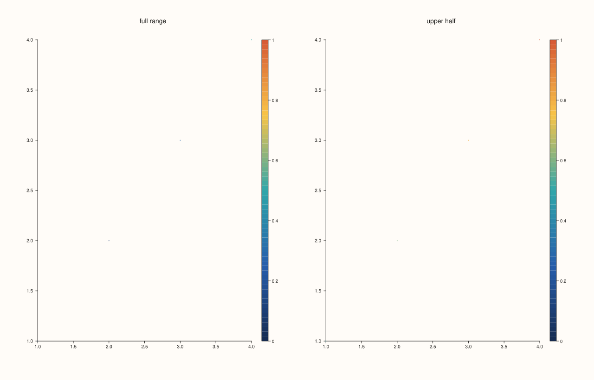
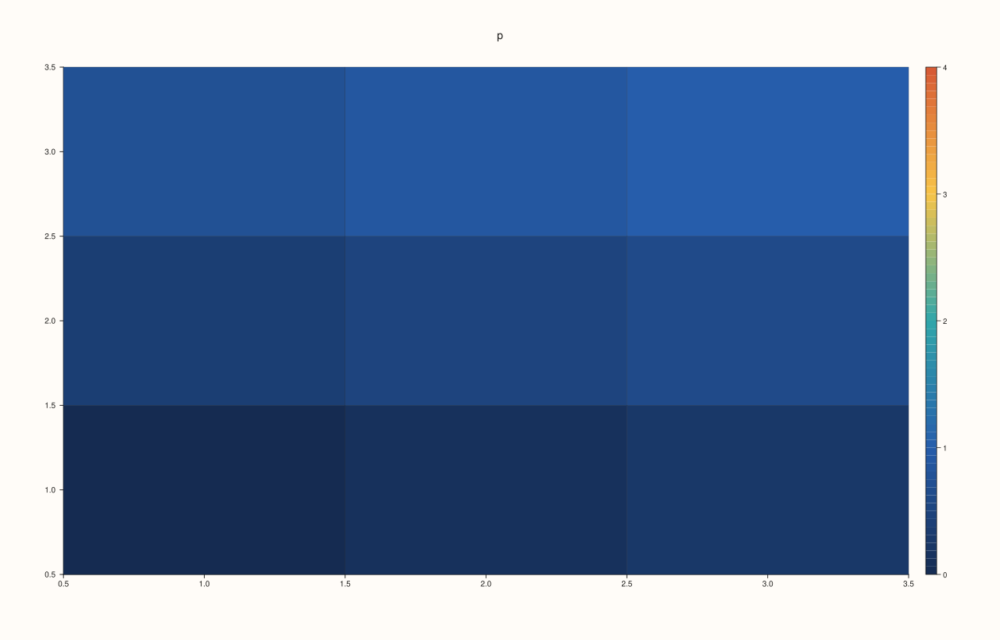
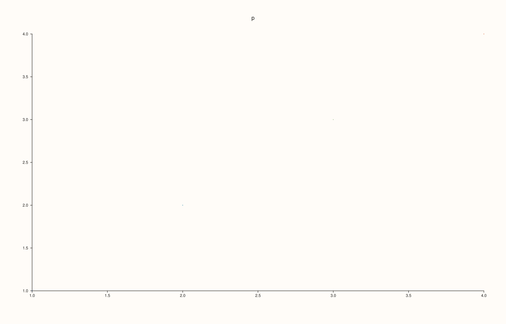

<!-- pluss-hand-authored -->

# Pane::color_limits

[Back to Pane API Reference](../../pane_api_reference)

## Signature

```cpp
Pane& Pane::color_limits(Range1d limits)
Pane& Pane::auto_color() noexcept
```

## What It Does

Sets by hand the range of values the pane's colours are mapped over, so that the lowest colour of the palette stands for `limits.low` and the highest for `limits.high`; values outside the range take the end colours. `auto_color()` goes back to deriving the range from the data (by [`color_limit_method`](color_limit_method.md)).

Without limits each trace spreads its palette over its own data, so two panes of different data use their colours differently. Set the same limits on both (or on one pane's traces, see below) when colours must mean the same value across figures, or when the range should be a round number instead of the data's extremes.

The range applies to every trace of the pane that is coloured by data: clouds, field maps, contours and surfaces, planar and volumetric. A trace can carry limits of its own ([`Trace::color_limits`](../trace/color_limits.md)), and those take precedence over the pane's for that trace. The range must be finite with `low` below `high`; otherwise the call throws and the pane is unchanged.

## Parameters

**limits** (`Range1d`)
    The values of the lowest and the highest colour. `low` must be strictly below `high`, both finite.

## Returns

`Pane&`
    The same pane, for chaining. `auto_color()` is `noexcept`.

## Examples

Example 1. Setting the range. The data runs from 0.13 to 0.97; with limits 0..10 the guide's ticks run to 10, and the points, all in the lower tenth of the range, are drawn in the low colours of the palette.

```cpp
auto fig = studio("color_limits_manual");
auto& pane = fig.pane2("p");
pane.cloud(std::vector<double>{1, 2, 3, 4}, std::vector<double>{1, 2, 3, 4}, std::vector<double>{5, 5, 5, 5}, std::vector<double>{0.13, 0.4, 0.62, 0.97});
pane.scale_guide(true);
auto texts = [](const std::string& svg) {
  std::string out;
  for (std::size_t at = svg.find("<text"); at != std::string::npos; at = svg.find("<text", at + 1)) {
    const auto gt = svg.find('>', at);
    out += svg.substr(gt + 1, svg.find("</text>", gt) - gt - 1) + " ";
  }
  return out;
};
std::cout << "from the data: " << texts(fig.to_svg()) << "\n";
pane.color_limits(Range1d{0.0, 10.0});
std::cout << "limits 0..10:  " << texts(fig.to_svg()) << "\n";
fig.save_svg("figure.svg");
```

### Output

```text
from the data: p 1.0 1.5 2.0 2.5 3.0 3.5 4.0 1.0 1.5 2.0 2.5 3.0 3.5 4.0 0.2 0.4 0.6 0.8 1 
limits 0..10:  p 1.0 1.5 2.0 2.5 3.0 3.5 4.0 1.0 1.5 2.0 2.5 3.0 3.5 4.0 0 2 4 6 8 10 
```


Example 2. `auto_color()` returns to the data's range; the figure is the one that never set limits.

```cpp
auto build = [&](bool toggled) {
  auto fig = studio("color_limits_auto");
  auto& pane = fig.pane2("p");
  pane.cloud(std::vector<double>{1, 2, 3, 4}, std::vector<double>{1, 2, 3, 4}, std::vector<double>{5, 5, 5, 5}, std::vector<double>{0.13, 0.4, 0.62, 0.97});
  pane.scale_guide(true);
  if (toggled) pane.color_limits(Range1d{0.0, 10.0}).auto_color();
  return fig.to_svg();
};
std::cout << "after auto_color == never set: " << (build(true) == build(false)) << "\n";
auto fig = studio("color_limits_auto_out");
auto& pane = fig.pane2("p");
pane.cloud(std::vector<double>{1, 2, 3, 4}, std::vector<double>{1, 2, 3, 4}, std::vector<double>{5, 5, 5, 5}, std::vector<double>{0.13, 0.4, 0.62, 0.97});
pane.scale_guide(true);
fig.save_svg("figure.svg");
```

### Output

```text
after auto_color == never set: 1
```


Example 3. The same limits on two panes make their colours comparable. Both panes use 0..1, so the colours of the second pane, whose data is only in the upper half, are the upper colours of the palette.

```cpp
auto fig = studio("color_limits_two");
fig.mosaic(1, 2);
for (int i = 0; i < 2; ++i) {
  auto& pane = fig.pane2(i == 0 ? "full range" : "upper half");
  const double lo = i == 0 ? 0.0 : 0.5;
  pane.cloud(std::vector<double>{1, 2, 3, 4}, std::vector<double>{1, 2, 3, 4}, std::vector<double>{5, 5, 5, 5}, std::vector<double>{lo, lo + 0.1, lo + 0.3, lo + 0.5});
  pane.color_limits(Range1d{0.0, 1.0}).scale_guide(true);
}
fig.save_svg("figure.svg");
```



Example 4. Surfaces and field maps follow the same limits: this field map's values run from 0 to 1, and limits 0..4 make the whole map use the lower quarter of the palette.

```cpp
auto build = [&](bool limited) {
  auto fig = studio("color_limits_field");
  auto& pane = fig.pane2("p");
  pane.fieldmap(std::vector<double>{1, 2, 3}, std::vector<double>{1, 2, 3}, pluss::series::linspace(0.0, 1.0, 9, pluss::ScalarType::Float64).reshape({3, 3}));
  pane.scale_guide(true);
  if (limited) pane.color_limits(Range1d{0.0, 4.0});
  return fig.to_svg();
};
std::cout << "limits change the figure: " << (build(true) != build(false)) << "\n";
auto fig = studio("color_limits_field_out");
auto& pane = fig.pane2("p");
pane.fieldmap(std::vector<double>{1, 2, 3}, std::vector<double>{1, 2, 3}, pluss::series::linspace(0.0, 1.0, 9, pluss::ScalarType::Float64).reshape({3, 3}));
pane.scale_guide(true).color_limits(Range1d{0.0, 4.0});
fig.save_svg("figure.svg");
```

### Output

```text
limits change the figure: 1
```



Example 5. A trace's own limits win over the pane's. The pane sets 0..10, the trace 0..1: the figure is the one with the trace's limits alone.

```cpp
auto build = [&](bool pane_limits) {
  auto fig = studio("color_limits_trace");
  auto& pane = fig.pane2("p");
  pane.cloud(std::vector<double>{1, 2, 3, 4}, std::vector<double>{1, 2, 3, 4}, std::vector<double>{5, 5, 5, 5}, std::vector<double>{0.13, 0.4, 0.62, 0.97}).color_limits(Range1d{0.0, 1.0});
  if (pane_limits) pane.color_limits(Range1d{0.0, 10.0});
  return fig.to_svg();
};
std::cout << "pane limits ignored for that trace: " << (build(true) == build(false)) << "\n";
auto fig = studio("color_limits_trace_out");
auto& pane = fig.pane2("p");
pane.cloud(std::vector<double>{1, 2, 3, 4}, std::vector<double>{1, 2, 3, 4}, std::vector<double>{5, 5, 5, 5}, std::vector<double>{0.13, 0.4, 0.62, 0.97}).color_limits(Range1d{0.0, 1.0});
pane.color_limits(Range1d{0.0, 10.0});
fig.save_svg("figure.svg");
```

### Output

```text
pane limits ignored for that trace: 1
```



Example 6. Invalid ranges throw and leave the limits as they were: `low` must be strictly below `high`, and both must be finite.

```cpp
auto fig = studio("color_limits_errors");
auto& pane = fig.pane2("p");
pane.trend(std::vector<double>{0, 1}, std::vector<double>{0, 1});
try { pane.color_limits(Range1d{2.0, 1.0}); } catch (const pluss::Error& e) { std::cout << e.message() << "\n"; }
try { pane.color_limits(Range1d{1.0, 1.0}); } catch (const pluss::Error& e) { std::cout << e.message() << "\n"; }
try { pane.color_limits(Range1d{0.0, std::numeric_limits<double>::infinity()}); } catch (const pluss::Error& e) { std::cout << e.message() << "\n"; }
std::cout << "limits still unset: " << !pane.color_axis().limits.has_value() << "\n";
fig.save_svg("figure.svg");
```

### Output

```text
color_limits: range must be finite and strictly increasing
color_limits: range must be finite and strictly increasing
color_limits: range must be finite and strictly increasing
limits still unset: 1
```


## Notes

- `color_limits` throws a `pluss::Error` for an invalid range; `auto_color()` is `noexcept`.
- The limits do not change which values a trace holds, only how they are coloured. Values outside the range are drawn in the end colours.

## See Also

- [`Pane::color_limit_method`](color_limit_method.md): how the range is derived when it is not set by hand.
- [`Pane::scale_guide`](scale_guide.md): the bar that shows the range.
- [`Trace::color_limits`](../trace/color_limits.md): limits of one trace.
- [`Trace::palette`](../trace/palette.md): the colours.

<div class="pluss-inline-prev-next">
  <a class="prev-link" href="color_limit_method.html">
    <span class="label">Previous</span>
    <span class="title">color_limit_method</span>
  </a>
  <a class="next-link" href="columns.html">
    <span class="label">Next</span>
    <span class="title">columns</span>
  </a>
</div>
