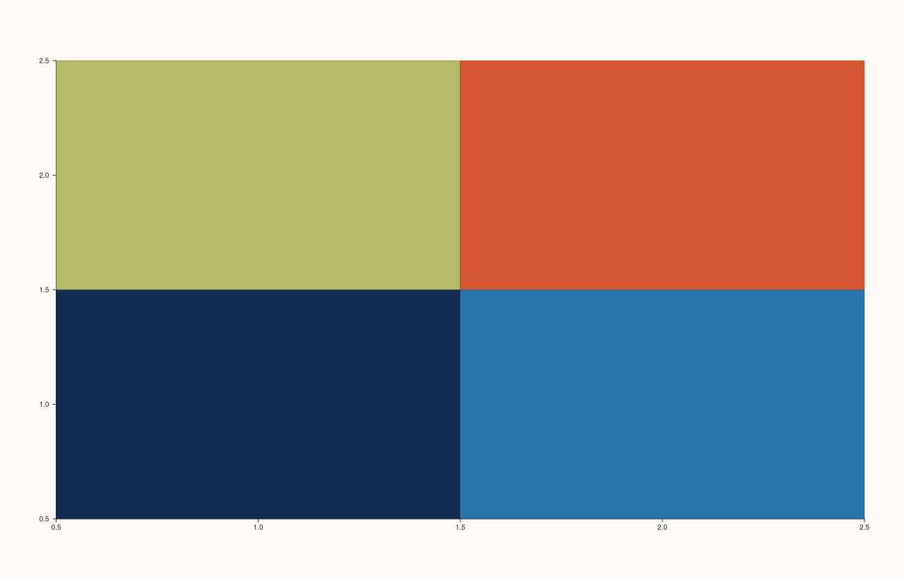
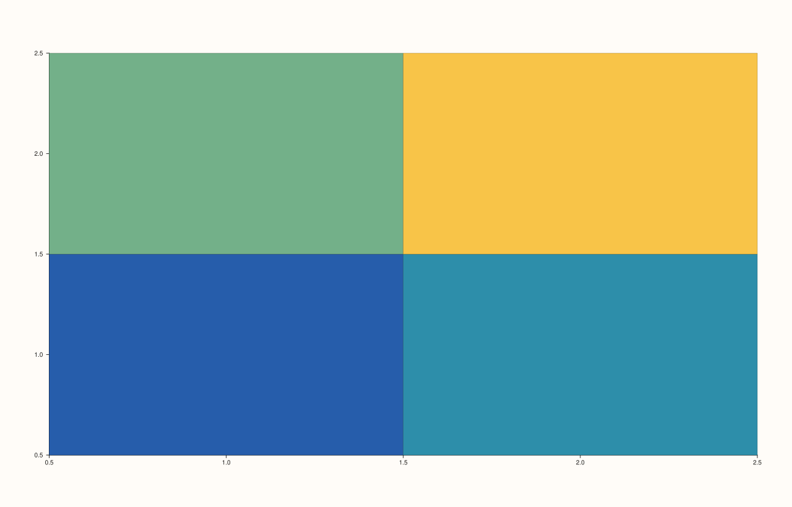

<!-- pluss-hand-authored -->

# Pane::color_limits

[Back to Pane API Reference](../../pane_api_reference)

## Signatures

```cpp
Pane& Pane::color_limits(Range1d limits)   // sets an explicit, manual range
Pane& Pane::auto_color() noexcept          // clears back to automatic fitting
```

## What It Does

The color-axis counterpart of [`x_limits()`](x_limits.md)/[`y_limits()`](y_limits.md)/
[`z_limits()`](z_limits.md): sets an explicit range for traces that map data to color (like
[`fieldmap()`](fieldmap.md)/`flash::heatmap`), flipping the color axis's `limit_mode` to
`Manual`. `auto_color()` clears it back to automatic fitting.

```{important} No scale-compatibility check -- there is no scale_color()
Unlike `x_limits()`/`y_limits()`/`z_limits()`, which each cross-validate against their
axis's own [`scale_x()`](scale_x.md)/[`scale_y()`](scale_y.md)/[`scale_z()`](scale_z.md),
`color_limits()` performs **only** the finite-and-strictly-increasing range check —
there is no `Pane::scale_color()` method, so a negative-to-positive color range (common
for diverging color maps centered at zero) is always accepted without complaint. See
Example 4.
```

## Parameters

**limits** (`Range1d`)
    The explicit `{low, high}` range to map to color. Must be finite and strictly
    increasing.

## Returns

`Pane&`
    A reference to the same pane, for chaining.

## Examples

Example 1. The default: color range auto-fit to the plotted data.

```cpp
using namespace pluss::pl;

auto fig = studio("color_limits_auto");
auto& pane = fig.pane2();
pane.fieldmap(std::vector<double>{1.0, 2.0}, std::vector<double>{1.0, 2.0}, pluss::series::linspace(0.0, 1.0, 4, pluss::ScalarType::Float64).reshape({2, 2}));
fig.show();

std::cout << (pane.color_axis().limit_mode == LimitMode::AutoFit) << "\n";
```

### Output

```text
1
```


Example 2. An explicit color range.

```cpp
using namespace pluss::pl;

auto fig = studio("color_limits_manual");
auto& pane = fig.pane2();
pane.fieldmap(std::vector<double>{1.0, 2.0}, std::vector<double>{1.0, 2.0}, pluss::series::linspace(0.0, 1.0, 4, pluss::ScalarType::Float64).reshape({2, 2}));
pane.color_limits(Range1d{0.0, 1.0});
fig.show();

std::cout << pane.color_axis().limits->low << " " << pane.color_axis().limits->high << "\n";
```

### Output

```text
0 1
```



Example 3. The single validation check that does apply: finite and strictly increasing.

```cpp
using namespace pluss::pl;

auto fig = studio("color_limits_reversed");
auto& pane = fig.pane2();
pane.fieldmap(std::vector<double>{1.0, 2.0}, std::vector<double>{1.0, 2.0}, pluss::series::linspace(0.0, 1.0, 4, pluss::ScalarType::Float64).reshape({2, 2}));

try {
  pane.color_limits(Range1d{1.0, 0.0});
} catch (const std::invalid_argument& e) {
  std::cout << e.what() << "\n";
}
```

### Output

```text
color_limits: range must be finite and strictly increasing
```

Example 4. A negative-to-positive color range — perfectly legal, unlike the equivalent for
`x_limits()`/`y_limits()`/`z_limits()` under a log scale, since there is no
`scale_color()` to be incompatible with.

```cpp
using namespace pluss::pl;

auto fig = studio("color_limits_negative_ok");
auto& pane = fig.pane2();
pane.fieldmap(std::vector<double>{1.0, 2.0}, std::vector<double>{1.0, 2.0}, pluss::series::linspace(-5.0, 5.0, 4, pluss::ScalarType::Float64).reshape({2, 2}));
pane.color_limits(Range1d{-10.0, 10.0});
fig.show();

std::cout << pane.color_axis().limits->low << " " << pane.color_axis().limits->high << "\n";
```

### Output

```text
-10 10
```



## Notes

- `color_limits()` is not `noexcept`; `auto_color()` is.
- No scale-compatibility check exists for the color axis — see the important callout
  above.
- [`color_limit_method()`](color_limit_method.md) governs automatic fitting only, same
  relationship as [`x_limit_method()`](x_limit_method.md) to `x_limits()`.

## See Also

- [`Pane::x_limits`](x_limits.md) / [`Pane::y_limits`](y_limits.md) /
  [`Pane::z_limits`](z_limits.md): the position-axis equivalents, which additionally
  cross-validate against their own scale.
- [`Pane::color_limit_method`](color_limit_method.md): governs automatic fitting only.
- [`Pane::fieldmap`](fieldmap.md): a representative trace method whose colors this range
  maps.

<div class="pluss-inline-prev-next">
  <a class="prev-link" href="z_limits.html">
    <span class="label">Previous</span>
    <span class="title">z_limits</span>
  </a>
  <a class="next-link" href="x_limit_method.html">
    <span class="label">Next</span>
    <span class="title">x_limit_method</span>
  </a>
</div>
